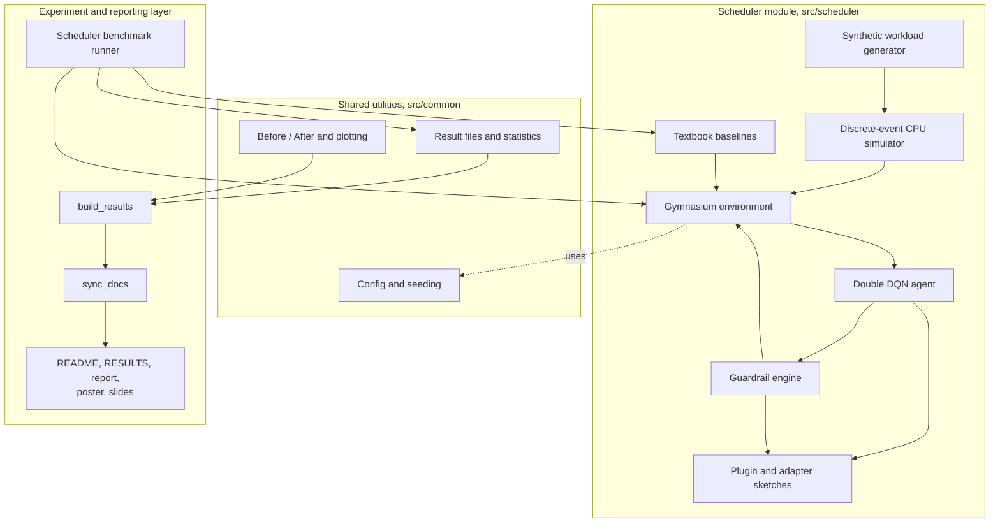
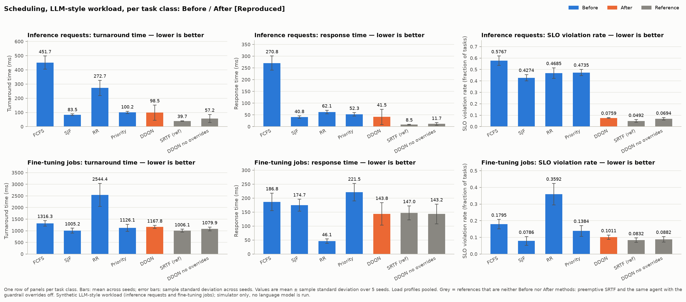

# ddqn-os-scheduling: Double DQN operating-system scheduling with guardrails

ddqn-os-scheduling is a reference implementation for researchers. At its centre is a
discrete-event simulator of a single-CPU operating-system scheduler, written in Python, in which
a Double DQN agent is compared with four textbook scheduling policies (First-Come-First-Serve,
Shortest Job First, Round Robin and Priority) on synthetic workloads at three load levels. The
agent's reward penalises waiting, turnaround and missed deadlines, and its decisions pass through
three guardrails that can override it. A preemptive shortest-remaining-time-first policy is run
on the same workloads as a reference. The repository provides a complete, runnable version of
the method with every setting written down, the baselines, the guardrails, a `SchedulerPlugin`
interface with job-queue adapter sketches, and a Before / After comparison measured under documented
conditions. Every number in the documentation carries one source label that says where it comes
from: `[Paper-reported]` (printed in the source paper and shown for reference only),
`[Reproduced]` (obtained by running this repository's code under the documented conditions) or
`[Target / TBD]` (not yet run). The code is aimed first at researchers who want to run,
benchmark and extend a learned scheduler, and second at platform and infrastructure engineers who
want to see what a guarded learned scheduler would need from a real system.

[](https://github.com/fguo10-tech/ddqn-os-scheduling/actions/workflows/ci.yml)
[](LICENSE)
[](https://www.python.org/)

> Draft reference implementation — values printed in the source paper are shown for reference only; see RESULTS.md for the values this code produces and the conditions under which it produces them.

The file referred to in the banner is [experiments/results/RESULTS.md](experiments/results/RESULTS.md).
The long-form write-up is the [project report](docs/report/PROJECT_REPORT.md); the topic guide
[01 — learned scheduling under varied load](docs/investigations/01-ddqn-scheduling-reproduction.md)
discusses the method and its results in depth; and the
[deliverables checklist](docs/DELIVERABLES_CHECKLIST.md) lists every document and artefact of
the repository and where to find it.

## Contents

1. [Why this project exists](#why-this-project-exists)
2. [The Proposed Endeavor](#the-proposed-endeavor)
3. [What is implemented, stubbed and planned](#what-is-implemented-stubbed-and-planned)
4. [Architecture overview](#architecture-overview)
5. [Quickstart](#quickstart)
6. [Repository tour](#repository-tour)
7. [Module guide](#module-guide)
8. [Datasets](#datasets)
9. [Results summary](#results-summary)
10. [Reproducibility](#reproducibility)
11. [Safety](#safety)
12. [How to collaborate](#how-to-collaborate)
13. [How to cite](#how-to-cite)
14. [Roadmap, limitations, FAQ, licence and acknowledgements](#roadmap-limitations-faq-licence-and-acknowledgements)

## Why this project exists

Deciding which task runs next on a CPU, and for how long, is a decision whose best answer
depends on the load: a rule that serves short tasks well at light load can let the queue grow
without bound at heavy load. A learned policy can adapt to the state of the queue, but it must
stay safe when it misbehaves. The method follows the Double DQN scheduler described by Sun et
al. (2025): Double DQN, a deep reinforcement-learning method that reduces the over-estimation of
action values by letting one network choose an action and a second network evaluate it (van
Hasselt et al., 2016), applied to operating-system task scheduling. The question studied here is
how such a learned scheduler behaves across different loads, and what it needs around it before
anyone could trust it with a real queue. The companion project `federated-privacy-adult` is a
separate repository with its own data, code and results; the two share the same research
direction and the same reporting conventions.

This repository adds four things:

- **Reproducibility.** Every setting is written down in YAML, commented and tagged with its
  provenance (`[Assumption — not in paper]` for a setting chosen here); every result has a raw
  CSV, the exact config used and a metadata file behind it; every `[Reproduced]` value is a mean
  and sample standard deviation over five seeds; and the tables in the documentation are generated from the result files
  rather than typed.
- **Guardrails.** The agent's decisions pass through three override rules (starvation
  prevention, a service-level-objective fallback to Round Robin and a Q-value divergence latch),
  each of which is unit-tested to fire, override and release as specified. Whether they help on
  the benchmark is a separate question; the results below answer it, and under heavy load they
  did not.
- **A path towards real systems.** A small `SchedulerPlugin` interface runs the trained agent,
  with its guardrails, on a snapshot of a job queue, and two adapter sketches show how a
  Kubernetes-style or Ray-style queue could be translated into such a snapshot. They are
  research sketches that have never been connected to a real system.
- **A Before / After comparison.** The agent (After) is compared with the textbook policies it
  would replace (Before) under one documented configuration, on the same workloads and the same
  five seeds. Regressions are shown in the same table as gains, with a negative
  Improvement %.

The main design choices of this implementation, and the reason for each, are these.

| Design choice | What this implementation does | Why |
|---|---|---|
| Reward | Waiting, turnaround and response time are penalties, missed deadlines are penalised, and a completed task earns a bonus. An alternative sign convention for the response-time term (response time is added instead of subtracted) is kept as the ablation `reward_paper_sign_as_printed`. | So that finishing work sooner earns more reward. |
| Double DQN target | The online network selects the next action with `argmax`; the target network evaluates it. | Limits over-estimation of action values. |
| Settings | Every hyperparameter, reward weight, state-encoding constant, workload distribution and load level is in `configs/scheduler_*.yaml`, commented and tagged; the agent learns online in the simulator. | So that every result has the exact config used behind it. |
| Guardrails | Three override rules (starvation, SLO fallback to Round Robin, Q-divergence latch) filter the agent's decisions. | So that a misbehaving policy is overridden by a simple rule. |
| Priority baseline | A static Priority policy is a fourth Before method next to FCFS, SJF and Round Robin. | A static priority policy is a natural thing for a platform to compare against, and the agent can change priorities. |
| SRTF reference | Preemptive shortest-remaining-time-first runs on the same workloads as a reference, not as a Before method. | The agent may preempt with short slices and textbook SJF may not; SRTF has the same information and the same freedom. |
| Paired evaluation | Every method is evaluated on the same workloads for each seed. | So that differences between methods are not due to different workloads. |
| Load profiles | Results are reported for light, medium and heavy load and pooled over them; throughput is reported over the whole run and inside a fixed window. | — |

## The Proposed Endeavor

The following paragraph states the endeavour that this codebase is built to support.

> Design and implement advanced machine learning and large language model architectures for secure, reliable system-level optimization in order to enhance the efficiency, reliability, and security of U.S. digital infrastructure and accelerate the deployment of next-generation artificial intelligence (AI) applications.

This repository addresses one part of that endeavour: machine learning for reliable
system-level scheduling, with guardrails around the learned policy. It still contains no
large-language-model architecture or component, and none is claimed anywhere in the code or the
documentation. What it now has is a scheduling study on a synthetic LLM-style workload
([The same benchmark on an LLM-style workload](#the-same-benchmark-on-an-llm-style-workload)):
the learned scheduler is run on tasks shaped like inference requests and fine-tuning jobs.

## What is implemented, stubbed and planned

"Implemented" means the code exists, is tested and was exercised by the reference run.
"Stubbed" means the code exists but is a sketch or was never exercised end to end. "Planned"
means nothing exists yet; any result for it is `[Target / TBD]`.

| Component | Status | Where / notes |
|---|---|---|
| Discrete-event single-CPU simulator (I/O blocking, soft memory limit with thrashing, context-switch cost) | Implemented | `src/scheduler/simulator.py`, `tasks.py`, `metrics.py`; cross-checked against two independent reference implementations in `tests/` |
| Synthetic workload generator (CPU-bound, memory-bound and I/O-bound tasks; light, medium and heavy load) | Implemented | `generate_workload` in `src/scheduler/tasks.py`; `data/synthetic/generate_scheduler_workload.py` writes one workload to CSV |
| FCFS, SJF, Round Robin, Priority baselines | Implemented | `src/scheduler/baselines.py`; Priority is this repository's addition |
| SRTF preemptive reference policy | Implemented | `src/scheduler/baselines.py`; a reference, not one of the four Before baselines |
| Gymnasium environment with action masks and the reward used here (response time is a penalty) | Implemented | `src/scheduler/env.py`, `reward.py` |
| Double DQN agent (slot-shared Q-network; MLP alternative) | Implemented | `src/scheduler/agent.py`, `training.py` |
| Guardrails: starvation override with aging, SLO fallback to Round Robin, Q-divergence latch | Implemented | `src/scheduler/guardrails.py`; benefit on the benchmark not demonstrated, and under heavy load the guarded agent did worse on average than the unguarded one (see results) |
| Scheduler ablations (reward, γ, learning rate, network, guardrails, aging, oracle feature) | Implemented | thirteen named entries under `ablations:` in `configs/scheduler_ddqn.yaml` |
| `SchedulerPlugin` interface with Double DQN and baseline plugins | Implemented (research only) | `src/scheduler/plugin.py`; never deployed on any real platform |
| Kubernetes-style and Ray-style job-queue adapters | Stubbed (sketch) | `src/scheduler/adapters.py`; import neither library, call no API, never run against a cluster |
| Before / After tables, charts and documentation sync | Implemented | `src/common/before_after.py`, `experiments/build_results.py`, `experiments/sync_docs.py` |
| Burst-length estimation in place of the exact current-burst length | Planned | `[Target / TBD]` |
| Trace-driven scheduling workloads | Planned | `[Target / TBD]` |
| Multi-core scheduling | Planned | `[Target / TBD]` |
| Workload profiles: task classes defined in YAML (`workload.task_types`), one one-hot observation column per class, per-class metrics with `--class-metrics` | Implemented | `src/common/config.py` (`replace_keys`), `src/scheduler/config.py`, `tasks.py`, `env.py`, `experiments/run_scheduler_benchmark.py`; `tests/test_scheduler_workload_profiles.py` |
| Scheduling of LLM-style workloads (inference requests and fine-tuning jobs) | Implemented in simulation, as a synthetic workload profile | `configs/scheduler_llm_workload.yaml`; results `[Reproduced]`; no language model is run |
| Large-language-model architectures of any kind | Planned (not started) | Nothing in this repository |

## Architecture overview

<!-- BEGIN GENERATED: diagram_system_overview -->

<!-- END GENERATED: diagram_system_overview -->

The diagram has three layers. The scheduler package (`src/scheduler`) holds the workload
generator, the simulator, the Gymnasium environment, the agent, the guardrail engine, the
baselines and the plugin and adapter sketches. It depends on `src/common`, which holds
configuration loading, seeding, result files, statistics, plotting, provenance labels and the
Before / After rules, and which knows nothing about scheduling. Above both sits the experiment
layer (`experiments/`): the benchmark script, which writes raw CSV files, a copy of the config
and a metadata file into a run folder, and a reporting step that turns the reference run into
tables, charts and the generated blocks embedded in every document. The guardrail engine sits
between the agent and the environment: the agent proposes, the engine may replace the proposal,
and only then does the simulator act.

The diagram does not show a large-language-model component or a deployment on a real system,
because neither exists. The LLM-style workload enters as a config file read by the existing
workload generator and needs no new component. It also does not show the inside of the scheduler; the simulator,
observation encoding, agent and guardrails, the experiment flow and a deployment sketch for
platform teams each have their own diagram and explanation in
[docs/architecture/](docs/architecture/README.md), starting with
[01-system-overview.md](docs/architecture/01-system-overview.md) and
[02-scheduler-detail.md](docs/architecture/02-scheduler-detail.md).

## Quickstart

Everything runs on a laptop CPU; no GPU is needed and nothing is downloaded. Python 3.11 or 3.12
is required. Commands are run from the repository root. The `make` targets call `python`, so
activate the virtual environment first (or pass `PYTHON=.venv/bin/python`). `make help` lists
every target: `install`, `lint`, `format`, `test`, `test-fast`, `smoke`, `smoke-llm`,
`scheduler`, `scheduler-llm`, `reference`, `results`, `docs-check`, `notebooks` and `clean`.

**1. Clone and install.**

```bash
git clone https://github.com/fguo10-tech/ddqn-os-scheduling.git
cd ddqn-os-scheduling
python -m venv .venv
source .venv/bin/activate            # Windows: .venv\Scripts\activate
make install                         # same as: python -m pip install -e ".[all]"
```

The core install brings NumPy, PyYAML, Matplotlib, Gymnasium and PyTorch. The optional extras
are `notebooks` (to execute the notebooks), `dev` (pytest, ruff and black) and `all` (both).
The exact package versions this draft was tested with are pinned in `requirements-lock.txt`;
to reproduce that environment exactly, run
`pip install -r requirements-lock.txt && pip install -e . --no-deps` instead of `make install`.

**2. Run the tests.**

```bash
make test                            # python -m pytest; no network, no dataset
make test-fast                       # leaves out the tests marked slow
```

The suite needs no network and no dataset, because every workload is synthetic. The
documentation-integrity tests check the documents themselves and fail if a required document is
missing, a relative link is broken or a generated block is stale.

**3. Smoke run.**

```bash
make smoke
```

This runs the benchmark end to end at a tiny scale (two development seeds, a handful of small
training episodes and short workloads, the `smoke_overrides:` block of
`configs/scheduler_ddqn.yaml`) and draws its figures. It is the same pair of commands as the
full benchmark below with `--smoke` added. Outputs go to
`experiments/results/runs/smoke_scheduler/`: `config_used.yaml`, `metadata.json`,
`raw_episodes.csv`, `training_log.csv`, `summary.csv`, `checkpoints/` and a `figures/` folder
with per-load metric charts, the training curve and the guardrail trigger counts. It finishes in
well under a minute, and the terminal log ends with one line per method and load profile.
Smoke numbers check that the pipeline works; they are not results. An even smaller entry point
prints a table straight to the terminal in a few seconds:

```bash
python examples/quickstart_scheduler.py
```

It trains a barely trained agent on development seed 100, prints turnaround, response, waiting
time and SLO violation rate for every baseline and for the agent on one medium-load workload,
and then asks the `DDQNSchedulerPlugin` for one decision on a queue snapshot, printing which job
it chose, for how long, and whether the agent or a guardrail made the decision. The last line of
the table reminds you that it is a pipeline check, not a result.

**4. Run the benchmark.**

```bash
make scheduler                       # 4 worker processes by default; WORKERS=8 make scheduler
```

which is

```bash
python -m experiments.run_scheduler_benchmark --config configs/scheduler_ddqn.yaml \
    --baselines-config configs/scheduler_baselines.yaml --workers 4 \
    --out experiments/results/runs/scheduler
python -m experiments.plot_scheduler --run-dir experiments/results/runs/scheduler
```

Expected output in `experiments/results/runs/scheduler/`: `config_used.yaml`, `metadata.json`,
`raw_episodes.csv` (one row per method, seed, load profile and evaluation workload),
`training_log.csv`, `summary.csv` (mean ± sample standard deviation across seeds),
`checkpoints/seed_<s>.pt`, and `figures/` with per-load metric charts, the training curve and the
guardrail trigger counts. The script's other options, all listed by
`python -m experiments.run_scheduler_benchmark --help`, are `--seeds` (a list of seeds),
`--set` (a dotted override, repeatable), `--skip-ddqn` (baselines only), `--ablation NAME`
(one named ablation, written to `<out>/ablations/NAME/`), `--class-metrics` (see below),
`--no-checkpoints` and `--log-level`.

**Run times.** The table below records when the reference run was made, on which seeds and in
which environment, and the measured wall-clock time of the main benchmark (ablations excluded).
To shrink a run further, use `--smoke` or fewer seeds with `--seeds`, for example
`--seeds 100`. The full reference run with every ablation (`make reference`) takes considerably
longer than the main benchmark, because each of the thirteen ablations retrains the agent on all
five seeds.

<!-- BEGIN GENERATED: reference_run_info -->
| Reference run | Created (UTC) | Seeds | Environment | Wall-clock time |
|---|---|---|---|---|
| scheduler | 2024-11-20T04:50:12Z | 0, 1, 2, 3, 4 | Python 3.12.14 on macOS-26.6.2-arm64-arm-64bit; gymnasium 1.4.0, matplotlib 3.11.2, numpy 2.5.5, pyyaml 6.0.3, torch 2.15.0 | 48 s with 5 worker processes |
| scheduler_llm | 2024-11-20T23:57:26Z | 0, 1, 2, 3, 4 | Python 3.12.14 on macOS-26.6.2-arm64-arm-64bit; gymnasium 1.4.0, matplotlib 3.11.2, numpy 2.5.5, pyyaml 6.0.3, torch 2.15.0 | 48 s with 5 worker processes |
<!-- END GENERATED: reference_run_info -->

Wall-clock times come from one Apple-silicon laptop; they are indicative only and depend on the
number of worker processes. Results themselves do not depend on the worker count.

**5. Run the same benchmark on the LLM-style workload profile.**

```bash
make smoke-llm                       # tiny run, a few seconds
make scheduler-llm                   # the full run, 4 worker processes by default
```

The second target runs

```bash
python -m experiments.run_scheduler_benchmark --config configs/scheduler_llm_workload.yaml \
    --baselines-config configs/scheduler_baselines.yaml --workers 4 --class-metrics \
    --out experiments/results/runs/scheduler_llm
python -m experiments.plot_scheduler --run-dir experiments/results/runs/scheduler_llm \
    --title "LLM-style workload"
```

It writes the same files as the benchmark. `--class-metrics` adds `class_episodes.csv` and
`class_summary.csv`, with turnaround, response and waiting time, SLO violation rate, starvation
count and longest wait for each task class; it changes none of the other files.

**6. Rebuild tables and notebooks (optional).**

```bash
python -m experiments.build_results  # tables, Before / After CSV and chart from reference/
python -m experiments.sync_docs --check
make notebooks                       # executes notebooks/ into notebooks/_executed (git-ignored)
```

`build_results` reads only `experiments/results/reference/`, so running it on an unchanged
checkout reproduces the committed tables; `--no-figures` writes the tables and CSV without
redrawing charts. `sync_docs` without `--check` rewrites every generated block in the
documentation; contributors should leave that to `make results`.

## Repository tour

**`src/`** is the import package. It is deliberately called `src` (see the FAQ) and is installed
in editable mode. It has two sub-packages: `src/scheduler`, which holds everything specific to
scheduling (simulator, tasks and workload generator, metrics, environment, reward, agent,
training loop, guardrails, baselines, plugin, adapters and the typed config schema), and
`src/common`, which holds shared utilities that know nothing about scheduling.

**`configs/`** holds every hyperparameter and experimental setting as commented YAML. Each key
carries its meaning, its unit and a provenance tag. `scheduler_ddqn.yaml` defines the workload,
machine model, metrics, observation, actions, reward, guardrails, agent, training, evaluation,
named ablations and smoke settings; `scheduler_baselines.yaml` lists the four baselines, the
SRTF reference and their settings; `scheduler_llm_workload.yaml` is the LLM-style workload
profile, which inherits everything from `scheduler_ddqn.yaml` and replaces only the task
classes; `before_after.yaml` defines which methods are compared in the
reports and how metrics are named, oriented and rounded. Reporting settings in
`before_after.yaml` change no measured value.

**`data/`** contains no dataset. It holds the generator script for the synthetic scheduler
workloads in `synthetic/` and the dataset card [data/README.md](data/README.md). Generated
workload files are git-ignored.

**`experiments/`** contains the command-line entry points: `run_scheduler_benchmark.py`,
`plot_scheduler.py`, `run_reference.py` (re-creates the reference run), `build_results.py`
(tables and charts), `sync_docs.py` (injects the generated blocks) and `run_notebooks.py`.
`experiments/results/reference/` holds the committed reference run behind every `[Reproduced]`
number, with the main run in `scheduler/`, its ablations in `scheduler/ablations/`, the run
of the LLM-style workload profile in `scheduler_llm/`, the Before / After CSV files and charts
in `before_after/` and the generated Markdown blocks in
`generated/`; `experiments/results/templates/` holds header-only CSV schemas;
`experiments/results/runs/` is where your own runs go, and it is git-ignored.
[experiments/results/RESULTS.md](experiments/results/RESULTS.md) collects every result table.

**`examples/`** has one short script, `quickstart_scheduler.py`, that runs in seconds and shows
the public API: a barely trained agent next to the baselines on one workload, plus one plugin
decision.

**`notebooks/`** contains two notebooks:
[01_scheduler_reproduction.ipynb](notebooks/01_scheduler_reproduction.ipynb) re-runs the
main benchmark at notebook scale and checks its rows against the reference run, and
[02_scheduler_ablation.ipynb](notebooks/02_scheduler_ablation.ipynb) runs a notebook-scale
sensitivity study with a reduced training budget (reward, load level, learning rate). They
are committed without outputs; `make notebooks` executes them into a git-ignored folder.

**`tests/`** is the pytest suite: unit tests for the simulator, the baselines, the reward, the
environment, the agent, the guardrails, the plugin and the configs; two independent simulator
cross-checks (`test_scheduler_reference_crosscheck.py` and `test_scheduler_reference_full.py`);
command-line smoke tests; tests of workload profiles and per-class metrics
(`test_scheduler_workload_profiles.py`); tests of the shared Before / After rules and statistics; a check that
every config key carries a comment; and the documentation-integrity and documentation-sync
checks.

**`docs/`** holds the [project report](docs/report/PROJECT_REPORT.md), the record of the source
paper and the values it reports in [SOURCE_PAPER_FACTS.md](docs/report/SOURCE_PAPER_FACTS.md),
the bibliography `docs/report/references.bib`, the topic guide under `docs/investigations/`, the four
architecture diagrams under [docs/architecture/](docs/architecture/README.md), a
[poster](docs/poster/POSTER.md), a [slide deck](docs/slides/PRESENTATION.md), the
[deliverables checklist](docs/DELIVERABLES_CHECKLIST.md) and the
[replication registry](docs/REPLICATIONS.md).

**`.github/`** holds the CI workflow (lint, tests on Python 3.11 and 3.12, the smoke run and the
documentation check), the pull-request template and the issue forms for bug reports, replication
reports, benchmark submissions and research proposals.

**Top-level files.** `pyproject.toml` declares the package, its optional extras (`notebooks`,
`dev`, `all`) and the lint and test settings. `requirements.txt` gives the supported ranges and
`requirements-lock.txt` the tested versions. The `Makefile` wraps the common tasks; `make help`
lists them. `LICENSE` is Apache-2.0. `CITATION.cff` is the machine-readable citation.
[CONTRIBUTING.md](CONTRIBUTING.md), [SECURITY.md](SECURITY.md) and
[CODE_OF_CONDUCT.md](CODE_OF_CONDUCT.md) describe how to take part.

## Module guide

### Concepts

A *workload* is a list of tasks with arrival times, CPU bursts separated by I/O waits, a memory
request, a priority and a deadline; tasks are CPU-bound, memory-bound or I/O-bound. The *simulator* runs one CPU: at each *decision point* a policy
chooses which ready task runs and for how long. Starting a task reserves its memory; when
resident memory exceeds the capacity the machine *thrashes* and every burst slows down, which is
what makes heavy load dangerous. Context switches cost time. A *load profile* (light, medium,
heavy) sets the arrival rate relative to capacity. The *agent* sees an encoded *observation* of
the system and of the top ready tasks, ordered by effective priority, in a fixed number of
*slots*; its *actions* either dispatch the task in one slot for a time slice (short, long or
until the burst ends) or raise or lower that task's priority. Actions that cannot be carried out
in the current state (an empty slot, a priority already at its limit) are masked, so the agent
never chooses them. The *reward* penalises waiting, time in the system, slow first response and
missed deadlines, and gives a small bonus for completions and utilisation. *Guardrails* sit
inside the environment step and may replace the agent's choice.

Six metrics are reported for every method. *Completion / turnaround time* is the time from a
task's arrival to its completion; *waiting time* is the part of it spent ready but not running;
*response time* is the time from arrival to the first moment the task runs; *throughput* is
completed tasks per second; the *SLO violation rate* is the fraction of tasks that finish after
their deadline; and the *starvation count* is the number of tasks per episode that waited
continuously for longer than a fixed threshold. Lower is better for every metric except
throughput.

The two tables below are generated from the code, so they always match the current encoding.

<details>
<summary>Show the full state table (every dimension of the observation)</summary>

<!-- BEGIN GENERATED: scheduler_state_table -->
| Index | Name | Description | Normalisation | Constants (from YAML) |
|---:|---|---|---|---|
| 0 | `ready_queue_length` | number of READY tasks | / observation.count_norm | `observation.count_norm` = 10.0; then clipped to ±`observation.clip` = 10 |
| 1 | `blocked_tasks` | number of tasks blocked on I/O | / observation.count_norm | `observation.count_norm` = 10.0; then clipped to ±`observation.clip` = 10 |
| 2 | `free_memory_fraction` | 1 − resident / capacity (negative when over-committed) | clipped to [-1, 1] | then clipped to ±`observation.clip` = 10 |
| 3 | `recent_cpu_utilisation` | exponentially decaying busy fraction | none (already in [0, 1]) | then clipped to ±`observation.clip` = 10 |
| 4 | `ready_current_burst_work` | sum of the remaining current CPU bursts of READY tasks | / (observation.work_norm_ms × observation.count_norm) | `observation.work_norm_ms` = 100.0; `observation.count_norm` = 10.0; then clipped to ±`observation.clip` = 10 |
| 5 | `mean_ready_wait` | mean continuous waiting time of READY tasks | / observation.wait_norm_ms | `observation.wait_norm_ms` = 500.0; then clipped to ±`observation.clip` = 10 |
| 6 | `max_ready_wait` | max continuous waiting time of READY tasks | / observation.wait_norm_ms | `observation.wait_norm_ms` = 500.0; then clipped to ±`observation.clip` = 10 |
| 7 | `slo_pressure` | fraction of READY tasks with deadline slack below observation.slo_slack_threshold_ms | none (fraction) | then clipped to ±`observation.clip` = 10 |
| 8 | `recent_arrival_rate` | exponentially decaying arrival rate (tasks/s) | / observation.arrival_rate_norm_per_s | `observation.arrival_rate_norm_per_s` = 50.0; then clipped to ±`observation.clip` = 10 |
| 9 | `recent_slo_violation_rate` | late fraction of the last observation.recent_completions completions | none (fraction) | then clipped to ±`observation.clip` = 10 |
| 10 | `priority_adjust_budget` | remaining consecutive priority actions before a dispatch is forced | / actions.max_priority_adjusts_per_dispatch (0 if that is 0) | `actions.max_priority_adjusts_per_dispatch` = 2; then clipped to ±`observation.clip` = 10 |
| 11 | `slot0.occupied` | 1 if the slot holds a task (0 if the slot is empty) | none | then clipped to ±`observation.clip` = 10 |
| 12 | `slot0.current_burst_remaining` | remaining time of the current CPU burst (0 if the slot is empty) | / observation.work_norm_ms | `observation.work_norm_ms` = 100.0; then clipped to ±`observation.clip` = 10 |
| 13 | `slot0.memory_fraction` | memory request / capacity (0 if the slot is empty) | / machine.memory_capacity_mb | `machine.memory_capacity_mb` = 4096; then clipped to ±`observation.clip` = 10 |
| 14 | `slot0.started` | 1 if the task already holds its memory (0 if the slot is empty) | none | then clipped to ±`observation.clip` = 10 |
| 15 | `slot0.current_wait` | continuous waiting time in the ready queue (0 if the slot is empty) | / observation.wait_norm_ms | `observation.wait_norm_ms` = 500.0; then clipped to ±`observation.clip` = 10 |
| 16 | `slot0.time_in_system` | now − arrival (0 if the slot is empty) | / observation.wait_norm_ms | `observation.wait_norm_ms` = 500.0; then clipped to ±`observation.clip` = 10 |
| 17 | `slot0.effective_priority` | priority + agent offset + aging boost (0 if the slot is empty) | / (levels − 1 + aging max_boost when aging is on) | divisor = 6 (`machine.num_priority_levels` = 4, `guardrails.aging.max_boost` = 3 when aging is on); then clipped to ±`observation.clip` = 10 |
| 18 | `slot0.deadline_slack` | deadline − now − current burst remaining (− total remaining CPU with the oracle flag) (0 if the slot is empty) | / observation.slack_norm_ms | `observation.slack_norm_ms` = 500.0; then clipped to ±`observation.clip` = 10 |
| 19 | `slot0.type_cpu_bound` | 1 if the task is cpu-bound (0 if the slot is empty) | none (one-hot) | then clipped to ±`observation.clip` = 10 |
| 20 | `slot0.type_memory_bound` | 1 if the task is memory-bound (0 if the slot is empty) | none (one-hot) | then clipped to ±`observation.clip` = 10 |
| 21 | `slot0.type_io_bound` | 1 if the task is io-bound (0 if the slot is empty) | none (one-hot) | then clipped to ±`observation.clip` = 10 |
| 22 | `slot1.occupied` | 1 if the slot holds a task (0 if the slot is empty) | none | then clipped to ±`observation.clip` = 10 |
| 23 | `slot1.current_burst_remaining` | remaining time of the current CPU burst (0 if the slot is empty) | / observation.work_norm_ms | `observation.work_norm_ms` = 100.0; then clipped to ±`observation.clip` = 10 |
| 24 | `slot1.memory_fraction` | memory request / capacity (0 if the slot is empty) | / machine.memory_capacity_mb | `machine.memory_capacity_mb` = 4096; then clipped to ±`observation.clip` = 10 |
| 25 | `slot1.started` | 1 if the task already holds its memory (0 if the slot is empty) | none | then clipped to ±`observation.clip` = 10 |
| 26 | `slot1.current_wait` | continuous waiting time in the ready queue (0 if the slot is empty) | / observation.wait_norm_ms | `observation.wait_norm_ms` = 500.0; then clipped to ±`observation.clip` = 10 |
| 27 | `slot1.time_in_system` | now − arrival (0 if the slot is empty) | / observation.wait_norm_ms | `observation.wait_norm_ms` = 500.0; then clipped to ±`observation.clip` = 10 |
| 28 | `slot1.effective_priority` | priority + agent offset + aging boost (0 if the slot is empty) | / (levels − 1 + aging max_boost when aging is on) | divisor = 6 (`machine.num_priority_levels` = 4, `guardrails.aging.max_boost` = 3 when aging is on); then clipped to ±`observation.clip` = 10 |
| 29 | `slot1.deadline_slack` | deadline − now − current burst remaining (− total remaining CPU with the oracle flag) (0 if the slot is empty) | / observation.slack_norm_ms | `observation.slack_norm_ms` = 500.0; then clipped to ±`observation.clip` = 10 |
| 30 | `slot1.type_cpu_bound` | 1 if the task is cpu-bound (0 if the slot is empty) | none (one-hot) | then clipped to ±`observation.clip` = 10 |
| 31 | `slot1.type_memory_bound` | 1 if the task is memory-bound (0 if the slot is empty) | none (one-hot) | then clipped to ±`observation.clip` = 10 |
| 32 | `slot1.type_io_bound` | 1 if the task is io-bound (0 if the slot is empty) | none (one-hot) | then clipped to ±`observation.clip` = 10 |
| 33 | `slot2.occupied` | 1 if the slot holds a task (0 if the slot is empty) | none | then clipped to ±`observation.clip` = 10 |
| 34 | `slot2.current_burst_remaining` | remaining time of the current CPU burst (0 if the slot is empty) | / observation.work_norm_ms | `observation.work_norm_ms` = 100.0; then clipped to ±`observation.clip` = 10 |
| 35 | `slot2.memory_fraction` | memory request / capacity (0 if the slot is empty) | / machine.memory_capacity_mb | `machine.memory_capacity_mb` = 4096; then clipped to ±`observation.clip` = 10 |
| 36 | `slot2.started` | 1 if the task already holds its memory (0 if the slot is empty) | none | then clipped to ±`observation.clip` = 10 |
| 37 | `slot2.current_wait` | continuous waiting time in the ready queue (0 if the slot is empty) | / observation.wait_norm_ms | `observation.wait_norm_ms` = 500.0; then clipped to ±`observation.clip` = 10 |
| 38 | `slot2.time_in_system` | now − arrival (0 if the slot is empty) | / observation.wait_norm_ms | `observation.wait_norm_ms` = 500.0; then clipped to ±`observation.clip` = 10 |
| 39 | `slot2.effective_priority` | priority + agent offset + aging boost (0 if the slot is empty) | / (levels − 1 + aging max_boost when aging is on) | divisor = 6 (`machine.num_priority_levels` = 4, `guardrails.aging.max_boost` = 3 when aging is on); then clipped to ±`observation.clip` = 10 |
| 40 | `slot2.deadline_slack` | deadline − now − current burst remaining (− total remaining CPU with the oracle flag) (0 if the slot is empty) | / observation.slack_norm_ms | `observation.slack_norm_ms` = 500.0; then clipped to ±`observation.clip` = 10 |
| 41 | `slot2.type_cpu_bound` | 1 if the task is cpu-bound (0 if the slot is empty) | none (one-hot) | then clipped to ±`observation.clip` = 10 |
| 42 | `slot2.type_memory_bound` | 1 if the task is memory-bound (0 if the slot is empty) | none (one-hot) | then clipped to ±`observation.clip` = 10 |
| 43 | `slot2.type_io_bound` | 1 if the task is io-bound (0 if the slot is empty) | none (one-hot) | then clipped to ±`observation.clip` = 10 |
| 44 | `slot3.occupied` | 1 if the slot holds a task (0 if the slot is empty) | none | then clipped to ±`observation.clip` = 10 |
| 45 | `slot3.current_burst_remaining` | remaining time of the current CPU burst (0 if the slot is empty) | / observation.work_norm_ms | `observation.work_norm_ms` = 100.0; then clipped to ±`observation.clip` = 10 |
| 46 | `slot3.memory_fraction` | memory request / capacity (0 if the slot is empty) | / machine.memory_capacity_mb | `machine.memory_capacity_mb` = 4096; then clipped to ±`observation.clip` = 10 |
| 47 | `slot3.started` | 1 if the task already holds its memory (0 if the slot is empty) | none | then clipped to ±`observation.clip` = 10 |
| 48 | `slot3.current_wait` | continuous waiting time in the ready queue (0 if the slot is empty) | / observation.wait_norm_ms | `observation.wait_norm_ms` = 500.0; then clipped to ±`observation.clip` = 10 |
| 49 | `slot3.time_in_system` | now − arrival (0 if the slot is empty) | / observation.wait_norm_ms | `observation.wait_norm_ms` = 500.0; then clipped to ±`observation.clip` = 10 |
| 50 | `slot3.effective_priority` | priority + agent offset + aging boost (0 if the slot is empty) | / (levels − 1 + aging max_boost when aging is on) | divisor = 6 (`machine.num_priority_levels` = 4, `guardrails.aging.max_boost` = 3 when aging is on); then clipped to ±`observation.clip` = 10 |
| 51 | `slot3.deadline_slack` | deadline − now − current burst remaining (− total remaining CPU with the oracle flag) (0 if the slot is empty) | / observation.slack_norm_ms | `observation.slack_norm_ms` = 500.0; then clipped to ±`observation.clip` = 10 |
| 52 | `slot3.type_cpu_bound` | 1 if the task is cpu-bound (0 if the slot is empty) | none (one-hot) | then clipped to ±`observation.clip` = 10 |
| 53 | `slot3.type_memory_bound` | 1 if the task is memory-bound (0 if the slot is empty) | none (one-hot) | then clipped to ±`observation.clip` = 10 |
| 54 | `slot3.type_io_bound` | 1 if the task is io-bound (0 if the slot is empty) | none (one-hot) | then clipped to ±`observation.clip` = 10 |
| 55 | `slot4.occupied` | 1 if the slot holds a task (0 if the slot is empty) | none | then clipped to ±`observation.clip` = 10 |
| 56 | `slot4.current_burst_remaining` | remaining time of the current CPU burst (0 if the slot is empty) | / observation.work_norm_ms | `observation.work_norm_ms` = 100.0; then clipped to ±`observation.clip` = 10 |
| 57 | `slot4.memory_fraction` | memory request / capacity (0 if the slot is empty) | / machine.memory_capacity_mb | `machine.memory_capacity_mb` = 4096; then clipped to ±`observation.clip` = 10 |
| 58 | `slot4.started` | 1 if the task already holds its memory (0 if the slot is empty) | none | then clipped to ±`observation.clip` = 10 |
| 59 | `slot4.current_wait` | continuous waiting time in the ready queue (0 if the slot is empty) | / observation.wait_norm_ms | `observation.wait_norm_ms` = 500.0; then clipped to ±`observation.clip` = 10 |
| 60 | `slot4.time_in_system` | now − arrival (0 if the slot is empty) | / observation.wait_norm_ms | `observation.wait_norm_ms` = 500.0; then clipped to ±`observation.clip` = 10 |
| 61 | `slot4.effective_priority` | priority + agent offset + aging boost (0 if the slot is empty) | / (levels − 1 + aging max_boost when aging is on) | divisor = 6 (`machine.num_priority_levels` = 4, `guardrails.aging.max_boost` = 3 when aging is on); then clipped to ±`observation.clip` = 10 |
| 62 | `slot4.deadline_slack` | deadline − now − current burst remaining (− total remaining CPU with the oracle flag) (0 if the slot is empty) | / observation.slack_norm_ms | `observation.slack_norm_ms` = 500.0; then clipped to ±`observation.clip` = 10 |
| 63 | `slot4.type_cpu_bound` | 1 if the task is cpu-bound (0 if the slot is empty) | none (one-hot) | then clipped to ±`observation.clip` = 10 |
| 64 | `slot4.type_memory_bound` | 1 if the task is memory-bound (0 if the slot is empty) | none (one-hot) | then clipped to ±`observation.clip` = 10 |
| 65 | `slot4.type_io_bound` | 1 if the task is io-bound (0 if the slot is empty) | none (one-hot) | then clipped to ±`observation.clip` = 10 |
| 66 | `slot5.occupied` | 1 if the slot holds a task (0 if the slot is empty) | none | then clipped to ±`observation.clip` = 10 |
| 67 | `slot5.current_burst_remaining` | remaining time of the current CPU burst (0 if the slot is empty) | / observation.work_norm_ms | `observation.work_norm_ms` = 100.0; then clipped to ±`observation.clip` = 10 |
| 68 | `slot5.memory_fraction` | memory request / capacity (0 if the slot is empty) | / machine.memory_capacity_mb | `machine.memory_capacity_mb` = 4096; then clipped to ±`observation.clip` = 10 |
| 69 | `slot5.started` | 1 if the task already holds its memory (0 if the slot is empty) | none | then clipped to ±`observation.clip` = 10 |
| 70 | `slot5.current_wait` | continuous waiting time in the ready queue (0 if the slot is empty) | / observation.wait_norm_ms | `observation.wait_norm_ms` = 500.0; then clipped to ±`observation.clip` = 10 |
| 71 | `slot5.time_in_system` | now − arrival (0 if the slot is empty) | / observation.wait_norm_ms | `observation.wait_norm_ms` = 500.0; then clipped to ±`observation.clip` = 10 |
| 72 | `slot5.effective_priority` | priority + agent offset + aging boost (0 if the slot is empty) | / (levels − 1 + aging max_boost when aging is on) | divisor = 6 (`machine.num_priority_levels` = 4, `guardrails.aging.max_boost` = 3 when aging is on); then clipped to ±`observation.clip` = 10 |
| 73 | `slot5.deadline_slack` | deadline − now − current burst remaining (− total remaining CPU with the oracle flag) (0 if the slot is empty) | / observation.slack_norm_ms | `observation.slack_norm_ms` = 500.0; then clipped to ±`observation.clip` = 10 |
| 74 | `slot5.type_cpu_bound` | 1 if the task is cpu-bound (0 if the slot is empty) | none (one-hot) | then clipped to ±`observation.clip` = 10 |
| 75 | `slot5.type_memory_bound` | 1 if the task is memory-bound (0 if the slot is empty) | none (one-hot) | then clipped to ±`observation.clip` = 10 |
| 76 | `slot5.type_io_bound` | 1 if the task is io-bound (0 if the slot is empty) | none (one-hot) | then clipped to ±`observation.clip` = 10 |
| 77 | `slot6.occupied` | 1 if the slot holds a task (0 if the slot is empty) | none | then clipped to ±`observation.clip` = 10 |
| 78 | `slot6.current_burst_remaining` | remaining time of the current CPU burst (0 if the slot is empty) | / observation.work_norm_ms | `observation.work_norm_ms` = 100.0; then clipped to ±`observation.clip` = 10 |
| 79 | `slot6.memory_fraction` | memory request / capacity (0 if the slot is empty) | / machine.memory_capacity_mb | `machine.memory_capacity_mb` = 4096; then clipped to ±`observation.clip` = 10 |
| 80 | `slot6.started` | 1 if the task already holds its memory (0 if the slot is empty) | none | then clipped to ±`observation.clip` = 10 |
| 81 | `slot6.current_wait` | continuous waiting time in the ready queue (0 if the slot is empty) | / observation.wait_norm_ms | `observation.wait_norm_ms` = 500.0; then clipped to ±`observation.clip` = 10 |
| 82 | `slot6.time_in_system` | now − arrival (0 if the slot is empty) | / observation.wait_norm_ms | `observation.wait_norm_ms` = 500.0; then clipped to ±`observation.clip` = 10 |
| 83 | `slot6.effective_priority` | priority + agent offset + aging boost (0 if the slot is empty) | / (levels − 1 + aging max_boost when aging is on) | divisor = 6 (`machine.num_priority_levels` = 4, `guardrails.aging.max_boost` = 3 when aging is on); then clipped to ±`observation.clip` = 10 |
| 84 | `slot6.deadline_slack` | deadline − now − current burst remaining (− total remaining CPU with the oracle flag) (0 if the slot is empty) | / observation.slack_norm_ms | `observation.slack_norm_ms` = 500.0; then clipped to ±`observation.clip` = 10 |
| 85 | `slot6.type_cpu_bound` | 1 if the task is cpu-bound (0 if the slot is empty) | none (one-hot) | then clipped to ±`observation.clip` = 10 |
| 86 | `slot6.type_memory_bound` | 1 if the task is memory-bound (0 if the slot is empty) | none (one-hot) | then clipped to ±`observation.clip` = 10 |
| 87 | `slot6.type_io_bound` | 1 if the task is io-bound (0 if the slot is empty) | none (one-hot) | then clipped to ±`observation.clip` = 10 |
| 88 | `slot7.occupied` | 1 if the slot holds a task (0 if the slot is empty) | none | then clipped to ±`observation.clip` = 10 |
| 89 | `slot7.current_burst_remaining` | remaining time of the current CPU burst (0 if the slot is empty) | / observation.work_norm_ms | `observation.work_norm_ms` = 100.0; then clipped to ±`observation.clip` = 10 |
| 90 | `slot7.memory_fraction` | memory request / capacity (0 if the slot is empty) | / machine.memory_capacity_mb | `machine.memory_capacity_mb` = 4096; then clipped to ±`observation.clip` = 10 |
| 91 | `slot7.started` | 1 if the task already holds its memory (0 if the slot is empty) | none | then clipped to ±`observation.clip` = 10 |
| 92 | `slot7.current_wait` | continuous waiting time in the ready queue (0 if the slot is empty) | / observation.wait_norm_ms | `observation.wait_norm_ms` = 500.0; then clipped to ±`observation.clip` = 10 |
| 93 | `slot7.time_in_system` | now − arrival (0 if the slot is empty) | / observation.wait_norm_ms | `observation.wait_norm_ms` = 500.0; then clipped to ±`observation.clip` = 10 |
| 94 | `slot7.effective_priority` | priority + agent offset + aging boost (0 if the slot is empty) | / (levels − 1 + aging max_boost when aging is on) | divisor = 6 (`machine.num_priority_levels` = 4, `guardrails.aging.max_boost` = 3 when aging is on); then clipped to ±`observation.clip` = 10 |
| 95 | `slot7.deadline_slack` | deadline − now − current burst remaining (− total remaining CPU with the oracle flag) (0 if the slot is empty) | / observation.slack_norm_ms | `observation.slack_norm_ms` = 500.0; then clipped to ±`observation.clip` = 10 |
| 96 | `slot7.type_cpu_bound` | 1 if the task is cpu-bound (0 if the slot is empty) | none (one-hot) | then clipped to ±`observation.clip` = 10 |
| 97 | `slot7.type_memory_bound` | 1 if the task is memory-bound (0 if the slot is empty) | none (one-hot) | then clipped to ±`observation.clip` = 10 |
| 98 | `slot7.type_io_bound` | 1 if the task is io-bound (0 if the slot is empty) | none (one-hot) | then clipped to ±`observation.clip` = 10 |
| 99 | `slot8.occupied` | 1 if the slot holds a task (0 if the slot is empty) | none | then clipped to ±`observation.clip` = 10 |
| 100 | `slot8.current_burst_remaining` | remaining time of the current CPU burst (0 if the slot is empty) | / observation.work_norm_ms | `observation.work_norm_ms` = 100.0; then clipped to ±`observation.clip` = 10 |
| 101 | `slot8.memory_fraction` | memory request / capacity (0 if the slot is empty) | / machine.memory_capacity_mb | `machine.memory_capacity_mb` = 4096; then clipped to ±`observation.clip` = 10 |
| 102 | `slot8.started` | 1 if the task already holds its memory (0 if the slot is empty) | none | then clipped to ±`observation.clip` = 10 |
| 103 | `slot8.current_wait` | continuous waiting time in the ready queue (0 if the slot is empty) | / observation.wait_norm_ms | `observation.wait_norm_ms` = 500.0; then clipped to ±`observation.clip` = 10 |
| 104 | `slot8.time_in_system` | now − arrival (0 if the slot is empty) | / observation.wait_norm_ms | `observation.wait_norm_ms` = 500.0; then clipped to ±`observation.clip` = 10 |
| 105 | `slot8.effective_priority` | priority + agent offset + aging boost (0 if the slot is empty) | / (levels − 1 + aging max_boost when aging is on) | divisor = 6 (`machine.num_priority_levels` = 4, `guardrails.aging.max_boost` = 3 when aging is on); then clipped to ±`observation.clip` = 10 |
| 106 | `slot8.deadline_slack` | deadline − now − current burst remaining (− total remaining CPU with the oracle flag) (0 if the slot is empty) | / observation.slack_norm_ms | `observation.slack_norm_ms` = 500.0; then clipped to ±`observation.clip` = 10 |
| 107 | `slot8.type_cpu_bound` | 1 if the task is cpu-bound (0 if the slot is empty) | none (one-hot) | then clipped to ±`observation.clip` = 10 |
| 108 | `slot8.type_memory_bound` | 1 if the task is memory-bound (0 if the slot is empty) | none (one-hot) | then clipped to ±`observation.clip` = 10 |
| 109 | `slot8.type_io_bound` | 1 if the task is io-bound (0 if the slot is empty) | none (one-hot) | then clipped to ±`observation.clip` = 10 |
| 110 | `slot9.occupied` | 1 if the slot holds a task (0 if the slot is empty) | none | then clipped to ±`observation.clip` = 10 |
| 111 | `slot9.current_burst_remaining` | remaining time of the current CPU burst (0 if the slot is empty) | / observation.work_norm_ms | `observation.work_norm_ms` = 100.0; then clipped to ±`observation.clip` = 10 |
| 112 | `slot9.memory_fraction` | memory request / capacity (0 if the slot is empty) | / machine.memory_capacity_mb | `machine.memory_capacity_mb` = 4096; then clipped to ±`observation.clip` = 10 |
| 113 | `slot9.started` | 1 if the task already holds its memory (0 if the slot is empty) | none | then clipped to ±`observation.clip` = 10 |
| 114 | `slot9.current_wait` | continuous waiting time in the ready queue (0 if the slot is empty) | / observation.wait_norm_ms | `observation.wait_norm_ms` = 500.0; then clipped to ±`observation.clip` = 10 |
| 115 | `slot9.time_in_system` | now − arrival (0 if the slot is empty) | / observation.wait_norm_ms | `observation.wait_norm_ms` = 500.0; then clipped to ±`observation.clip` = 10 |
| 116 | `slot9.effective_priority` | priority + agent offset + aging boost (0 if the slot is empty) | / (levels − 1 + aging max_boost when aging is on) | divisor = 6 (`machine.num_priority_levels` = 4, `guardrails.aging.max_boost` = 3 when aging is on); then clipped to ±`observation.clip` = 10 |
| 117 | `slot9.deadline_slack` | deadline − now − current burst remaining (− total remaining CPU with the oracle flag) (0 if the slot is empty) | / observation.slack_norm_ms | `observation.slack_norm_ms` = 500.0; then clipped to ±`observation.clip` = 10 |
| 118 | `slot9.type_cpu_bound` | 1 if the task is cpu-bound (0 if the slot is empty) | none (one-hot) | then clipped to ±`observation.clip` = 10 |
| 119 | `slot9.type_memory_bound` | 1 if the task is memory-bound (0 if the slot is empty) | none (one-hot) | then clipped to ±`observation.clip` = 10 |
| 120 | `slot9.type_io_bound` | 1 if the task is io-bound (0 if the slot is empty) | none (one-hot) | then clipped to ±`observation.clip` = 10 |
<!-- END GENERATED: scheduler_state_table -->

</details>

<details>
<summary>Show the full action table (every action index)</summary>

<!-- BEGIN GENERATED: scheduler_action_table -->
| Index | Family | Slot | Time slice (ms) / priority delta | Meaning | Masked when |
|---:|---|---:|---|---|---|
| 0 | DISPATCH | 0 | 10.0 | run slot 0 for 10.0 ms | slot 0 is empty |
| 1 | DISPATCH | 0 | 40.0 | run slot 0 for 40.0 ms | slot 0 is empty |
| 2 | DISPATCH | 0 | until burst ends | run slot 0 until its burst ends | slot 0 is empty |
| 3 | DISPATCH | 1 | 10.0 | run slot 1 for 10.0 ms | slot 1 is empty |
| 4 | DISPATCH | 1 | 40.0 | run slot 1 for 40.0 ms | slot 1 is empty |
| 5 | DISPATCH | 1 | until burst ends | run slot 1 until its burst ends | slot 1 is empty |
| 6 | DISPATCH | 2 | 10.0 | run slot 2 for 10.0 ms | slot 2 is empty |
| 7 | DISPATCH | 2 | 40.0 | run slot 2 for 40.0 ms | slot 2 is empty |
| 8 | DISPATCH | 2 | until burst ends | run slot 2 until its burst ends | slot 2 is empty |
| 9 | DISPATCH | 3 | 10.0 | run slot 3 for 10.0 ms | slot 3 is empty |
| 10 | DISPATCH | 3 | 40.0 | run slot 3 for 40.0 ms | slot 3 is empty |
| 11 | DISPATCH | 3 | until burst ends | run slot 3 until its burst ends | slot 3 is empty |
| 12 | DISPATCH | 4 | 10.0 | run slot 4 for 10.0 ms | slot 4 is empty |
| 13 | DISPATCH | 4 | 40.0 | run slot 4 for 40.0 ms | slot 4 is empty |
| 14 | DISPATCH | 4 | until burst ends | run slot 4 until its burst ends | slot 4 is empty |
| 15 | DISPATCH | 5 | 10.0 | run slot 5 for 10.0 ms | slot 5 is empty |
| 16 | DISPATCH | 5 | 40.0 | run slot 5 for 40.0 ms | slot 5 is empty |
| 17 | DISPATCH | 5 | until burst ends | run slot 5 until its burst ends | slot 5 is empty |
| 18 | DISPATCH | 6 | 10.0 | run slot 6 for 10.0 ms | slot 6 is empty |
| 19 | DISPATCH | 6 | 40.0 | run slot 6 for 40.0 ms | slot 6 is empty |
| 20 | DISPATCH | 6 | until burst ends | run slot 6 until its burst ends | slot 6 is empty |
| 21 | DISPATCH | 7 | 10.0 | run slot 7 for 10.0 ms | slot 7 is empty |
| 22 | DISPATCH | 7 | 40.0 | run slot 7 for 40.0 ms | slot 7 is empty |
| 23 | DISPATCH | 7 | until burst ends | run slot 7 until its burst ends | slot 7 is empty |
| 24 | DISPATCH | 8 | 10.0 | run slot 8 for 10.0 ms | slot 8 is empty |
| 25 | DISPATCH | 8 | 40.0 | run slot 8 for 40.0 ms | slot 8 is empty |
| 26 | DISPATCH | 8 | until burst ends | run slot 8 until its burst ends | slot 8 is empty |
| 27 | DISPATCH | 9 | 10.0 | run slot 9 for 10.0 ms | slot 9 is empty |
| 28 | DISPATCH | 9 | 40.0 | run slot 9 for 40.0 ms | slot 9 is empty |
| 29 | DISPATCH | 9 | until burst ends | run slot 9 until its burst ends | slot 9 is empty |
| 30 | PRIORITY | 0 | +1 | raise priority of slot 0 | slot 0 is empty; or the task's priority + offset is already 3 (range 0..3, `machine.num_priority_levels`); or 2 consecutive priority actions were taken since the last dispatch (`actions.max_priority_adjusts_per_dispatch`) |
| 31 | PRIORITY | 0 | -1 | lower priority of slot 0 | slot 0 is empty; or the task's priority + offset is already 0 (range 0..3, `machine.num_priority_levels`); or 2 consecutive priority actions were taken since the last dispatch (`actions.max_priority_adjusts_per_dispatch`) |
| 32 | PRIORITY | 1 | +1 | raise priority of slot 1 | slot 1 is empty; or the task's priority + offset is already 3 (range 0..3, `machine.num_priority_levels`); or 2 consecutive priority actions were taken since the last dispatch (`actions.max_priority_adjusts_per_dispatch`) |
| 33 | PRIORITY | 1 | -1 | lower priority of slot 1 | slot 1 is empty; or the task's priority + offset is already 0 (range 0..3, `machine.num_priority_levels`); or 2 consecutive priority actions were taken since the last dispatch (`actions.max_priority_adjusts_per_dispatch`) |
| 34 | PRIORITY | 2 | +1 | raise priority of slot 2 | slot 2 is empty; or the task's priority + offset is already 3 (range 0..3, `machine.num_priority_levels`); or 2 consecutive priority actions were taken since the last dispatch (`actions.max_priority_adjusts_per_dispatch`) |
| 35 | PRIORITY | 2 | -1 | lower priority of slot 2 | slot 2 is empty; or the task's priority + offset is already 0 (range 0..3, `machine.num_priority_levels`); or 2 consecutive priority actions were taken since the last dispatch (`actions.max_priority_adjusts_per_dispatch`) |
| 36 | PRIORITY | 3 | +1 | raise priority of slot 3 | slot 3 is empty; or the task's priority + offset is already 3 (range 0..3, `machine.num_priority_levels`); or 2 consecutive priority actions were taken since the last dispatch (`actions.max_priority_adjusts_per_dispatch`) |
| 37 | PRIORITY | 3 | -1 | lower priority of slot 3 | slot 3 is empty; or the task's priority + offset is already 0 (range 0..3, `machine.num_priority_levels`); or 2 consecutive priority actions were taken since the last dispatch (`actions.max_priority_adjusts_per_dispatch`) |
| 38 | PRIORITY | 4 | +1 | raise priority of slot 4 | slot 4 is empty; or the task's priority + offset is already 3 (range 0..3, `machine.num_priority_levels`); or 2 consecutive priority actions were taken since the last dispatch (`actions.max_priority_adjusts_per_dispatch`) |
| 39 | PRIORITY | 4 | -1 | lower priority of slot 4 | slot 4 is empty; or the task's priority + offset is already 0 (range 0..3, `machine.num_priority_levels`); or 2 consecutive priority actions were taken since the last dispatch (`actions.max_priority_adjusts_per_dispatch`) |
| 40 | PRIORITY | 5 | +1 | raise priority of slot 5 | slot 5 is empty; or the task's priority + offset is already 3 (range 0..3, `machine.num_priority_levels`); or 2 consecutive priority actions were taken since the last dispatch (`actions.max_priority_adjusts_per_dispatch`) |
| 41 | PRIORITY | 5 | -1 | lower priority of slot 5 | slot 5 is empty; or the task's priority + offset is already 0 (range 0..3, `machine.num_priority_levels`); or 2 consecutive priority actions were taken since the last dispatch (`actions.max_priority_adjusts_per_dispatch`) |
| 42 | PRIORITY | 6 | +1 | raise priority of slot 6 | slot 6 is empty; or the task's priority + offset is already 3 (range 0..3, `machine.num_priority_levels`); or 2 consecutive priority actions were taken since the last dispatch (`actions.max_priority_adjusts_per_dispatch`) |
| 43 | PRIORITY | 6 | -1 | lower priority of slot 6 | slot 6 is empty; or the task's priority + offset is already 0 (range 0..3, `machine.num_priority_levels`); or 2 consecutive priority actions were taken since the last dispatch (`actions.max_priority_adjusts_per_dispatch`) |
| 44 | PRIORITY | 7 | +1 | raise priority of slot 7 | slot 7 is empty; or the task's priority + offset is already 3 (range 0..3, `machine.num_priority_levels`); or 2 consecutive priority actions were taken since the last dispatch (`actions.max_priority_adjusts_per_dispatch`) |
| 45 | PRIORITY | 7 | -1 | lower priority of slot 7 | slot 7 is empty; or the task's priority + offset is already 0 (range 0..3, `machine.num_priority_levels`); or 2 consecutive priority actions were taken since the last dispatch (`actions.max_priority_adjusts_per_dispatch`) |
| 46 | PRIORITY | 8 | +1 | raise priority of slot 8 | slot 8 is empty; or the task's priority + offset is already 3 (range 0..3, `machine.num_priority_levels`); or 2 consecutive priority actions were taken since the last dispatch (`actions.max_priority_adjusts_per_dispatch`) |
| 47 | PRIORITY | 8 | -1 | lower priority of slot 8 | slot 8 is empty; or the task's priority + offset is already 0 (range 0..3, `machine.num_priority_levels`); or 2 consecutive priority actions were taken since the last dispatch (`actions.max_priority_adjusts_per_dispatch`) |
| 48 | PRIORITY | 9 | +1 | raise priority of slot 9 | slot 9 is empty; or the task's priority + offset is already 3 (range 0..3, `machine.num_priority_levels`); or 2 consecutive priority actions were taken since the last dispatch (`actions.max_priority_adjusts_per_dispatch`) |
| 49 | PRIORITY | 9 | -1 | lower priority of slot 9 | slot 9 is empty; or the task's priority + offset is already 0 (range 0..3, `machine.num_priority_levels`); or 2 consecutive priority actions were taken since the last dispatch (`actions.max_priority_adjusts_per_dispatch`) |
<!-- END GENERATED: scheduler_action_table -->

</details>

The state table lists every dimension of the observation with its normalisation constant; the
action table lists every action with the condition under which it is masked. Neither shows
learned behaviour.

### Configuration files

`configs/scheduler_ddqn.yaml` has `seeds`, `workload` (task types, size ranges, load profiles),
`machine` (memory capacity, context-switch cost, priority levels), `metrics`, `observation`,
`actions`, `reward`, `guardrails`, `agent` (network, learning rate, γ, replay, target updates,
exploration), `training`, `evaluation`, `ablations` and `smoke_overrides`.
`configs/scheduler_baselines.yaml` has `methods`, `reference_methods`, and one section per
configurable policy (`round_robin`, `priority`, `srtf`). Both files are read into frozen
dataclasses defined in `src/scheduler/config.py` (`SchedulerConfig` and `BaselinesConfig`), and
`validate_scheduler_config` in the same file checks constraints a type check cannot express, for
example that every task type fits in memory and that every load profile named under training or
evaluation exists. `configs/scheduler_llm_workload.yaml` is a workload profile: it names
`scheduler_ddqn.yaml` as its `base_config` and replaces only `workload.task_types` (two
classes, `inference_request` and `finetune_job`) and `workload.priority_level_weights` (one
list per class); it is read into the same `SchedulerConfig`.

### Changing a hyperparameter

Edit the YAML, or override any key on the command line with a dotted path; `--set` may be
repeated and values are parsed with YAML rules:

```bash
python -m experiments.run_scheduler_benchmark --config configs/scheduler_ddqn.yaml \
    --baselines-config configs/scheduler_baselines.yaml --seeds 100 101 \
    --set agent.learning_rate=0.0001 --set agent.gamma=0.99 \
    --out experiments/results/runs/scheduler_lr_dev
```

Configs are validated strictly: a missing or unknown key is an error, so a typo cannot be
ignored silently. Use development seeds (100 and above) for anything exploratory. Remember that
some settings change what the network sees (for example the number of slots or aging) and
therefore need retraining; the comments in the YAML say which.

### Recipe: add a baseline

1. Write the policy class in `src/scheduler/baselines.py`. It needs a `name` attribute, a
   `reset()` method and `decide(view) -> Decision`, where `view` is the simulator's `SimView`
   (the whole ready queue and the current burst lengths, the same information the other
   baselines get). The `Policy` protocol at the top of the file states this contract.
2. Add a branch for its name to `make_policy` in the same file.
3. Add the name to `POLICY_NAMES` and to the `Literal` of `BaselinesConfig.methods` (or of
   `BaselinesConfig.reference_methods`) in `src/scheduler/config.py`; if it has settings, add a
   small frozen dataclass and a field for them, because config dataclasses carry no defaults.
4. Add the name to `methods:` in `configs/scheduler_baselines.yaml` (or to `reference_methods:`
   if it should be a reference rather than a Before baseline; then also add it to `REFERENCES`
   in `experiments/plot_scheduler.py` so the run figures draw it in grey), with a commented
   settings section and provenance tags.
5. Give it a display name under `scheduling.method_labels` in `configs/before_after.yaml` and
   list it under `before_methods` (or `reference_methods`) there; in
   `experiments/build_results.py`, add its short chart label to the `short` mapping.
6. Add the tests CONTRIBUTING.md asks for to `tests/test_scheduler_baselines.py`: hand-computed
   completion, waiting and response times on a small fixed workload, every task completing
   exactly once, and determinism.

A baseline added this way is evaluated on exactly the same workloads as every other method,
appears in `summary.csv`, and enters the Before / After tables at the next `make results`.

### Recipe: run or add an ablation

Each entry under `ablations:` in `configs/scheduler_ddqn.yaml` is a name mapped to dotted
overrides; `apply_ablation` in `src/scheduler/config.py` merges them over the base config. The
thirteen existing entries vary the reward (`reward_paper_sign_as_printed`,
`reward_turnaround_only`, `reward_responsive`), the discount (`gamma_low`, `gamma_high`), the
learning rate (`lr_low`, `lr_high`), the network (`network_mlp`), the guardrails
(`slo_fallback_aggressive`, `slo_fallback_off`, `aging_off`, `no_guardrails_in_training`) and
the oracle feature (`oracle_total_remaining`). Run one with

```bash
python -m experiments.run_scheduler_benchmark --config configs/scheduler_ddqn.yaml \
    --baselines-config configs/scheduler_baselines.yaml --seeds 100 101 \
    --ablation gamma_low --out experiments/results/runs/ablation_dev
```

which writes into `experiments/results/runs/ablation_dev/ablations/gamma_low/`. To add one,
add a new name with its overrides and a comment that says what it tests; the reference
ablations and their results are in the ablations section of
[RESULTS.md](experiments/results/RESULTS.md).

### Recipe: generate and inspect a workload

To look at the tasks the agent and the baselines are scheduling, write one workload to CSV:

```bash
python data/synthetic/generate_scheduler_workload.py --load medium --seed 100 --out w.csv
```

The script calls `generate_workload` in `src/scheduler/tasks.py` with the `workload:` block of
the config (`--config`, `--smoke` and `--set` work as in the benchmark) and writes one row per
task. Changing a distribution in that block changes every method's workloads in the same way;
it is a new experimental condition and should be reported as one.

### Recipe: define a workload profile

A workload profile changes the shape of the workload and nothing else. It is a YAML file with
three parts:

1. `base_config: scheduler_ddqn.yaml`, so that the machine, load profiles, observation,
   actions, reward, guardrails, agent, training and evaluation protocol and seeds are inherited.
2. `replace_keys: [workload.task_types]`, so that your classes replace the base config's
   classes instead of being merged into them.
3. Your own classes under `workload.task_types` (each with the same keys as the classes of the
   base config) and, optionally, one `priority_level_weights` list per class instead of one list
   for all classes.

Every key needs a comment with its provenance tag; `tests/test_config_comments.py` enforces
this once you add the file to its list. Inspect a generated workload, then run the profile:

```bash
python data/synthetic/generate_scheduler_workload.py --config configs/scheduler_llm_workload.yaml \
    --load heavy --seed 100 --out llm.csv
python -m experiments.run_scheduler_benchmark --config <profile> \
    --baselines-config configs/scheduler_baselines.yaml --class-metrics \
    --out experiments/results/runs/<name>
```

The observation has one one-hot column per class, so its width depends on the number of
classes: an agent is trained per profile.

### Shared utilities (`src/common`)

`config.py` loads YAML, resolves `base_config` inheritance, merges `smoke_overrides` when
`--smoke` is given, applies `--set key.sub=value` overrides and builds frozen dataclasses with
`from_dict`, which rejects missing and unknown keys. `seeding.py` provides `derive_seed`, a hash
of a parent seed and a label: every consumer of randomness (a training run, an evaluation
workload) gets its own child seed, so adding a new consumer never shifts an existing stream.
`io.py` writes CSV and JSON and provides `save_run_metadata`, which records seeds, the command
line and package versions. `metrics.py` implements `summarise_by_seed` (average within a seed,
then mean and sample standard deviation across seeds). `labels.py` defines the three source
labels and the assumption tag. `paper_values.py` holds the reference values of the `paper_vs_reproduced` table and is the
only module that does. `before_after.py` implements the Before / After rules: Delta is After
minus Before in the metric's unit; Improvement % is signed so that a positive value always means
better after; no percentage is computed when Before is zero or near zero or the two sides were
not measured under the same conditions; an unrun side is `TBD`. `plotting.py` gives every chart
the same colour roles: blue for Before, orange for After, grey for references.

### The `SchedulerPlugin` interface (for platform engineers)

`src/scheduler/plugin.py` defines a small protocol: a platform hands the plugin a
`QueueSnapshot` (waiting jobs with their estimated burst, memory, priority and deadline, plus
resource state) and receives a `SchedulingDecision` (which job, for how long, any priority
change); afterwards it reports completions through `observe()` and can poll `health()`.
`DDQNSchedulerPlugin` converts the snapshot into the simulator's view and calls exactly the
functions the training environment uses, including the guardrail engine, so there is no
train/serve skew; a test drives it with simulator snapshots and checks it makes the same
decisions as the agent inside the environment. Every decision reports who made it: the agent, a
guardrail or the Q-divergence fallback. `BaselineSchedulerPlugin` wraps any baseline the same way.
`src/scheduler/adapters.py` contains two sketches, `KubernetesStyleQueueAdapter` and
`RayStyleQueueAdapter`, that translate plain dictionaries shaped like Kubernetes pending Pods and
Ray job submissions into snapshots and back. They are not production integrations: they import
neither library, call no API, rely on invented annotation keys, and assume a runtime estimate and
a completion feedback path that no real system provides here. The
[deployment sketch](docs/architecture/04-deployment-sketch.md) shows what a platform would have
to supply.

## Datasets

The dataset card is [data/README.md](data/README.md).

This repository uses synthetic workloads only. There is no real scheduling dataset in it, none
is downloaded, and none is claimed. Every workload is
generated from a seed by `generate_workload` in `src/scheduler/tasks.py`, using the
distributions in the `workload:` block of `configs/scheduler_ddqn.yaml`: the mix of CPU-bound,
memory-bound and I/O-bound tasks, the range of CPU burst lengths, I/O waits, memory requests,
priorities and deadlines for each type, the number of tasks per workload, and the arrival rate
of each load profile. Every one of those distributions is `[Assumption — not in paper]`.

Training workloads and evaluation workloads come from different random streams, and evaluation
workloads are generated once per seed and shared by every method, so every comparison is paired.
A workload file can be written to CSV for inspection with the script shown in the module guide;
such files are git-ignored. No real medical, financial or personal data is in the repository.

There are now two synthetic workload definitions: the benchmark mix above and the LLM-style
workload profile in `configs/scheduler_llm_workload.yaml` (inference requests and fine-tuning
jobs). Neither is a real dataset; the repository holds no real
request, prompt, user or trace data.

## Results summary

This section shows the Before / After comparison of the benchmark. Before is the best of the four
textbook baselines (FCFS, SJF, Round Robin and Priority) on each metric, and After is the Double
DQN agent with its guardrails on. Every value in these tables carries the label `[Reproduced]`:
it was obtained by running this repository's code under the documented conditions (the config,
seeds and workloads named in each table). The label says where a number comes from; it does not
say that a number printed in a paper was reproduced. In every table a positive Improvement %
always means better after, and a regression shows as a negative Improvement %.

### Before / After

The Before method in each row is the best of the four textbook baselines on that metric, which is
the most demanding comparison; the After method is the Double DQN agent with guardrails on. The
three load profiles are pooled; the table for each load level follows further down.

<!-- BEGIN GENERATED: before_after_summary -->
Source label: [Reproduced]. For each metric the Before method is the **best of the four baselines on that metric**, which is the most demanding comparison: if the After method loses to it, the row shows a negative Improvement %. The table against every baseline is in `experiments/results/RESULTS.md`. Values are mean ± sample standard deviation over 5 seeds.

| Metric | Unit | Direction | Before Method | Before Value | After Method | After Value | Delta (absolute) | Improvement % | Source Label |
|---|---|---|---|---|---|---|---|---|---|
| Completion / turnaround time | ms | Lower is better | SJF | 178.0 ± 8.0 | Double DQN (guardrails on) | 198.2 ± 54.6 | +20.2 | -11.3% | [Reproduced] |
| Throughput | tasks/s | Higher is better | SJF | 16.468 ± 0.956 | Double DQN (guardrails on) | 16.216 ± 0.884 | -0.253 | -1.5% | [Reproduced] |
| Response time | ms | Lower is better | Round Robin | 48.8 ± 7.6 | Double DQN (guardrails on) | 27.7 ± 10.3 | -21.0 | +43.1% | [Reproduced] |
| Waiting time | ms | Lower is better | SJF | 94.9 ± 7.3 | Double DQN (guardrails on) | 113.4 ± 53.2 | +18.5 | -19.5% | [Reproduced] |
| SLO violation rate | fraction of tasks | Lower is better | SJF | 0.1539 ± 0.0174 | Double DQN (guardrails on) | 0.0828 ± 0.0270 | -0.0711 | +46.2% | [Reproduced] |
| Starvation count | tasks per episode | Lower is better | Round Robin | 0.000 ± 0.000 | Double DQN (guardrails on) | 0.567 ± 0.629 | +0.567 | N/A — baseline zero / not comparable | [Reproduced] |

- Starvation count, Round Robin → Double DQN (guardrails on): Before is zero or near zero (|Before| <= 0.05 tasks per episode), so a percentage would be meaningless.

Improvement % convention: a positive value always means better after. For higher-is-better metrics, Improvement % = (After − Before) / |Before| × 100; for lower-is-better metrics, Improvement % = (Before − After) / |Before| × 100. Delta = After − Before in the metric's own unit. Both are computed from unrounded means measured under the same config, dataset, workload and seeds; a regression shows as a negative Improvement %.
<!-- END GENERATED: before_after_summary -->


*Figure: Before / After, all three load profiles pooled, mean and sample standard deviation over
five seeds. Blue bars are the Before baselines, orange is the agent, grey bars are references
that are not Before methods (preemptive SRTF and the agent with its guardrails off). It shows a
single-CPU simulator on synthetic workloads with exact burst lengths only; it does not show
behaviour on a real operating system or on real traces, and because the loads are pooled it does
not show the per-load picture (see the table for each load level below).*

**How to read the result, and when to use the agent.** In this implementation, with the
documented configuration and five seeds, the agent's average turnaround time is lower than SJF's
at light and medium load and higher at heavy load; pooled over the three loads it is higher, and
so is its waiting time; its pooled throughput is slightly lower than SJF's, and it starves some
tasks where Round Robin starves none. Response time and the SLO violation rate are better than
every baseline's on the pooled average. Preemptive shortest-remaining-time-first (SRTF), a
reference that is not a Before method, has a lower average turnaround than the agent at every
load. The guardrails did not help under heavy load: there the guarded agent is worse on average than the
unguarded one. As selection guidance, this means that a user who cares most about first response
or about deadline misses can consider the agent under these conditions; a user who cares most
about turnaround under heavy load should prefer SJF or a preemptive shortest-remaining-time rule;
and a user who needs a bounded worst case should not rely on the guardrails as they are
configured here. The table for each load level below gives the values.

<details>
<summary>Show the Before / After table for each load level</summary>

<!-- BEGIN GENERATED: before_after_by_load -->
Source label: [Reproduced]. One table per load profile. Values are mean ± sample standard deviation over 5 seeds.

**Load profile: light**

| Metric | Unit | Direction | Before Method | Before Value | After Method | After Value | Delta (absolute) | Improvement % | Source Label |
|---|---|---|---|---|---|---|---|---|---|
| Completion / turnaround time | ms | Lower is better | FCFS | 156.7 ± 12.9 | Double DQN (guardrails on) | 115.7 ± 3.4 | -41.0 | +26.1% | [Reproduced] |
| Completion / turnaround time | ms | Lower is better | SJF | 133.4 ± 6.0 | Double DQN (guardrails on) | 115.7 ± 3.4 | -17.7 | +13.3% | [Reproduced] |
| Completion / turnaround time | ms | Lower is better | Round Robin | 141.8 ± 9.1 | Double DQN (guardrails on) | 115.7 ± 3.4 | -26.1 | +18.4% | [Reproduced] |
| Completion / turnaround time | ms | Lower is better | Priority | 154.3 ± 10.6 | Double DQN (guardrails on) | 115.7 ± 3.4 | -38.6 | +25.0% | [Reproduced] |
| Throughput | tasks/s | Higher is better | FCFS | 11.490 ± 0.999 | Double DQN (guardrails on) | 11.532 ± 0.988 | +0.042 | +0.4% | [Reproduced] |
| Throughput | tasks/s | Higher is better | SJF | 11.514 ± 1.001 | Double DQN (guardrails on) | 11.532 ± 0.988 | +0.018 | +0.2% | [Reproduced] |
| Throughput | tasks/s | Higher is better | Round Robin | 11.521 ± 1.002 | Double DQN (guardrails on) | 11.532 ± 0.988 | +0.011 | +0.1% | [Reproduced] |
| Throughput | tasks/s | Higher is better | Priority | 11.499 ± 1.004 | Double DQN (guardrails on) | 11.532 ± 0.988 | +0.033 | +0.3% | [Reproduced] |
| Response time | ms | Lower is better | FCFS | 35.5 ± 9.1 | Double DQN (guardrails on) | 7.5 ± 2.7 | -28.0 | +78.8% | [Reproduced] |
| Response time | ms | Lower is better | SJF | 25.2 ± 4.8 | Double DQN (guardrails on) | 7.5 ± 2.7 | -17.7 | +70.1% | [Reproduced] |
| Response time | ms | Lower is better | Round Robin | 12.1 ± 2.6 | Double DQN (guardrails on) | 7.5 ± 2.7 | -4.6 | +37.6% | [Reproduced] |
| Response time | ms | Lower is better | Priority | 39.9 ± 10.1 | Double DQN (guardrails on) | 7.5 ± 2.7 | -32.3 | +81.1% | [Reproduced] |
| Waiting time | ms | Lower is better | FCFS | 73.0 ± 14.6 | Double DQN (guardrails on) | 31.8 ± 5.7 | -41.2 | +56.4% | [Reproduced] |
| Waiting time | ms | Lower is better | SJF | 49.8 ± 5.7 | Double DQN (guardrails on) | 31.8 ± 5.7 | -18.0 | +36.2% | [Reproduced] |
| Waiting time | ms | Lower is better | Round Robin | 57.4 ± 11.1 | Double DQN (guardrails on) | 31.8 ± 5.7 | -25.6 | +44.6% | [Reproduced] |
| Waiting time | ms | Lower is better | Priority | 70.8 ± 11.9 | Double DQN (guardrails on) | 31.8 ± 5.7 | -38.9 | +55.0% | [Reproduced] |
| SLO violation rate | fraction of tasks | Lower is better | FCFS | 0.1282 ± 0.0363 | Double DQN (guardrails on) | 0.0104 ± 0.0069 | -0.1178 | +91.9% | [Reproduced] |
| SLO violation rate | fraction of tasks | Lower is better | SJF | 0.0658 ± 0.0231 | Double DQN (guardrails on) | 0.0104 ± 0.0069 | -0.0554 | +84.2% | [Reproduced] |
| SLO violation rate | fraction of tasks | Lower is better | Round Robin | 0.0792 ± 0.0380 | Double DQN (guardrails on) | 0.0104 ± 0.0069 | -0.0688 | +86.9% | [Reproduced] |
| SLO violation rate | fraction of tasks | Lower is better | Priority | 0.1136 ± 0.0310 | Double DQN (guardrails on) | 0.0104 ± 0.0069 | -0.1032 | +90.8% | [Reproduced] |
| Starvation count | tasks per episode | Lower is better | FCFS | 0.000 ± 0.000 | Double DQN (guardrails on) | 0.000 ± 0.000 | +0.000 | N/A — baseline zero / not comparable | [Reproduced] |
| Starvation count | tasks per episode | Lower is better | SJF | 0.020 ± 0.045 | Double DQN (guardrails on) | 0.000 ± 0.000 | -0.020 | N/A — baseline zero / not comparable | [Reproduced] |
| Starvation count | tasks per episode | Lower is better | Round Robin | 0.000 ± 0.000 | Double DQN (guardrails on) | 0.000 ± 0.000 | +0.000 | N/A — baseline zero / not comparable | [Reproduced] |
| Starvation count | tasks per episode | Lower is better | Priority | 0.180 ± 0.217 | Double DQN (guardrails on) | 0.000 ± 0.000 | -0.180 | +100.0% | [Reproduced] |

- Starvation count, FCFS → Double DQN (guardrails on): Before is zero or near zero (|Before| <= 0.05 tasks per episode), so a percentage would be meaningless.
- Starvation count, SJF → Double DQN (guardrails on): Before is zero or near zero (|Before| <= 0.05 tasks per episode), so a percentage would be meaningless.
- Starvation count, Round Robin → Double DQN (guardrails on): Before is zero or near zero (|Before| <= 0.05 tasks per episode), so a percentage would be meaningless.

**Load profile: medium**

| Metric | Unit | Direction | Before Method | Before Value | After Method | After Value | Delta (absolute) | Improvement % | Source Label |
|---|---|---|---|---|---|---|---|---|---|
| Completion / turnaround time | ms | Lower is better | FCFS | 300.1 ± 37.7 | Double DQN (guardrails on) | 156.6 ± 14.0 | -143.5 | +47.8% | [Reproduced] |
| Completion / turnaround time | ms | Lower is better | SJF | 181.4 ± 8.7 | Double DQN (guardrails on) | 156.6 ± 14.0 | -24.9 | +13.7% | [Reproduced] |
| Completion / turnaround time | ms | Lower is better | Round Robin | 306.5 ± 122.6 | Double DQN (guardrails on) | 156.6 ± 14.0 | -149.9 | +48.9% | [Reproduced] |
| Completion / turnaround time | ms | Lower is better | Priority | 244.0 ± 19.1 | Double DQN (guardrails on) | 156.6 ± 14.0 | -87.5 | +35.8% | [Reproduced] |
| Throughput | tasks/s | Higher is better | FCFS | 16.142 ± 1.428 | Double DQN (guardrails on) | 16.536 ± 1.416 | +0.394 | +2.4% | [Reproduced] |
| Throughput | tasks/s | Higher is better | SJF | 16.645 ± 1.547 | Double DQN (guardrails on) | 16.536 ± 1.416 | -0.109 | -0.7% | [Reproduced] |
| Throughput | tasks/s | Higher is better | Round Robin | 15.731 ± 1.261 | Double DQN (guardrails on) | 16.536 ± 1.416 | +0.805 | +5.1% | [Reproduced] |
| Throughput | tasks/s | Higher is better | Priority | 16.437 ± 1.457 | Double DQN (guardrails on) | 16.536 ± 1.416 | +0.099 | +0.6% | [Reproduced] |
| Response time | ms | Lower is better | FCFS | 97.8 ± 16.0 | Double DQN (guardrails on) | 18.1 ± 6.2 | -79.7 | +81.5% | [Reproduced] |
| Response time | ms | Lower is better | SJF | 53.6 ± 7.5 | Double DQN (guardrails on) | 18.1 ± 6.2 | -35.5 | +66.2% | [Reproduced] |
| Response time | ms | Lower is better | Round Robin | 39.5 ± 16.5 | Double DQN (guardrails on) | 18.1 ± 6.2 | -21.4 | +54.2% | [Reproduced] |
| Response time | ms | Lower is better | Priority | 94.2 ± 16.5 | Double DQN (guardrails on) | 18.1 ± 6.2 | -76.1 | +80.8% | [Reproduced] |
| Waiting time | ms | Lower is better | FCFS | 214.5 ± 38.5 | Double DQN (guardrails on) | 72.1 ± 15.6 | -142.5 | +66.4% | [Reproduced] |
| Waiting time | ms | Lower is better | SJF | 97.6 ± 8.0 | Double DQN (guardrails on) | 72.1 ± 15.6 | -25.5 | +26.2% | [Reproduced] |
| Waiting time | ms | Lower is better | Round Robin | 218.2 ± 120.5 | Double DQN (guardrails on) | 72.1 ± 15.6 | -146.2 | +67.0% | [Reproduced] |
| Waiting time | ms | Lower is better | Priority | 159.9 ± 20.5 | Double DQN (guardrails on) | 72.1 ± 15.6 | -87.9 | +54.9% | [Reproduced] |
| SLO violation rate | fraction of tasks | Lower is better | FCFS | 0.3525 ± 0.0585 | Double DQN (guardrails on) | 0.0577 ± 0.0283 | -0.2949 | +83.6% | [Reproduced] |
| SLO violation rate | fraction of tasks | Lower is better | SJF | 0.1704 ± 0.0183 | Double DQN (guardrails on) | 0.0577 ± 0.0283 | -0.1127 | +66.2% | [Reproduced] |
| SLO violation rate | fraction of tasks | Lower is better | Round Robin | 0.2780 ± 0.0853 | Double DQN (guardrails on) | 0.0577 ± 0.0283 | -0.2203 | +79.3% | [Reproduced] |
| SLO violation rate | fraction of tasks | Lower is better | Priority | 0.2596 ± 0.0307 | Double DQN (guardrails on) | 0.0577 ± 0.0283 | -0.2020 | +77.8% | [Reproduced] |
| Starvation count | tasks per episode | Lower is better | FCFS | 0.140 ± 0.313 | Double DQN (guardrails on) | 0.100 ± 0.141 | -0.040 | +28.6% | [Reproduced] |
| Starvation count | tasks per episode | Lower is better | SJF | 0.160 ± 0.089 | Double DQN (guardrails on) | 0.100 ± 0.141 | -0.060 | +37.5% | [Reproduced] |
| Starvation count | tasks per episode | Lower is better | Round Robin | 0.000 ± 0.000 | Double DQN (guardrails on) | 0.100 ± 0.141 | +0.100 | N/A — baseline zero / not comparable | [Reproduced] |
| Starvation count | tasks per episode | Lower is better | Priority | 0.500 ± 0.274 | Double DQN (guardrails on) | 0.100 ± 0.141 | -0.400 | +80.0% | [Reproduced] |

- Starvation count, Round Robin → Double DQN (guardrails on): Before is zero or near zero (|Before| <= 0.05 tasks per episode), so a percentage would be meaningless.

**Load profile: heavy**

| Metric | Unit | Direction | Before Method | Before Value | After Method | After Value | Delta (absolute) | Improvement % | Source Label |
|---|---|---|---|---|---|---|---|---|---|
| Completion / turnaround time | ms | Lower is better | FCFS | 543.3 ± 27.7 | Double DQN (guardrails on) | 322.3 ± 159.3 | -221.0 | +40.7% | [Reproduced] |
| Completion / turnaround time | ms | Lower is better | SJF | 219.3 ± 10.6 | Double DQN (guardrails on) | 322.3 ± 159.3 | +103.0 | -47.0% | [Reproduced] |
| Completion / turnaround time | ms | Lower is better | Round Robin | 758.7 ± 88.9 | Double DQN (guardrails on) | 322.3 ± 159.3 | -436.4 | +57.5% | [Reproduced] |
| Completion / turnaround time | ms | Lower is better | Priority | 378.7 ± 25.0 | Double DQN (guardrails on) | 322.3 ± 159.3 | -56.4 | +14.9% | [Reproduced] |
| Throughput | tasks/s | Higher is better | FCFS | 19.126 ± 1.540 | Double DQN (guardrails on) | 20.579 ± 1.589 | +1.453 | +7.6% | [Reproduced] |
| Throughput | tasks/s | Higher is better | SJF | 21.246 ± 1.694 | Double DQN (guardrails on) | 20.579 ± 1.589 | -0.667 | -3.1% | [Reproduced] |
| Throughput | tasks/s | Higher is better | Round Robin | 17.168 ± 1.394 | Double DQN (guardrails on) | 20.579 ± 1.589 | +3.410 | +19.9% | [Reproduced] |
| Throughput | tasks/s | Higher is better | Priority | 20.527 ± 1.649 | Double DQN (guardrails on) | 20.579 ± 1.589 | +0.052 | +0.3% | [Reproduced] |
| Response time | ms | Lower is better | FCFS | 187.3 ± 16.7 | Double DQN (guardrails on) | 57.6 ± 25.8 | -129.7 | +69.3% | [Reproduced] |
| Response time | ms | Lower is better | SJF | 79.5 ± 6.8 | Double DQN (guardrails on) | 57.6 ± 25.8 | -22.0 | +27.6% | [Reproduced] |
| Response time | ms | Lower is better | Round Robin | 94.7 ± 8.6 | Double DQN (guardrails on) | 57.6 ± 25.8 | -37.2 | +39.2% | [Reproduced] |
| Response time | ms | Lower is better | Priority | 178.4 ± 23.2 | Double DQN (guardrails on) | 57.6 ± 25.8 | -120.9 | +67.7% | [Reproduced] |
| Waiting time | ms | Lower is better | FCFS | 455.5 ± 28.7 | Double DQN (guardrails on) | 236.2 ± 154.7 | -219.3 | +48.1% | [Reproduced] |
| Waiting time | ms | Lower is better | SJF | 137.2 ± 9.4 | Double DQN (guardrails on) | 236.2 ± 154.7 | +99.0 | -72.1% | [Reproduced] |
| Waiting time | ms | Lower is better | Round Robin | 660.0 ± 87.5 | Double DQN (guardrails on) | 236.2 ± 154.7 | -423.8 | +64.2% | [Reproduced] |
| Waiting time | ms | Lower is better | Priority | 295.7 ± 27.3 | Double DQN (guardrails on) | 236.2 ± 154.7 | -59.5 | +20.1% | [Reproduced] |
| SLO violation rate | fraction of tasks | Lower is better | FCFS | 0.6012 ± 0.0368 | Double DQN (guardrails on) | 0.1803 ± 0.0556 | -0.4208 | +70.0% | [Reproduced] |
| SLO violation rate | fraction of tasks | Lower is better | SJF | 0.2256 ± 0.0168 | Double DQN (guardrails on) | 0.1803 ± 0.0556 | -0.0453 | +20.1% | [Reproduced] |
| SLO violation rate | fraction of tasks | Lower is better | Round Robin | 0.5851 ± 0.0408 | Double DQN (guardrails on) | 0.1803 ± 0.0556 | -0.4047 | +69.2% | [Reproduced] |
| SLO violation rate | fraction of tasks | Lower is better | Priority | 0.4131 ± 0.0200 | Double DQN (guardrails on) | 0.1803 ± 0.0556 | -0.2327 | +56.3% | [Reproduced] |
| Starvation count | tasks per episode | Lower is better | FCFS | 2.660 ± 1.503 | Double DQN (guardrails on) | 1.600 ± 1.857 | -1.060 | +39.8% | [Reproduced] |
| Starvation count | tasks per episode | Lower is better | SJF | 0.500 ± 0.200 | Double DQN (guardrails on) | 1.600 ± 1.857 | +1.100 | -220.0% | [Reproduced] |
| Starvation count | tasks per episode | Lower is better | Round Robin | 0.000 ± 0.000 | Double DQN (guardrails on) | 1.600 ± 1.857 | +1.600 | N/A — baseline zero / not comparable | [Reproduced] |
| Starvation count | tasks per episode | Lower is better | Priority | 2.500 ± 1.269 | Double DQN (guardrails on) | 1.600 ± 1.857 | -0.900 | +36.0% | [Reproduced] |

- Starvation count, Round Robin → Double DQN (guardrails on): Before is zero or near zero (|Before| <= 0.05 tasks per episode), so a percentage would be meaningless.

Improvement % convention: a positive value always means better after. For higher-is-better metrics, Improvement % = (After − Before) / |Before| × 100; for lower-is-better metrics, Improvement % = (Before − After) / |Before| × 100. Delta = After − Before in the metric's own unit. Both are computed from unrounded means measured under the same config, dataset, workload and seeds; a regression shows as a negative Improvement %.
<!-- END GENERATED: before_after_by_load -->

</details>

Further tables are in [RESULTS.md](experiments/results/RESULTS.md): the Before / After table
against every baseline; all methods and all metrics for each load profile; the observations with
their values; the tail analysis, with per-seed heavy-load values, the distribution over single
workloads and the agent's worst workloads with their guardrail activity, which shows that a few
heavy-load workloads drive the heavy-load average; and the ablations, which show how strongly
the result depends on the learning rate, the reward weights, γ and the network. The default
settings were fixed on development seeds before the reference run and were not changed
afterwards, so the ablations are a sensitivity analysis, not tuning.

**What these tables do not show.** They do not show that the agent would schedule a real
operating system well, that it would behave the same on real traces or with estimated rather
than exact burst lengths, or that the guardrails make a learned scheduler safe.

### The same benchmark on an LLM-style workload

This study runs the benchmark unchanged (the baselines, the agent, the guardrails, the seeds and
the protocol) on a second workload, the LLM-style workload profile
`configs/scheduler_llm_workload.yaml`. The question is how the learned scheduler behaves when
short, latency-sensitive inference requests share a node with long, memory-heavy fine-tuning
jobs. Only the task classes differ from the benchmark, and the agent was trained from scratch on
the profile.

No language model is run: the profile is a synthetic task mix shaped like the work of an LLM
platform, the simulator's one processor and memory budget stand in for one accelerator node, and
none of the profile's values was measured on an LLM system.

<!-- BEGIN GENERATED: llm_workload_profile -->
Every value in this table is read from `configs/scheduler_llm_workload.yaml`, where each key carries the tag `[Assumption — not in paper]`: the values were chosen by hand to give the mix its shape and were not measured on an LLM system or fitted to a trace. Machine: one processor, 4096 MB of memory, 0.5 ms per context switch (inherited from `configs/scheduler_ddqn.yaml`).

| Setting | Inference requests | Fine-tuning jobs |
|---|---|---|
| Config key under `workload.task_types` | `inference_request` | `finetune_job` |
| Share of tasks (mixture weight) | 0.85 | 0.15 |
| Compute demand per task | lognormal, median 12 ms, sigma 0.7, clipped to 2 to 80 ms | lognormal, median 250 ms, sigma 0.5, clipped to 80 to 800 ms |
| Waits inside a task | 0 to 1 | 1 to 4 |
| Length of one wait | 5 to 30 ms | 10 to 60 ms |
| Memory footprint | 64 to 512 MB | 1536 to 3072 MB |
| Deadline | arrival + 2 × (compute + waits) + 20 ms | arrival + 6 × (compute + waits) + 20 ms |
| Priority level weights (level 0 lowest) | [0, 0, 0.5, 0.5] | [0.5, 0.5, 0, 0] |

**The mix the generator produced** [Reproduced] — computed from the 150 evaluation workloads of the reporting seeds (0, 1, 2, 3, 4; 10 workloads per load profile and seed); `all` pools the load profiles. These are properties of the generated input, not results of a scheduler.

| Load profile | Task class | Tasks per workload | Share of tasks | Share of compute demand | Compute demand per task (ms) | Memory per task (MB) |
|---|---|---|---|---|---|---|
| light | Inference requests | 41.1 | 84.1% | 22.6% | 15.6 | 288 |
| light | Fine-tuning jobs | 7.7 | 15.9% | 77.4% | 285.0 | 2310 |
| medium | Inference requests | 43.1 | 85.1% | 23.3% | 15.1 | 287 |
| medium | Fine-tuning jobs | 7.5 | 14.9% | 76.7% | 285.2 | 2297 |
| heavy | Inference requests | 44.0 | 86.0% | 24.3% | 14.9 | 288 |
| heavy | Fine-tuning jobs | 7.1 | 14.0% | 75.7% | 286.9 | 2346 |
| all | Inference requests | 42.7 | 85.1% | 23.4% | 15.2 | 288 |
| all | Fine-tuning jobs | 7.5 | 14.9% | 76.6% | 285.7 | 2317 |
<!-- END GENERATED: llm_workload_profile -->

As above, Before is the best of the four textbook baselines on each metric and After is Double
DQN (guardrails on); the three load profiles are pooled.

<!-- BEGIN GENERATED: llm_before_after_summary -->
Source label: [Reproduced]. Workload: the LLM-style profile of `configs/scheduler_llm_workload.yaml` (synthetic inference requests and fine-tuning jobs on the simulated node; no language model is run). For each metric the Before method is the **best of the four baselines on that metric**, which is the most demanding comparison: if the After method loses to it, the row shows a negative Improvement %. The table against every baseline is in `experiments/results/RESULTS.md`. Values are mean ± sample standard deviation over 5 seeds.

| Metric | Unit | Direction | Before Method | Before Value | After Method | After Value | Delta (absolute) | Improvement % | Source Label |
|---|---|---|---|---|---|---|---|---|---|
| Completion / turnaround time | ms | Lower is better | SJF | 225.7 ± 27.3 | Double DQN (guardrails on) | 266.4 ± 58.1 | +40.7 | -18.0% | [Reproduced] |
| Throughput | tasks/s | Higher is better | SJF | 11.967 ± 0.636 | Double DQN (guardrails on) | 11.798 ± 0.618 | -0.169 | -1.4% | [Reproduced] |
| Response time | ms | Lower is better | Round Robin | 59.9 ± 7.5 | Double DQN (guardrails on) | 56.9 ± 30.6 | -3.0 | +5.0% | [Reproduced] |
| Waiting time | ms | Lower is better | SJF | 137.6 ± 22.3 | Double DQN (guardrails on) | 175.6 ± 53.7 | +38.0 | -27.6% | [Reproduced] |
| SLO violation rate | fraction of tasks | Lower is better | SJF | 0.3752 ± 0.0269 | Double DQN (guardrails on) | 0.0807 ± 0.0024 | -0.2946 | +78.5% | [Reproduced] |
| Starvation count | tasks per episode | Lower is better | Round Robin | 0.000 ± 0.000 | Double DQN (guardrails on) | 1.247 ± 0.371 | +1.247 | N/A — baseline zero / not comparable | [Reproduced] |

- Starvation count, Round Robin → Double DQN (guardrails on): Before is zero or near zero (|Before| <= 0.05 tasks per episode), so a percentage would be meaningless.

Improvement % convention: a positive value always means better after. For higher-is-better metrics, Improvement % = (After − Before) / |Before| × 100; for lower-is-better metrics, Improvement % = (Before − After) / |Before| × 100. Delta = After − Before in the metric's own unit. Both are computed from unrounded means measured under the same config, dataset, workload and seeds; a regression shows as a negative Improvement %.
<!-- END GENERATED: llm_before_after_summary -->


The same run, with each metric computed separately for inference requests and fine-tuning jobs:

<!-- BEGIN GENERATED: llm_by_class -->
Source label: [Reproduced]. Workload: the LLM-style profile of `configs/scheduler_llm_workload.yaml` (synthetic inference requests and fine-tuning jobs on the simulated node; no language model is run). The same run, with every metric computed separately for the tasks of one class. For each class and metric the Before method is the **best of the four baselines on that metric**; After = Double DQN (guardrails on). Load profiles light, medium and heavy are pooled. Values are mean ± sample standard deviation over 5 seeds. A workload that happens to contain no task of a class contributes nothing to that class. Underlying CSV: `experiments/results/reference/before_after/scheduling_llm_by_class.csv`.

| Metric | Unit | Direction | Before Method | Before Value | After Method | After Value | Delta (absolute) | Improvement % | Source Label |
|---|---|---|---|---|---|---|---|---|---|
| Inference requests: turnaround time | ms | Lower is better | SJF | 83.5 ± 6.1 | Double DQN (guardrails on) | 98.5 ± 53.2 | +15.0 | -17.9% | [Reproduced] |
| Inference requests: response time | ms | Lower is better | SJF | 40.8 ± 5.4 | Double DQN (guardrails on) | 41.5 ± 32.4 | +0.8 | -1.9% | [Reproduced] |
| Inference requests: SLO violation rate | fraction of tasks | Lower is better | SJF | 0.4274 ± 0.0279 | Double DQN (guardrails on) | 0.0759 ± 0.0038 | -0.3515 | +82.2% | [Reproduced] |
| Fine-tuning jobs: turnaround time | ms | Lower is better | SJF | 1005.2 ± 104.9 | Double DQN (guardrails on) | 1167.8 ± 66.5 | +162.6 | -16.2% | [Reproduced] |
| Fine-tuning jobs: response time | ms | Lower is better | Round Robin | 46.1 ± 7.9 | Double DQN (guardrails on) | 143.8 ± 40.2 | +97.7 | -212.1% | [Reproduced] |
| Fine-tuning jobs: SLO violation rate | fraction of tasks | Lower is better | SJF | 0.0786 ± 0.0262 | Double DQN (guardrails on) | 0.1011 ± 0.0131 | +0.0225 | -28.6% | [Reproduced] |

Improvement % convention: a positive value always means better after. For higher-is-better metrics, Improvement % = (After − Before) / |Before| × 100; for lower-is-better metrics, Improvement % = (Before − After) / |Before| × 100. Delta = After − Before in the metric's own unit. Both are computed from unrounded means measured under the same config, dataset, workload and seeds; a regression shows as a negative Improvement %.

**Every method per task class, load profiles pooled** (mean ± sample standard deviation across seeds):

| Method | Inference requests: turnaround time (ms) | Inference requests: response time (ms) | Inference requests: SLO violation rate (fraction of tasks) | Fine-tuning jobs: turnaround time (ms) | Fine-tuning jobs: response time (ms) | Fine-tuning jobs: SLO violation rate (fraction of tasks) |
|---|---|---|---|---|---|---|
| FCFS | 451.7 ± 46.0 | 270.8 ± 29.9 | 0.5767 ± 0.0413 | 1316.3 ± 117.6 | 186.8 ± 31.2 | 0.1795 ± 0.0281 |
| SJF | 83.5 ± 6.1 | 40.8 ± 5.4 | 0.4274 ± 0.0279 | 1005.2 ± 104.9 | 174.7 ± 21.3 | 0.0786 ± 0.0262 |
| Round Robin | 272.7 ± 53.2 | 62.1 ± 7.8 | 0.4685 ± 0.0464 | 2544.4 ± 492.4 | 46.1 ± 7.9 | 0.3592 ± 0.0647 |
| Priority | 100.2 ± 8.5 | 52.3 ± 7.5 | 0.4735 ± 0.0271 | 1126.1 ± 152.3 | 221.5 ± 31.2 | 0.1384 ± 0.0325 |
| Double DQN (guardrails on) | 98.5 ± 53.2 | 41.5 ± 32.4 | 0.0759 ± 0.0038 | 1167.8 ± 66.5 | 143.8 ± 40.2 | 0.1011 ± 0.0131 |
| SRTF (preemptive reference) | 39.7 ± 1.9 | 8.5 ± 1.6 | 0.0492 ± 0.0121 | 1006.1 ± 64.4 | 147.0 ± 25.2 | 0.0832 ± 0.0133 |
| Double DQN (guardrail overrides off) | 57.2 ± 28.2 | 11.7 ± 5.5 | 0.0694 ± 0.0109 | 1079.9 ± 80.3 | 143.2 ± 35.4 | 0.0882 ± 0.0165 |

**Every method per task class, heavy load only** (mean ± sample standard deviation across seeds):

| Method | Inference requests: turnaround time (ms) | Inference requests: response time (ms) | Inference requests: SLO violation rate (fraction of tasks) | Fine-tuning jobs: turnaround time (ms) | Fine-tuning jobs: response time (ms) | Fine-tuning jobs: SLO violation rate (fraction of tasks) |
|---|---|---|---|---|---|---|
| FCFS | 825.5 ± 112.2 | 497.0 ± 79.2 | 0.7568 ± 0.0442 | 2025.1 ± 255.7 | 326.1 ± 58.9 | 0.3248 ± 0.0718 |
| SJF | 101.2 ± 10.5 | 53.9 ± 9.1 | 0.5344 ± 0.0199 | 1428.2 ± 151.0 | 326.4 ± 59.9 | 0.1541 ± 0.0533 |
| Round Robin | 472.9 ± 176.6 | 105.4 ± 20.9 | 0.6683 ± 0.0508 | 3838.7 ± 940.5 | 74.4 ± 16.0 | 0.5585 ± 0.0807 |
| Priority | 129.9 ± 13.1 | 72.9 ± 11.7 | 0.6054 ± 0.0188 | 1693.1 ± 308.2 | 410.2 ± 53.2 | 0.2758 ± 0.0710 |
| Double DQN (guardrails on) | 210.3 ± 159.6 | 105.3 ± 96.5 | 0.1292 ± 0.0242 | 1910.9 ± 324.6 | 252.0 ± 76.0 | 0.2055 ± 0.0551 |
| SRTF (preemptive reference) | 47.5 ± 5.1 | 12.9 ± 3.9 | 0.0885 ± 0.0149 | 1412.4 ± 113.1 | 284.2 ± 81.2 | 0.1679 ± 0.0312 |
| Double DQN (guardrail overrides off) | 95.2 ± 85.6 | 21.6 ± 17.5 | 0.1217 ± 0.0317 | 1689.5 ± 296.5 | 248.8 ± 58.1 | 0.1890 ± 0.0736 |
<!-- END GENERATED: llm_by_class -->



**What this study shows.**

- **Deadlines: the one clear gain.** With guardrails on, the agent misses far fewer deadlines
  than each of the four baselines, pooled and at each load profile, and almost all of that gain
  is in the inference requests.
- **Mean times: not improved.** Pooled, the agent's turnaround and waiting time are worse than
  SJF's (better at light and medium load, clearly worse at heavy load), and fine-tuning jobs
  are worse off than under the best baseline on all three per-class metrics.
- **A simple preemptive rule does better.** SRTF, which has the same burst information, is
  better than the agent on pooled turnaround, response time and deadline misses. When exact
  burst lengths are known and preemption is allowed, it is the better choice on this kind of
  mix.
- **The guardrails made things worse here.** The same trained network with the three override
  rules off has a lower turnaround at every load profile, and more tasks of both classes waited
  past the starvation threshold with the rules on than off. At heavy load the agent's mean is
  driven by a few very poor workloads in which the starvation override fired dozens of times.
  A variant that bounds the forced time slice of that override was run afterwards as a post hoc
  check: most of the cost of the rules disappears, but the agent stays behind SJF on mean
  turnaround and behind SRTF. It is exploratory and changes none of the tables here; see
  section 4.8 of [RESULTS.md](experiments/results/RESULTS.md).

**What it does not show.** Anything about a real LLM system. The profile's values are chosen by
hand, not measured and not fitted to a trace; time keeps the ratio between a request and a job,
not the durations of a production system; one processor and one memory budget stand in for one
node, with no request batching and no model-loading cost; an agent is trained per profile, and
transfer between profiles was not tested. The evidence is five seeds in a simulator.

The full tables (each load profile, every method, guardrail activity and the tail analysis) are
in section 4 of [RESULTS.md](experiments/results/RESULTS.md). The values of the profile were
written down before any run and were not changed afterwards. A run on development seeds 100,
101 and 102 was used only to check that episodes finish and training stays stable; the reporting
seeds 0–4 were then run once. No setting of the agent, the reward or the guardrails was retuned
for the profile. The one variant run on it afterwards is post hoc and is reported separately.

## Reproducibility

**Seeds.** Seeds 0–4 are the reporting seeds and are used once for each reference run. The one
exception is the post hoc variant of the LLM-style workload study, which was run on them after
that study's results had been seen and is labelled as such. All tuning and development use seeds
100 and above; the scheduler's settings were chosen on seeds 100–104. Child seeds are derived with `derive_seed`, so every training run and evaluation
workload has its own reproducible random stream.

**Configs.** Every run writes the merged config it actually used as `config_used.yaml`, and the
reference run's copy is committed in `experiments/results/reference/scheduler/`. To re-run a
reference result, point the benchmark at that file or at the config in `configs/` with the same
overrides.

**Paired evaluation.** The evaluation workloads of a seed are generated once, the agent is
trained with that seed, and every method, baselines and references included, is evaluated on
exactly the same workloads; evaluation workloads cannot influence training.

**Statistics.** "mean ± std" means: average a metric within each seed, then take the mean and the
sample standard deviation (ddof = 1) of the per-seed values across five seeds. The standard
deviation describes run-to-run variation; it is not a confidence interval, and with five seeds
small differences between methods may be chance.

**Determinism and hardware.** Results are byte-identical for different worker counts, and the
reference run was made on a CPU-only laptop. PyTorch is limited to one thread per worker process
so that floating-point results do not depend on the worker count. Different CPUs, operating
systems or library versions may change results in the last digits; `metadata.json` records the
versions used. Expected run times are in the reference-run table in the
[Quickstart](#quickstart).

**The reference run.** `experiments/results/reference/` holds the run behind every `[Reproduced]`
number: raw CSV files, summaries, configs, metadata, figures, the ablations, the Before / After
CSV and chart, and the generated Markdown blocks. Only `make reference` (which calls
`python -m experiments.run_reference`, and then `make results`) writes there; contributors do
not commit to it. `make results` rebuilds the tables and charts from it and syncs them into the
documents, and `make docs-check` fails CI if any document is out of date.

**The LLM-style workload study.** Its reference run is in
`experiments/results/reference/scheduler_llm/` (seeds 0–4). Re-create it alone with
`python -m experiments.run_reference --only llm_workload`, then `make results`. Adding workload
profiles did not change the benchmark: its reference run was re-run after the change and its
result files are byte-identical to the committed ones.

**Replicating independently.** Clone a tagged commit, install the locked versions, then run the
benchmark as in the Quickstart into your own output folder (never into `reference/`). Compare
your `summary.csv` with the reference one, method by method and load profile by load profile,
and report what you find through the "Replication report" issue form, attaching the summary
CSV, `config_used.yaml`, `metadata.json`, the exact command with every `--set` override, the
seeds, the commit and your hardware. A replication that does not match is as useful as one that
does, and it is recorded the same way in [docs/REPLICATIONS.md](docs/REPLICATIONS.md).

## Safety

> **Warning.** Do not connect this code to a production scheduler or let it make decisions for a
> real system without an independent engineering and safety review. It is draft research code:
> the agent was trained and evaluated only in a simulator, the guardrails did not contain the
> worst overloads in that simulator, and the plugin and adapters have never been connected to a
> real system.

**No personal data.** The repository uses no personal data of any kind. Every workload is
synthetic, generated from a seed; no trace, log or record of a real person or a real system is
read, stored or committed.

**Guardrails.** Three override rules filter the agent's decision inside the environment step,
each with its own switch under `guardrails:` in `configs/scheduler_ddqn.yaml`:

1. *Starvation override.* If, at a decision point, a ready task has waited at least the
   configured maximum (1,000 ms of simulated time in the reference config), a dispatch of the
   longest-waiting such task (until its burst ends) replaces the agent's choice. Aging, which
   raises the effective priority of long-waiting tasks, is part of the observation encoding and
   is not an override.
2. *SLO fallback to Round Robin.* If 16 of the last 20 completions missed their deadline, control
   passes to Round Robin for 200 ms of simulated time, then returns to the agent. A more
   aggressive setting is kept as the ablation `slo_fallback_aggressive`.
3. *Q-divergence latch.* If any Q-value is NaN, infinite or larger in magnitude than a limit, the
   engine latches into a configured baseline for the rest of the episode (in the plugin, until an
   operator clears it).

When several apply, the starvation override wins, then the SLO fallback, then the latch. Each
rule is unit-tested to trigger, override and release as specified, and every decision records
which rule, if any, made it, so the guardrail trigger counts are part of every run's figures.

**Fallback behaviour, as measured.** On the benchmark the guardrails almost never fire at light
and medium load, where the guarded and unguarded agents are nearly identical. On the
catastrophic heavy-load workloads they fired often without containing the overload, and under
heavy load the guarded agent did worse than the unguarded one; a fallback is only as good as the
policy it falls back to. The guardrails are therefore a tested mechanism, not a demonstrated safety property.
The same holds for starvation: the starvation metric's threshold equals the override's maximum
wait, so the guarded agent's starvation count is tied to the guardrail and is not a learned
property, but the override does not prevent starvation. It acts only at decision points (a task
can cross the limit while another burst is running) and serves one starving task at a time, so it
forces a dispatch of the longest-waiting task once the limit is reached without guaranteeing
that no task ever waits longer. In the reference run the guarded agent's starvation count is not
zero, and under heavy load it is higher than the unguarded agent's.

**Limits of a simulator.** Everything measured here comes from a discrete-event model of one CPU
with a simple memory model and a fixed context-switch cost. The agent and the baselines both see
the exact length of each task's current CPU burst, which a real operating system has to estimate;
a real system would also have several cores, interrupts, caches, priority inversion, and tasks
whose behaviour changes with the scheduler's own decisions. A policy that does well here may do
badly there, and a guardrail that is tested here has never been exercised against a real
failure. Anyone who wants to move towards a real system should start from the
[deployment sketch](docs/architecture/04-deployment-sketch.md), which lists what a platform
would have to supply (runtime estimates, completion feedback, an operator who can clear a latch),
and should treat the plugin as a starting point for a shadow-mode experiment, not as a component
ready for use.

Security problems are reported privately as described in [SECURITY.md](SECURITY.md), never in a
public issue.

## How to collaborate

Contributions, replications and criticism are welcome. [CONTRIBUTING.md](CONTRIBUTING.md) is the
authoritative guide; this is a summary.

**Good first issues** listed there include a multi-level feedback queue baseline with
hand-computed tests, a trace-driven workload loader for a public cluster trace format, SJF and
SRTF variants that estimate burst lengths by exponential averaging instead of reading the exact
length, CI on macOS runners, and a schema check that every YAML key carries a provenance tag.

**Research proposals (RFCs).** Open a "Research proposal" issue before writing code that changes
simulator semantics, the reward, metric definitions, the workload distributions, or a public
interface such as `SchedulerPlugin`, the config schema or the CSV columns. The form asks for the
question, hypothesis, design, the evidence that would change the conclusion, data sources and
compute. A maintainer accepts it in the issue, and the pull request links to it.

**Pull-request checklist.** One logical change per pull request, on a topic branch from `main`.
Before pushing: `make format`, `make lint`, `make test`, `make smoke`. Every new setting lives in
YAML with a comment and a provenance tag; every number carries one source label; reproduced
numbers use at least five seeds and have a raw CSV, `config_used.yaml` and `metadata.json` behind
them; nothing is tuned on seeds 0–4; no secrets are committed; regressions are reported as they
are; nothing between generated markers is edited by hand. The template in
`.github/PULL_REQUEST_TEMPLATE.md` lists every item.

**Benchmark submissions.** Use the "Benchmark submission" issue form. Run your method on the
standard protocol (at least five seeds, all three load profiles, the workloads of
`configs/scheduler_ddqn.yaml`) and attach the summary and raw per-seed CSVs, `config_used.yaml`,
`metadata.json`, the exact command, the seeds and the hardware. Submitted numbers are listed as
external submissions and become `[Reproduced]` only after a maintainer has re-run them from your
config.

**Replication reports and credit.** Use the "Replication report" form whether or not your numbers
matched. Accepted reports are recorded in [docs/REPLICATIONS.md](docs/REPLICATIONS.md) and in the
release notes of the next release. Names and affiliations are recorded only with explicit
consent; otherwise the entry is anonymous. Replicators are credited as replicators, not as
authors, and a replication is never presented as an endorsement.

**Who the project hopes to hear from.** Researchers in HPC and cluster scheduling who could bring
real traces and a realistic machine model; reinforcement-learning researchers interested in
semi-Markov formulations, safe exploration or learned policies with formal fallbacks; operating
systems researchers who could judge what a kernel-level experiment would need; and platform
engineers who could describe what runtime estimates and feedback a real job queue can provide.
Chapter 12 of the [project report](docs/report/PROJECT_REPORT.md) describes study shapes for
such collaborations in more detail. No one has been contacted, and the project has no
collaborators, endorsers or users to report.

The [Code of Conduct](CODE_OF_CONDUCT.md) applies to every space of the project.

## How to cite

`CITATION.cff` holds the machine-readable citation of this repository and of its source paper;
GitHub shows it as "Cite this repository". If you use the code, please cite the paper as well as
the repository.

```bibtex
@inproceedings{sun2025ddqn,
  author    = {Sun, Xiaoxuan and Duan, Yifei and Deng, Yingnan and Guo, Fan and Cai, Guohui and Peng, Yuting},
  title     = {Dynamic Operating System Scheduling Using Double {DQN}: A Reinforcement Learning Approach to Task Optimization},
  booktitle = {2025 8th International Conference on Advanced Algorithms and Control Engineering (ICAACE)},
  pages     = {1492--1497},
  year      = {2025},
  publisher = {IEEE},
  doi       = {10.1109/ICAACE65325.2025.11020551},
  eprint    = {2503.23659},
  archivePrefix = {arXiv},
  url       = {https://ieeexplore.ieee.org/document/11020551/}
}

@misc{ddqn_os_scheduling_2025,
  author       = {Fan Guo},
  title        = {ddqn-os-scheduling: a reference implementation of Double {DQN} operating-system scheduling with guardrails},
  year         = {2025},
  version      = {0.1.0.dev0},
  howpublished = {\url{https://github.com/fguo10-tech/ddqn-os-scheduling}},
  note         = {Draft reference implementation; values printed in the source paper are shown for reference only}
}
```

If you discuss the Double DQN method itself, please also cite van Hasselt et al. (2016).

## Roadmap, limitations, FAQ, licence and acknowledgements

### Roadmap

Every item below is `[Target / TBD]`; nothing here has been run.

- Trace-driven workloads, starting with a public cluster or HPC trace format.
- Burst-length estimation in place of the exact current-burst oracle that both the agent and the
  baselines now see.
- Multi-core scheduling, and a semi-Markov discount that accounts for the different durations of
  decisions.
- Guardrails that actually contain overloads, for example admission control or a memory-aware
  fallback, evaluated on the catastrophic workloads found here.
- Further baselines, starting with a multi-level feedback queue.
- For the bounded forced time slice of the starvation override, tried post hoc on the LLM-style
  workload profile: a repeat fixed in advance on fresh seeds, and other slice lengths. The
  ablations of the benchmark have not been run on that profile either.
- Calibrating the LLM-style workload profile against a public LLM-serving trace.
- More than one node, request batching and a model-loading cost in the simulator.
- Transfer of a trained agent between workload profiles.
- A shadow-mode experiment in which the plugin observes a real job queue and its decisions are
  logged but never applied.
- A first exploration of the large-language-model part of the Proposed Endeavor, which this
  draft does not touch.

### Limitations

- **Simulator, not a kernel.** One CPU, a simple memory model, synthetic workloads whose every
  setting is an assumption.
- **Oracle burst lengths.** The agent and the baselines both see the exact length of each task's
  current CPU burst, which a real operating system must estimate. The comparison is fair, but
  every result rests on this oracle. The agent also sees the task type, a hint the baselines do
  not use, and only a window of the ready queue, while the baselines see all of it.
- **Per-decision discount.** γ is applied per decision even though decisions take very different
  amounts of simulated time. Priority-adjust actions are cheap and look more like noise than
  strategy.
- **Hyperparameter sensitivity.** The result moves a lot with learning rate, reward weights, γ
  and network; five seeds and rare catastrophic workloads make variant rankings fragile.
- **Heavy-load tail risk.** Under heavy load the agent's average is driven by a small number of
  workloads on which it does far worse than SJF, and its seed-to-seed spread there is large.
  The guardrails did not contain these cases. The per-seed values and the worst workloads are
  in the tail-analysis section of [RESULTS.md](experiments/results/RESULTS.md).
- **Development seeds looked better than reporting seeds.** On the seeds used while the agent
  was being developed it was stable under heavy load; on the held-out reporting seeds it is
  not. Settings were not changed after the reporting seeds were seen.
- **The LLM-style workload study is narrow.** It is one synthetic profile with hand-chosen
  values on one simulated node, run on five seeds without ablation or retuning; it shows
  nothing about a real LLM system. The full list is under "What it does not show" in the
  [Results summary](#the-same-benchmark-on-an-llm-style-workload).
- **Untested paths.** The job-queue adapters have never been run against any real system, and
  the plugin has never driven one.

### FAQ

**Is this a kernel scheduler?**
No. It is a discrete-event simulator of a single CPU, written in Python. Nothing here modifies or
runs inside an operating-system kernel, and the plugin has never driven a real system.

**When should I use the agent instead of SJF?**
It depends on the metric and the load. In this implementation the agent is better on average than
non-preemptive SJF on response time and SLO violations, and on turnaround under light and medium
load; it is worse on pooled turnaround and waiting time, and much worse on average under heavy
load because of a few catastrophic workloads. Preemptive SRTF, a reference that is not a Before
method and uses the same burst information, has a lower average turnaround than the agent at
every load, so a user who cares most about turnaround should prefer SRTF, or SJF under heavy
load. The table for each load
level is in the Results summary; the per-workload distribution is in the tail-analysis section
of [RESULTS.md](experiments/results/RESULTS.md).

**Did the guardrails help?**
Not on the benchmark. At light and medium load they almost never fire and the guarded and
unguarded agents are nearly identical; on the worst heavy-load workloads they fired many times,
and under heavy load the guarded agent did worse than the unguarded one, including a higher
starvation count. Their behaviour is verified by unit tests, but their benefit is not
demonstrated.

**Why not tune the agent until it wins?**
Because judging settings by their results on the reporting seeds would be tuning on the test set.
Several ablation variants do look better than the default on seeds 0–4, but settings were fixed
on development seeds before the reference run and were not changed afterwards. The ablation table
is published as a sensitivity analysis instead, in the ablations section of
[RESULTS.md](experiments/results/RESULTS.md).

**Why is SRTF a reference and not a Before baseline?**
The Before methods (FCFS, SJF, Round Robin and Priority) are non-preemptive or quantum-based
textbook policies. SRTF is preemptive and uses the same exact burst information as the agent, so
it is the like-for-like reference for an agent that is allowed to cut a burst short. It is shown in grey in every chart so that the reader can see how
far a simple preemptive rule gets on the same workloads.

**What are the reference values in RESULTS.md?**
Values printed in the source paper, obtained in a different setup; they are shown for reference
only and are not compared with values from this code.

**Does the agent see more than the baselines?**
In one way it does and in another it does not. Both see the exact current burst length. The
agent also sees each task's type, which the baselines do not use, but it sees only a fixed window
of slots of the ready queue, while the baselines see the whole queue. The ablation
`oracle_total_remaining` gives the agent one more piece of oracle information to show how much
such a hint is worth.

**Can I use the plugin with Kubernetes or Ray?**
Not as it is. The adapters are sketches that translate plain dictionaries shaped like those
systems' objects; they import neither library and call no API. A real integration would need a
runtime estimate for every job and a completion feedback path, which the
[deployment sketch](docs/architecture/04-deployment-sketch.md) describes.

**Is any real or personal data used?**
No. Every workload is generated from a seed; no trace, log or personal record is read or stored.

**Why is the import package called `src`?**
So that renaming the project never requires touching imports. Install in editable mode from a
checkout (`make install`) and use one virtual environment per project, because another project
that also installs a package called `src` would collide with this one; the package is not meant
to be installed from an index.

**My numbers differ from the reference run in the last digits. Is that a problem?**
Usually not. Results are deterministic for a given machine and library versions, but a different
CPU, operating system or PyTorch version can change floating-point results slightly. Compare your
`metadata.json` with the reference one, and report the difference through a replication report
if it is larger than the seed-to-seed spread.

**How do I report a failed replication?**
Open a "Replication report" issue with your summary CSV, `config_used.yaml`, `metadata.json`,
exact command, seeds, commit and hardware. It is recorded in `docs/REPLICATIONS.md` exactly like a
successful one.

**Where is the LLM part?**
There is no language model in this repository, and no large-language-model architecture work has
started. There is a scheduling study on a synthetic LLM-style workload: the same agent and
baselines on a task mix of inference requests and fine-tuning jobs, in the simulator. It can tell
you how this learned scheduler trades deadline misses of short, urgent tasks against the
completion time of long jobs on one simulated node. It cannot tell you how a real serving or
training platform would behave, because nothing in it was measured on one.

**Can I run it without a GPU?**
Yes. Everything was developed and run on a CPU-only laptop.

### Licence

Apache-2.0; see [LICENSE](LICENSE).

### Acknowledgements

This code builds on the method described by Sun et al. (2025) and on the open-source libraries
PyTorch, Gymnasium, NumPy, PyYAML and Matplotlib and their maintainers. The project has received
no funding and claims no affiliation.

### References

- Sun, X., Duan, Y., Deng, Y., Guo, F., Cai, G. and Peng, Y. (2025). Dynamic Operating System
  Scheduling Using Double DQN: A Reinforcement Learning Approach to Task Optimization. ICAACE
  2025, 1492–1497. https://doi.org/10.1109/ICAACE65325.2025.11020551.
- van Hasselt, H., Guez, A. and Silver, D. (2016). Deep Reinforcement Learning with Double
  Q-learning. AAAI 30.
