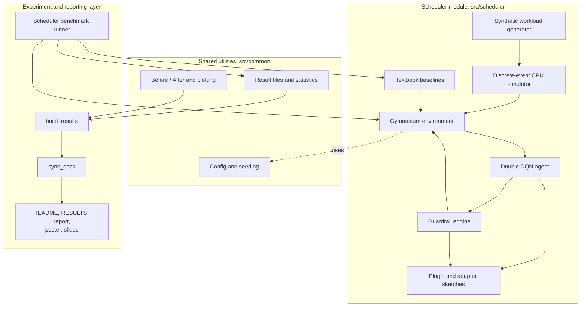

# System overview

## Explanation

The repository has three parts: the scheduler module, a small package of shared utilities,
and the experiment and reporting layer. The diagram shows all three. There is no
large-language-model component and no integrated demo; both are planned, not implemented.

**Scheduler module (`src/scheduler/`).** A discrete-event simulator of one CPU, not a kernel
modification.

- *Synthetic workload generator* (`tasks.py`) draws CPU-bound, memory-bound and I/O-bound tasks
  for the light, medium and heavy load profiles defined in `configs/scheduler_ddqn.yaml`. The
  task classes are the keys of `workload.task_types`, so a workload profile is a YAML file:
  `configs/scheduler_llm_workload.yaml` replaces the three classes with synthetic inference
  requests and fine-tuning jobs and inherits everything else. There is no real scheduling
  dataset, and no language model is run.
- *Discrete-event CPU simulator* (`simulator.py`, with episode metrics in `metrics.py`) models
  memory thrashing, context switches, priority-adjust overhead and I/O blocking.
- *Gymnasium environment* (`env.py`, reward in `reward.py`) turns the simulator into a decision
  process: observation of a window of ready tasks, action mask, and the reward used here
  (response time is a penalty).
- *Double DQN agent* (`agent.py`, training and evaluation loops in `training.py`).
- *Guardrail engine* (`guardrails.py`) filters the agent's proposed decision inside the
  environment step; the edge back to the environment shows that the filtered decision is what
  is executed.
- *Textbook baselines* (`baselines.py`): FCFS, SJF, Round Robin, Priority and the SRTF
  reference. They drive the same environment directly, without guardrails.
- *Plugin and adapter sketches* (`plugin.py`, `adapters.py`) wrap a trained agent and the
  guardrail engine behind an interface for platform engineers. They are sketches, see
  [04-deployment-sketch.md](04-deployment-sketch.md).

The configuration dataclasses of the module live in `src/scheduler/config.py` and are built
from YAML by the shared configuration loader. The inner loop of the module (observation
encoding, the Double DQN update and the order of the override rules) is drawn in
[02-scheduler-detail.md](02-scheduler-detail.md).

**Shared utilities (`src/common/`).** Configuration loading and overrides (`config.py`),
seed derivation (`seeding.py`), logging (`logging_utils.py`), result files and run metadata
(`io.py`), summary statistics (`metrics.py`), the Before / After rules (`before_after.py`),
plotting (`plotting.py`), source labels (`labels.py`) and the reference values of the block
`paper_vs_reproduced` (`paper_values.py`). The package docstring states the dependency rule: nothing in
`src/common` knows about scheduling; `src/scheduler` and the experiment scripts depend on it,
never the other way round. The diagram draws only the environment's use of the configuration
code as a dashed edge; the runner, the plotting script and the reporting scripts use the
package too.

**Experiment and reporting layer (`experiments/`).** `run_scheduler_benchmark.py` trains one
agent per seed, runs every method on the same workloads and writes CSV files;
`build_results.py` turns the reference run into tables, the Before / After CSV and chart, and
Markdown blocks; `sync_docs.py` injects those blocks into the README, the results file, the
project report, the topic guide, the poster and the slides. The detail is in
[03-experiment-flow.md](03-experiment-flow.md).

## Assumptions

- The scheduler is evaluated on its own; combining it with any other system is outside the scope of this draft.
- Everything runs on one machine: one simulated CPU, synthetic workloads drawn from seeds, and
  no real job queue.
- Every setting chosen by this implementation lives in a YAML file under `configs/` and is
  marked `[Assumption — not in paper]` there.

## Design alternatives considered

1. **Folding the shared utilities into the scheduler package.** Not chosen because
   configuration, seeding, result files, statistics and the Before / After rules are not
   specific to scheduling, and keeping them apart makes the dependency rule easy to check.
   `src/common` is a small package inside this repository; it holds the reporting
   conventions (seed derivation, Before / After rows, result files) that this repository
   shares with the companion project `federated-privacy-adult`.
2. **Guardrails as a separate service around the agent.** Not chosen because the training
   loop must know which decisions were overridden, and the plugin should reuse the same
   filtering code; the guardrail engine is therefore called from inside the environment step
   (see diagram 2).
3. **Hand-written result tables in each document.** Not chosen because the same number would
   then be typed in several places and could drift; every reproduced number instead comes from
   one generated block (see diagram 3).

## What this diagram does not show

- The internal loop of the scheduler (diagram 2) and the plugin path for platforms
  (diagram 4).
- Configuration files, the notebooks, the tests and the continuous-integration workflow.
- The ablation runs, which use the same runner with one setting changed, and the run on the
  LLM-style workload profile, which uses the same runner with a second config.
- Any large-language-model component, because none exists in this draft.
- Any real platform, cluster or deployment: there is none.
