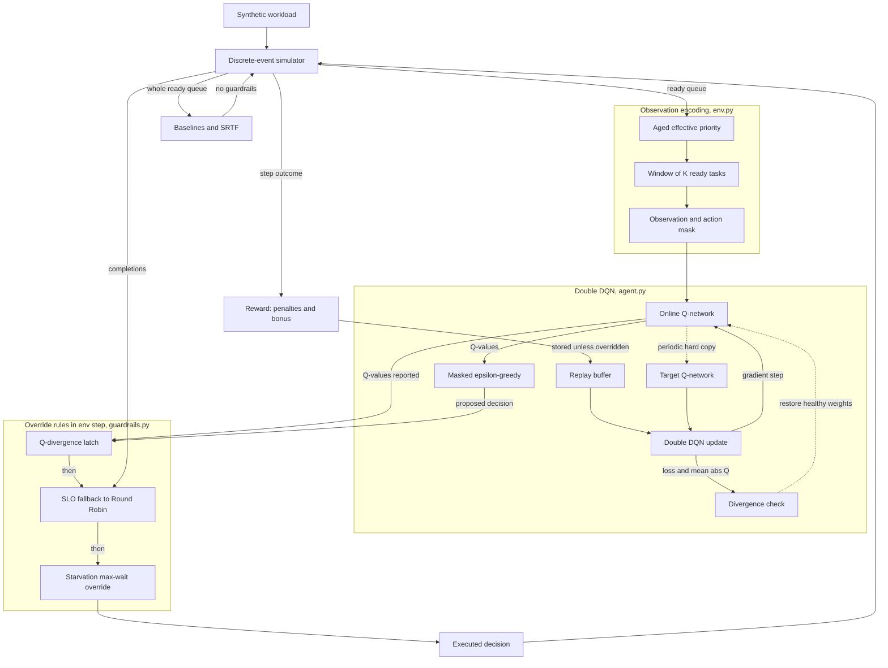

# Scheduler detail: simulator, Double DQN loop and guardrails

## Explanation

One environment step is one scheduling decision. The loop runs left to right and back to the
simulator.

- **Synthetic workload** (`src/scheduler/tasks.py`) generates the tasks of one episode from a
  seed and a load profile. Training and evaluation use disjoint child seeds
  (`src/scheduler/training.py`).
- **Discrete-event simulator** (`src/scheduler/simulator.py`) executes one decision per
  decision point on a single CPU and returns a step outcome: waiting, time-in-system and
  response integrals, completions, deadline misses, busy time.
- **Observation encoding** (`src/scheduler/env.py`, `build_decision_state`). The agent does not
  see the whole ready queue. Ready tasks are ordered by *effective priority* — the static
  priority plus the priority-adjust offset plus an **aging** boost for continuous waiting — and
  only the top `K = observation.num_slots` tasks are encoded into slots. Aging is therefore part
  of the state encoding, not an override: it changes which tasks are visible, it is controlled
  only by `guardrails.aging.enabled`, and it stays on for both the guarded and the unguarded
  agent. The action mask marks empty slots, out-of-range priority changes and excess
  consecutive priority actions as invalid. By default the slot features contain the remaining
  time of the current CPU burst (the same oracle information the baselines use) and not the
  total remaining work over future bursts; that extra oracle is an ablation.
- **Double DQN** (`src/scheduler/agent.py`). The online network (slot-shared by default, flat
  MLP as an ablation) produces one Q-value per action. Masked ε-greedy picks an action among
  valid actions only. Transitions go to a uniform replay buffer; the update uses the Double DQN
  target — the online network selects the next action, the target network evaluates it — and
  the target network receives a hard copy of the online weights at a fixed interval. The
  divergence check in `train_agent` (`src/scheduler/training.py`) stops training on a
  non-finite or very large loss or Q-value and restores the last healthy weights.
- **Override rules** (`src/scheduler/guardrails.py`, called from `SchedulerEnv.step` in
  `src/scheduler/env.py`). The proposed decision is filtered *inside the environment step*, so
  what the simulator executes may differ from what the agent chose. The order in the diagram is
  the order of precedence in `GuardrailEngine.filter`: the Q-divergence latch (engaged when the
  reported Q-values are NaN, infinite or larger than a limit) replaces the agent with a fallback
  baseline for the rest of the episode; an active SLO fallback (triggered by the share of late
  completions in a recent window, fed by the completions edge) replaces that with Round Robin
  for a fixed period; the starvation override (any ready task that has waited at least the maximum)
  is applied last and wins. A transition whose decision was overridden, or whose action was
  invalid, is not stored in the replay buffer.
- **Reward** (`src/scheduler/reward.py`) penalises waiting, time in system, response
  waiting and deadline misses, and rewards completions and utilisation, so that finishing work
  sooner earns more reward. An alternative sign convention for the response-time term
  (response time is added instead of subtracted) is kept as the ablation
  `reward_paper_sign_as_printed`.
- **Baselines and SRTF** (`src/scheduler/baselines.py`) see the **whole ready queue**, not the
  agent's window, and the same current-burst information. They act through
  `SchedulerEnv.step_decision`, which never filters a decision, so they bypass the override
  rules. SRTF is a preemptive reference method, not one of the four Before baselines.

## Assumptions

- The machine model, workload distributions, observation layout, action set, reward weights,
  guardrail thresholds and every hyperparameter are `[Assumption — not in paper]`; they are
  listed in `configs/scheduler_ddqn.yaml`.
- Both the agent and the baselines know the exact length of each task's current CPU burst. A
  real operating system would have to estimate it; this is a limitation of every result in this
  repository.
- The agent learns online in the simulator, not from logged traces.
- The discount factor is applied per decision, although decisions take different amounts of
  simulated time.

## Design alternatives considered

1. **Guardrails as a wrapper around the agent, outside the environment.** Not chosen because the
   environment then could not tell the training loop which transitions were overridden (they
   must not be stored as if the agent had chosen them), and the plugin would need a second
   copy of the filtering logic. Filtering inside the step gives one code path for training,
   evaluation and the plugin.
2. **Aging as a fourth override rule, switched with the other three.** Not chosen because aging
   changes which tasks the network sees; if it were switched off together with the overrides,
   the unguarded ablation would also change the observation and would no longer isolate the
   effect of the overrides. An earlier draft of this code had exactly that problem, and the
   encoding was changed before the reference run.
3. **Encoding the whole ready queue instead of a window of `K` slots.** Not chosen because a
   fixed-size action space (`K` slots times the time slices plus priority actions) needs a
   fixed number of slots; the window is ordered by aged effective priority so that long-waiting
   tasks become visible. The cost is an information asymmetry with the baselines, which see the
   whole queue.
4. **A flat MLP Q-network instead of the slot-shared network.** The slot-shared network was
   chosen on development seeds because it learned a shortest-first ordering quickly; the flat
   MLP is kept as the ablation `network_mlp` because the two were not compared at full scale
   before the reference run.
5. **The vanilla DQN target.** `vanilla_dqn_targets` exists in `agent.py` and is used only for
   comparison in `tests/test_scheduler_agent.py`. The training loop uses the standard Double DQN
   target, in which the online network selects the next action and the target network
   evaluates it, because that limits over-estimation of action values. No ablation trains with
   the vanilla target.

## What this diagram does not show

- The exact observation features and actions; they are in the generated tables
  `scheduler_state_table` and `scheduler_action_table`.
- Simulator internals: thrashing slowdown, context-switch cost, I/O blocking and tie-breaking.
- How the benchmark runner pairs workloads across methods and seeds
  ([diagram 3](03-experiment-flow.md)).
- The plugin and adapter path for platforms ([diagram 4](04-deployment-sketch.md)).
- Any result. Whether the guardrails helped in the reference run is reported in the
  generated blocks `findings` and `tail_analysis`; unit tests show that each rule fires, overrides and releases as
  specified.
