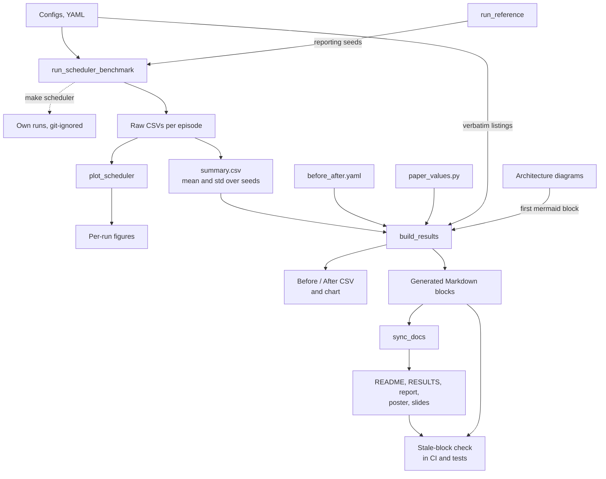

# Experiment flow: from configuration to documents



## Explanation

Every reproduced number in the documentation travels this path, and only this path.

- **Configs** (`configs/scheduler_ddqn.yaml` for the simulator, workload, observation,
  actions, reward, guardrails, agent, training, evaluation and the named ablations;
  `configs/scheduler_baselines.yaml` for the textbook baselines and the SRTF reference;
  `configs/before_after.yaml` for the comparison rules) hold every setting, each tagged with
  its provenance. A workload profile is one more config on the same path:
  `configs/scheduler_llm_workload.yaml` inherits `configs/scheduler_ddqn.yaml` and replaces
  only the task classes (synthetic inference requests and fine-tuning jobs; no language model
  is run). Command-line overrides (`--set key=value`, `--smoke`, `--ablation NAME`) are
  merged by `src/common/config.py`, and the merged configuration is written next to the
  results as `config_used.yaml`.
- **run_reference** (`experiments/run_reference.py`, `make reference`) runs the benchmark on
  the reporting seeds 0–4 and then every named ablation, by calling the benchmark runner with
  `--out` pointing into `experiments/results/reference/scheduler/` (ablations go to its
  `ablations/` sub-folder). It then runs the same benchmark on the LLM-style workload profile
  into `experiments/results/reference/scheduler_llm/` (`--only llm_workload` runs that part
  alone). It is the only command meant to overwrite the raw results there;
  `--skip-ablations` leaves the ablations out. `build_results` adds the derived tables and
  charts under `generated/` and `before_after/` in the reference folder.
- **The benchmark runner** (`experiments/run_scheduler_benchmark.py`) trains one agent per
  seed and evaluates every method (the four baselines, the SRTF reference, the agent with
  guardrails and the agent with its override rules off) on the same workloads of that seed.
  It writes `raw_episodes.csv` (one row per seed, method, load profile and evaluation workload),
  `training_log.csv`, a `summary.csv` with the mean and standard deviation over seeds
  (`summarise_by_seed` in `src/common/metrics.py`) and `metadata.json`. With `--class-metrics`
  it also writes the same metrics per task class (`class_episodes.csv`, `class_summary.csv`),
  which the run on the LLM-style profile uses. Results do not depend
  on the number of worker processes. Runs started with `make scheduler`, `make scheduler-llm`,
  `make smoke` or `make smoke-llm` go to `experiments/results/runs/`, which is git-ignored and
  never read by the reporting step.
- **Plotting** (`experiments/plot_scheduler.py`) draws the per-run figures into each run's
  `figures/` folder: the metrics per load profile and pooled, the guardrail trigger counts and
  the training reward curve.
- **build_results** (`experiments/build_results.py`, first half of `make results`) reads only the
  reference run's summary and raw files, `configs/before_after.yaml` (which methods are
  compared and how each metric is oriented and rounded) and `src/common/paper_values.py` (the
  only source of the reference values in the block `paper_vs_reproduced`). It applies the Before / After rules of
  `src/common/before_after.py` and writes `scheduling.csv` and `scheduling.png` under
  `reference/before_after/` and one Markdown file per block under `reference/generated/`. For
  the run on the LLM-style profile it writes `scheduling_llm.csv` and `.png`,
  `scheduling_llm_by_class.csv` and `.png`, and the blocks whose id starts with `llm_`, with the
  same rules and the same metric definitions. It
  also turns every config file into a verbatim listing and extracts the first Mermaid block of
  each file in `docs/architecture/` into a `diagram_*` block, which is why these file names
  are fixed. If a CSV is missing, the dependent values are rendered as `TBD`; nothing is
  invented or copied by hand.
- **sync_docs** (`experiments/sync_docs.py`, second half of `make results`) replaces the text
  between every `BEGIN GENERATED` and `END GENERATED` marker pair with the current block. The
  same block file feeds the README, the results file, the project report, the topic guide, the
  poster and the slides, so a value cannot differ between placements.
- **The check** (`make docs-check`, run in `.github/workflows/ci.yml`, and
  `tests/test_docs_integrity.py`) fails if any block in any document differs from its generated
  file.

The commands, in the order a user would run them:

```bash
make smoke        # tiny run into experiments/results/runs/smoke_scheduler
make smoke-llm    # the same tiny run on the LLM-style workload profile, with per-class metrics
make scheduler    # full benchmark over the reporting seeds into experiments/results/runs/scheduler
make scheduler-llm  # the same benchmark on the LLM-style workload profile
make reference    # re-create both reference runs, then make results (overwrites reference/)
make results      # rebuild tables, Before / After CSV and chart, and sync the documents
make docs-check   # fail if a generated block in a document is stale
```

## Assumptions

- The reporting seeds 0–4 are used once, for the reference run; development and tuning use
  seeds 100 and above.
- The configuration is fixed on development seeds before the reference run, and no choice is
  made on the reporting seeds; the ablations are reported as sensitivity, not as tuning.
- The values of the LLM-style workload profile were written down before any run and were not
  changed afterwards; development seeds were used only to check that episodes finish and
  training stays stable, and the reporting seeds were run once.
- Wall-clock time is recorded separately from result rows, so result files are identical for
  any number of workers.

## Design alternatives considered

1. **Typing result tables into each document.** Not chosen because the same value would appear
   in several documents and could drift, and because a hand-typed table cannot be checked
   mechanically. Generated blocks with a CI check make drift a test failure.
2. **Reporting from whichever run was made last.** Not chosen because a development run or a
   smoke run could then silently replace the numbers the documents cite. Own runs go to a
   git-ignored folder; only `run_reference` writes the reference folder, and `build_results`
   reads only that folder.
3. **Placeholder numbers for parts that have not been run.** Not chosen because a plausible
   placeholder is indistinguishable from a result. Missing inputs become `TBD` with the
   `[Target / TBD]` label.
4. **Selecting the best configuration on the reporting seeds.** Not chosen because it would be
   tuning on the test set; the configuration fixed on development seeds is reported, and the
   ablations that did better on the reporting seeds are reported as sensitivity.

## What this diagram does not show

- The notebooks (`experiments/run_notebooks.py`, `make notebooks`).
- The internal task scheduling of the runner: worker processes and the per-seed pairing of
  workloads across methods.
- The ablation sub-folders of the reference run, which follow the same path.
- Any result value.
