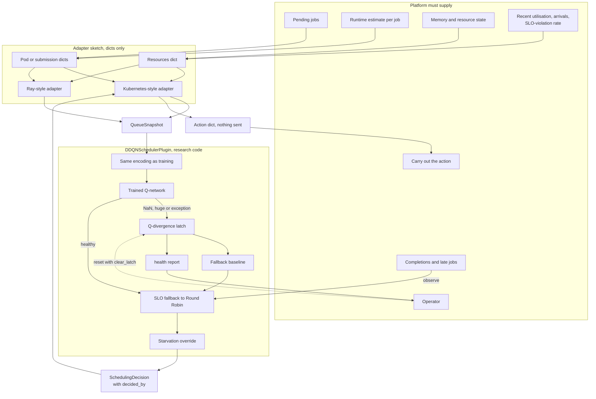

# Deployment sketch for platform teams (not a production integration)

## Explanation

**This is a sketch, not a production integration.** Nothing here has been deployed on any
platform, the adapters call no cluster API, and nothing in the repository sends a decision
anywhere. The diagram shows what a platform team would have to build around the research code
to try the Double DQN scheduler, and what the code does when the model misbehaves.

**What the platform must supply** (types in `src/scheduler/plugin.py`). At each decision point
the platform builds a `QueueSnapshot`: the current time, one `JobView` per waiting job (queue
wait, time in system, expected next burst and expected remaining work, memory request,
priority and priority offset, deadline slack, job class, whether it has started, queue order),
and a `ResourceState` (memory capacity and resident memory, blocked jobs, number of priority
levels, and the recent CPU utilisation, arrival rate and SLO-violation rate that the simulator
otherwise computes itself). The runtime estimate is the critical input: in the simulator the
agent and the baselines are given the exact remaining time of the current CPU burst, and a real
platform would have to estimate it. After acting, the platform must report completions and
which of them were late through `SchedulerPlugin.observe`, because the SLO fallback rule
depends on them. `decide` must not be called with an empty queue; it raises an error.

**Adapter sketches** (`src/scheduler/adapters.py`). `KubernetesStyleQueueAdapter` and
`RayStyleQueueAdapter` translate plain dictionaries *shaped like* pending Pods or Ray job
submissions into a `QueueSnapshot`, and a `SchedulingDecision` back into a plain action
dictionary (`bind` or `patch_priority`, `start_job` or `reprioritise`). They import neither
`kubernetes` nor `ray`, call no API, read invented annotation keys under `scheduler.example/`,
take the runtime estimate from such an annotation, and provide no feedback path for
completions. The diagram draws the return path through the Kubernetes-style adapter only; the
Ray-style adapter has the same `to_action` method.

**The plugin** (`DDQNSchedulerPlugin` in `src/scheduler/plugin.py`). It converts the snapshot
into the simulator's view and then calls exactly the functions the training environment uses —
`build_decision_state` and `action_to_decision` from `src/scheduler/env.py` and the
`GuardrailEngine` from `src/scheduler/guardrails.py` — so there is one code path and no
train/serve skew; `tests/test_scheduler_plugin.py` checks that the plugin and the environment
make the same decisions. The agent acts greedily over valid actions. Every decision carries a
`decided_by` label: `agent`, `guardrail:starvation`, `guardrail:slo_fallback` or
`fallback:q_divergence`.

**When the model misbehaves.**

| Event | Rule that reacts | What runs instead | How it ends |
|---|---|---|---|
| Q-values NaN, infinite or above `q_abs_limit`, or the network raises an exception | Q-divergence latch | the configured fallback baseline (Round Robin by default) | only when an operator calls `reset(clear_latch=True)`; `health()` reports unhealthy while latched |
| Too many recent completions late | SLO fallback | Round Robin | after a fixed period of time, then the window is cleared |
| A ready job has waited at least the maximum | starvation override | forced dispatch of the longest-waiting job | at the next decision |

The precedence is the same as in training: the latch replaces the agent, an active SLO fallback
replaces that, and the starvation override wins over both. `BaselineSchedulerPlugin` wraps any
textbook baseline behind the same interface and is the plain alternative for a platform that
does not want a learned policy.

**What the reference run says about these rules.** In the simulator, the overrides are a
safety net whose benefit is not demonstrated: on the reporting seeds the guardrails did not
contain the heavy-load failure mode that actually occurred: in the worst heavy-load workloads
the overrides fired many times, on the seeds that contain those workloads the guarded agent did
worse than the unguarded one, and its heavy-load starvation count was higher, not lower. Under memory pressure both the forced
dispatch and Round Robin can make an overload worse. The generated blocks `findings`,
`tail_analysis` and `all_methods` give the evidence; unit tests show only that each rule fires, overrides and
releases as specified.

## Assumptions

- A platform can supply a per-job runtime estimate; the plugin does not estimate it.
- The platform's notion of a decision point matches the simulator's: the resource is free and
  at least one job is waiting.
- A platform can honour time slices and preemption; the adapters only express them as fields
  of a dictionary.
- The trained agent was trained on synthetic single-CPU workloads; nothing suggests it
  transfers to a real job queue without retraining.

## Design alternatives considered

1. **Adapters that call the Kubernetes or Ray APIs directly.** Not chosen because there is no
   runtime estimate source, completion feedback or preemption model to connect them to, and an
   adapter that appears to work against a cluster would overstate what has been tested. The
   sketches translate dictionaries only.
2. **Separate serving-time feature code in the plugin.** Not chosen because two encodings drift
   apart (train/serve skew); the plugin reuses the environment's own encoding and guardrail
   engine.
3. **Clearing the Q-divergence latch automatically at every reset.** The environment does this
   at every episode for the benchmark, but the plugin keeps the latch across `reset()` because a
   diverged model should not resume control without a human decision.
4. **A more aggressive SLO fallback.** The first setting fired often under heavy load on
   development seeds, and handing control to Round Robin then made things worse because Round
   Robin starts many memory-heavy jobs and the machine thrashes. The conservative default fires
   only at violation rates above what the baselines themselves show; the aggressive setting is
   kept as the ablation `slo_fallback_aggressive`, and the generated block `ablations` shows
   how it behaved on the reporting seeds. A fallback is only as good as the policy it falls
   back to.

## What this diagram does not show

- Any real cluster, scheduler extension point, authentication or network path: none exists.
- How a platform would obtain runtime estimates, deadlines or job classes.
- Model loading, versioning, monitoring and rollback beyond the `health()` report.
- Multi-CPU or multi-node placement; the simulator and the agent model one CPU.
- The training of the agent ([diagram 2](02-scheduler-detail.md)).
