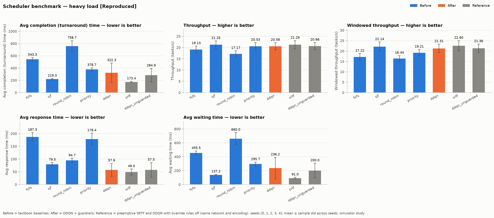
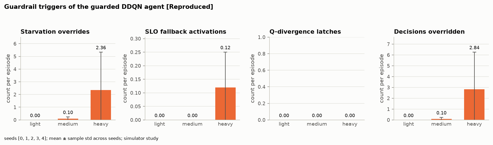
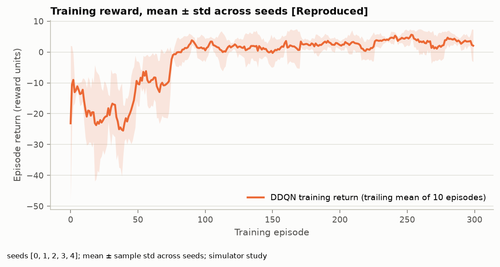
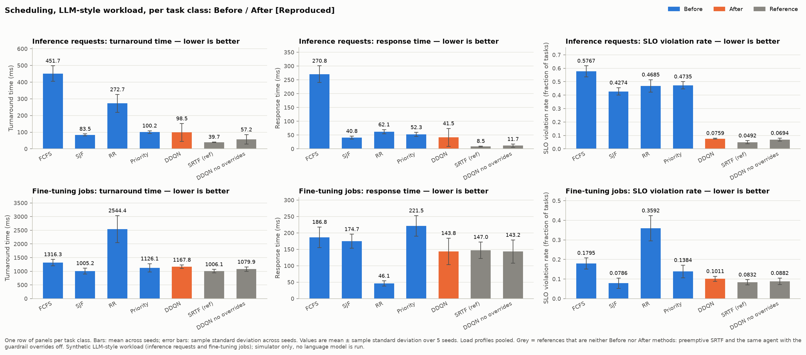

# Topic guide 01 — Learned scheduling under varied load

This topic guide describes the reference implementation of the learned scheduler in this
repository: a Double DQN agent that schedules tasks on a simulated single CPU. It explains
what the implementation does, what was measured and under which conditions, when a user
should and should not rely on it, and what to try next. The method follows the Double DQN
scheduler described by Sun et al. (2025), [arXiv:2503.23659](https://arxiv.org/abs/2503.23659),
and is compared here with First-Come-First-Serve (FCFS), Shortest Job First (SJF), Round Robin
(RR) and a static Priority baseline. The companion project `federated-privacy-adult` is a
separate repository with its own data, code and results; the two share the same direction and
the same reporting conventions, and nothing in this guide depends on it.

Everything this guide says about results comes from the reference run on reporting seeds
0–4 in this repository's own discrete-event simulator. The simulator is a model of a single
CPU, not a kernel modification, and every workload is synthetic. Every number in this file
carries a source label. `[Paper-reported]` means printed in a source paper and shown for
reference only; such a value is not a target for this code and is never compared numerically
with a value from this code. `[Reproduced]` means obtained by running this repository's code
under the documented conditions (the config, seeds and workload named next to it); the label
says where a number comes from, not that a number printed in a paper was reproduced.
`[Reproduced]` numbers appear only inside generated blocks, which are filled from the result
files and checked in CI. Anything not yet run is `[Target / TBD]`.

**In brief.** In this implementation, with the documented configuration and five seeds, the
agent's average turnaround time is lower than SJF's at light and medium load and higher at
heavy load; pooled over the three loads it is higher. The Before / After tables in section 3
give the values. The same tables show that the agent's response time and SLO violation rate
are better than every baseline's on the pooled average, and that it has a lower turnaround
than FCFS, Round Robin and the added Priority baseline at every load (against Priority at
heavy load only on average, not on every seed). Preemptive shortest-remaining-time-first
(SRTF), a reference that is not a Before method, has a lower average turnaround than the agent
at every load. The heavy-load result comes from a few very poor workloads, not from a consistent
shortfall, so it is a tail risk, and the guardrails, as configured, did not contain it: under
heavy load the guarded agent did worse on average than the same agent with the override rules off. All
of this holds for a simulator with synthetic workloads in which every method knows the exact
length of each task's current CPU burst. A second study runs the same benchmark on a synthetic
LLM-style workload of inference requests and fine-tuning jobs, in which no language model is
run; its results are E9 (section 3.9) and its observations F18–F23 (section 4.11), followed by one post hoc variant, E10 (section 3.10) and F24. On throughput, the schedulers measured here differ
little on the pooled average, as expected for a stable queue, and more at heavy load; section 4.3 explains the two throughput definitions
this implementation reports.

## 1. Scope and question

**The usage question.** Under which load conditions does the learned scheduler in this
implementation improve on the textbook baselines, on which metrics, and what should a user
check before relying on it? The question is asked under a fully specified setup:

- training and evaluation use fixed seeds (0–4), and every method runs on the same paired
  workloads;
- the load is varied over three explicit profiles (light, medium, heavy, set as target CPU
  utilisations in `configs/scheduler_ddqn.yaml`, all `[Assumption — not in paper]`);
- the reward used here treats every time term as a penalty (section 4.8); and
- the Double DQN target is the standard one: the online network selects the next action and
  the target network evaluates it (section 4.9).

The question is asked separately for each baseline (FCFS, SJF, Round Robin, plus the
repository's Priority baseline) and for each load profile, because a pooled average can
hide a loss at one load behind wins at others.

**How each comparison is read.**

- *Better* for a baseline at a load: the agent's mean over seeds is better, the gap is larger
  than the seed-to-seed spread, and the paired per-workload comparison agrees with the mean,
  with the agent ahead on most workloads and no large losses on the rest.
- *Worse*: the agent's mean is worse by more than the spread, or the paired comparison shows
  losses large enough to decide the mean.
- *Not distinguishable*: the means differ by less than the spread, or the mean and the paired
  comparison disagree (for example, a typical-workload win cancelled by rare large losses).
  The result is then reported as a distribution rather than as a single ordering.

**The second question: a different workload shape.** What changes when the same benchmark
runs on work shaped like that of an LLM platform: many short, latency-sensitive inference
requests next to a few long, memory-heavy fine-tuning jobs? No language model is run: the
LLM-style workload profile (`configs/scheduler_llm_workload.yaml`) is a synthetic task mix
shaped like the work of an LLM platform, and none of its values was measured on an LLM
system. The simulated node, one processor with one memory budget, stands in for one
accelerator node. Everything except the task classes is inherited from the benchmark config,
so the two studies differ only in the shape of the workload. This is the LLM-style workload
study; its results are E9 (section 3.9) and its observations are F18–F23 (section 4.11). One variant of that profile was run afterwards as a post hoc check (E10, section 3.10; F24).

**What this guide compares.** Only methods run by this code: it reports the ordering and the
size of differences between them *within* this implementation.

## 2. Setup

### 2.1 What was built

Every setting below (state encoding, action count, hyperparameters, reward weights) was chosen
for this implementation, is tagged `[Assumption — not in paper]` in the configuration and
lives in YAML.

- **Simulator** (`src/scheduler/simulator.py`). One CPU; tasks with CPU bursts separated by
  I/O waits; a soft memory limit beyond which every running task slows down (thrashing);
  context-switch and priority-adjustment overheads. A task holds its memory from its first
  dispatch until it finishes. The simulator is cross-checked against two independent
  reference implementations that share no code with it:
  `tests/test_scheduler_reference_crosscheck.py` covers the textbook setting on random
  workloads, with exact agreement on finish and first-dispatch times, and
  `tests/test_scheduler_reference_full.py` covers I/O, thrashing, overheads and the reward
  integrals step by step.
- **Workloads** (`src/scheduler/tasks.py`). Three task types (CPU-bound, memory-bound,
  I/O-bound), with lognormal CPU demand,
  Poisson arrivals scaled to a target utilisation, priorities and deadlines. All distribution
  parameters are assumptions.
- **Workload profiles** (`src/common/config.py`, `src/scheduler/tasks.py`). The task classes
  are defined by the config: the keys of `workload.task_types`, in file order, are the
  classes, and the observation has one one-hot column per class. `workload.priority_level_weights`
  is either one list for all classes or one list per class. A child config names its parent
  in `base_config` and may list `replace_keys`, so that its mapping replaces the parent's
  instead of being merged into it. The LLM-style workload profile uses this to swap the three
  benchmark classes for two, `inference_request` and `finetune_job`, with requests on the two
  upper priority levels and jobs on the two lower ones. The benchmark config is unchanged, and
  its results are byte-identical to those before profiles were added.
- **Per-class metrics** (`--class-metrics`). The runner then also writes `class_episodes.csv`
  and `class_summary.csv`: turnaround, response time, waiting time, SLO violation rate,
  starvation count and longest wait, per task class. It changes none of the other output
  files.
- **Observation and actions** (`src/scheduler/env.py`). Global features plus the ten most
  urgent ready tasks ("slots", ordered by effective priority). An action either dispatches a
  slot for one of three time slices (10 ms, 40 ms, or until the burst ends) or nudges a
  slot's priority up or down. The full tables are in section 3.8.
- **Agent** (`src/scheduler/agent.py`). Double DQN with a slot-shared Q-network (one small
  network scores every slot), a uniform replay buffer, masked ε-greedy exploration, a hard
  target update and a Huber loss.
- **Baselines** (`src/scheduler/baselines.py`). FCFS, non-preemptive SJF on the current
  burst, Round Robin with a 20 ms quantum and non-preemptive static Priority. The
  **SRTF reference** (preemptive shortest remaining burst, 10 ms quantum) is drawn in grey. It
  is not a Before baseline.
- **Guardrails** (`src/scheduler/guardrails.py`). Three override rules: a starvation max-wait
  override, an SLO fallback to Round Robin, and a Q-divergence latch. Priority aging is part
  of the state encoding, not an override, and stays on in both agent variants. `ddqn` is the
  reported method, with the overrides on; `ddqn_unguarded` is the same trained network,
  evaluated with the overrides off.

**Design choices.** The table lists the choices that shape the results, each with the reason
recorded for it in this repository. Sections 4.4, 4.6, 4.8 and 4.9 give the detail.

| Design choice | What this implementation does | Why |
|---|---|---|
| Reward | Waiting, turnaround and response time are penalties; a completed task earns a bonus (section 4.8) | So that finishing work sooner earns more reward |
| Double DQN target | The online network selects the next action and the target network evaluates it (section 4.9) | Limits over-estimation of action values |
| Guardrails | Three override rules filter the agent's decisions (section 4.6) | So that a misbehaving policy is overridden by a simple rule; under heavy load they did not have that effect here (F14) |
| Paired workloads | Every method is evaluated on the same workloads for each seed and load | So that differences between methods are not due to different workloads |
| SRTF reference | A preemptive shortest-remaining-time policy is run next to the baselines (section 4.4) | The agent may preempt and textbook SJF may not, so a gain over SJF could come from preemption alone |
| Priority baseline | A static, non-preemptive Priority scheduler is added to FCFS, SJF and Round Robin | A learned scheduler that ignores priorities should be measured against one that uses only priorities |
| Per-load reporting | Light, medium and heavy load are reported separately as well as pooled | A pooled average can hide a loss at one load behind wins at others |
| Slot-shared network | One small network scores each of the ten visible slots | It learned a shortest-first ordering quickly on development seeds |
| No total-remaining-CPU feature | The agent sees the current burst, not the total remaining CPU over future bursts (section 2.2) | That feature is an advantage the baselines lack; it is kept only as an ablation |
| Two throughput definitions | Plain and windowed throughput are both reported (section 4.3) | So that a user can see which one a scheduling decision can move |
| Held-out seeds | Settings were chosen on development seeds 100–104 only; seeds 0–4 are for reporting (section 2.3) | So that the reported results are not tuned on the seeds they are reported on |
| Task classes in the config | The classes are the keys of `workload.task_types`; the observation has one column per class | So that another workload family can be studied without a code change |
| A profile inherits all but the task classes | `configs/scheduler_llm_workload.yaml` names `scheduler_ddqn.yaml` as its base and replaces only `workload.task_types` (section 3.9) | So that the two studies differ only in the shape of the workload |
| Per-class metrics | Metrics are also reported per task class (`--class-metrics`) | A pooled average hides the trade between short requests and long jobs |
| Class-specific priorities | Inference requests get the two upper priority levels, fine-tuning jobs the two lower ones | A platform marks interactive work as more urgent than batch work |

### 2.2 What each method knows

Both the agent and every baseline see the exact remaining length of each task's *current*
CPU burst. That is oracle information: a real operating system has to estimate burst lengths.
Because the oracle is shared, the comparison is fair, but every result here is conditional
on it. By default the agent does **not** see a task's total remaining CPU over future bursts.
An earlier draft exposed it, a review flagged it as an advantage the baselines lack, and it
was removed. It is now measured only as the ablation `oracle_total_remaining`. The agent
does see the task type as a one-hot feature, which hints at future bursts and is something
the baselines do not use. The agent sees only ten slots; the baselines see the whole ready
queue.

### 2.3 Protocol and statistics

For each reporting seed *s* in 0–4, the evaluation workloads are generated once: 10 per
load profile, from child seeds derived from *s*. One agent is trained with seed *s* for 300
episodes, with the load drawn uniformly from the three profiles. Every method is then
evaluated on exactly the same workloads, greedily (ε = 0). Training workloads cannot
influence evaluation, and results are byte-identical for any number of worker processes.

**Statistics convention.** A seed's value for a metric at a load is the mean over that
seed's 10 evaluation workloads. Tables report the mean ± sample standard deviation of those
five seed values. "Pooled" means all three load profiles together. Because the workloads are
paired, the tail-analysis block also compares methods workload by workload. The 5-seed
design, the 10 workloads per load and the 300 training episodes are settings chosen for this
implementation.

**How settings were chosen.** Only on development seeds 100–104, never on reporting seeds
0–4. That covers the slot-shared network (picked because it learned a shortest-first ordering
quickly; it was not compared with the flat MLP at full scale before the reference run) and
the 300 training episodes (600 changed nothing on a development seed). Reward weights and
guardrail thresholds were set by principle and were not searched. The SLO fallback was
deliberately made conservative before any reporting-seed run (section 4.6). The default
configuration was then frozen, the reference run was made once, and nothing was changed
afterwards.

**The LLM-style workload study (E9).** The values of the profile were written down before
any run and were not changed afterwards. A run on development seeds 100, 101 and 102 was used
only to check that episodes finish and that training stays stable; the reporting seeds 0–4
were then run once, with five worker processes. No hyperparameter of the agent, the reward or
the guardrails was retuned for this profile: the agent was trained from scratch on it with
the settings of the benchmark config, under the same protocol and statistics convention as
above. None of the benchmark's ablations was run on this profile.

**The post hoc variant (E10).** One variant of the profile, `starvation_bounded_slice`, was
defined after the results of E9 had been seen and was run on the reporting seeds. That is
outside the protocol above, which keeps the reporting seeds for results fixed in advance, and
it is why E10 is reported as post hoc and exploratory. Three things were fixed before it was
run: the one value of the setting, the rule for reading the result
(`scheduling_llm.ablation` in `configs/before_after.yaml`), and that the reporting seeds would
be run once. Adding the variant to the profile's config changed the saved configuration of the
E9 reference run, so that run was re-created; its result files are byte-identical to those of
the first run.

### 2.4 Commands

Run the reference configuration, which writes into `experiments/results/runs/scheduler` and
never overwrites the reference:

```bash
make scheduler
# equivalent to
python -m experiments.run_scheduler_benchmark --config configs/scheduler_ddqn.yaml \
    --baselines-config configs/scheduler_baselines.yaml --workers 4 \
    --out experiments/results/runs/scheduler
python -m experiments.plot_scheduler --run-dir experiments/results/runs/scheduler
```

Run one named ablation (output goes to `<out>/ablations/<name>/`):

```bash
python -m experiments.run_scheduler_benchmark --config configs/scheduler_ddqn.yaml \
    --baselines-config configs/scheduler_baselines.yaml \
    --out experiments/results/runs/scheduler --ablation reward_paper_sign_as_printed
```

Re-create the full reference run, with every ablation (this overwrites
`experiments/results/reference/`), rebuild the tables and charts, and check that the
documentation is in sync:

```bash
python -m experiments.run_reference --workers 5
make results
make docs-check
```

`make reference` runs the first two steps together; `--skip-ablations` re-creates the main
run only.

A tiny end-to-end check on development seeds only (`make smoke` runs the same benchmark
command into `experiments/results/runs/smoke_scheduler` and then plots it):

```bash
python -m experiments.run_scheduler_benchmark --config configs/scheduler_ddqn.yaml \
    --baselines-config configs/scheduler_baselines.yaml --smoke \
    --out experiments/results/runs/smoke_scheduler
```

Run the LLM-style workload profile (E9). `make smoke-llm` is the tiny end-to-end check on
development seeds (a few seconds); `make scheduler-llm` is the full run into
`experiments/results/runs/scheduler_llm`; both write the per-class files as well:

```bash
make smoke-llm
make scheduler-llm
# the full run is
python -m experiments.run_scheduler_benchmark --config configs/scheduler_llm_workload.yaml \
    --baselines-config configs/scheduler_baselines.yaml --workers 4 --class-metrics \
    --out experiments/results/runs/scheduler_llm
python -m experiments.plot_scheduler --run-dir experiments/results/runs/scheduler_llm \
    --title "LLM-style workload"
```

Re-create only the reference run of the profile (this overwrites
`experiments/results/reference/scheduler_llm/`):

```bash
python -m experiments.run_reference --only llm_workload
```

The reference runs that this guide cites (the benchmark and the LLM-style workload study):

<!-- BEGIN GENERATED: reference_run_info -->
| Reference run | Created (UTC) | Seeds | Environment | Wall-clock time |
|---|---|---|---|---|
| scheduler | 2024-11-20T04:50:12Z | 0, 1, 2, 3, 4 | Python 3.12.14 on macOS-26.6.2-arm64-arm-64bit; gymnasium 1.4.0, matplotlib 3.11.2, numpy 2.5.5, pyyaml 6.0.3, torch 2.15.0 | 48 s with 5 worker processes |
| scheduler_llm | 2024-11-20T23:57:26Z | 0, 1, 2, 3, 4 | Python 3.12.14 on macOS-26.6.2-arm64-arm-64bit; gymnasium 1.4.0, matplotlib 3.11.2, numpy 2.5.5, pyyaml 6.0.3, torch 2.15.0 | 48 s with 5 worker processes |
<!-- END GENERATED: reference_run_info -->

*Caption.* When and where each reference run was made, on which seeds, and how long it
took. It shows provenance only. It does not show that a run on another machine or library
version gives identical numbers; that has not been tested here, and the README notes that
another CPU, operating system or library version may change results in the last digits.

### 2.5 Related files in this repository

This guide is the long-form reading of one benchmark. Other files show the same material in a
different form:

| File | What it adds to this guide |
|---|---|
| [`experiments/results/RESULTS.md`](../../experiments/results/RESULTS.md) | every generated table in one place, the threats to validity and the experiments specified but not run |
| [`docs/architecture/02-scheduler-detail.md`](../architecture/02-scheduler-detail.md) | a diagram of the simulator, the Double DQN loop and the guardrails described in section 2.1 |
| [`docs/architecture/03-experiment-flow.md`](../architecture/03-experiment-flow.md) | how a configuration becomes a run folder, the generated tables and the documents |
| [`docs/architecture/04-deployment-sketch.md`](../architecture/04-deployment-sketch.md) | how the `SchedulerPlugin` interface and the job-queue adapter sketches would sit in a platform; not a production integration |
| [`notebooks/01_scheduler_reproduction.ipynb`](../../notebooks/01_scheduler_reproduction.ipynb) | a notebook-scale run of the same protocol: trains the agent, evaluates every method on the paired workloads, checks the per-workload rows against the reference run and rebuilds the Before / After table from its own run |
| [`notebooks/02_scheduler_ablation.ipynb`](../../notebooks/02_scheduler_ablation.ipynb) | a notebook-scale sensitivity study: retrains the agent with one setting changed at a time (reward, load level, learning rate) with a reduced training budget; it does not replace the reference ablations of section 3.5 |
| [`data/README.md`](../../data/README.md) | the card of the synthetic workloads: how they are generated and what they can and cannot support |
| [`configs/scheduler_llm_workload.yaml`](../../configs/scheduler_llm_workload.yaml) | the LLM-style workload profile of E9: the two task classes, every value commented and tagged |
| [`experiments/results/reference/scheduler_llm/`](../../experiments/results/reference/scheduler_llm/) | the reference run of the profile behind E9, including `class_episodes.csv` and `class_summary.csv` |
| [`tests/test_scheduler_workload_profiles.py`](../../tests/test_scheduler_workload_profiles.py) | tests of config-defined task classes, `replace_keys`, per-class priorities and per-class metrics |

## 3. Results

All tables below are `[Reproduced]`. Every one comes from a synthetic workload on a
simulated single CPU. None of them says anything about a real operating system (section
4.10).

### 3.1 E1 — Before / After, all baselines, loads pooled

<!-- BEGIN GENERATED: before_after_full -->
Source label: [Reproduced]. Before = FCFS, SJF, Round Robin and Priority; After = Double DQN (guardrails on). Load profiles light, medium and heavy are pooled. Values are mean ± sample standard deviation over 5 seeds. Underlying CSV: `experiments/results/reference/before_after/scheduling.csv`.

| Metric | Unit | Direction | Before Method | Before Value | After Method | After Value | Delta (absolute) | Improvement % | Source Label |
|---|---|---|---|---|---|---|---|---|---|
| Completion / turnaround time | ms | Lower is better | FCFS | 333.3 ± 20.9 | Double DQN (guardrails on) | 198.2 ± 54.6 | -135.2 | +40.5% | [Reproduced] |
| Completion / turnaround time | ms | Lower is better | SJF | 178.0 ± 8.0 | Double DQN (guardrails on) | 198.2 ± 54.6 | +20.2 | -11.3% | [Reproduced] |
| Completion / turnaround time | ms | Lower is better | Round Robin | 402.3 ± 64.9 | Double DQN (guardrails on) | 198.2 ± 54.6 | -204.2 | +50.7% | [Reproduced] |
| Completion / turnaround time | ms | Lower is better | Priority | 259.0 ± 13.7 | Double DQN (guardrails on) | 198.2 ± 54.6 | -60.8 | +23.5% | [Reproduced] |
| Throughput | tasks/s | Higher is better | FCFS | 15.586 ± 0.833 | Double DQN (guardrails on) | 16.216 ± 0.884 | +0.630 | +4.0% | [Reproduced] |
| Throughput | tasks/s | Higher is better | SJF | 16.468 ± 0.956 | Double DQN (guardrails on) | 16.216 ± 0.884 | -0.253 | -1.5% | [Reproduced] |
| Throughput | tasks/s | Higher is better | Round Robin | 14.807 ± 0.892 | Double DQN (guardrails on) | 16.216 ± 0.884 | +1.409 | +9.5% | [Reproduced] |
| Throughput | tasks/s | Higher is better | Priority | 16.154 ± 0.889 | Double DQN (guardrails on) | 16.216 ± 0.884 | +0.061 | +0.4% | [Reproduced] |
| Response time | ms | Lower is better | FCFS | 106.9 ± 10.6 | Double DQN (guardrails on) | 27.7 ± 10.3 | -79.1 | +74.0% | [Reproduced] |
| Response time | ms | Lower is better | SJF | 52.8 ± 5.4 | Double DQN (guardrails on) | 27.7 ± 10.3 | -25.0 | +47.4% | [Reproduced] |
| Response time | ms | Lower is better | Round Robin | 48.8 ± 7.6 | Double DQN (guardrails on) | 27.7 ± 10.3 | -21.0 | +43.1% | [Reproduced] |
| Response time | ms | Lower is better | Priority | 104.2 ± 11.0 | Double DQN (guardrails on) | 27.7 ± 10.3 | -76.4 | +73.4% | [Reproduced] |
| Waiting time | ms | Lower is better | FCFS | 247.7 ± 21.3 | Double DQN (guardrails on) | 113.4 ± 53.2 | -134.3 | +54.2% | [Reproduced] |
| Waiting time | ms | Lower is better | SJF | 94.9 ± 7.3 | Double DQN (guardrails on) | 113.4 ± 53.2 | +18.5 | -19.5% | [Reproduced] |
| Waiting time | ms | Lower is better | Round Robin | 311.9 ± 63.5 | Double DQN (guardrails on) | 113.4 ± 53.2 | -198.5 | +63.7% | [Reproduced] |
| Waiting time | ms | Lower is better | Priority | 175.5 ± 15.1 | Double DQN (guardrails on) | 113.4 ± 53.2 | -62.1 | +35.4% | [Reproduced] |
| SLO violation rate | fraction of tasks | Lower is better | FCFS | 0.3606 ± 0.0364 | Double DQN (guardrails on) | 0.0828 ± 0.0270 | -0.2778 | +77.0% | [Reproduced] |
| SLO violation rate | fraction of tasks | Lower is better | SJF | 0.1539 ± 0.0174 | Double DQN (guardrails on) | 0.0828 ± 0.0270 | -0.0711 | +46.2% | [Reproduced] |
| SLO violation rate | fraction of tasks | Lower is better | Round Robin | 0.3141 ± 0.0399 | Double DQN (guardrails on) | 0.0828 ± 0.0270 | -0.2313 | +73.6% | [Reproduced] |
| SLO violation rate | fraction of tasks | Lower is better | Priority | 0.2621 ± 0.0245 | Double DQN (guardrails on) | 0.0828 ± 0.0270 | -0.1793 | +68.4% | [Reproduced] |
| Starvation count | tasks per episode | Lower is better | FCFS | 0.933 ± 0.535 | Double DQN (guardrails on) | 0.567 ± 0.629 | -0.367 | +39.3% | [Reproduced] |
| Starvation count | tasks per episode | Lower is better | SJF | 0.227 ± 0.064 | Double DQN (guardrails on) | 0.567 ± 0.629 | +0.340 | -150.0% | [Reproduced] |
| Starvation count | tasks per episode | Lower is better | Round Robin | 0.000 ± 0.000 | Double DQN (guardrails on) | 0.567 ± 0.629 | +0.567 | N/A — baseline zero / not comparable | [Reproduced] |
| Starvation count | tasks per episode | Lower is better | Priority | 1.060 ± 0.435 | Double DQN (guardrails on) | 0.567 ± 0.629 | -0.493 | +46.5% | [Reproduced] |

- Starvation count, Round Robin → Double DQN (guardrails on): Before is zero or near zero (|Before| <= 0.05 tasks per episode), so a percentage would be meaningless.

Improvement % convention: a positive value always means better after. For higher-is-better metrics, Improvement % = (After − Before) / |Before| × 100; for lower-is-better metrics, Improvement % = (Before − After) / |Before| × 100. Delta = After − Before in the metric's own unit. Both are computed from unrounded means measured under the same config, dataset, workload and seeds; a regression shows as a negative Improvement %.
<!-- END GENERATED: before_after_full -->

*Caption.* Each of the four textbook baselines (Before) against the guarded agent (After)
on six metrics, all loads pooled. It shows the pooled result per baseline, including the
regressions against SJF. It does not show where in the load range a gain or loss comes from
(see E2), and it does not include the SRTF reference, which is not a Before method (see E4
and E3).


*Caption.* The same pooled comparison as bars, with the SRTF reference and the unguarded
agent in grey; error bars are the sample standard deviation across seeds. It shows how the
spread compares with the gaps: the agent's error bars on turnaround and waiting time are much
wider than those of SJF, its closest competitor on these metrics (only Round Robin, far behind
on both, has a comparable spread). It does not show per-load behaviour or the per-workload
distribution behind those wide bars. Simulator only, synthetic workloads.

### 3.2 E2 — Before / After by load profile

<!-- BEGIN GENERATED: before_after_by_load -->
Source label: [Reproduced]. One table per load profile. Values are mean ± sample standard deviation over 5 seeds.

**Load profile: light**

| Metric | Unit | Direction | Before Method | Before Value | After Method | After Value | Delta (absolute) | Improvement % | Source Label |
|---|---|---|---|---|---|---|---|---|---|
| Completion / turnaround time | ms | Lower is better | FCFS | 156.7 ± 12.9 | Double DQN (guardrails on) | 115.7 ± 3.4 | -41.0 | +26.1% | [Reproduced] |
| Completion / turnaround time | ms | Lower is better | SJF | 133.4 ± 6.0 | Double DQN (guardrails on) | 115.7 ± 3.4 | -17.7 | +13.3% | [Reproduced] |
| Completion / turnaround time | ms | Lower is better | Round Robin | 141.8 ± 9.1 | Double DQN (guardrails on) | 115.7 ± 3.4 | -26.1 | +18.4% | [Reproduced] |
| Completion / turnaround time | ms | Lower is better | Priority | 154.3 ± 10.6 | Double DQN (guardrails on) | 115.7 ± 3.4 | -38.6 | +25.0% | [Reproduced] |
| Throughput | tasks/s | Higher is better | FCFS | 11.490 ± 0.999 | Double DQN (guardrails on) | 11.532 ± 0.988 | +0.042 | +0.4% | [Reproduced] |
| Throughput | tasks/s | Higher is better | SJF | 11.514 ± 1.001 | Double DQN (guardrails on) | 11.532 ± 0.988 | +0.018 | +0.2% | [Reproduced] |
| Throughput | tasks/s | Higher is better | Round Robin | 11.521 ± 1.002 | Double DQN (guardrails on) | 11.532 ± 0.988 | +0.011 | +0.1% | [Reproduced] |
| Throughput | tasks/s | Higher is better | Priority | 11.499 ± 1.004 | Double DQN (guardrails on) | 11.532 ± 0.988 | +0.033 | +0.3% | [Reproduced] |
| Response time | ms | Lower is better | FCFS | 35.5 ± 9.1 | Double DQN (guardrails on) | 7.5 ± 2.7 | -28.0 | +78.8% | [Reproduced] |
| Response time | ms | Lower is better | SJF | 25.2 ± 4.8 | Double DQN (guardrails on) | 7.5 ± 2.7 | -17.7 | +70.1% | [Reproduced] |
| Response time | ms | Lower is better | Round Robin | 12.1 ± 2.6 | Double DQN (guardrails on) | 7.5 ± 2.7 | -4.6 | +37.6% | [Reproduced] |
| Response time | ms | Lower is better | Priority | 39.9 ± 10.1 | Double DQN (guardrails on) | 7.5 ± 2.7 | -32.3 | +81.1% | [Reproduced] |
| Waiting time | ms | Lower is better | FCFS | 73.0 ± 14.6 | Double DQN (guardrails on) | 31.8 ± 5.7 | -41.2 | +56.4% | [Reproduced] |
| Waiting time | ms | Lower is better | SJF | 49.8 ± 5.7 | Double DQN (guardrails on) | 31.8 ± 5.7 | -18.0 | +36.2% | [Reproduced] |
| Waiting time | ms | Lower is better | Round Robin | 57.4 ± 11.1 | Double DQN (guardrails on) | 31.8 ± 5.7 | -25.6 | +44.6% | [Reproduced] |
| Waiting time | ms | Lower is better | Priority | 70.8 ± 11.9 | Double DQN (guardrails on) | 31.8 ± 5.7 | -38.9 | +55.0% | [Reproduced] |
| SLO violation rate | fraction of tasks | Lower is better | FCFS | 0.1282 ± 0.0363 | Double DQN (guardrails on) | 0.0104 ± 0.0069 | -0.1178 | +91.9% | [Reproduced] |
| SLO violation rate | fraction of tasks | Lower is better | SJF | 0.0658 ± 0.0231 | Double DQN (guardrails on) | 0.0104 ± 0.0069 | -0.0554 | +84.2% | [Reproduced] |
| SLO violation rate | fraction of tasks | Lower is better | Round Robin | 0.0792 ± 0.0380 | Double DQN (guardrails on) | 0.0104 ± 0.0069 | -0.0688 | +86.9% | [Reproduced] |
| SLO violation rate | fraction of tasks | Lower is better | Priority | 0.1136 ± 0.0310 | Double DQN (guardrails on) | 0.0104 ± 0.0069 | -0.1032 | +90.8% | [Reproduced] |
| Starvation count | tasks per episode | Lower is better | FCFS | 0.000 ± 0.000 | Double DQN (guardrails on) | 0.000 ± 0.000 | +0.000 | N/A — baseline zero / not comparable | [Reproduced] |
| Starvation count | tasks per episode | Lower is better | SJF | 0.020 ± 0.045 | Double DQN (guardrails on) | 0.000 ± 0.000 | -0.020 | N/A — baseline zero / not comparable | [Reproduced] |
| Starvation count | tasks per episode | Lower is better | Round Robin | 0.000 ± 0.000 | Double DQN (guardrails on) | 0.000 ± 0.000 | +0.000 | N/A — baseline zero / not comparable | [Reproduced] |
| Starvation count | tasks per episode | Lower is better | Priority | 0.180 ± 0.217 | Double DQN (guardrails on) | 0.000 ± 0.000 | -0.180 | +100.0% | [Reproduced] |

- Starvation count, FCFS → Double DQN (guardrails on): Before is zero or near zero (|Before| <= 0.05 tasks per episode), so a percentage would be meaningless.
- Starvation count, SJF → Double DQN (guardrails on): Before is zero or near zero (|Before| <= 0.05 tasks per episode), so a percentage would be meaningless.
- Starvation count, Round Robin → Double DQN (guardrails on): Before is zero or near zero (|Before| <= 0.05 tasks per episode), so a percentage would be meaningless.

**Load profile: medium**

| Metric | Unit | Direction | Before Method | Before Value | After Method | After Value | Delta (absolute) | Improvement % | Source Label |
|---|---|---|---|---|---|---|---|---|---|
| Completion / turnaround time | ms | Lower is better | FCFS | 300.1 ± 37.7 | Double DQN (guardrails on) | 156.6 ± 14.0 | -143.5 | +47.8% | [Reproduced] |
| Completion / turnaround time | ms | Lower is better | SJF | 181.4 ± 8.7 | Double DQN (guardrails on) | 156.6 ± 14.0 | -24.9 | +13.7% | [Reproduced] |
| Completion / turnaround time | ms | Lower is better | Round Robin | 306.5 ± 122.6 | Double DQN (guardrails on) | 156.6 ± 14.0 | -149.9 | +48.9% | [Reproduced] |
| Completion / turnaround time | ms | Lower is better | Priority | 244.0 ± 19.1 | Double DQN (guardrails on) | 156.6 ± 14.0 | -87.5 | +35.8% | [Reproduced] |
| Throughput | tasks/s | Higher is better | FCFS | 16.142 ± 1.428 | Double DQN (guardrails on) | 16.536 ± 1.416 | +0.394 | +2.4% | [Reproduced] |
| Throughput | tasks/s | Higher is better | SJF | 16.645 ± 1.547 | Double DQN (guardrails on) | 16.536 ± 1.416 | -0.109 | -0.7% | [Reproduced] |
| Throughput | tasks/s | Higher is better | Round Robin | 15.731 ± 1.261 | Double DQN (guardrails on) | 16.536 ± 1.416 | +0.805 | +5.1% | [Reproduced] |
| Throughput | tasks/s | Higher is better | Priority | 16.437 ± 1.457 | Double DQN (guardrails on) | 16.536 ± 1.416 | +0.099 | +0.6% | [Reproduced] |
| Response time | ms | Lower is better | FCFS | 97.8 ± 16.0 | Double DQN (guardrails on) | 18.1 ± 6.2 | -79.7 | +81.5% | [Reproduced] |
| Response time | ms | Lower is better | SJF | 53.6 ± 7.5 | Double DQN (guardrails on) | 18.1 ± 6.2 | -35.5 | +66.2% | [Reproduced] |
| Response time | ms | Lower is better | Round Robin | 39.5 ± 16.5 | Double DQN (guardrails on) | 18.1 ± 6.2 | -21.4 | +54.2% | [Reproduced] |
| Response time | ms | Lower is better | Priority | 94.2 ± 16.5 | Double DQN (guardrails on) | 18.1 ± 6.2 | -76.1 | +80.8% | [Reproduced] |
| Waiting time | ms | Lower is better | FCFS | 214.5 ± 38.5 | Double DQN (guardrails on) | 72.1 ± 15.6 | -142.5 | +66.4% | [Reproduced] |
| Waiting time | ms | Lower is better | SJF | 97.6 ± 8.0 | Double DQN (guardrails on) | 72.1 ± 15.6 | -25.5 | +26.2% | [Reproduced] |
| Waiting time | ms | Lower is better | Round Robin | 218.2 ± 120.5 | Double DQN (guardrails on) | 72.1 ± 15.6 | -146.2 | +67.0% | [Reproduced] |
| Waiting time | ms | Lower is better | Priority | 159.9 ± 20.5 | Double DQN (guardrails on) | 72.1 ± 15.6 | -87.9 | +54.9% | [Reproduced] |
| SLO violation rate | fraction of tasks | Lower is better | FCFS | 0.3525 ± 0.0585 | Double DQN (guardrails on) | 0.0577 ± 0.0283 | -0.2949 | +83.6% | [Reproduced] |
| SLO violation rate | fraction of tasks | Lower is better | SJF | 0.1704 ± 0.0183 | Double DQN (guardrails on) | 0.0577 ± 0.0283 | -0.1127 | +66.2% | [Reproduced] |
| SLO violation rate | fraction of tasks | Lower is better | Round Robin | 0.2780 ± 0.0853 | Double DQN (guardrails on) | 0.0577 ± 0.0283 | -0.2203 | +79.3% | [Reproduced] |
| SLO violation rate | fraction of tasks | Lower is better | Priority | 0.2596 ± 0.0307 | Double DQN (guardrails on) | 0.0577 ± 0.0283 | -0.2020 | +77.8% | [Reproduced] |
| Starvation count | tasks per episode | Lower is better | FCFS | 0.140 ± 0.313 | Double DQN (guardrails on) | 0.100 ± 0.141 | -0.040 | +28.6% | [Reproduced] |
| Starvation count | tasks per episode | Lower is better | SJF | 0.160 ± 0.089 | Double DQN (guardrails on) | 0.100 ± 0.141 | -0.060 | +37.5% | [Reproduced] |
| Starvation count | tasks per episode | Lower is better | Round Robin | 0.000 ± 0.000 | Double DQN (guardrails on) | 0.100 ± 0.141 | +0.100 | N/A — baseline zero / not comparable | [Reproduced] |
| Starvation count | tasks per episode | Lower is better | Priority | 0.500 ± 0.274 | Double DQN (guardrails on) | 0.100 ± 0.141 | -0.400 | +80.0% | [Reproduced] |

- Starvation count, Round Robin → Double DQN (guardrails on): Before is zero or near zero (|Before| <= 0.05 tasks per episode), so a percentage would be meaningless.

**Load profile: heavy**

| Metric | Unit | Direction | Before Method | Before Value | After Method | After Value | Delta (absolute) | Improvement % | Source Label |
|---|---|---|---|---|---|---|---|---|---|
| Completion / turnaround time | ms | Lower is better | FCFS | 543.3 ± 27.7 | Double DQN (guardrails on) | 322.3 ± 159.3 | -221.0 | +40.7% | [Reproduced] |
| Completion / turnaround time | ms | Lower is better | SJF | 219.3 ± 10.6 | Double DQN (guardrails on) | 322.3 ± 159.3 | +103.0 | -47.0% | [Reproduced] |
| Completion / turnaround time | ms | Lower is better | Round Robin | 758.7 ± 88.9 | Double DQN (guardrails on) | 322.3 ± 159.3 | -436.4 | +57.5% | [Reproduced] |
| Completion / turnaround time | ms | Lower is better | Priority | 378.7 ± 25.0 | Double DQN (guardrails on) | 322.3 ± 159.3 | -56.4 | +14.9% | [Reproduced] |
| Throughput | tasks/s | Higher is better | FCFS | 19.126 ± 1.540 | Double DQN (guardrails on) | 20.579 ± 1.589 | +1.453 | +7.6% | [Reproduced] |
| Throughput | tasks/s | Higher is better | SJF | 21.246 ± 1.694 | Double DQN (guardrails on) | 20.579 ± 1.589 | -0.667 | -3.1% | [Reproduced] |
| Throughput | tasks/s | Higher is better | Round Robin | 17.168 ± 1.394 | Double DQN (guardrails on) | 20.579 ± 1.589 | +3.410 | +19.9% | [Reproduced] |
| Throughput | tasks/s | Higher is better | Priority | 20.527 ± 1.649 | Double DQN (guardrails on) | 20.579 ± 1.589 | +0.052 | +0.3% | [Reproduced] |
| Response time | ms | Lower is better | FCFS | 187.3 ± 16.7 | Double DQN (guardrails on) | 57.6 ± 25.8 | -129.7 | +69.3% | [Reproduced] |
| Response time | ms | Lower is better | SJF | 79.5 ± 6.8 | Double DQN (guardrails on) | 57.6 ± 25.8 | -22.0 | +27.6% | [Reproduced] |
| Response time | ms | Lower is better | Round Robin | 94.7 ± 8.6 | Double DQN (guardrails on) | 57.6 ± 25.8 | -37.2 | +39.2% | [Reproduced] |
| Response time | ms | Lower is better | Priority | 178.4 ± 23.2 | Double DQN (guardrails on) | 57.6 ± 25.8 | -120.9 | +67.7% | [Reproduced] |
| Waiting time | ms | Lower is better | FCFS | 455.5 ± 28.7 | Double DQN (guardrails on) | 236.2 ± 154.7 | -219.3 | +48.1% | [Reproduced] |
| Waiting time | ms | Lower is better | SJF | 137.2 ± 9.4 | Double DQN (guardrails on) | 236.2 ± 154.7 | +99.0 | -72.1% | [Reproduced] |
| Waiting time | ms | Lower is better | Round Robin | 660.0 ± 87.5 | Double DQN (guardrails on) | 236.2 ± 154.7 | -423.8 | +64.2% | [Reproduced] |
| Waiting time | ms | Lower is better | Priority | 295.7 ± 27.3 | Double DQN (guardrails on) | 236.2 ± 154.7 | -59.5 | +20.1% | [Reproduced] |
| SLO violation rate | fraction of tasks | Lower is better | FCFS | 0.6012 ± 0.0368 | Double DQN (guardrails on) | 0.1803 ± 0.0556 | -0.4208 | +70.0% | [Reproduced] |
| SLO violation rate | fraction of tasks | Lower is better | SJF | 0.2256 ± 0.0168 | Double DQN (guardrails on) | 0.1803 ± 0.0556 | -0.0453 | +20.1% | [Reproduced] |
| SLO violation rate | fraction of tasks | Lower is better | Round Robin | 0.5851 ± 0.0408 | Double DQN (guardrails on) | 0.1803 ± 0.0556 | -0.4047 | +69.2% | [Reproduced] |
| SLO violation rate | fraction of tasks | Lower is better | Priority | 0.4131 ± 0.0200 | Double DQN (guardrails on) | 0.1803 ± 0.0556 | -0.2327 | +56.3% | [Reproduced] |
| Starvation count | tasks per episode | Lower is better | FCFS | 2.660 ± 1.503 | Double DQN (guardrails on) | 1.600 ± 1.857 | -1.060 | +39.8% | [Reproduced] |
| Starvation count | tasks per episode | Lower is better | SJF | 0.500 ± 0.200 | Double DQN (guardrails on) | 1.600 ± 1.857 | +1.100 | -220.0% | [Reproduced] |
| Starvation count | tasks per episode | Lower is better | Round Robin | 0.000 ± 0.000 | Double DQN (guardrails on) | 1.600 ± 1.857 | +1.600 | N/A — baseline zero / not comparable | [Reproduced] |
| Starvation count | tasks per episode | Lower is better | Priority | 2.500 ± 1.269 | Double DQN (guardrails on) | 1.600 ± 1.857 | -0.900 | +36.0% | [Reproduced] |

- Starvation count, Round Robin → Double DQN (guardrails on): Before is zero or near zero (|Before| <= 0.05 tasks per episode), so a percentage would be meaningless.

Improvement % convention: a positive value always means better after. For higher-is-better metrics, Improvement % = (After − Before) / |Before| × 100; for lower-is-better metrics, Improvement % = (Before − After) / |Before| × 100. Delta = After − Before in the metric's own unit. Both are computed from unrounded means measured under the same config, dataset, workload and seeds; a regression shows as a negative Improvement %.
<!-- END GENERATED: before_after_by_load -->

*Caption.* The Before / After comparison separately for light, medium and heavy load. It
shows the load at which the comparison with SJF changes direction. It does not show whether
the heavy-load loss is a consistent shift or a few large outliers; that is E4. Load levels
are this repository's target utilisations, set in `configs/scheduler_ddqn.yaml`.



*Caption.* Heavy load only, every method including SRTF and the unguarded agent, with
both throughput definitions. It shows that the agent's heavy-load error bars on turnaround
and waiting are far wider than those of SJF or SRTF. It does not show which workloads cause
that spread.

### 3.3 E3 — Every method, every load, every metric

<!-- BEGIN GENERATED: all_methods -->
Source label: [Reproduced]. Every cell is mean ± sample standard deviation across seeds; `all` pools the three load profiles.

| Load | Method | Completion / turnaround time (ms) | Throughput (tasks/s) | Response time (ms) | Waiting time (ms) | SLO violation rate (fraction of tasks) | Starvation count (tasks per episode) | p95 turnaround (ms) | Windowed throughput (tasks/s) | CPU utilisation (fraction) | Longest wait (ms) | Priority actions (per episode) | Guardrail overrides (per episode) |
|---|---|---|---|---|---|---|---|---|---|---|---|---|---|
| all | FCFS | 333.3 ± 20.9 | 15.586 ± 0.833 | 106.9 ± 10.6 | 247.7 ± 21.3 | 0.3606 ± 0.0364 | 0.933 ± 0.535 | 832.2 ± 50.3 | 14.569 ± 0.943 | 0.695 ± 0.019 | 384.5 ± 25.1 | 0.0 ± 0.0 | 0.00 ± 0.00 |
| all | SJF | 178.0 ± 8.0 | 16.468 ± 0.956 | 52.8 ± 5.4 | 94.9 ± 7.3 | 0.1539 ± 0.0174 | 0.227 ± 0.064 | 478.5 ± 20.5 | 16.648 ± 1.066 | 0.691 ± 0.020 | 551.6 ± 53.6 | 0.0 ± 0.0 | 0.00 ± 0.00 |
| all | Round Robin | 402.3 ± 64.9 | 14.807 ± 0.892 | 48.8 ± 7.6 | 311.9 ± 63.5 | 0.3141 ± 0.0399 | 0.000 ± 0.000 | 917.6 ± 123.4 | 14.309 ± 0.950 | 0.703 ± 0.018 | 154.7 ± 22.3 | 0.0 ± 0.0 | 0.00 ± 0.00 |
| all | Priority | 259.0 ± 13.7 | 16.154 ± 0.889 | 104.2 ± 11.0 | 175.5 ± 15.1 | 0.2621 ± 0.0245 | 1.060 ± 0.435 | 759.6 ± 40.2 | 15.455 ± 0.860 | 0.687 ± 0.020 | 698.3 ± 59.7 | 0.0 ± 0.0 | 0.00 ± 0.00 |
| all | Double DQN (guardrails on) | 198.2 ± 54.6 | 16.216 ± 0.884 | 27.7 ± 10.3 | 113.4 ± 53.2 | 0.0828 ± 0.0270 | 0.567 ± 0.629 | 537.3 ± 104.6 | 16.398 ± 1.016 | 0.690 ± 0.020 | 324.6 ± 73.2 | 68.9 ± 35.8 | 0.98 ± 1.15 |
| all | SRTF (preemptive reference) | 139.5 ± 5.4 | 16.515 ± 0.962 | 26.6 ± 4.7 | 56.0 ± 6.7 | 0.0550 ± 0.0135 | 0.220 ± 0.112 | 401.2 ± 27.5 | 16.926 ± 1.143 | 0.692 ± 0.020 | 512.1 ± 81.1 | 0.0 ± 0.0 | 0.00 ± 0.00 |
| all | Double DQN (guardrail overrides off) | 185.6 ± 38.7 | 16.243 ± 0.905 | 27.7 ± 11.5 | 101.2 ± 38.0 | 0.0815 ± 0.0279 | 0.293 ± 0.424 | 518.0 ± 85.6 | 16.417 ± 1.011 | 0.690 ± 0.020 | 344.2 ± 121.0 | 72.6 ± 33.0 | 0.00 ± 0.00 |
| light | FCFS | 156.7 ± 12.9 | 11.490 ± 0.999 | 35.5 ± 9.1 | 73.0 ± 14.6 | 0.1282 ± 0.0363 | 0.000 ± 0.000 | 432.8 ± 47.1 | 11.291 ± 1.000 | 0.488 ± 0.024 | 251.8 ± 39.0 | 0.0 ± 0.0 | 0.00 ± 0.00 |
| light | SJF | 133.4 ± 6.0 | 11.514 ± 1.001 | 25.2 ± 4.8 | 49.8 ± 5.7 | 0.0658 ± 0.0231 | 0.020 ± 0.045 | 350.8 ± 26.8 | 11.337 ± 1.023 | 0.488 ± 0.023 | 301.3 ± 60.2 | 0.0 ± 0.0 | 0.00 ± 0.00 |
| light | Round Robin | 141.8 ± 9.1 | 11.521 ± 1.002 | 12.1 ± 2.6 | 57.4 ± 11.1 | 0.0792 ± 0.0380 | 0.000 ± 0.000 | 386.5 ± 34.6 | 11.273 ± 0.992 | 0.492 ± 0.024 | 69.5 ± 10.5 | 0.0 ± 0.0 | 0.00 ± 0.00 |
| light | Priority | 154.3 ± 10.6 | 11.499 ± 1.004 | 39.9 ± 10.1 | 70.8 ± 11.9 | 0.1136 ± 0.0310 | 0.180 ± 0.217 | 443.1 ± 53.1 | 11.283 ± 1.045 | 0.487 ± 0.022 | 419.8 ± 78.6 | 0.0 ± 0.0 | 0.00 ± 0.00 |
| light | Double DQN (guardrails on) | 115.7 ± 3.4 | 11.532 ± 0.988 | 7.5 ± 2.7 | 31.8 ± 5.7 | 0.0104 ± 0.0069 | 0.000 ± 0.000 | 300.1 ± 35.9 | 11.400 ± 0.973 | 0.489 ± 0.022 | 145.7 ± 30.6 | 17.0 ± 13.9 | 0.00 ± 0.00 |
| light | SRTF (preemptive reference) | 109.2 ± 1.4 | 11.552 ± 1.000 | 9.5 ± 2.5 | 25.3 ± 2.9 | 0.0111 ± 0.0043 | 0.020 ± 0.045 | 263.1 ± 22.8 | 11.443 ± 0.968 | 0.489 ± 0.022 | 216.5 ± 60.7 | 0.0 ± 0.0 | 0.00 ± 0.00 |
| light | Double DQN (guardrail overrides off) | 115.7 ± 3.4 | 11.532 ± 0.988 | 7.5 ± 2.7 | 31.8 ± 5.7 | 0.0104 ± 0.0069 | 0.000 ± 0.000 | 300.1 ± 35.9 | 11.400 ± 0.973 | 0.489 ± 0.022 | 145.7 ± 30.6 | 17.0 ± 13.9 | 0.00 ± 0.00 |
| medium | FCFS | 300.1 ± 37.7 | 16.142 ± 1.428 | 97.8 ± 16.0 | 214.5 ± 38.5 | 0.3525 ± 0.0585 | 0.140 ± 0.313 | 770.6 ± 81.7 | 15.197 ± 1.273 | 0.731 ± 0.026 | 360.0 ± 50.1 | 0.0 ± 0.0 | 0.00 ± 0.00 |
| medium | SJF | 181.4 ± 8.7 | 16.645 ± 1.547 | 53.6 ± 7.5 | 97.6 ± 8.0 | 0.1704 ± 0.0183 | 0.160 ± 0.089 | 470.5 ± 28.3 | 16.471 ± 1.469 | 0.725 ± 0.032 | 532.9 ± 94.9 | 0.0 ± 0.0 | 0.00 ± 0.00 |
| medium | Round Robin | 306.5 ± 122.6 | 15.731 ± 1.261 | 39.5 ± 16.5 | 218.2 ± 120.5 | 0.2780 ± 0.0853 | 0.000 ± 0.000 | 736.5 ± 230.5 | 15.212 ± 1.375 | 0.738 ± 0.031 | 137.3 ± 42.2 | 0.0 ± 0.0 | 0.00 ± 0.00 |
| medium | Priority | 244.0 ± 19.1 | 16.437 ± 1.457 | 94.2 ± 16.5 | 159.9 ± 20.5 | 0.2596 ± 0.0307 | 0.500 ± 0.274 | 712.8 ± 75.4 | 15.872 ± 1.576 | 0.722 ± 0.029 | 660.2 ± 85.6 | 0.0 ± 0.0 | 0.00 ± 0.00 |
| medium | Double DQN (guardrails on) | 156.6 ± 14.0 | 16.536 ± 1.416 | 18.1 ± 6.2 | 72.1 ± 15.6 | 0.0577 ± 0.0283 | 0.100 ± 0.141 | 475.6 ± 85.1 | 16.489 ± 1.449 | 0.724 ± 0.030 | 296.3 ± 102.0 | 59.1 ± 34.4 | 0.10 ± 0.14 |
| medium | SRTF (preemptive reference) | 136.0 ± 6.3 | 16.703 ± 1.497 | 21.2 ± 5.0 | 51.7 ± 7.9 | 0.0440 ± 0.0169 | 0.120 ± 0.110 | 371.0 ± 54.9 | 16.732 ± 1.515 | 0.727 ± 0.029 | 485.8 ± 137.7 | 0.0 ± 0.0 | 0.00 ± 0.00 |
| medium | Double DQN (guardrail overrides off) | 156.2 ± 14.4 | 16.537 ± 1.416 | 18.2 ± 6.7 | 71.7 ± 15.8 | 0.0557 ± 0.0280 | 0.080 ± 0.110 | 477.4 ± 86.2 | 16.489 ± 1.449 | 0.725 ± 0.030 | 318.7 ± 128.0 | 60.0 ± 33.6 | 0.00 ± 0.00 |
| heavy | FCFS | 543.3 ± 27.7 | 19.126 ± 1.540 | 187.3 ± 16.7 | 455.5 ± 28.7 | 0.6012 ± 0.0368 | 2.660 ± 1.503 | 1293.3 ± 87.0 | 17.219 ± 1.572 | 0.865 ± 0.034 | 541.9 ± 54.1 | 0.0 ± 0.0 | 0.00 ± 0.00 |
| heavy | SJF | 219.3 ± 10.6 | 21.246 ± 1.694 | 79.5 ± 6.8 | 137.2 ± 9.4 | 0.2256 ± 0.0168 | 0.500 ± 0.200 | 614.3 ± 32.5 | 22.136 ± 2.234 | 0.860 ± 0.034 | 820.6 ± 65.3 | 0.0 ± 0.0 | 0.00 ± 0.00 |
| heavy | Round Robin | 758.7 ± 88.9 | 17.168 ± 1.394 | 94.7 ± 8.6 | 660.0 ± 87.5 | 0.5851 ± 0.0408 | 0.000 ± 0.000 | 1629.7 ± 157.8 | 16.441 ± 1.385 | 0.878 ± 0.026 | 257.3 ± 27.4 | 0.0 ± 0.0 | 0.00 ± 0.00 |
| heavy | Priority | 378.7 ± 25.0 | 20.527 ± 1.649 | 178.4 ± 23.2 | 295.7 ± 27.3 | 0.4131 ± 0.0200 | 2.500 ± 1.269 | 1122.8 ± 77.9 | 19.209 ± 1.537 | 0.852 ± 0.032 | 1014.7 ± 90.1 | 0.0 ± 0.0 | 0.00 ± 0.00 |
| heavy | Double DQN (guardrails on) | 322.3 ± 159.3 | 20.579 ± 1.589 | 57.6 ± 25.8 | 236.2 ± 154.7 | 0.1803 ± 0.0556 | 1.600 ± 1.857 | 836.2 ± 293.4 | 21.305 ± 2.057 | 0.856 ± 0.032 | 531.9 ± 131.8 | 130.7 ± 64.0 | 2.84 ± 3.43 |
| heavy | SRTF (preemptive reference) | 173.4 ± 9.9 | 21.290 ± 1.779 | 49.0 ± 11.8 | 91.0 ± 12.6 | 0.1099 ± 0.0252 | 0.520 ± 0.295 | 569.5 ± 89.9 | 22.603 ± 2.425 | 0.861 ± 0.033 | 834.0 ± 92.7 | 0.0 ± 0.0 | 0.00 ± 0.00 |
| heavy | Double DQN (guardrail overrides off) | 284.9 ± 109.6 | 20.661 ± 1.569 | 57.5 ± 28.7 | 200.0 ± 106.7 | 0.1783 ± 0.0567 | 0.800 ± 1.198 | 776.5 ± 223.9 | 21.362 ± 2.021 | 0.856 ± 0.029 | 568.3 ± 223.5 | 140.7 ± 57.9 | 0.00 ± 0.00 |
<!-- END GENERATED: all_methods -->

*Caption.* The reproduced-only master table: all seven methods (four baselines, the guarded
agent, the SRTF reference and the unguarded agent) at each load and pooled, including p95
turnaround, windowed throughput, longest wait, priority actions and guardrail overrides. It
shows everything needed for the starvation, SLO and throughput analyses. It does not show
paired, per-workload differences.

### 3.4 E4 — Summary of results and tail analysis

<!-- BEGIN GENERATED: findings -->
Load profiles pooled:

- **Completion / turnaround time** (lower is better): Double DQN (guardrails on) 198.2 ± 54.6 ms; best baseline SJF 178.0 ± 8.0 ms; Improvement -11.3% (worse). Better than 3 of 4 baselines with a computable percentage (FCFS, Round Robin, Priority). [Reproduced]
- **Throughput** (higher is better): Double DQN (guardrails on) 16.216 ± 0.884 tasks/s; best baseline SJF 16.468 ± 0.956 tasks/s; Improvement -1.5% (worse). Better than 3 of 4 baselines with a computable percentage (FCFS, Round Robin, Priority). [Reproduced]
- **Response time** (lower is better): Double DQN (guardrails on) 27.7 ± 10.3 ms; best baseline Round Robin 48.8 ± 7.6 ms; Improvement +43.1% (better). Better than 4 of 4 baselines with a computable percentage (FCFS, SJF, Round Robin, Priority). [Reproduced]
- **Waiting time** (lower is better): Double DQN (guardrails on) 113.4 ± 53.2 ms; best baseline SJF 94.9 ± 7.3 ms; Improvement -19.5% (worse). Better than 3 of 4 baselines with a computable percentage (FCFS, Round Robin, Priority). [Reproduced]
- **SLO violation rate** (lower is better): Double DQN (guardrails on) 0.0828 ± 0.0270 fraction of tasks; best baseline SJF 0.1539 ± 0.0174 fraction of tasks; Improvement +46.2% (better). Better than 4 of 4 baselines with a computable percentage (FCFS, SJF, Round Robin, Priority). [Reproduced]
- **Starvation count** (lower is better): Double DQN (guardrails on) 0.567 ± 0.629 tasks per episode; best baseline Round Robin 0.000 ± 0.000 tasks per episode; no percentage (N/A — baseline zero / not comparable). Better than 2 of 3 baselines with a computable percentage (FCFS, Priority). [Reproduced]
- Against the best baseline per metric, Double DQN (guardrails on) is better on 2 of 5 metrics with a computable percentage. [Reproduced]

Completion / turnaround time by load profile:

- light: Double DQN (guardrails on) 115.7 ± 3.4 ms; best baseline SJF 133.4 ± 6.0 ms; Improvement +13.3% (better). [Reproduced]
- medium: Double DQN (guardrails on) 156.6 ± 14.0 ms; best baseline SJF 181.4 ± 8.7 ms; Improvement +13.7% (better). [Reproduced]
- heavy: Double DQN (guardrails on) 322.3 ± 159.3 ms; best baseline SJF 219.3 ± 10.6 ms; Improvement -47.0% (worse). [Reproduced]

References that are not Before methods (pooled):

- SRTF (preemptive reference) — Completion / turnaround time: reference 139.5 ± 5.4 versus 198.2 ± 54.6 ms for Double DQN (guardrails on) (Double DQN (guardrails on) is 42.0% worse than the reference); Response time: reference 26.6 ± 4.7 versus 27.7 ± 10.3 ms for Double DQN (guardrails on) (Double DQN (guardrails on) is 4.5% worse than the reference); SLO violation rate: reference 0.0550 ± 0.0135 versus 0.0828 ± 0.0270 fraction of tasks for Double DQN (guardrails on) (Double DQN (guardrails on) is 50.6% worse than the reference). [Reproduced]
  - light: completion / turnaround time reference 109.2 ± 1.4 versus 115.7 ± 3.4 ms (Double DQN (guardrails on) is 6.0% worse than the reference).
  - medium: completion / turnaround time reference 136.0 ± 6.3 versus 156.6 ± 14.0 ms (Double DQN (guardrails on) is 15.1% worse than the reference).
  - heavy: completion / turnaround time reference 173.4 ± 9.9 versus 322.3 ± 159.3 ms (Double DQN (guardrails on) is 85.8% worse than the reference).
- Double DQN (guardrail overrides off) — Completion / turnaround time: reference 185.6 ± 38.7 versus 198.2 ± 54.6 ms for Double DQN (guardrails on) (Double DQN (guardrails on) is 6.8% worse than the reference); Response time: reference 27.7 ± 11.5 versus 27.7 ± 10.3 ms for Double DQN (guardrails on) (Double DQN (guardrails on) is 0.1% worse than the reference); SLO violation rate: reference 0.0815 ± 0.0279 versus 0.0828 ± 0.0270 fraction of tasks for Double DQN (guardrails on) (Double DQN (guardrails on) is 1.6% worse than the reference). [Reproduced]
  - light: completion / turnaround time reference 115.7 ± 3.4 versus 115.7 ± 3.4 ms (Double DQN (guardrails on) is 0.0% worse than the reference).
  - medium: completion / turnaround time reference 156.2 ± 14.4 versus 156.6 ± 14.0 ms (Double DQN (guardrails on) is 0.2% worse than the reference).
  - heavy: completion / turnaround time reference 284.9 ± 109.6 versus 322.3 ± 159.3 ms (Double DQN (guardrails on) is 13.1% worse than the reference).

- Plain throughput differs by at most 11.2% between the five compared methods (pooled). [Reproduced]
<!-- END GENERATED: findings -->

*Caption.* The generated list of what the scheduling results show, with the numbers. It is
the factual basis of every statement in section 4. It does not show per-workload variation
beyond what the tail block below adds.

<!-- BEGIN GENERATED: tail_analysis -->
Source label: [Reproduced]. All values are average turnaround times in ms, computed from `experiments/results/reference/scheduler/raw_episodes.csv`.

**Per seed, heavy load** (mean over that seed's evaluation workloads):

| Method | Seed 0 | Seed 1 | Seed 2 | Seed 3 | Seed 4 | Mean ± std across seeds |
|---|---|---|---|---|---|---|
| FCFS | 511.9 | 542.8 | 544.5 | 587.0 | 530.1 | 543.3 ± 27.7 |
| SJF | 231.9 | 207.6 | 214.5 | 228.9 | 213.4 | 219.3 ± 10.6 |
| Round Robin | 775.2 | 646.6 | 825.8 | 856.2 | 689.7 | 758.7 ± 88.9 |
| Priority | 338.2 | 387.8 | 386.7 | 405.4 | 375.2 | 378.7 ± 25.0 |
| Double DQN (guardrails on) | 212.3 | 197.9 | 224.3 | 555.8 | 421.2 | 322.3 ± 159.3 |
| SRTF (preemptive reference) | 174.1 | 161.9 | 185.6 | 179.9 | 165.5 | 173.4 ± 9.9 |
| Double DQN (guardrail overrides off) | 212.2 | 196.0 | 224.3 | 453.1 | 339.1 | 284.9 ± 109.6 |

**Distribution over single evaluation workloads, heavy load** (all seeds together):

| Method | Workloads | Median | 90th percentile | Maximum |
|---|---|---|---|---|
| FCFS | 50 | 391.1 | 981.6 | 1693.9 |
| SJF | 50 | 209.1 | 275.7 | 412.7 |
| Round Robin | 50 | 351.7 | 1733.6 | 3816.9 |
| Priority | 50 | 339.4 | 627.9 | 978.3 |
| Double DQN (guardrails on) | 50 | 190.5 | 341.1 | 3334.7 |
| SRTF (preemptive reference) | 50 | 163.5 | 229.0 | 298.9 |
| Double DQN (guardrail overrides off) | 50 | 190.5 | 330.9 | 2395.0 |

**Paired comparison on identical workloads** — in how many evaluation workloads does Double DQN (guardrails on) have a lower turnaround than the other method:

| Load | Workloads | Lower than SJF | Lower than SRTF (preemptive reference) | More than twice SJF |
|---|---|---|---|---|
| light | 50 | 50 of 50 | 1 of 50 | 0 |
| medium | 50 | 45 of 50 | 0 of 50 | 0 |
| heavy | 50 | 33 of 50 | 0 of 50 | 3 |

**The five worst heavy-load workloads of Double DQN (guardrails on):**

| Seed | Workload | Tasks | Turnaround, Double DQN (guardrails on) | Turnaround, SJF | Guardrail overrides | SLO-fallback activations | Starvation triggers |
|---|---|---|---|---|---|---|---|
| 3 | 1 | 47 | 3334.7 | 412.7 | 59 | 2 | 58 |
| 4 | 7 | 57 | 2638.7 | 353.7 | 49 | 2 | 44 |
| 3 | 6 | 49 | 504.7 | 248.9 | 16 | 1 | 4 |
| 3 | 4 | 45 | 476.5 | 259.3 | 4 | 0 | 4 |
| 1 | 6 | 60 | 342.4 | 273.1 | 5 | 0 | 5 |
<!-- END GENERATED: tail_analysis -->

*Caption.* Heavy-load turnaround per seed; the distribution over all 50 single heavy-load
workloads (median, 90th percentile, maximum); paired win counts against SJF and SRTF at each
load; and the agent's five worst heavy-load workloads with the guardrail activity in each.
It shows whether the heavy-load average reflects typical behaviour or rare failures. It does
not show *why* a particular workload failed. Section 4.5 gives the mechanism as far as the
raw counters reveal it, and that part is partly inference.

### 3.5 E5 — Ablations and sensitivity

<!-- BEGIN GENERATED: ablations -->
Source label: [Reproduced]. Each variant retrains the agent on the same seeds with one setting changed and evaluates **Double DQN (guardrails on)** on the same paired workloads as the reference run; mean ± sample standard deviation across seeds. In the last column a positive value means the variant has a lower pooled turnaround than the default, a negative value a higher one. A variant that was not run shows TBD. The baselines are not affected by any of these settings.

| Variant | What changed | Turnaround, pooled (ms) | Turnaround, heavy load (ms) | Response time, pooled (ms) | SLO violation rate, pooled (fraction) | Starvation count, pooled (tasks/episode) | Guardrail overrides, pooled (decisions/episode) | Pooled turnaround versus default |
|---|---|---|---|---|---|---|---|---|
| default (reference run) | nothing | 198.2 ± 54.6 | 322.3 ± 159.3 | 27.7 ± 10.3 | 0.0828 ± 0.0270 | 0.567 ± 0.629 | 0.98 ± 1.15 | reference |
| `reward_paper_sign_as_printed` | `reward.paper_sign_as_printed` = `True` | 193.9 ± 47.9 | 301.6 ± 145.4 | 38.9 ± 11.4 | 0.1007 ± 0.0196 | 0.487 ± 0.604 | 0.97 ± 1.20 | +2.2% |
| `reward_turnaround_only` | `reward.w_wait` = `0.0`; `reward.w_response` = `0.0`; `reward.w_slo_violation` = `0.0`; `reward.w_completion` = `0.0`; `reward.w_utilisation` = `0.0` | 173.4 ± 9.4 | 233.5 ± 28.8 | 28.4 ± 5.6 | 0.1063 ± 0.0169 | 0.207 ± 0.297 | 0.33 ± 0.43 | +12.5% |
| `reward_responsive` | `reward.w_response` = `1.0`; `reward.w_slo_violation` = `2.0` | 198.1 ± 45.6 | 311.1 ± 122.0 | 31.8 ± 13.9 | 0.0971 ± 0.0214 | 0.573 ± 0.545 | 1.37 ± 0.82 | +0.0% |
| `gamma_low` | `agent.gamma` = `0.9` | 195.4 ± 52.2 | 308.1 ± 140.2 | 29.6 ± 10.5 | 0.0920 ± 0.0291 | 0.480 ± 0.465 | 0.70 ± 0.67 | +1.4% |
| `gamma_high` | `agent.gamma` = `0.995` | 175.0 ± 22.0 | 257.0 ± 62.4 | 28.9 ± 10.1 | 0.0756 ± 0.0163 | 0.433 ± 0.415 | 0.53 ± 0.53 | +11.7% |
| `lr_low` | `agent.learning_rate` = `0.0001` | 163.6 ± 16.6 | 218.5 ± 39.6 | 20.3 ± 3.2 | 0.0735 ± 0.0160 | 0.160 ± 0.157 | 0.16 ± 0.16 | +17.5% |
| `lr_high` | `agent.learning_rate` = `0.002` | 193.0 ± 30.1 | 299.5 ± 86.5 | 33.7 ± 7.7 | 0.0890 ± 0.0190 | 0.567 ± 0.416 | 0.75 ± 0.57 | +2.6% |
| `network_mlp` | `agent.network.type` = `mlp`; `agent.network.hidden_sizes` = `[256, 256]` | 254.6 ± 45.1 | 452.4 ± 102.1 | 40.8 ± 9.6 | 0.1571 ± 0.0337 | 0.980 ± 0.577 | 2.79 ± 1.11 | -28.5% |
| `slo_fallback_aggressive` | `guardrails.slo_fallback.window_completions` = `10`; `guardrails.slo_fallback.violation_threshold` = `6`; `guardrails.slo_fallback.fallback_duration_ms` = `500.0` | 191.1 ± 21.1 | 294.0 ± 50.0 | 28.2 ± 8.5 | 0.0967 ± 0.0204 | 0.093 ± 0.123 | 6.89 ± 2.44 | +3.6% |
| `slo_fallback_off` | `guardrails.slo_fallback.enabled` = `False` | 178.7 ± 25.7 | 258.7 ± 67.0 | 26.1 ± 6.9 | 0.0844 ± 0.0211 | 0.427 ± 0.362 | 0.49 ± 0.45 | +9.8% |
| `aging_off` | `guardrails.aging.enabled` = `False` | 174.2 ± 27.3 | 249.2 ± 74.6 | 25.9 ± 3.9 | 0.0812 ± 0.0166 | 0.393 ± 0.413 | 0.56 ± 0.68 | +12.1% |
| `oracle_total_remaining` | `observation.reveal_total_remaining_cpu` = `True` | 185.4 ± 45.3 | 285.0 ± 128.2 | 24.5 ± 6.9 | 0.0782 ± 0.0199 | 0.473 ± 0.555 | 0.72 ± 0.91 | +6.4% |
| `no_guardrails_in_training` | `training.guardrails_in_training` = `False` | 199.3 ± 51.4 | 324.7 ± 152.6 | 33.3 ± 18.0 | 0.0856 ± 0.0198 | 0.627 ± 0.697 | 1.15 ± 1.16 | -0.6% |
<!-- END GENERATED: ablations -->

*Caption.* Each variant changes one setting, retrains on reporting seeds 0–4 and is
evaluated on the same paired workloads as the default. It shows how strongly the result
depends on the reward, the hyperparameters, the network and the guardrail settings. It does
not show a tuned agent: none of these variants was used to choose the default, and picking
the best one now would be selecting on the test set (section 4.7).

### 3.6 E6 — Guardrail activity



*Caption.* Starvation overrides, SLO-fallback activations, Q-divergence latches and
overridden decisions per episode, per load, for the guarded agent. It shows that the
overrides are essentially silent at light and medium load and fire mainly under heavy load.
It does not show whether firing helped; compare the guarded and unguarded agents in E3 and
E4 for that.

### 3.7 E7 — Training curve



*Caption.* Episode return during training, as a trailing mean with the spread across seeds.
It shows that training did not diverge and that the return levels off well before the last
episode. It does not show evaluation quality: the return mixes three load profiles drawn at
random and is measured with exploration on.

### 3.8 E8 — State and action spaces

<!-- BEGIN GENERATED: scheduler_state_table -->
| Index | Name | Description | Normalisation | Constants (from YAML) |
|---:|---|---|---|---|
| 0 | `ready_queue_length` | number of READY tasks | / observation.count_norm | `observation.count_norm` = 10.0; then clipped to ±`observation.clip` = 10 |
| 1 | `blocked_tasks` | number of tasks blocked on I/O | / observation.count_norm | `observation.count_norm` = 10.0; then clipped to ±`observation.clip` = 10 |
| 2 | `free_memory_fraction` | 1 − resident / capacity (negative when over-committed) | clipped to [-1, 1] | then clipped to ±`observation.clip` = 10 |
| 3 | `recent_cpu_utilisation` | exponentially decaying busy fraction | none (already in [0, 1]) | then clipped to ±`observation.clip` = 10 |
| 4 | `ready_current_burst_work` | sum of the remaining current CPU bursts of READY tasks | / (observation.work_norm_ms × observation.count_norm) | `observation.work_norm_ms` = 100.0; `observation.count_norm` = 10.0; then clipped to ±`observation.clip` = 10 |
| 5 | `mean_ready_wait` | mean continuous waiting time of READY tasks | / observation.wait_norm_ms | `observation.wait_norm_ms` = 500.0; then clipped to ±`observation.clip` = 10 |
| 6 | `max_ready_wait` | max continuous waiting time of READY tasks | / observation.wait_norm_ms | `observation.wait_norm_ms` = 500.0; then clipped to ±`observation.clip` = 10 |
| 7 | `slo_pressure` | fraction of READY tasks with deadline slack below observation.slo_slack_threshold_ms | none (fraction) | then clipped to ±`observation.clip` = 10 |
| 8 | `recent_arrival_rate` | exponentially decaying arrival rate (tasks/s) | / observation.arrival_rate_norm_per_s | `observation.arrival_rate_norm_per_s` = 50.0; then clipped to ±`observation.clip` = 10 |
| 9 | `recent_slo_violation_rate` | late fraction of the last observation.recent_completions completions | none (fraction) | then clipped to ±`observation.clip` = 10 |
| 10 | `priority_adjust_budget` | remaining consecutive priority actions before a dispatch is forced | / actions.max_priority_adjusts_per_dispatch (0 if that is 0) | `actions.max_priority_adjusts_per_dispatch` = 2; then clipped to ±`observation.clip` = 10 |
| 11 | `slot0.occupied` | 1 if the slot holds a task (0 if the slot is empty) | none | then clipped to ±`observation.clip` = 10 |
| 12 | `slot0.current_burst_remaining` | remaining time of the current CPU burst (0 if the slot is empty) | / observation.work_norm_ms | `observation.work_norm_ms` = 100.0; then clipped to ±`observation.clip` = 10 |
| 13 | `slot0.memory_fraction` | memory request / capacity (0 if the slot is empty) | / machine.memory_capacity_mb | `machine.memory_capacity_mb` = 4096; then clipped to ±`observation.clip` = 10 |
| 14 | `slot0.started` | 1 if the task already holds its memory (0 if the slot is empty) | none | then clipped to ±`observation.clip` = 10 |
| 15 | `slot0.current_wait` | continuous waiting time in the ready queue (0 if the slot is empty) | / observation.wait_norm_ms | `observation.wait_norm_ms` = 500.0; then clipped to ±`observation.clip` = 10 |
| 16 | `slot0.time_in_system` | now − arrival (0 if the slot is empty) | / observation.wait_norm_ms | `observation.wait_norm_ms` = 500.0; then clipped to ±`observation.clip` = 10 |
| 17 | `slot0.effective_priority` | priority + agent offset + aging boost (0 if the slot is empty) | / (levels − 1 + aging max_boost when aging is on) | divisor = 6 (`machine.num_priority_levels` = 4, `guardrails.aging.max_boost` = 3 when aging is on); then clipped to ±`observation.clip` = 10 |
| 18 | `slot0.deadline_slack` | deadline − now − current burst remaining (− total remaining CPU with the oracle flag) (0 if the slot is empty) | / observation.slack_norm_ms | `observation.slack_norm_ms` = 500.0; then clipped to ±`observation.clip` = 10 |
| 19 | `slot0.type_cpu_bound` | 1 if the task is cpu-bound (0 if the slot is empty) | none (one-hot) | then clipped to ±`observation.clip` = 10 |
| 20 | `slot0.type_memory_bound` | 1 if the task is memory-bound (0 if the slot is empty) | none (one-hot) | then clipped to ±`observation.clip` = 10 |
| 21 | `slot0.type_io_bound` | 1 if the task is io-bound (0 if the slot is empty) | none (one-hot) | then clipped to ±`observation.clip` = 10 |
| 22 | `slot1.occupied` | 1 if the slot holds a task (0 if the slot is empty) | none | then clipped to ±`observation.clip` = 10 |
| 23 | `slot1.current_burst_remaining` | remaining time of the current CPU burst (0 if the slot is empty) | / observation.work_norm_ms | `observation.work_norm_ms` = 100.0; then clipped to ±`observation.clip` = 10 |
| 24 | `slot1.memory_fraction` | memory request / capacity (0 if the slot is empty) | / machine.memory_capacity_mb | `machine.memory_capacity_mb` = 4096; then clipped to ±`observation.clip` = 10 |
| 25 | `slot1.started` | 1 if the task already holds its memory (0 if the slot is empty) | none | then clipped to ±`observation.clip` = 10 |
| 26 | `slot1.current_wait` | continuous waiting time in the ready queue (0 if the slot is empty) | / observation.wait_norm_ms | `observation.wait_norm_ms` = 500.0; then clipped to ±`observation.clip` = 10 |
| 27 | `slot1.time_in_system` | now − arrival (0 if the slot is empty) | / observation.wait_norm_ms | `observation.wait_norm_ms` = 500.0; then clipped to ±`observation.clip` = 10 |
| 28 | `slot1.effective_priority` | priority + agent offset + aging boost (0 if the slot is empty) | / (levels − 1 + aging max_boost when aging is on) | divisor = 6 (`machine.num_priority_levels` = 4, `guardrails.aging.max_boost` = 3 when aging is on); then clipped to ±`observation.clip` = 10 |
| 29 | `slot1.deadline_slack` | deadline − now − current burst remaining (− total remaining CPU with the oracle flag) (0 if the slot is empty) | / observation.slack_norm_ms | `observation.slack_norm_ms` = 500.0; then clipped to ±`observation.clip` = 10 |
| 30 | `slot1.type_cpu_bound` | 1 if the task is cpu-bound (0 if the slot is empty) | none (one-hot) | then clipped to ±`observation.clip` = 10 |
| 31 | `slot1.type_memory_bound` | 1 if the task is memory-bound (0 if the slot is empty) | none (one-hot) | then clipped to ±`observation.clip` = 10 |
| 32 | `slot1.type_io_bound` | 1 if the task is io-bound (0 if the slot is empty) | none (one-hot) | then clipped to ±`observation.clip` = 10 |
| 33 | `slot2.occupied` | 1 if the slot holds a task (0 if the slot is empty) | none | then clipped to ±`observation.clip` = 10 |
| 34 | `slot2.current_burst_remaining` | remaining time of the current CPU burst (0 if the slot is empty) | / observation.work_norm_ms | `observation.work_norm_ms` = 100.0; then clipped to ±`observation.clip` = 10 |
| 35 | `slot2.memory_fraction` | memory request / capacity (0 if the slot is empty) | / machine.memory_capacity_mb | `machine.memory_capacity_mb` = 4096; then clipped to ±`observation.clip` = 10 |
| 36 | `slot2.started` | 1 if the task already holds its memory (0 if the slot is empty) | none | then clipped to ±`observation.clip` = 10 |
| 37 | `slot2.current_wait` | continuous waiting time in the ready queue (0 if the slot is empty) | / observation.wait_norm_ms | `observation.wait_norm_ms` = 500.0; then clipped to ±`observation.clip` = 10 |
| 38 | `slot2.time_in_system` | now − arrival (0 if the slot is empty) | / observation.wait_norm_ms | `observation.wait_norm_ms` = 500.0; then clipped to ±`observation.clip` = 10 |
| 39 | `slot2.effective_priority` | priority + agent offset + aging boost (0 if the slot is empty) | / (levels − 1 + aging max_boost when aging is on) | divisor = 6 (`machine.num_priority_levels` = 4, `guardrails.aging.max_boost` = 3 when aging is on); then clipped to ±`observation.clip` = 10 |
| 40 | `slot2.deadline_slack` | deadline − now − current burst remaining (− total remaining CPU with the oracle flag) (0 if the slot is empty) | / observation.slack_norm_ms | `observation.slack_norm_ms` = 500.0; then clipped to ±`observation.clip` = 10 |
| 41 | `slot2.type_cpu_bound` | 1 if the task is cpu-bound (0 if the slot is empty) | none (one-hot) | then clipped to ±`observation.clip` = 10 |
| 42 | `slot2.type_memory_bound` | 1 if the task is memory-bound (0 if the slot is empty) | none (one-hot) | then clipped to ±`observation.clip` = 10 |
| 43 | `slot2.type_io_bound` | 1 if the task is io-bound (0 if the slot is empty) | none (one-hot) | then clipped to ±`observation.clip` = 10 |
| 44 | `slot3.occupied` | 1 if the slot holds a task (0 if the slot is empty) | none | then clipped to ±`observation.clip` = 10 |
| 45 | `slot3.current_burst_remaining` | remaining time of the current CPU burst (0 if the slot is empty) | / observation.work_norm_ms | `observation.work_norm_ms` = 100.0; then clipped to ±`observation.clip` = 10 |
| 46 | `slot3.memory_fraction` | memory request / capacity (0 if the slot is empty) | / machine.memory_capacity_mb | `machine.memory_capacity_mb` = 4096; then clipped to ±`observation.clip` = 10 |
| 47 | `slot3.started` | 1 if the task already holds its memory (0 if the slot is empty) | none | then clipped to ±`observation.clip` = 10 |
| 48 | `slot3.current_wait` | continuous waiting time in the ready queue (0 if the slot is empty) | / observation.wait_norm_ms | `observation.wait_norm_ms` = 500.0; then clipped to ±`observation.clip` = 10 |
| 49 | `slot3.time_in_system` | now − arrival (0 if the slot is empty) | / observation.wait_norm_ms | `observation.wait_norm_ms` = 500.0; then clipped to ±`observation.clip` = 10 |
| 50 | `slot3.effective_priority` | priority + agent offset + aging boost (0 if the slot is empty) | / (levels − 1 + aging max_boost when aging is on) | divisor = 6 (`machine.num_priority_levels` = 4, `guardrails.aging.max_boost` = 3 when aging is on); then clipped to ±`observation.clip` = 10 |
| 51 | `slot3.deadline_slack` | deadline − now − current burst remaining (− total remaining CPU with the oracle flag) (0 if the slot is empty) | / observation.slack_norm_ms | `observation.slack_norm_ms` = 500.0; then clipped to ±`observation.clip` = 10 |
| 52 | `slot3.type_cpu_bound` | 1 if the task is cpu-bound (0 if the slot is empty) | none (one-hot) | then clipped to ±`observation.clip` = 10 |
| 53 | `slot3.type_memory_bound` | 1 if the task is memory-bound (0 if the slot is empty) | none (one-hot) | then clipped to ±`observation.clip` = 10 |
| 54 | `slot3.type_io_bound` | 1 if the task is io-bound (0 if the slot is empty) | none (one-hot) | then clipped to ±`observation.clip` = 10 |
| 55 | `slot4.occupied` | 1 if the slot holds a task (0 if the slot is empty) | none | then clipped to ±`observation.clip` = 10 |
| 56 | `slot4.current_burst_remaining` | remaining time of the current CPU burst (0 if the slot is empty) | / observation.work_norm_ms | `observation.work_norm_ms` = 100.0; then clipped to ±`observation.clip` = 10 |
| 57 | `slot4.memory_fraction` | memory request / capacity (0 if the slot is empty) | / machine.memory_capacity_mb | `machine.memory_capacity_mb` = 4096; then clipped to ±`observation.clip` = 10 |
| 58 | `slot4.started` | 1 if the task already holds its memory (0 if the slot is empty) | none | then clipped to ±`observation.clip` = 10 |
| 59 | `slot4.current_wait` | continuous waiting time in the ready queue (0 if the slot is empty) | / observation.wait_norm_ms | `observation.wait_norm_ms` = 500.0; then clipped to ±`observation.clip` = 10 |
| 60 | `slot4.time_in_system` | now − arrival (0 if the slot is empty) | / observation.wait_norm_ms | `observation.wait_norm_ms` = 500.0; then clipped to ±`observation.clip` = 10 |
| 61 | `slot4.effective_priority` | priority + agent offset + aging boost (0 if the slot is empty) | / (levels − 1 + aging max_boost when aging is on) | divisor = 6 (`machine.num_priority_levels` = 4, `guardrails.aging.max_boost` = 3 when aging is on); then clipped to ±`observation.clip` = 10 |
| 62 | `slot4.deadline_slack` | deadline − now − current burst remaining (− total remaining CPU with the oracle flag) (0 if the slot is empty) | / observation.slack_norm_ms | `observation.slack_norm_ms` = 500.0; then clipped to ±`observation.clip` = 10 |
| 63 | `slot4.type_cpu_bound` | 1 if the task is cpu-bound (0 if the slot is empty) | none (one-hot) | then clipped to ±`observation.clip` = 10 |
| 64 | `slot4.type_memory_bound` | 1 if the task is memory-bound (0 if the slot is empty) | none (one-hot) | then clipped to ±`observation.clip` = 10 |
| 65 | `slot4.type_io_bound` | 1 if the task is io-bound (0 if the slot is empty) | none (one-hot) | then clipped to ±`observation.clip` = 10 |
| 66 | `slot5.occupied` | 1 if the slot holds a task (0 if the slot is empty) | none | then clipped to ±`observation.clip` = 10 |
| 67 | `slot5.current_burst_remaining` | remaining time of the current CPU burst (0 if the slot is empty) | / observation.work_norm_ms | `observation.work_norm_ms` = 100.0; then clipped to ±`observation.clip` = 10 |
| 68 | `slot5.memory_fraction` | memory request / capacity (0 if the slot is empty) | / machine.memory_capacity_mb | `machine.memory_capacity_mb` = 4096; then clipped to ±`observation.clip` = 10 |
| 69 | `slot5.started` | 1 if the task already holds its memory (0 if the slot is empty) | none | then clipped to ±`observation.clip` = 10 |
| 70 | `slot5.current_wait` | continuous waiting time in the ready queue (0 if the slot is empty) | / observation.wait_norm_ms | `observation.wait_norm_ms` = 500.0; then clipped to ±`observation.clip` = 10 |
| 71 | `slot5.time_in_system` | now − arrival (0 if the slot is empty) | / observation.wait_norm_ms | `observation.wait_norm_ms` = 500.0; then clipped to ±`observation.clip` = 10 |
| 72 | `slot5.effective_priority` | priority + agent offset + aging boost (0 if the slot is empty) | / (levels − 1 + aging max_boost when aging is on) | divisor = 6 (`machine.num_priority_levels` = 4, `guardrails.aging.max_boost` = 3 when aging is on); then clipped to ±`observation.clip` = 10 |
| 73 | `slot5.deadline_slack` | deadline − now − current burst remaining (− total remaining CPU with the oracle flag) (0 if the slot is empty) | / observation.slack_norm_ms | `observation.slack_norm_ms` = 500.0; then clipped to ±`observation.clip` = 10 |
| 74 | `slot5.type_cpu_bound` | 1 if the task is cpu-bound (0 if the slot is empty) | none (one-hot) | then clipped to ±`observation.clip` = 10 |
| 75 | `slot5.type_memory_bound` | 1 if the task is memory-bound (0 if the slot is empty) | none (one-hot) | then clipped to ±`observation.clip` = 10 |
| 76 | `slot5.type_io_bound` | 1 if the task is io-bound (0 if the slot is empty) | none (one-hot) | then clipped to ±`observation.clip` = 10 |
| 77 | `slot6.occupied` | 1 if the slot holds a task (0 if the slot is empty) | none | then clipped to ±`observation.clip` = 10 |
| 78 | `slot6.current_burst_remaining` | remaining time of the current CPU burst (0 if the slot is empty) | / observation.work_norm_ms | `observation.work_norm_ms` = 100.0; then clipped to ±`observation.clip` = 10 |
| 79 | `slot6.memory_fraction` | memory request / capacity (0 if the slot is empty) | / machine.memory_capacity_mb | `machine.memory_capacity_mb` = 4096; then clipped to ±`observation.clip` = 10 |
| 80 | `slot6.started` | 1 if the task already holds its memory (0 if the slot is empty) | none | then clipped to ±`observation.clip` = 10 |
| 81 | `slot6.current_wait` | continuous waiting time in the ready queue (0 if the slot is empty) | / observation.wait_norm_ms | `observation.wait_norm_ms` = 500.0; then clipped to ±`observation.clip` = 10 |
| 82 | `slot6.time_in_system` | now − arrival (0 if the slot is empty) | / observation.wait_norm_ms | `observation.wait_norm_ms` = 500.0; then clipped to ±`observation.clip` = 10 |
| 83 | `slot6.effective_priority` | priority + agent offset + aging boost (0 if the slot is empty) | / (levels − 1 + aging max_boost when aging is on) | divisor = 6 (`machine.num_priority_levels` = 4, `guardrails.aging.max_boost` = 3 when aging is on); then clipped to ±`observation.clip` = 10 |
| 84 | `slot6.deadline_slack` | deadline − now − current burst remaining (− total remaining CPU with the oracle flag) (0 if the slot is empty) | / observation.slack_norm_ms | `observation.slack_norm_ms` = 500.0; then clipped to ±`observation.clip` = 10 |
| 85 | `slot6.type_cpu_bound` | 1 if the task is cpu-bound (0 if the slot is empty) | none (one-hot) | then clipped to ±`observation.clip` = 10 |
| 86 | `slot6.type_memory_bound` | 1 if the task is memory-bound (0 if the slot is empty) | none (one-hot) | then clipped to ±`observation.clip` = 10 |
| 87 | `slot6.type_io_bound` | 1 if the task is io-bound (0 if the slot is empty) | none (one-hot) | then clipped to ±`observation.clip` = 10 |
| 88 | `slot7.occupied` | 1 if the slot holds a task (0 if the slot is empty) | none | then clipped to ±`observation.clip` = 10 |
| 89 | `slot7.current_burst_remaining` | remaining time of the current CPU burst (0 if the slot is empty) | / observation.work_norm_ms | `observation.work_norm_ms` = 100.0; then clipped to ±`observation.clip` = 10 |
| 90 | `slot7.memory_fraction` | memory request / capacity (0 if the slot is empty) | / machine.memory_capacity_mb | `machine.memory_capacity_mb` = 4096; then clipped to ±`observation.clip` = 10 |
| 91 | `slot7.started` | 1 if the task already holds its memory (0 if the slot is empty) | none | then clipped to ±`observation.clip` = 10 |
| 92 | `slot7.current_wait` | continuous waiting time in the ready queue (0 if the slot is empty) | / observation.wait_norm_ms | `observation.wait_norm_ms` = 500.0; then clipped to ±`observation.clip` = 10 |
| 93 | `slot7.time_in_system` | now − arrival (0 if the slot is empty) | / observation.wait_norm_ms | `observation.wait_norm_ms` = 500.0; then clipped to ±`observation.clip` = 10 |
| 94 | `slot7.effective_priority` | priority + agent offset + aging boost (0 if the slot is empty) | / (levels − 1 + aging max_boost when aging is on) | divisor = 6 (`machine.num_priority_levels` = 4, `guardrails.aging.max_boost` = 3 when aging is on); then clipped to ±`observation.clip` = 10 |
| 95 | `slot7.deadline_slack` | deadline − now − current burst remaining (− total remaining CPU with the oracle flag) (0 if the slot is empty) | / observation.slack_norm_ms | `observation.slack_norm_ms` = 500.0; then clipped to ±`observation.clip` = 10 |
| 96 | `slot7.type_cpu_bound` | 1 if the task is cpu-bound (0 if the slot is empty) | none (one-hot) | then clipped to ±`observation.clip` = 10 |
| 97 | `slot7.type_memory_bound` | 1 if the task is memory-bound (0 if the slot is empty) | none (one-hot) | then clipped to ±`observation.clip` = 10 |
| 98 | `slot7.type_io_bound` | 1 if the task is io-bound (0 if the slot is empty) | none (one-hot) | then clipped to ±`observation.clip` = 10 |
| 99 | `slot8.occupied` | 1 if the slot holds a task (0 if the slot is empty) | none | then clipped to ±`observation.clip` = 10 |
| 100 | `slot8.current_burst_remaining` | remaining time of the current CPU burst (0 if the slot is empty) | / observation.work_norm_ms | `observation.work_norm_ms` = 100.0; then clipped to ±`observation.clip` = 10 |
| 101 | `slot8.memory_fraction` | memory request / capacity (0 if the slot is empty) | / machine.memory_capacity_mb | `machine.memory_capacity_mb` = 4096; then clipped to ±`observation.clip` = 10 |
| 102 | `slot8.started` | 1 if the task already holds its memory (0 if the slot is empty) | none | then clipped to ±`observation.clip` = 10 |
| 103 | `slot8.current_wait` | continuous waiting time in the ready queue (0 if the slot is empty) | / observation.wait_norm_ms | `observation.wait_norm_ms` = 500.0; then clipped to ±`observation.clip` = 10 |
| 104 | `slot8.time_in_system` | now − arrival (0 if the slot is empty) | / observation.wait_norm_ms | `observation.wait_norm_ms` = 500.0; then clipped to ±`observation.clip` = 10 |
| 105 | `slot8.effective_priority` | priority + agent offset + aging boost (0 if the slot is empty) | / (levels − 1 + aging max_boost when aging is on) | divisor = 6 (`machine.num_priority_levels` = 4, `guardrails.aging.max_boost` = 3 when aging is on); then clipped to ±`observation.clip` = 10 |
| 106 | `slot8.deadline_slack` | deadline − now − current burst remaining (− total remaining CPU with the oracle flag) (0 if the slot is empty) | / observation.slack_norm_ms | `observation.slack_norm_ms` = 500.0; then clipped to ±`observation.clip` = 10 |
| 107 | `slot8.type_cpu_bound` | 1 if the task is cpu-bound (0 if the slot is empty) | none (one-hot) | then clipped to ±`observation.clip` = 10 |
| 108 | `slot8.type_memory_bound` | 1 if the task is memory-bound (0 if the slot is empty) | none (one-hot) | then clipped to ±`observation.clip` = 10 |
| 109 | `slot8.type_io_bound` | 1 if the task is io-bound (0 if the slot is empty) | none (one-hot) | then clipped to ±`observation.clip` = 10 |
| 110 | `slot9.occupied` | 1 if the slot holds a task (0 if the slot is empty) | none | then clipped to ±`observation.clip` = 10 |
| 111 | `slot9.current_burst_remaining` | remaining time of the current CPU burst (0 if the slot is empty) | / observation.work_norm_ms | `observation.work_norm_ms` = 100.0; then clipped to ±`observation.clip` = 10 |
| 112 | `slot9.memory_fraction` | memory request / capacity (0 if the slot is empty) | / machine.memory_capacity_mb | `machine.memory_capacity_mb` = 4096; then clipped to ±`observation.clip` = 10 |
| 113 | `slot9.started` | 1 if the task already holds its memory (0 if the slot is empty) | none | then clipped to ±`observation.clip` = 10 |
| 114 | `slot9.current_wait` | continuous waiting time in the ready queue (0 if the slot is empty) | / observation.wait_norm_ms | `observation.wait_norm_ms` = 500.0; then clipped to ±`observation.clip` = 10 |
| 115 | `slot9.time_in_system` | now − arrival (0 if the slot is empty) | / observation.wait_norm_ms | `observation.wait_norm_ms` = 500.0; then clipped to ±`observation.clip` = 10 |
| 116 | `slot9.effective_priority` | priority + agent offset + aging boost (0 if the slot is empty) | / (levels − 1 + aging max_boost when aging is on) | divisor = 6 (`machine.num_priority_levels` = 4, `guardrails.aging.max_boost` = 3 when aging is on); then clipped to ±`observation.clip` = 10 |
| 117 | `slot9.deadline_slack` | deadline − now − current burst remaining (− total remaining CPU with the oracle flag) (0 if the slot is empty) | / observation.slack_norm_ms | `observation.slack_norm_ms` = 500.0; then clipped to ±`observation.clip` = 10 |
| 118 | `slot9.type_cpu_bound` | 1 if the task is cpu-bound (0 if the slot is empty) | none (one-hot) | then clipped to ±`observation.clip` = 10 |
| 119 | `slot9.type_memory_bound` | 1 if the task is memory-bound (0 if the slot is empty) | none (one-hot) | then clipped to ±`observation.clip` = 10 |
| 120 | `slot9.type_io_bound` | 1 if the task is io-bound (0 if the slot is empty) | none (one-hot) | then clipped to ±`observation.clip` = 10 |
<!-- END GENERATED: scheduler_state_table -->

<!-- BEGIN GENERATED: scheduler_action_table -->
| Index | Family | Slot | Time slice (ms) / priority delta | Meaning | Masked when |
|---:|---|---:|---|---|---|
| 0 | DISPATCH | 0 | 10.0 | run slot 0 for 10.0 ms | slot 0 is empty |
| 1 | DISPATCH | 0 | 40.0 | run slot 0 for 40.0 ms | slot 0 is empty |
| 2 | DISPATCH | 0 | until burst ends | run slot 0 until its burst ends | slot 0 is empty |
| 3 | DISPATCH | 1 | 10.0 | run slot 1 for 10.0 ms | slot 1 is empty |
| 4 | DISPATCH | 1 | 40.0 | run slot 1 for 40.0 ms | slot 1 is empty |
| 5 | DISPATCH | 1 | until burst ends | run slot 1 until its burst ends | slot 1 is empty |
| 6 | DISPATCH | 2 | 10.0 | run slot 2 for 10.0 ms | slot 2 is empty |
| 7 | DISPATCH | 2 | 40.0 | run slot 2 for 40.0 ms | slot 2 is empty |
| 8 | DISPATCH | 2 | until burst ends | run slot 2 until its burst ends | slot 2 is empty |
| 9 | DISPATCH | 3 | 10.0 | run slot 3 for 10.0 ms | slot 3 is empty |
| 10 | DISPATCH | 3 | 40.0 | run slot 3 for 40.0 ms | slot 3 is empty |
| 11 | DISPATCH | 3 | until burst ends | run slot 3 until its burst ends | slot 3 is empty |
| 12 | DISPATCH | 4 | 10.0 | run slot 4 for 10.0 ms | slot 4 is empty |
| 13 | DISPATCH | 4 | 40.0 | run slot 4 for 40.0 ms | slot 4 is empty |
| 14 | DISPATCH | 4 | until burst ends | run slot 4 until its burst ends | slot 4 is empty |
| 15 | DISPATCH | 5 | 10.0 | run slot 5 for 10.0 ms | slot 5 is empty |
| 16 | DISPATCH | 5 | 40.0 | run slot 5 for 40.0 ms | slot 5 is empty |
| 17 | DISPATCH | 5 | until burst ends | run slot 5 until its burst ends | slot 5 is empty |
| 18 | DISPATCH | 6 | 10.0 | run slot 6 for 10.0 ms | slot 6 is empty |
| 19 | DISPATCH | 6 | 40.0 | run slot 6 for 40.0 ms | slot 6 is empty |
| 20 | DISPATCH | 6 | until burst ends | run slot 6 until its burst ends | slot 6 is empty |
| 21 | DISPATCH | 7 | 10.0 | run slot 7 for 10.0 ms | slot 7 is empty |
| 22 | DISPATCH | 7 | 40.0 | run slot 7 for 40.0 ms | slot 7 is empty |
| 23 | DISPATCH | 7 | until burst ends | run slot 7 until its burst ends | slot 7 is empty |
| 24 | DISPATCH | 8 | 10.0 | run slot 8 for 10.0 ms | slot 8 is empty |
| 25 | DISPATCH | 8 | 40.0 | run slot 8 for 40.0 ms | slot 8 is empty |
| 26 | DISPATCH | 8 | until burst ends | run slot 8 until its burst ends | slot 8 is empty |
| 27 | DISPATCH | 9 | 10.0 | run slot 9 for 10.0 ms | slot 9 is empty |
| 28 | DISPATCH | 9 | 40.0 | run slot 9 for 40.0 ms | slot 9 is empty |
| 29 | DISPATCH | 9 | until burst ends | run slot 9 until its burst ends | slot 9 is empty |
| 30 | PRIORITY | 0 | +1 | raise priority of slot 0 | slot 0 is empty; or the task's priority + offset is already 3 (range 0..3, `machine.num_priority_levels`); or 2 consecutive priority actions were taken since the last dispatch (`actions.max_priority_adjusts_per_dispatch`) |
| 31 | PRIORITY | 0 | -1 | lower priority of slot 0 | slot 0 is empty; or the task's priority + offset is already 0 (range 0..3, `machine.num_priority_levels`); or 2 consecutive priority actions were taken since the last dispatch (`actions.max_priority_adjusts_per_dispatch`) |
| 32 | PRIORITY | 1 | +1 | raise priority of slot 1 | slot 1 is empty; or the task's priority + offset is already 3 (range 0..3, `machine.num_priority_levels`); or 2 consecutive priority actions were taken since the last dispatch (`actions.max_priority_adjusts_per_dispatch`) |
| 33 | PRIORITY | 1 | -1 | lower priority of slot 1 | slot 1 is empty; or the task's priority + offset is already 0 (range 0..3, `machine.num_priority_levels`); or 2 consecutive priority actions were taken since the last dispatch (`actions.max_priority_adjusts_per_dispatch`) |
| 34 | PRIORITY | 2 | +1 | raise priority of slot 2 | slot 2 is empty; or the task's priority + offset is already 3 (range 0..3, `machine.num_priority_levels`); or 2 consecutive priority actions were taken since the last dispatch (`actions.max_priority_adjusts_per_dispatch`) |
| 35 | PRIORITY | 2 | -1 | lower priority of slot 2 | slot 2 is empty; or the task's priority + offset is already 0 (range 0..3, `machine.num_priority_levels`); or 2 consecutive priority actions were taken since the last dispatch (`actions.max_priority_adjusts_per_dispatch`) |
| 36 | PRIORITY | 3 | +1 | raise priority of slot 3 | slot 3 is empty; or the task's priority + offset is already 3 (range 0..3, `machine.num_priority_levels`); or 2 consecutive priority actions were taken since the last dispatch (`actions.max_priority_adjusts_per_dispatch`) |
| 37 | PRIORITY | 3 | -1 | lower priority of slot 3 | slot 3 is empty; or the task's priority + offset is already 0 (range 0..3, `machine.num_priority_levels`); or 2 consecutive priority actions were taken since the last dispatch (`actions.max_priority_adjusts_per_dispatch`) |
| 38 | PRIORITY | 4 | +1 | raise priority of slot 4 | slot 4 is empty; or the task's priority + offset is already 3 (range 0..3, `machine.num_priority_levels`); or 2 consecutive priority actions were taken since the last dispatch (`actions.max_priority_adjusts_per_dispatch`) |
| 39 | PRIORITY | 4 | -1 | lower priority of slot 4 | slot 4 is empty; or the task's priority + offset is already 0 (range 0..3, `machine.num_priority_levels`); or 2 consecutive priority actions were taken since the last dispatch (`actions.max_priority_adjusts_per_dispatch`) |
| 40 | PRIORITY | 5 | +1 | raise priority of slot 5 | slot 5 is empty; or the task's priority + offset is already 3 (range 0..3, `machine.num_priority_levels`); or 2 consecutive priority actions were taken since the last dispatch (`actions.max_priority_adjusts_per_dispatch`) |
| 41 | PRIORITY | 5 | -1 | lower priority of slot 5 | slot 5 is empty; or the task's priority + offset is already 0 (range 0..3, `machine.num_priority_levels`); or 2 consecutive priority actions were taken since the last dispatch (`actions.max_priority_adjusts_per_dispatch`) |
| 42 | PRIORITY | 6 | +1 | raise priority of slot 6 | slot 6 is empty; or the task's priority + offset is already 3 (range 0..3, `machine.num_priority_levels`); or 2 consecutive priority actions were taken since the last dispatch (`actions.max_priority_adjusts_per_dispatch`) |
| 43 | PRIORITY | 6 | -1 | lower priority of slot 6 | slot 6 is empty; or the task's priority + offset is already 0 (range 0..3, `machine.num_priority_levels`); or 2 consecutive priority actions were taken since the last dispatch (`actions.max_priority_adjusts_per_dispatch`) |
| 44 | PRIORITY | 7 | +1 | raise priority of slot 7 | slot 7 is empty; or the task's priority + offset is already 3 (range 0..3, `machine.num_priority_levels`); or 2 consecutive priority actions were taken since the last dispatch (`actions.max_priority_adjusts_per_dispatch`) |
| 45 | PRIORITY | 7 | -1 | lower priority of slot 7 | slot 7 is empty; or the task's priority + offset is already 0 (range 0..3, `machine.num_priority_levels`); or 2 consecutive priority actions were taken since the last dispatch (`actions.max_priority_adjusts_per_dispatch`) |
| 46 | PRIORITY | 8 | +1 | raise priority of slot 8 | slot 8 is empty; or the task's priority + offset is already 3 (range 0..3, `machine.num_priority_levels`); or 2 consecutive priority actions were taken since the last dispatch (`actions.max_priority_adjusts_per_dispatch`) |
| 47 | PRIORITY | 8 | -1 | lower priority of slot 8 | slot 8 is empty; or the task's priority + offset is already 0 (range 0..3, `machine.num_priority_levels`); or 2 consecutive priority actions were taken since the last dispatch (`actions.max_priority_adjusts_per_dispatch`) |
| 48 | PRIORITY | 9 | +1 | raise priority of slot 9 | slot 9 is empty; or the task's priority + offset is already 3 (range 0..3, `machine.num_priority_levels`); or 2 consecutive priority actions were taken since the last dispatch (`actions.max_priority_adjusts_per_dispatch`) |
| 49 | PRIORITY | 9 | -1 | lower priority of slot 9 | slot 9 is empty; or the task's priority + offset is already 0 (range 0..3, `machine.num_priority_levels`); or 2 consecutive priority actions were taken since the last dispatch (`actions.max_priority_adjusts_per_dispatch`) |
<!-- END GENERATED: scheduler_action_table -->

*Caption.* Every dimension of the observation and every action, with the YAML constants
behind them. They show exactly what the agent can and cannot see, including the per-slot
current-burst feature, which is the same oracle the baselines use.

### 3.9 E9 — The same benchmark on an LLM-style workload profile

E9 runs the whole benchmark again, with the same machine, load profiles, observation,
actions, reward, guardrails, agent settings, protocol and seeds, on the LLM-style workload
profile `configs/scheduler_llm_workload.yaml`. Only the task classes differ: inference
requests and fine-tuning jobs instead of the three benchmark classes. No language model is
run: the tasks are synthetic, shaped like the work of an LLM platform, and the simulated node
(one processor, one memory budget) stands in for one accelerator node. The agent is trained
from scratch on this profile with the benchmark's settings (section 2.3). The reference run is
in `experiments/results/reference/scheduler_llm/`.

The first table lists the two task classes as set in the profile, and the mix of tasks and
compute demand that the generator produced for the evaluation workloads of seeds 0–4. It
describes the input, not a scheduler.

<!-- BEGIN GENERATED: llm_workload_profile -->
Every value in this table is read from `configs/scheduler_llm_workload.yaml`, where each key carries the tag `[Assumption — not in paper]`: the values were chosen by hand to give the mix its shape and were not measured on an LLM system or fitted to a trace. Machine: one processor, 4096 MB of memory, 0.5 ms per context switch (inherited from `configs/scheduler_ddqn.yaml`).

| Setting | Inference requests | Fine-tuning jobs |
|---|---|---|
| Config key under `workload.task_types` | `inference_request` | `finetune_job` |
| Share of tasks (mixture weight) | 0.85 | 0.15 |
| Compute demand per task | lognormal, median 12 ms, sigma 0.7, clipped to 2 to 80 ms | lognormal, median 250 ms, sigma 0.5, clipped to 80 to 800 ms |
| Waits inside a task | 0 to 1 | 1 to 4 |
| Length of one wait | 5 to 30 ms | 10 to 60 ms |
| Memory footprint | 64 to 512 MB | 1536 to 3072 MB |
| Deadline | arrival + 2 × (compute + waits) + 20 ms | arrival + 6 × (compute + waits) + 20 ms |
| Priority level weights (level 0 lowest) | [0, 0, 0.5, 0.5] | [0.5, 0.5, 0, 0] |

**The mix the generator produced** [Reproduced] — computed from the 150 evaluation workloads of the reporting seeds (0, 1, 2, 3, 4; 10 workloads per load profile and seed); `all` pools the load profiles. These are properties of the generated input, not results of a scheduler.

| Load profile | Task class | Tasks per workload | Share of tasks | Share of compute demand | Compute demand per task (ms) | Memory per task (MB) |
|---|---|---|---|---|---|---|
| light | Inference requests | 41.1 | 84.1% | 22.6% | 15.6 | 288 |
| light | Fine-tuning jobs | 7.7 | 15.9% | 77.4% | 285.0 | 2310 |
| medium | Inference requests | 43.1 | 85.1% | 23.3% | 15.1 | 287 |
| medium | Fine-tuning jobs | 7.5 | 14.9% | 76.7% | 285.2 | 2297 |
| heavy | Inference requests | 44.0 | 86.0% | 24.3% | 14.9 | 288 |
| heavy | Fine-tuning jobs | 7.1 | 14.0% | 75.7% | 286.9 | 2346 |
| all | Inference requests | 42.7 | 85.1% | 23.4% | 15.2 | 288 |
| all | Fine-tuning jobs | 7.5 | 14.9% | 76.6% | 285.7 | 2317 |
<!-- END GENERATED: llm_workload_profile -->

*Caption.* What each class is made of and how the generated workloads split between them. It
shows that inference requests are most of the tasks while fine-tuning jobs carry most of the
compute demand and need a large part of the node's memory each. It does not show that these
shapes match any production system; every value was chosen by hand.

The Before / After comparison against the best of the four baselines on each metric, loads
pooled. Its CSV is `experiments/results/reference/before_after/scheduling_llm.csv`; the table
against every baseline is in `experiments/results/RESULTS.md`.

<!-- BEGIN GENERATED: llm_before_after_summary -->
Source label: [Reproduced]. Workload: the LLM-style profile of `configs/scheduler_llm_workload.yaml` (synthetic inference requests and fine-tuning jobs on the simulated node; no language model is run). For each metric the Before method is the **best of the four baselines on that metric**, which is the most demanding comparison: if the After method loses to it, the row shows a negative Improvement %. The table against every baseline is in `experiments/results/RESULTS.md`. Values are mean ± sample standard deviation over 5 seeds.

| Metric | Unit | Direction | Before Method | Before Value | After Method | After Value | Delta (absolute) | Improvement % | Source Label |
|---|---|---|---|---|---|---|---|---|---|
| Completion / turnaround time | ms | Lower is better | SJF | 225.7 ± 27.3 | Double DQN (guardrails on) | 266.4 ± 58.1 | +40.7 | -18.0% | [Reproduced] |
| Throughput | tasks/s | Higher is better | SJF | 11.967 ± 0.636 | Double DQN (guardrails on) | 11.798 ± 0.618 | -0.169 | -1.4% | [Reproduced] |
| Response time | ms | Lower is better | Round Robin | 59.9 ± 7.5 | Double DQN (guardrails on) | 56.9 ± 30.6 | -3.0 | +5.0% | [Reproduced] |
| Waiting time | ms | Lower is better | SJF | 137.6 ± 22.3 | Double DQN (guardrails on) | 175.6 ± 53.7 | +38.0 | -27.6% | [Reproduced] |
| SLO violation rate | fraction of tasks | Lower is better | SJF | 0.3752 ± 0.0269 | Double DQN (guardrails on) | 0.0807 ± 0.0024 | -0.2946 | +78.5% | [Reproduced] |
| Starvation count | tasks per episode | Lower is better | Round Robin | 0.000 ± 0.000 | Double DQN (guardrails on) | 1.247 ± 0.371 | +1.247 | N/A — baseline zero / not comparable | [Reproduced] |

- Starvation count, Round Robin → Double DQN (guardrails on): Before is zero or near zero (|Before| <= 0.05 tasks per episode), so a percentage would be meaningless.

Improvement % convention: a positive value always means better after. For higher-is-better metrics, Improvement % = (After − Before) / |Before| × 100; for lower-is-better metrics, Improvement % = (Before − After) / |Before| × 100. Delta = After − Before in the metric's own unit. Both are computed from unrounded means measured under the same config, dataset, workload and seeds; a regression shows as a negative Improvement %.
<!-- END GENERATED: llm_before_after_summary -->

*Caption.* The guarded agent (After) against the best baseline per metric (Before), loads
pooled. It shows one large gain, on the SLO violation rate, next to regressions against SJF
on turnaround and waiting time. It does not show where in the load range these come from
(next table) or which task class carries them (the per-class table below).


*Caption.* The same pooled comparison as bars, with SRTF and the unguarded agent in grey and
the sample standard deviation across seeds as error bars. Simulator only, synthetic workload.

The comparison against each of the four baselines, one table per load profile, from the same
run (`experiments/results/reference/scheduler_llm/summary.csv`).

<!-- BEGIN GENERATED: llm_before_after_by_load -->
Source label: [Reproduced]. Workload: the LLM-style profile of `configs/scheduler_llm_workload.yaml` (synthetic inference requests and fine-tuning jobs on the simulated node; no language model is run). One table per load profile. Values are mean ± sample standard deviation over 5 seeds.

**Load profile: light**

| Metric | Unit | Direction | Before Method | Before Value | After Method | After Value | Delta (absolute) | Improvement % | Source Label |
|---|---|---|---|---|---|---|---|---|---|
| Completion / turnaround time | ms | Lower is better | FCFS | 225.4 ± 74.5 | Double DQN (guardrails on) | 134.9 ± 41.6 | -90.5 | +40.2% | [Reproduced] |
| Completion / turnaround time | ms | Lower is better | SJF | 157.2 ± 33.1 | Double DQN (guardrails on) | 134.9 ± 41.6 | -22.4 | +14.2% | [Reproduced] |
| Completion / turnaround time | ms | Lower is better | Round Robin | 249.6 ± 89.5 | Double DQN (guardrails on) | 134.9 ± 41.6 | -114.8 | +46.0% | [Reproduced] |
| Completion / turnaround time | ms | Lower is better | Priority | 164.5 ± 40.8 | Double DQN (guardrails on) | 134.9 ± 41.6 | -29.6 | +18.0% | [Reproduced] |
| Throughput | tasks/s | Higher is better | FCFS | 8.714 ± 1.225 | Double DQN (guardrails on) | 8.747 ± 1.153 | +0.033 | +0.4% | [Reproduced] |
| Throughput | tasks/s | Higher is better | SJF | 8.757 ± 1.120 | Double DQN (guardrails on) | 8.747 ± 1.153 | -0.010 | -0.1% | [Reproduced] |
| Throughput | tasks/s | Higher is better | Round Robin | 8.311 ± 1.269 | Double DQN (guardrails on) | 8.747 ± 1.153 | +0.436 | +5.2% | [Reproduced] |
| Throughput | tasks/s | Higher is better | Priority | 8.759 ± 1.155 | Double DQN (guardrails on) | 8.747 ± 1.153 | -0.012 | -0.1% | [Reproduced] |
| Response time | ms | Lower is better | FCFS | 74.3 ± 30.4 | Double DQN (guardrails on) | 16.5 ± 11.8 | -57.7 | +77.7% | [Reproduced] |
| Response time | ms | Lower is better | SJF | 30.7 ± 5.9 | Double DQN (guardrails on) | 16.5 ± 11.8 | -14.1 | +46.1% | [Reproduced] |
| Response time | ms | Lower is better | Round Robin | 19.9 ± 6.6 | Double DQN (guardrails on) | 16.5 ± 11.8 | -3.3 | +16.7% | [Reproduced] |
| Response time | ms | Lower is better | Priority | 34.4 ± 9.1 | Double DQN (guardrails on) | 16.5 ± 11.8 | -17.9 | +51.9% | [Reproduced] |
| Waiting time | ms | Lower is better | FCFS | 136.8 ± 64.5 | Double DQN (guardrails on) | 48.5 ± 32.1 | -88.3 | +64.5% | [Reproduced] |
| Waiting time | ms | Lower is better | SJF | 70.2 ± 24.2 | Double DQN (guardrails on) | 48.5 ± 32.1 | -21.7 | +30.9% | [Reproduced] |
| Waiting time | ms | Lower is better | Round Robin | 150.1 ± 74.3 | Double DQN (guardrails on) | 48.5 ± 32.1 | -101.6 | +67.7% | [Reproduced] |
| Waiting time | ms | Lower is better | Priority | 77.2 ± 31.6 | Double DQN (guardrails on) | 48.5 ± 32.1 | -28.6 | +37.1% | [Reproduced] |
| SLO violation rate | fraction of tasks | Lower is better | FCFS | 0.3094 ± 0.0374 | Double DQN (guardrails on) | 0.0263 ± 0.0150 | -0.2831 | +91.5% | [Reproduced] |
| SLO violation rate | fraction of tasks | Lower is better | SJF | 0.2524 ± 0.0306 | Double DQN (guardrails on) | 0.0263 ± 0.0150 | -0.2261 | +89.6% | [Reproduced] |
| SLO violation rate | fraction of tasks | Lower is better | Round Robin | 0.2260 ± 0.0703 | Double DQN (guardrails on) | 0.0263 ± 0.0150 | -0.1997 | +88.4% | [Reproduced] |
| SLO violation rate | fraction of tasks | Lower is better | Priority | 0.2640 ± 0.0326 | Double DQN (guardrails on) | 0.0263 ± 0.0150 | -0.2377 | +90.0% | [Reproduced] |
| Starvation count | tasks per episode | Lower is better | FCFS | 0.640 ± 1.266 | Double DQN (guardrails on) | 0.240 ± 0.537 | -0.400 | +62.5% | [Reproduced] |
| Starvation count | tasks per episode | Lower is better | SJF | 0.340 ± 0.329 | Double DQN (guardrails on) | 0.240 ± 0.537 | -0.100 | +29.4% | [Reproduced] |
| Starvation count | tasks per episode | Lower is better | Round Robin | 0.000 ± 0.000 | Double DQN (guardrails on) | 0.240 ± 0.537 | +0.240 | N/A — baseline zero / not comparable | [Reproduced] |
| Starvation count | tasks per episode | Lower is better | Priority | 0.200 ± 0.292 | Double DQN (guardrails on) | 0.240 ± 0.537 | +0.040 | -20.0% | [Reproduced] |

- Starvation count, Round Robin → Double DQN (guardrails on): Before is zero or near zero (|Before| <= 0.05 tasks per episode), so a percentage would be meaningless.

**Load profile: medium**

| Metric | Unit | Direction | Before Method | Before Value | After Method | After Value | Delta (absolute) | Improvement % | Source Label |
|---|---|---|---|---|---|---|---|---|---|
| Completion / turnaround time | ms | Lower is better | FCFS | 530.7 ± 71.7 | Double DQN (guardrails on) | 186.9 ± 34.5 | -343.8 | +64.8% | [Reproduced] |
| Completion / turnaround time | ms | Lower is better | SJF | 221.9 ± 25.9 | Double DQN (guardrails on) | 186.9 ± 34.5 | -35.0 | +15.8% | [Reproduced] |
| Completion / turnaround time | ms | Lower is better | Round Robin | 693.9 ± 238.7 | Double DQN (guardrails on) | 186.9 ± 34.5 | -507.0 | +73.1% | [Reproduced] |
| Completion / turnaround time | ms | Lower is better | Priority | 248.9 ± 20.4 | Double DQN (guardrails on) | 186.9 ± 34.5 | -62.0 | +24.9% | [Reproduced] |
| Throughput | tasks/s | Higher is better | FCFS | 12.018 ± 0.789 | Double DQN (guardrails on) | 12.553 ± 1.131 | +0.535 | +4.5% | [Reproduced] |
| Throughput | tasks/s | Higher is better | SJF | 12.648 ± 0.784 | Double DQN (guardrails on) | 12.553 ± 1.131 | -0.095 | -0.7% | [Reproduced] |
| Throughput | tasks/s | Higher is better | Round Robin | 10.361 ± 0.507 | Double DQN (guardrails on) | 12.553 ± 1.131 | +2.192 | +21.2% | [Reproduced] |
| Throughput | tasks/s | Higher is better | Priority | 12.617 ± 0.841 | Double DQN (guardrails on) | 12.553 ± 1.131 | -0.065 | -0.5% | [Reproduced] |
| Response time | ms | Lower is better | FCFS | 228.7 ± 58.0 | Double DQN (guardrails on) | 29.7 ± 4.7 | -199.0 | +87.0% | [Reproduced] |
| Response time | ms | Lower is better | SJF | 60.6 ± 8.9 | Double DQN (guardrails on) | 29.7 ± 4.7 | -30.9 | +51.0% | [Reproduced] |
| Response time | ms | Lower is better | Round Robin | 58.4 ± 17.3 | Double DQN (guardrails on) | 29.7 ± 4.7 | -28.7 | +49.1% | [Reproduced] |
| Response time | ms | Lower is better | Priority | 79.5 ± 13.0 | Double DQN (guardrails on) | 29.7 ± 4.7 | -49.8 | +62.7% | [Reproduced] |
| Waiting time | ms | Lower is better | FCFS | 435.6 ± 72.7 | Double DQN (guardrails on) | 100.5 ± 28.7 | -335.1 | +76.9% | [Reproduced] |
| Waiting time | ms | Lower is better | SJF | 134.9 ± 23.7 | Double DQN (guardrails on) | 100.5 ± 28.7 | -34.4 | +25.5% | [Reproduced] |
| Waiting time | ms | Lower is better | Round Robin | 568.6 ± 227.6 | Double DQN (guardrails on) | 100.5 ± 28.7 | -468.1 | +82.3% | [Reproduced] |
| Waiting time | ms | Lower is better | Priority | 161.3 ± 21.7 | Double DQN (guardrails on) | 100.5 ± 28.7 | -60.8 | +37.7% | [Reproduced] |
| SLO violation rate | fraction of tasks | Lower is better | FCFS | 0.5480 ± 0.0698 | Double DQN (guardrails on) | 0.0728 ± 0.0284 | -0.4752 | +86.7% | [Reproduced] |
| SLO violation rate | fraction of tasks | Lower is better | SJF | 0.3905 ± 0.0500 | Double DQN (guardrails on) | 0.0728 ± 0.0284 | -0.3177 | +81.4% | [Reproduced] |
| SLO violation rate | fraction of tasks | Lower is better | Round Robin | 0.4828 ± 0.0923 | Double DQN (guardrails on) | 0.0728 ± 0.0284 | -0.4100 | +84.9% | [Reproduced] |
| SLO violation rate | fraction of tasks | Lower is better | Priority | 0.4460 ± 0.0551 | Double DQN (guardrails on) | 0.0728 ± 0.0284 | -0.3732 | +83.7% | [Reproduced] |
| Starvation count | tasks per episode | Lower is better | FCFS | 3.600 ± 1.283 | Double DQN (guardrails on) | 0.460 ± 0.602 | -3.140 | +87.2% | [Reproduced] |
| Starvation count | tasks per episode | Lower is better | SJF | 0.900 ± 0.224 | Double DQN (guardrails on) | 0.460 ± 0.602 | -0.440 | +48.9% | [Reproduced] |
| Starvation count | tasks per episode | Lower is better | Round Robin | 0.000 ± 0.000 | Double DQN (guardrails on) | 0.460 ± 0.602 | +0.460 | N/A — baseline zero / not comparable | [Reproduced] |
| Starvation count | tasks per episode | Lower is better | Priority | 0.940 ± 0.055 | Double DQN (guardrails on) | 0.460 ± 0.602 | -0.480 | +51.1% | [Reproduced] |

- Starvation count, Round Robin → Double DQN (guardrails on): Before is zero or near zero (|Before| <= 0.05 tasks per episode), so a percentage would be meaningless.

**Load profile: heavy**

| Metric | Unit | Direction | Before Method | Before Value | After Method | After Value | Delta (absolute) | Improvement % | Source Label |
|---|---|---|---|---|---|---|---|---|---|
| Completion / turnaround time | ms | Lower is better | FCFS | 1012.5 ± 129.3 | Double DQN (guardrails on) | 477.3 ± 167.8 | -535.2 | +52.9% | [Reproduced] |
| Completion / turnaround time | ms | Lower is better | SJF | 298.0 ± 35.8 | Double DQN (guardrails on) | 477.3 ± 167.8 | +179.3 | -60.2% | [Reproduced] |
| Completion / turnaround time | ms | Lower is better | Round Robin | 1005.9 ± 318.3 | Double DQN (guardrails on) | 477.3 ± 167.8 | -528.6 | +52.6% | [Reproduced] |
| Completion / turnaround time | ms | Lower is better | Priority | 367.0 ± 74.9 | Double DQN (guardrails on) | 477.3 ± 167.8 | +110.3 | -30.1% | [Reproduced] |
| Throughput | tasks/s | Higher is better | FCFS | 13.002 ± 1.013 | Double DQN (guardrails on) | 14.095 ± 1.146 | +1.093 | +8.4% | [Reproduced] |
| Throughput | tasks/s | Higher is better | SJF | 14.497 ± 1.375 | Double DQN (guardrails on) | 14.095 ± 1.146 | -0.401 | -2.8% | [Reproduced] |
| Throughput | tasks/s | Higher is better | Round Robin | 10.454 ± 1.072 | Double DQN (guardrails on) | 14.095 ± 1.146 | +3.641 | +34.8% | [Reproduced] |
| Throughput | tasks/s | Higher is better | Priority | 13.925 ± 1.788 | Double DQN (guardrails on) | 14.095 ± 1.146 | +0.170 | +1.2% | [Reproduced] |
| Response time | ms | Lower is better | FCFS | 472.1 ± 69.9 | Double DQN (guardrails on) | 124.5 ± 82.6 | -347.6 | +73.6% | [Reproduced] |
| Response time | ms | Lower is better | SJF | 98.1 ± 16.1 | Double DQN (guardrails on) | 124.5 ± 82.6 | +26.4 | -26.9% | [Reproduced] |
| Response time | ms | Lower is better | Round Robin | 101.4 ± 19.7 | Double DQN (guardrails on) | 124.5 ± 82.6 | +23.1 | -22.8% | [Reproduced] |
| Response time | ms | Lower is better | Priority | 126.6 ± 22.3 | Double DQN (guardrails on) | 124.5 ± 82.6 | -2.1 | +1.7% | [Reproduced] |
| Waiting time | ms | Lower is better | FCFS | 906.3 ± 123.1 | Double DQN (guardrails on) | 377.8 ± 161.5 | -528.5 | +58.3% | [Reproduced] |
| Waiting time | ms | Lower is better | SJF | 207.8 ± 29.1 | Double DQN (guardrails on) | 377.8 ± 161.5 | +170.0 | -81.8% | [Reproduced] |
| Waiting time | ms | Lower is better | Round Robin | 868.3 ± 301.6 | Double DQN (guardrails on) | 377.8 ± 161.5 | -490.5 | +56.5% | [Reproduced] |
| Waiting time | ms | Lower is better | Priority | 272.9 ± 63.2 | Double DQN (guardrails on) | 377.8 ± 161.5 | +104.9 | -38.5% | [Reproduced] |
| SLO violation rate | fraction of tasks | Lower is better | FCFS | 0.7025 ± 0.0422 | Double DQN (guardrails on) | 0.1429 ± 0.0266 | -0.5596 | +79.7% | [Reproduced] |
| SLO violation rate | fraction of tasks | Lower is better | SJF | 0.4829 ± 0.0141 | Double DQN (guardrails on) | 0.1429 ± 0.0266 | -0.3400 | +70.4% | [Reproduced] |
| SLO violation rate | fraction of tasks | Lower is better | Round Robin | 0.6598 ± 0.0457 | Double DQN (guardrails on) | 0.1429 ± 0.0266 | -0.5169 | +78.3% | [Reproduced] |
| SLO violation rate | fraction of tasks | Lower is better | Priority | 0.5643 ± 0.0194 | Double DQN (guardrails on) | 0.1429 ± 0.0266 | -0.4214 | +74.7% | [Reproduced] |
| Starvation count | tasks per episode | Lower is better | FCFS | 10.780 ± 3.038 | Double DQN (guardrails on) | 3.040 ± 1.050 | -7.740 | +71.8% | [Reproduced] |
| Starvation count | tasks per episode | Lower is better | SJF | 1.940 ± 0.351 | Double DQN (guardrails on) | 3.040 ± 1.050 | +1.100 | -56.7% | [Reproduced] |
| Starvation count | tasks per episode | Lower is better | Round Robin | 0.000 ± 0.000 | Double DQN (guardrails on) | 3.040 ± 1.050 | +3.040 | N/A — baseline zero / not comparable | [Reproduced] |
| Starvation count | tasks per episode | Lower is better | Priority | 2.440 ± 0.723 | Double DQN (guardrails on) | 3.040 ± 1.050 | +0.600 | -24.6% | [Reproduced] |

- Starvation count, Round Robin → Double DQN (guardrails on): Before is zero or near zero (|Before| <= 0.05 tasks per episode), so a percentage would be meaningless.

Improvement % convention: a positive value always means better after. For higher-is-better metrics, Improvement % = (After − Before) / |Before| × 100; for lower-is-better metrics, Improvement % = (Before − After) / |Before| × 100. Delta = After − Before in the metric's own unit. Both are computed from unrounded means measured under the same config, dataset, workload and seeds; a regression shows as a negative Improvement %.
<!-- END GENERATED: llm_before_after_by_load -->

*Caption.* Before / After per load profile. It shows the load at which the comparison with
SJF on turnaround changes direction, as in E2. It does not show whether the heavy-load loss is
a consistent shift or a few large outliers; the tail block below shows that.

The per-class comparison: every metric computed separately for the inference requests and the
fine-tuning jobs of the same run, first against the best baseline, then for every method,
pooled and at heavy load only. Its CSV is
`experiments/results/reference/before_after/scheduling_llm_by_class.csv`, built from
`class_summary.csv`.

<!-- BEGIN GENERATED: llm_by_class -->
Source label: [Reproduced]. Workload: the LLM-style profile of `configs/scheduler_llm_workload.yaml` (synthetic inference requests and fine-tuning jobs on the simulated node; no language model is run). The same run, with every metric computed separately for the tasks of one class. For each class and metric the Before method is the **best of the four baselines on that metric**; After = Double DQN (guardrails on). Load profiles light, medium and heavy are pooled. Values are mean ± sample standard deviation over 5 seeds. A workload that happens to contain no task of a class contributes nothing to that class. Underlying CSV: `experiments/results/reference/before_after/scheduling_llm_by_class.csv`.

| Metric | Unit | Direction | Before Method | Before Value | After Method | After Value | Delta (absolute) | Improvement % | Source Label |
|---|---|---|---|---|---|---|---|---|---|
| Inference requests: turnaround time | ms | Lower is better | SJF | 83.5 ± 6.1 | Double DQN (guardrails on) | 98.5 ± 53.2 | +15.0 | -17.9% | [Reproduced] |
| Inference requests: response time | ms | Lower is better | SJF | 40.8 ± 5.4 | Double DQN (guardrails on) | 41.5 ± 32.4 | +0.8 | -1.9% | [Reproduced] |
| Inference requests: SLO violation rate | fraction of tasks | Lower is better | SJF | 0.4274 ± 0.0279 | Double DQN (guardrails on) | 0.0759 ± 0.0038 | -0.3515 | +82.2% | [Reproduced] |
| Fine-tuning jobs: turnaround time | ms | Lower is better | SJF | 1005.2 ± 104.9 | Double DQN (guardrails on) | 1167.8 ± 66.5 | +162.6 | -16.2% | [Reproduced] |
| Fine-tuning jobs: response time | ms | Lower is better | Round Robin | 46.1 ± 7.9 | Double DQN (guardrails on) | 143.8 ± 40.2 | +97.7 | -212.1% | [Reproduced] |
| Fine-tuning jobs: SLO violation rate | fraction of tasks | Lower is better | SJF | 0.0786 ± 0.0262 | Double DQN (guardrails on) | 0.1011 ± 0.0131 | +0.0225 | -28.6% | [Reproduced] |

Improvement % convention: a positive value always means better after. For higher-is-better metrics, Improvement % = (After − Before) / |Before| × 100; for lower-is-better metrics, Improvement % = (Before − After) / |Before| × 100. Delta = After − Before in the metric's own unit. Both are computed from unrounded means measured under the same config, dataset, workload and seeds; a regression shows as a negative Improvement %.

**Every method per task class, load profiles pooled** (mean ± sample standard deviation across seeds):

| Method | Inference requests: turnaround time (ms) | Inference requests: response time (ms) | Inference requests: SLO violation rate (fraction of tasks) | Fine-tuning jobs: turnaround time (ms) | Fine-tuning jobs: response time (ms) | Fine-tuning jobs: SLO violation rate (fraction of tasks) |
|---|---|---|---|---|---|---|
| FCFS | 451.7 ± 46.0 | 270.8 ± 29.9 | 0.5767 ± 0.0413 | 1316.3 ± 117.6 | 186.8 ± 31.2 | 0.1795 ± 0.0281 |
| SJF | 83.5 ± 6.1 | 40.8 ± 5.4 | 0.4274 ± 0.0279 | 1005.2 ± 104.9 | 174.7 ± 21.3 | 0.0786 ± 0.0262 |
| Round Robin | 272.7 ± 53.2 | 62.1 ± 7.8 | 0.4685 ± 0.0464 | 2544.4 ± 492.4 | 46.1 ± 7.9 | 0.3592 ± 0.0647 |
| Priority | 100.2 ± 8.5 | 52.3 ± 7.5 | 0.4735 ± 0.0271 | 1126.1 ± 152.3 | 221.5 ± 31.2 | 0.1384 ± 0.0325 |
| Double DQN (guardrails on) | 98.5 ± 53.2 | 41.5 ± 32.4 | 0.0759 ± 0.0038 | 1167.8 ± 66.5 | 143.8 ± 40.2 | 0.1011 ± 0.0131 |
| SRTF (preemptive reference) | 39.7 ± 1.9 | 8.5 ± 1.6 | 0.0492 ± 0.0121 | 1006.1 ± 64.4 | 147.0 ± 25.2 | 0.0832 ± 0.0133 |
| Double DQN (guardrail overrides off) | 57.2 ± 28.2 | 11.7 ± 5.5 | 0.0694 ± 0.0109 | 1079.9 ± 80.3 | 143.2 ± 35.4 | 0.0882 ± 0.0165 |

**Every method per task class, heavy load only** (mean ± sample standard deviation across seeds):

| Method | Inference requests: turnaround time (ms) | Inference requests: response time (ms) | Inference requests: SLO violation rate (fraction of tasks) | Fine-tuning jobs: turnaround time (ms) | Fine-tuning jobs: response time (ms) | Fine-tuning jobs: SLO violation rate (fraction of tasks) |
|---|---|---|---|---|---|---|
| FCFS | 825.5 ± 112.2 | 497.0 ± 79.2 | 0.7568 ± 0.0442 | 2025.1 ± 255.7 | 326.1 ± 58.9 | 0.3248 ± 0.0718 |
| SJF | 101.2 ± 10.5 | 53.9 ± 9.1 | 0.5344 ± 0.0199 | 1428.2 ± 151.0 | 326.4 ± 59.9 | 0.1541 ± 0.0533 |
| Round Robin | 472.9 ± 176.6 | 105.4 ± 20.9 | 0.6683 ± 0.0508 | 3838.7 ± 940.5 | 74.4 ± 16.0 | 0.5585 ± 0.0807 |
| Priority | 129.9 ± 13.1 | 72.9 ± 11.7 | 0.6054 ± 0.0188 | 1693.1 ± 308.2 | 410.2 ± 53.2 | 0.2758 ± 0.0710 |
| Double DQN (guardrails on) | 210.3 ± 159.6 | 105.3 ± 96.5 | 0.1292 ± 0.0242 | 1910.9 ± 324.6 | 252.0 ± 76.0 | 0.2055 ± 0.0551 |
| SRTF (preemptive reference) | 47.5 ± 5.1 | 12.9 ± 3.9 | 0.0885 ± 0.0149 | 1412.4 ± 113.1 | 284.2 ± 81.2 | 0.1679 ± 0.0312 |
| Double DQN (guardrail overrides off) | 95.2 ± 85.6 | 21.6 ± 17.5 | 0.1217 ± 0.0317 | 1689.5 ± 296.5 | 248.8 ± 58.1 | 0.1890 ± 0.0736 |
<!-- END GENERATED: llm_by_class -->

*Caption.* Per task class, Before / After and every method. It shows which class carries the
gain and which classes carry the regressions. It does not show the per-class numbers per load
other than heavy; those are in `class_summary.csv`.



*Caption.* Three metrics per task class as bars, every method, loads pooled. Simulator only,
synthetic workload.

The generated list of findings of the study: every comparison of the tables above in one
place, including the agent against the two grey references pooled, per load and per task
class.

<!-- BEGIN GENERATED: llm_findings -->
Workload: the LLM-style profile of `configs/scheduler_llm_workload.yaml` (synthetic inference requests and fine-tuning jobs on the simulated node; no language model is run).

Load profiles pooled:

- **Completion / turnaround time** (lower is better): Double DQN (guardrails on) 266.4 ± 58.1 ms; best baseline SJF 225.7 ± 27.3 ms; Improvement -18.0% (worse). Better than 2 of 4 baselines with a computable percentage (FCFS, Round Robin). [Reproduced]
- **Throughput** (higher is better): Double DQN (guardrails on) 11.798 ± 0.618 tasks/s; best baseline SJF 11.967 ± 0.636 tasks/s; Improvement -1.4% (worse). Better than 3 of 4 baselines with a computable percentage (FCFS, Round Robin, Priority). [Reproduced]
- **Response time** (lower is better): Double DQN (guardrails on) 56.9 ± 30.6 ms; best baseline Round Robin 59.9 ± 7.5 ms; Improvement +5.0% (better). Better than 4 of 4 baselines with a computable percentage (FCFS, SJF, Round Robin, Priority). [Reproduced]
- **Waiting time** (lower is better): Double DQN (guardrails on) 175.6 ± 53.7 ms; best baseline SJF 137.6 ± 22.3 ms; Improvement -27.6% (worse). Better than 2 of 4 baselines with a computable percentage (FCFS, Round Robin). [Reproduced]
- **SLO violation rate** (lower is better): Double DQN (guardrails on) 0.0807 ± 0.0024 fraction of tasks; best baseline SJF 0.3752 ± 0.0269 fraction of tasks; Improvement +78.5% (better). Better than 4 of 4 baselines with a computable percentage (FCFS, SJF, Round Robin, Priority). [Reproduced]
- **Starvation count** (lower is better): Double DQN (guardrails on) 1.247 ± 0.371 tasks per episode; best baseline Round Robin 0.000 ± 0.000 tasks per episode; no percentage (N/A — baseline zero / not comparable). Better than 1 of 3 baselines with a computable percentage (FCFS). [Reproduced]
- Against the best baseline per metric, Double DQN (guardrails on) is better on 2 of 5 metrics with a computable percentage. [Reproduced]

Completion / turnaround time by load profile:

- light: Double DQN (guardrails on) 134.9 ± 41.6 ms; best baseline SJF 157.2 ± 33.1 ms; Improvement +14.2% (better). [Reproduced]
- medium: Double DQN (guardrails on) 186.9 ± 34.5 ms; best baseline SJF 221.9 ± 25.9 ms; Improvement +15.8% (better). [Reproduced]
- heavy: Double DQN (guardrails on) 477.3 ± 167.8 ms; best baseline SJF 298.0 ± 35.8 ms; Improvement -60.2% (worse). [Reproduced]

References that are not Before methods (pooled):

- SRTF (preemptive reference) — Completion / turnaround time: reference 188.6 ± 18.1 versus 266.4 ± 58.1 ms for Double DQN (guardrails on) (Double DQN (guardrails on) is 41.2% worse than the reference); Response time: reference 31.3 ± 5.0 versus 56.9 ± 30.6 ms for Double DQN (guardrails on) (Double DQN (guardrails on) is 82.0% worse than the reference); SLO violation rate: reference 0.0554 ± 0.0122 versus 0.0807 ± 0.0024 fraction of tasks for Double DQN (guardrails on) (Double DQN (guardrails on) is 45.5% worse than the reference). [Reproduced]
  - light: completion / turnaround time reference 132.8 ± 32.0 versus 134.9 ± 41.6 ms (Double DQN (guardrails on) is 1.5% worse than the reference).
  - medium: completion / turnaround time reference 183.4 ± 14.5 versus 186.9 ± 34.5 ms (Double DQN (guardrails on) is 1.9% worse than the reference).
  - heavy: completion / turnaround time reference 249.5 ± 29.3 versus 477.3 ± 167.8 ms (Double DQN (guardrails on) is 91.3% worse than the reference).
- Double DQN (guardrail overrides off) — Completion / turnaround time: reference 214.7 ± 44.1 versus 266.4 ± 58.1 ms for Double DQN (guardrails on) (Double DQN (guardrails on) is 24.1% worse than the reference); Response time: reference 32.7 ± 7.2 versus 56.9 ± 30.6 ms for Double DQN (guardrails on) (Double DQN (guardrails on) is 74.1% worse than the reference); SLO violation rate: reference 0.0731 ± 0.0099 versus 0.0807 ± 0.0024 fraction of tasks for Double DQN (guardrails on) (Double DQN (guardrails on) is 10.4% worse than the reference). [Reproduced]
  - light: completion / turnaround time reference 129.6 ± 30.4 versus 134.9 ± 41.6 ms (Double DQN (guardrails on) is 4.1% worse than the reference).
  - medium: completion / turnaround time reference 175.0 ± 18.3 versus 186.9 ± 34.5 ms (Double DQN (guardrails on) is 6.8% worse than the reference).
  - heavy: completion / turnaround time reference 339.5 ± 129.8 versus 477.3 ± 167.8 ms (Double DQN (guardrails on) is 40.6% worse than the reference).

- Plain throughput differs by at most 23.3% between the five compared methods (pooled). [Reproduced]

Per task class (load profiles pooled, best baseline on each metric):

- **Inference requests: turnaround time** (lower is better): Double DQN (guardrails on) 98.5 ± 53.2 ms; best baseline SJF 83.5 ± 6.1 ms; Improvement -17.9% (worse). [Reproduced]
- **Inference requests: response time** (lower is better): Double DQN (guardrails on) 41.5 ± 32.4 ms; best baseline SJF 40.8 ± 5.4 ms; Improvement -1.9% (worse). [Reproduced]
- **Inference requests: SLO violation rate** (lower is better): Double DQN (guardrails on) 0.0759 ± 0.0038 fraction of tasks; best baseline SJF 0.4274 ± 0.0279 fraction of tasks; Improvement +82.2% (better). [Reproduced]
- **Fine-tuning jobs: turnaround time** (lower is better): Double DQN (guardrails on) 1167.8 ± 66.5 ms; best baseline SJF 1005.2 ± 104.9 ms; Improvement -16.2% (worse). [Reproduced]
- **Fine-tuning jobs: response time** (lower is better): Double DQN (guardrails on) 143.8 ± 40.2 ms; best baseline Round Robin 46.1 ± 7.9 ms; Improvement -212.1% (worse). [Reproduced]
- **Fine-tuning jobs: SLO violation rate** (lower is better): Double DQN (guardrails on) 0.1011 ± 0.0131 fraction of tasks; best baseline SJF 0.0786 ± 0.0262 fraction of tasks; Improvement -28.6% (worse). [Reproduced]
- Against the best baseline per class and metric, Double DQN (guardrails on) is better in 1 of 6 comparisons with a computable percentage. [Reproduced]

References that are not Before methods, per task class (pooled):

- SRTF (preemptive reference), inference requests: turnaround time 39.7 ± 1.9 versus 98.5 ± 53.2 ms for Double DQN (guardrails on); response time 8.5 ± 1.6 versus 41.5 ± 32.4 ms for Double DQN (guardrails on); SLO violation rate 0.0492 ± 0.0121 versus 0.0759 ± 0.0038 fraction of tasks for Double DQN (guardrails on). [Reproduced]
- SRTF (preemptive reference), fine-tuning jobs: turnaround time 1006.1 ± 64.4 versus 1167.8 ± 66.5 ms for Double DQN (guardrails on); response time 147.0 ± 25.2 versus 143.8 ± 40.2 ms for Double DQN (guardrails on); SLO violation rate 0.0832 ± 0.0133 versus 0.1011 ± 0.0131 fraction of tasks for Double DQN (guardrails on). [Reproduced]
- Double DQN (guardrail overrides off), inference requests: turnaround time 57.2 ± 28.2 versus 98.5 ± 53.2 ms for Double DQN (guardrails on); response time 11.7 ± 5.5 versus 41.5 ± 32.4 ms for Double DQN (guardrails on); SLO violation rate 0.0694 ± 0.0109 versus 0.0759 ± 0.0038 fraction of tasks for Double DQN (guardrails on). [Reproduced]
- Double DQN (guardrail overrides off), fine-tuning jobs: turnaround time 1079.9 ± 80.3 versus 1167.8 ± 66.5 ms for Double DQN (guardrails on); response time 143.2 ± 35.4 versus 143.8 ± 40.2 ms for Double DQN (guardrails on); SLO violation rate 0.0882 ± 0.0165 versus 0.1011 ± 0.0131 fraction of tasks for Double DQN (guardrails on). [Reproduced]
<!-- END GENERATED: llm_findings -->

*Caption.* The comparisons behind F18–F21, with their values. It shows which method is ahead
on each metric and by how much. It does not show single workloads; the tail block below does.

How often each guardrail override fired, and the guarded agent next to the same trained
network evaluated with the three override rules off, overall and per task class. Computed from
`summary.csv` and `class_summary.csv` of the reference run.

<!-- BEGIN GENERATED: llm_guardrails -->
Source label: [Reproduced]. Workload: the LLM-style profile of `configs/scheduler_llm_workload.yaml` (synthetic inference requests and fine-tuning jobs on the simulated node; no language model is run). Counts are for Double DQN (guardrails on): how often each override rule fired in one evaluation workload, mean ± sample standard deviation across seeds. The last two columns put the turnaround of that agent next to the same trained network evaluated with the three override rules off; `all` pools the load profiles.

| Load | Starvation overrides (per episode) | SLO-fallback activations (per episode) | Q-divergence latches (per episode) | Decisions overridden (per episode) | Turnaround, Double DQN (guardrails on) (ms) | Turnaround, Double DQN (guardrail overrides off) (ms) |
|---|---|---|---|---|---|---|
| light | 0.26 ± 0.58 | 0.00 ± 0.00 | 0.00 ± 0.00 | 0.24 ± 0.54 | 134.9 ± 41.6 | 129.6 ± 30.4 |
| medium | 0.74 ± 1.16 | 0.02 ± 0.04 | 0.00 ± 0.00 | 0.74 ± 1.16 | 186.9 ± 34.5 | 175.0 ± 18.3 |
| heavy | 5.32 ± 1.57 | 0.18 ± 0.11 | 0.00 ± 0.00 | 6.10 ± 1.79 | 477.3 ± 167.8 | 339.5 ± 129.8 |
| all | 2.11 ± 0.64 | 0.07 ± 0.02 | 0.00 ± 0.00 | 2.36 ± 0.54 | 266.4 ± 58.1 | 214.7 ± 44.1 |

**Tasks that waited longer than the starvation threshold, per task class** (tasks per evaluation workload whose longest continuous wait exceeded `metrics.starvation_threshold_ms`; mean ± sample standard deviation across seeds):

| Load | Inference requests, Double DQN (guardrails on) | Inference requests, Double DQN (guardrail overrides off) | Fine-tuning jobs, Double DQN (guardrails on) | Fine-tuning jobs, Double DQN (guardrail overrides off) |
|---|---|---|---|---|
| light | 0.10 ± 0.22 | 0.00 ± 0.00 | 0.14 ± 0.31 | 0.04 ± 0.09 |
| medium | 0.04 ± 0.09 | 0.00 ± 0.00 | 0.42 ± 0.54 | 0.24 ± 0.30 |
| heavy | 1.46 ± 1.20 | 0.32 ± 0.55 | 1.58 ± 0.30 | 1.28 ± 0.28 |
| all | 0.53 ± 0.43 | 0.11 ± 0.18 | 0.71 ± 0.14 | 0.52 ± 0.04 |
<!-- END GENERATED: llm_guardrails -->

*Caption.* Override counts per load, turnaround with and without the overrides, and the number
of tasks per class that waited longer than the starvation threshold with and without them. It
shows what the guardrails did on this profile. It does not show why; F22 gives a mechanism,
and that mechanism is inferred.

The heavy-load tail of the agent on this profile, in the same form as the tail block of E4,
computed from `experiments/results/reference/scheduler_llm/raw_episodes.csv`.

<!-- BEGIN GENERATED: llm_tail_analysis -->
Source label: [Reproduced]. Workload: the LLM-style profile of `configs/scheduler_llm_workload.yaml` (synthetic inference requests and fine-tuning jobs on the simulated node; no language model is run). All values are average turnaround times in ms, computed from `experiments/results/reference/scheduler_llm/raw_episodes.csv`.

**Per seed, heavy load** (mean over that seed's evaluation workloads):

| Method | Seed 0 | Seed 1 | Seed 2 | Seed 3 | Seed 4 | Mean ± std across seeds |
|---|---|---|---|---|---|---|
| FCFS | 1037.9 | 1007.3 | 931.6 | 872.9 | 1212.8 | 1012.5 ± 129.3 |
| SJF | 294.1 | 334.9 | 260.4 | 266.1 | 334.3 | 298.0 ± 35.8 |
| Round Robin | 1233.3 | 947.6 | 693.6 | 729.6 | 1425.7 | 1005.9 ± 318.3 |
| Priority | 329.8 | 443.1 | 278.3 | 336.6 | 447.2 | 367.0 ± 74.9 |
| Double DQN (guardrails on) | 690.6 | 597.1 | 333.5 | 298.5 | 466.7 | 477.3 ± 167.8 |
| SRTF (preemptive reference) | 267.2 | 241.9 | 209.3 | 242.1 | 286.9 | 249.5 ± 29.3 |
| Double DQN (guardrail overrides off) | 556.0 | 280.6 | 241.1 | 256.7 | 363.0 | 339.5 ± 129.8 |

**Distribution over single evaluation workloads, heavy load** (all seeds together):

| Method | Workloads | Median | 90th percentile | Maximum |
|---|---|---|---|---|
| FCFS | 50 | 638.8 | 2314.7 | 5279.5 |
| SJF | 50 | 239.9 | 467.6 | 1239.4 |
| Round Robin | 50 | 608.9 | 1995.5 | 5972.8 |
| Priority | 50 | 269.6 | 595.3 | 1642.6 |
| Double DQN (guardrails on) | 50 | 171.9 | 1201.7 | 4801.2 |
| SRTF (preemptive reference) | 50 | 203.7 | 475.7 | 853.4 |
| Double DQN (guardrail overrides off) | 50 | 171.4 | 701.1 | 3496.0 |

**Paired comparison on identical workloads** — in how many evaluation workloads does Double DQN (guardrails on) have a lower turnaround than the other method:

| Load | Workloads | Lower than SJF | Lower than SRTF (preemptive reference) | More than twice SJF |
|---|---|---|---|---|
| light | 50 | 46 of 50 | 22 of 50 | 0 |
| medium | 50 | 43 of 50 | 19 of 50 | 0 |
| heavy | 50 | 35 of 50 | 22 of 50 | 8 |

**The five worst heavy-load workloads of Double DQN (guardrails on):**

| Seed | Workload | Tasks | Turnaround, Double DQN (guardrails on) | Turnaround, SJF | Guardrail overrides | SLO-fallback activations | Starvation triggers |
|---|---|---|---|---|---|---|---|
| 0 | 4 | 59 | 4801.2 | 916.5 | 66 | 2 | 57 |
| 1 | 6 | 60 | 4350.4 | 1239.4 | 64 | 2 | 64 |
| 4 | 0 | 57 | 1539.2 | 461.1 | 22 | 1 | 22 |
| 4 | 7 | 57 | 1528.7 | 679.4 | 24 | 0 | 24 |
| 2 | 4 | 53 | 1307.7 | 415.0 | 31 | 0 | 32 |
<!-- END GENERATED: llm_tail_analysis -->

*Caption.* Heavy-load turnaround per seed, the distribution over single workloads, paired win
counts against SJF and SRTF at each load, and the agent's five worst heavy-load workloads with
the guardrail activity in each. It shows whether the heavy-load mean reflects typical
behaviour or a few failures. It does not show a trace of any failure.

### 3.10 E10 — Post hoc ablation on the LLM-style profile: a bounded forced slice

E9 ends with an explanation it cannot test: the starvation override runs the task it forces to
the end of its burst, and on this profile that is often a long burst of a fine-tuning job. E10
changes exactly that setting. The variant `starvation_bounded_slice` hands the processor to the
longest-waiting task for one Round Robin quantum, the quantum of the Round Robin baseline and of
the SLO fallback rule, and then returns the task to the queue. Everything else is the
configuration of E9, and the agent is retrained, because the override rules are active during
training. The variant is post hoc (section 2.3): it does not change the Before / After tables,
the After method or the reference configuration.

<!-- BEGIN GENERATED: llm_ablation -->
Source label: [Reproduced]. Workload: the LLM-style profile of `configs/scheduler_llm_workload.yaml` (synthetic inference requests and fine-tuning jobs on the simulated node; no language model is run). Post hoc variant `starvation_bounded_slice`: `guardrails.starvation.forced_time_slice_ms` = `20.0` (reference run: `null`). It was added after the reference results of this profile had been seen and is not part of the Before / After tables above. The agent is retrained on the same seeds with this one setting changed, in training and in evaluation, and is evaluated on the same paired workloads, with the override rules on and with them off. Mean ± sample standard deviation across seeds. The gap is the per-seed difference between the agent with the override rules on and the same trained network with them off, on identical workloads: a positive gap means the rules cost that much. `all` pools the load profiles.

**Turnaround of Double DQN (guardrails on) with the override rules on and off (ms):**

| Run | Load | Starvation overrides (per episode) | Decisions overridden (per episode) | Rules on | Rules off | Gap, on − off | Seeds with a higher value with the rules on |
|---|---|---|---|---|---|---|---|
| Reference run | heavy | 5.32 ± 1.57 | 6.10 ± 1.79 | 477.3 ± 167.8 | 339.5 ± 129.8 | +137.8 ± 105.3 | 5 of 5 |
| Reference run | all | 2.11 ± 0.64 | 2.36 ± 0.54 | 266.4 ± 58.1 | 214.7 ± 44.1 | +51.7 ± 39.1 | 5 of 5 |
| Variant `starvation_bounded_slice` | heavy | 2.54 ± 2.92 | 3.60 ± 3.52 | 374.4 ± 163.0 | 364.8 ± 134.1 | +9.6 ± 33.9 | 3 of 5 |
| Variant `starvation_bounded_slice` | all | 1.03 ± 0.85 | 1.45 ± 1.07 | 236.8 ± 60.2 | 235.7 ± 53.1 | +1.1 ± 12.9 | 2 of 5 |

**Tasks that waited longer than the starvation threshold** (tasks per evaluation workload whose longest continuous wait exceeded `metrics.starvation_threshold_ms`):

| Run | Load | Rules on | Rules off | Gap, on − off | Seeds with a higher value with the rules on |
|---|---|---|---|---|---|
| Reference run | heavy | 3.04 ± 1.05 | 1.60 ± 0.68 | +1.44 ± 0.65 | 5 of 5 |
| Reference run | all | 1.25 ± 0.37 | 0.63 ± 0.18 | +0.62 ± 0.35 | 5 of 5 |
| Variant `starvation_bounded_slice` | heavy | 0.98 ± 0.74 | 0.98 ± 0.65 | +0.00 ± 0.19 | 1 of 5 |
| Variant `starvation_bounded_slice` | all | 0.43 ± 0.15 | 0.46 ± 0.12 | -0.03 ± 0.09 | 1 of 5 |

**Reading rule, fixed before the variant was run** (`scheduling_llm.ablation` in `configs/before_after.yaml`). On the `heavy` load profile, the explanation — the length of the forced dispatch is what makes the override rules costly on this profile — counts as supported on a quantity when the gap in the variant is smaller than 0.5 × the gap in the reference run:

| Quantity | Gap, reference run | Gap, variant | Variant gap ÷ reference gap | Below 0.5? |
|---|---|---|---|---|
| Turnaround (ms) | +137.8 | +9.6 | 0.07 | yes |
| Tasks waiting past the starvation threshold (per episode) | +1.44 | +0.00 | 0.00 | yes |

**By this rule the explanation is supported.** [Reproduced]

**Double DQN (guardrails on) in the variant, next to the reference run, the best baseline and the two references.** The baselines and SRTF do not use this setting, so their values are those of the reference run; the guardrail-overrides-off column is the network of the reference run evaluated with the rules off. In the two percentage columns a positive value means the variant is better, a negative value worse. Both runs use the same seeds and the same evaluation workloads, so the column between them counts the seeds in which the per-seed mean of the variant is the better one. Underlying CSV (variant against reference run): `experiments/results/reference/before_after/scheduling_llm_ablation.csv`.

| Metric | Scope | Best baseline | SRTF (preemptive reference) | Double DQN (guardrail overrides off), reference run | Double DQN (guardrails on), reference run | Double DQN (guardrails on), variant | Variant versus reference run | Seeds in which the variant is better | Variant versus best baseline |
|---|---|---|---|---|---|---|---|---|---|
| Completion / turnaround time (ms) | all loads | SJF 225.7 ± 27.3 | 188.6 ± 18.1 | 214.7 ± 44.1 | 266.4 ± 58.1 | 236.8 ± 60.2 | +11.1% | 4 of 5 | -4.9% |
| Throughput (tasks/s) | all loads | SJF 11.967 ± 0.636 | 11.844 ± 0.671 | 11.874 ± 0.673 | 11.798 ± 0.618 | 11.876 ± 0.637 | +0.7% | 4 of 5 | -0.8% |
| Response time (ms) | all loads | Round Robin 59.9 ± 7.5 | 31.3 ± 5.0 | 32.7 ± 7.2 | 56.9 ± 30.6 | 30.1 ± 5.0 | +47.2% | 5 of 5 | +49.8% |
| Waiting time (ms) | all loads | SJF 137.6 ± 22.3 | 99.9 ± 13.0 | 126.0 ± 39.7 | 175.6 ± 53.7 | 147.5 ± 57.3 | +16.0% | 4 of 5 | -7.2% |
| SLO violation rate (fraction of tasks) | all loads | SJF 0.3752 ± 0.0269 | 0.0554 ± 0.0122 | 0.0731 ± 0.0099 | 0.0807 ± 0.0024 | 0.0826 ± 0.0293 | -2.4% | 2 of 5 | +78.0% |
| Starvation count (tasks per episode) | all loads | Round Robin 0.000 ± 0.000 | 0.993 ± 0.202 | 0.627 ± 0.175 | 1.247 ± 0.371 | 0.433 ± 0.155 | +65.2% | 5 of 5 | N/A — baseline zero / not comparable |
| Completion / turnaround time (ms) | light load | SJF 157.2 ± 33.1 | 132.8 ± 32.0 | 129.6 ± 30.4 | 134.9 ± 41.6 | 133.7 ± 32.9 | +0.9% | 3 of 5 | +15.0% |
| Completion / turnaround time (ms) | medium load | SJF 221.9 ± 25.9 | 183.4 ± 14.5 | 175.0 ± 18.3 | 186.9 ± 34.5 | 202.5 ± 101.4 | -8.3% | 4 of 5 | +8.7% |
| Completion / turnaround time (ms) | heavy load | SJF 298.0 ± 35.8 | 249.5 ± 29.3 | 339.5 ± 129.8 | 477.3 ± 167.8 | 374.4 ± 163.0 | +21.6% | 4 of 5 | -25.6% |
| Turnaround time (ms) | inference requests, all loads | SJF 83.5 ± 6.1 | 39.7 ± 1.9 | 57.2 ± 28.2 | 98.5 ± 53.2 | 76.9 ± 46.7 | +21.9% | 5 of 5 | +7.9% |
| Response time (ms) | inference requests, all loads | SJF 40.8 ± 5.4 | 8.5 ± 1.6 | 11.7 ± 5.5 | 41.5 ± 32.4 | 12.9 ± 6.1 | +69.0% | 5 of 5 | +68.4% |
| SLO violation rate (fraction of tasks) | inference requests, all loads | SJF 0.4274 ± 0.0279 | 0.0492 ± 0.0121 | 0.0694 ± 0.0109 | 0.0759 ± 0.0038 | 0.0807 ± 0.0309 | -6.3% | 2 of 5 | +81.1% |
| Turnaround time (ms) | fine-tuning jobs, all loads | SJF 1005.2 ± 104.9 | 1006.1 ± 64.4 | 1079.9 ± 80.3 | 1167.8 ± 66.5 | 1102.0 ± 123.5 | +5.6% | 3 of 5 | -9.6% |
| Response time (ms) | fine-tuning jobs, all loads | Round Robin 46.1 ± 7.9 | 147.0 ± 25.2 | 143.2 ± 35.4 | 143.8 ± 40.2 | 121.8 ± 20.9 | +15.3% | 3 of 5 | -164.5% |
| SLO violation rate (fraction of tasks) | fine-tuning jobs, all loads | SJF 0.0786 ± 0.0262 | 0.0832 ± 0.0133 | 0.0882 ± 0.0165 | 0.1011 ± 0.0131 | 0.0859 ± 0.0208 | +15.1% | 4 of 5 | -9.2% |
<!-- END GENERATED: llm_ablation -->

*Caption.* The agent with the override rules on and off in the E9 reference run and in the
variant, the reading rule fixed before the variant was run with the verdict computed from it,
and the agent of the variant next to the reference run, the best baseline and the two
references. It shows whether bounding the forced slice removes the cost of the override rules.
It does not show a confirmation: the variant was run on seeds whose results had been seen, with
one value of the setting, and its network is a different network from that of E9.

## 4. Observations

Each observation is a statement about this implementation and carries a source label.
*Measured here* means the generated blocks show it. *Argued* means it follows from first
principles or from the code, and nothing in this benchmark measured it. The identifiers F1,
F2, … are stable labels that other documents refer to.

### 4.1 Mean turnaround against each baseline and each load (measured here)

**F1 — FCFS: the agent is better at every load. [Reproduced; E1, E2, E3]** The agent's mean
turnaround is lower than FCFS's pooled and at each load profile, and the gap is outside
the seed-to-seed spread. The same holds for waiting time and response time.

**F2 — Round Robin: the agent is better at every load. [Reproduced; E1, E2, E3]** Round
Robin has the worst pooled turnaround of the four baselines here. The agent's turnaround is
lower at every load. Round Robin's response time is also above the agent's at every load
(F6), although it has the best pooled response time of the four baselines (F7; at heavy load
SJF's is better). Its starvation count is zero by design (F13).

**F3 — Priority (this repository's addition): better at light and medium load; at heavy load
only on average. [Reproduced; E1, E2, E3, E4]** At heavy load the agent's mean is below
Priority's, but the gap is smaller than the agent's seed-to-seed spread, and on the two seeds
with catastrophic workloads (seeds 3 and 4 in the per-seed table, E4) the agent is worse than
Priority. Priority is an addition of this implementation, included because a learned scheduler that ignores priorities should be
measured against one that uses only priorities.

**F4 — SJF: better at light and medium load; worse at heavy load and pooled.
[Reproduced; E2, E4]** This is the comparison that matters most for a user. For mean
completion time on one machine, shortest-first rules are the classical optimum: preemptive
shortest-remaining-processing-time is provably optimal (Schrage, 1968), and non-preemptive
SJF is optimal for jobs that are all present at once (Silberschatz et al., 2018). A learned
policy should therefore struggle to improve on SJF on this metric. In this implementation:

- At **light load** the agent's mean turnaround is below SJF's, and the paired comparison
  agrees completely: the agent is ahead of SJF on every one of the 50 light workloads (E4).
- At **medium load** the agent is again ahead on average, and on most single workloads.
- At **heavy load** the agent's mean is clearly *worse* than SJF's, and its seed-to-seed
  spread is many times SJF's. The per-seed table (E4) shows why the spread is so large. On
  seeds 0 and 1 the agent's heavy-load mean is below SJF's; on seed 2 it is slightly above.
  On seeds 3 and 4 it is far above, by a factor large enough to decide the five-seed mean on
  its own.
- **Pooled**, the agent is worse than SJF on turnaround and waiting time and slightly worse
  on plain throughput. The summary block (E4) records the pooled turnaround result as a
  regression against SJF, and this guide says the same: in this implementation, with the
  documented configuration and five seeds, the agent's average turnaround time is higher
  than SJF's when the three loads are pooled.

So whether the agent improves on SJF depends on the load and on which statistic you read.
Neither "the agent is ahead of SJF" nor "the agent is behind SJF" is accurate on its own;
section 4.5 explains how both can be true at once.

**F5 — The SRTF reference has a lower average turnaround than the agent at every load. [Reproduced; E3,
E4]** SRTF has lower mean turnaround than the agent at every load and pooled. In the paired
comparison, SRTF is better on essentially every workload at every load (E4). Section 4.4
discusses what that means for a user.

### 4.2 Response time, waiting time and SLO violations (measured here)

**F6 — Response time: the agent is better than all four baselines pooled and at every load.
[Reproduced; E1, E2, E3]** Response time is the delay from arrival to first dispatch. The
agent's short slices let it start newly arrived tasks quickly, much as Round Robin does, but
without Round Robin's cost in turnaround. Against SRTF the picture is closer. Pooled, the
agent is marginally behind (E4). At light and medium load the agent's mean response time is
*below* SRTF's, by less than the seed-to-seed spread, and at heavy load it is above (E3).
This is the one metric on which the learned policy does something the like-for-like
heuristic does not, at least at the lower two loads.

**F7 — Round Robin leads the baselines on response time. [Reproduced; E1, E3]** Among the
four baselines, Round Robin has the best pooled response time here, ahead of SJF. Starting
every task quickly is what Round Robin is designed for, so this ordering is the expected one
for a rotation with a short quantum. It depends on the 20 ms quantum and on the workload
mix set in the YAML files; a user with a different quantum or task mix should expect the
ordering between Round Robin and SJF on this metric to move.

**F8 — SLO violation rate: the agent is better than all four baselines at every load,
including heavy load. SRTF is better still pooled and at medium and heavy load; at light load
the two are level. [Reproduced; E2, E3]** Even at heavy load, where its mean turnaround is
worse than SJF's, the agent misses fewer deadlines than SJF on average, although at heavy
load that gap is smaller than the agent's seed-to-seed spread. This is consistent with the
tail picture in section 4.5. In the typical heavy workload the agent serves short,
deadline-sensitive tasks early. In the rare catastrophic workloads very many tasks are late,
but those workloads are too few to outweigh the typical ones in a *fraction-of-tasks* metric
averaged over workloads. The mean turnaround, which is unbounded, is far more sensitive to
them.

### 4.3 Throughput: two definitions (argued, then measured here)

**F9a — Argued.** In a stable single-server queue, every work-conserving scheduler (one
that never idles while work is waiting) completes tasks at the arrival rate in the long run.
The order of service changes *who* waits, not *how much* work is done per second. A
throughput difference between work-conserving schedulers can arise in two ways: in an
overloaded system, where the queue grows without bound and the scheduler decides which tasks
finish within the measurement period, or with a fixed measurement window that cuts off tasks
still in the system. This implementation therefore reports two definitions, so that a user
can see which one a scheduling decision can move.

**F9b — Measured here: two throughput definitions. [Reproduced; E3, E4]**
`src/scheduler/metrics.py` reports both:

- *Plain throughput*: completed tasks divided by makespan (first arrival to last finish).
  For a finite episode this is close to the arrival rate whenever the queue drains.
- *Windowed throughput*: tasks finished at or before the last arrival, divided by the
  arrival span. It rewards finishing work early inside the arrival window, so it *does*
  depend on the order of service.

The results agree with the argument. At light load all methods have nearly the same plain
throughput. At heavy load the spread widens, for three reasons the model makes explicit.
First, an episode is finite, so the makespan includes the time to drain the remaining queue.
Second, the simulator is not purely work-conserving in the textbook sense. Memory thrashing
slows every running task when too many memory-heavy tasks have started, and context switches
cost time, so the total wall-clock service a workload needs depends on the scheduler; Round
Robin, which starts many tasks, pays most. Third, heavy load is set close to saturation.
Even so, the pooled spread in plain throughput between the compared methods stays small, as
the summary block records (E4). Pooled and at heavy load, the agent is behind SJF and SRTF
on both definitions. At light and medium load, the small differences between the agent, SJF
and SRTF go either way and are far inside the seed-to-seed spread (E3). A user who wants to
measure a scheduler's effect on throughput should use an overloaded profile or the windowed
definition, and say which.

### 4.4 The SRTF reference: what the learned policy adds (measured here, then argued)

**Why SRTF is the like-for-like comparison.** Textbook SJF is non-preemptive: once
dispatched, a burst runs to its end. The agent can choose a 10 ms slice and so can preempt,
which lets a short newcomer overtake a long burst already running. A gain over
non-preemptive SJF could therefore come entirely from preemption, which needs no learning.
SRTF, preemptive shortest remaining burst first with a 10 ms quantum
(`configs/scheduler_baselines.yaml`), has exactly the agent's information (the current-burst
oracle) and exactly its freedom (preemption at the agent's shortest slice). That makes it the
heuristic a learned policy has to improve on to show that learning contributed something.

**What it shows.** SRTF has a lower mean turnaround than the agent at every load. In the
paired comparison it is ahead on essentially every workload. It also has a lower waiting time
and SLO violation rate pooled, and a far smaller seed-to-seed spread (E3, E4). The agent's
gains over SJF at light and medium load are therefore best explained as a partial
rediscovery of preemptive shortest-first scheduling. The policy learned *some* preemption
and *some* shortest-first ordering, but less well than a one-line rule with the same
information.

**What that implies for a user (argued).** In this simulator, with the current-burst oracle,
the learned policy adds little on turnaround: a known heuristic dominates it. Its clearest
measured advantage over SRTF is a lower mean response time at light and medium load (F6), a
narrow gain, inside the seed-to-seed spread, that a hand-written variant of SRTF might also
achieve; its pooled mean longest wait is also shorter than SRTF's (F13). A comparison against FCFS, SJF and Round Robin alone would overstate what the
learned policy contributes, so SRTF is reported next to the textbook baselines throughout
this repository. That SJF and SRTF are the right yardsticks follows from scheduling theory
(Schrage, 1968); it is not a matter of taste.

### 4.5 The heavy-load result is tail risk (measured here, mechanism partly inferred)

**F10 — Typical heavy workloads are fine; a few are catastrophic. [Reproduced; E4]** The
heavy-load distribution in the tail block is the key evidence. The agent's *median*
heavy-load turnaround is below SJF's median. Its 90th percentile is somewhat above SJF's.
Its *maximum* is many times SJF's maximum. In the paired comparison the agent is ahead of
SJF on a clear majority of heavy workloads, but far from all, and on a few it takes more
than twice as long as SJF. The table of the five worst workloads separates two kinds of
loss. The first two rows are outright failures, in which the agent's mean turnaround is
several times SJF's on the same tasks. The other three are smaller losses, one of them just
over twice SJF's turnaround.

Description in one sentence: **typically competitive with SJF, occasionally far worse, and
therefore worse on average.** For a scheduler this is the harder kind of result to plan
around. An operator can plan around a scheduler that is consistently 10% slower, but not
around one that is usually a little faster and occasionally collapses.

**F11 — The development seeds did not reveal this. [Argued from the protocol]** On
development seeds 100–104 the agent was stable under heavy load. On reporting seeds it is
not. This is why reporting seeds are held out, and it is an observation in its own right: a
five-seed development check could not detect a failure mode that occurs in a few percent of
heavy workloads.

**F12 — What happens in a failure (partly inferred).** The counters for the two
catastrophic workloads (E4, and `experiments/results/reference/scheduler/raw_episodes.csv`)
show many starvation overrides and repeated SLO-fallback activations, and a makespan far
longer than SJF's on the same tasks. The likely mechanism is a memory overload that feeds
itself. Memory-bound tasks need a large share of the machine's memory and hold it from
their first dispatch until they finish. A policy that starts several of them, for example
by giving each a short slice, pushes resident memory past capacity. Every slice then runs
slower, more tasks wait past the starvation limit, and more tasks are started. The SLO
fallback also starts tasks in Round Robin order. This mechanism is inferred from the
counters and from the simulator's rules; no trace of an individual failure was recorded.

### 4.6 Starvation, longest wait and guardrails (measured here)

**F13 — Starvation by method. [Reproduced; E1, E3]** A task counts as starved when its
longest continuous wait in the ready queue exceeds 1000 ms
(`metrics.starvation_threshold_ms`). What the tables show:

- **Round Robin** never starves a task here, at any load, because it serves the ready
  queue in rotation. It also has by far the shortest longest-wait, and it pays for this with
  the worst turnaround.
- **Priority** (static, non-preemptive, no aging: `use_aging: false`) has the highest
  pooled starvation count of the baselines and the longest waits. Low-priority tasks wait
  behind a stream of higher-priority arrivals, which is the textbook weakness of static
  priority scheduling and the reason aging exists (Silberschatz et al., 2018).
- **FCFS** starves tasks under heavy load because long bursts block the queue.
- **SJF** and **SRTF** starve few tasks on average, but their longest waits are long:
  long-burst tasks are pushed back repeatedly. SJF's mean longest wait is above the
  agent's.
- The **guarded agent** has a pooled starvation count above SJF's and below FCFS's and
  Priority's, with all of it at medium and heavy load. Its pooled mean longest wait is
  shorter than SJF's or SRTF's.

**F14 — What the guardrails did and did not do. [Reproduced; E3, E4, E6]**

- At light load the overrides never fired, and the guarded and unguarded agents are
  identical. At medium load they fired rarely and changed almost nothing. At heavy load they
  fired, mostly in the worst workloads.
- **The guardrails did not contain the failure that actually occurred.** In the two
  catastrophic workloads, the guarded agent's turnaround is *higher* than the unguarded
  agent's on the same workloads, and pooled over all heavy workloads the guarded agent is
  worse than the unguarded one (E4). The starvation override forces the longest-waiting task
  to run until its burst ends (`forced_time_slice_ms: null`), which starts more memory-heavy
  tasks. The SLO fallback hands control to Round Robin, which also starts many tasks. Under
  memory pressure both deepen the overload instead of relieving it. A fallback is only as
  good as the policy it falls back to.
- **The starvation count is tied to the guardrail by construction and is not a learned
  property.** The metric threshold equals the override's max-wait. That does not make the
  guarded agent's count zero. The override acts only at a decision point, which happens when
  the CPU becomes free, so a task can pass the threshold while another burst is still
  running. When several tasks are starving, the override serves them one at a time. As a
  result, at heavy load the guarded agent's starvation count is *higher* than the unguarded
  agent's (E3): the override typically rescues a task just after it has crossed the
  threshold, which still counts, while the unguarded agent leaves fewer tasks waiting that
  long but some of them much longer. In the moderate tail workloads the raw file shows the
  override keeping the longest wait close to the threshold, while the unguarded agent's
  longest wait was much longer. In the two catastrophic workloads it could not do even that.
- The Q-divergence latch never fired during evaluation on any reporting seed, for either
  agent variant.
- What *is* shown, by `tests/test_scheduler_guardrails.py`, is that each rule fires,
  overrides and releases as specified when forced to. The benchmark shows an untriggered
  safety net at light and medium load and an ineffective one at heavy load. It does not show
  a benefit.

**F15 — The SLO fallback setting.** The default fires only when 16 of the last 20
completions were late, and then holds Round Robin for 200 ms. That threshold was chosen to
sit above the late rates the baselines themselves show under heavy load. The earlier, more
aggressive setting (6 of 10, 500 ms) is kept as `slo_fallback_aggressive`. On development
seeds it fired often under heavy load and made things worse through thrashing, which is why
it was replaced before the reference run. On the reporting seeds (E5) it overrides many more
decisions than the default and has the lowest starvation count of all variants; its
turnaround is not distinguishable from the default within the spread. Turning the SLO
fallback off entirely (`slo_fallback_off`) gives a lower pooled and heavy-load turnaround
than the default (E5). That agrees with F14, but it rests on five seeds.

### 4.7 Sensitivity (measured here)

**F16 — The result depends strongly on hyperparameters. [Reproduced; E5]** Read the ablation
table as a sensitivity analysis, not as a menu:

- **Reward weights.** `reward_turnaround_only` (only the time-in-system penalty) gives a
  lower pooled turnaround and a much smaller spread than the default, but a higher SLO
  violation rate: it optimises what it is told to optimise. `reward_responsive` (stronger
  response and deadline penalties) changes the pooled turnaround by essentially nothing,
  and its response time and SLO rate are not better than the default's.
- **Discount.** `gamma_high` (0.995) gives a lower turnaround with a smaller spread;
  `gamma_low` (0.9) is close to the default. The discount is applied per decision even
  though decisions span very different amounts of simulated time. A semi-Markov discount
  (discounting by elapsed time) is future work, and the γ sensitivity may partly reflect this
  mismatch.
- **Learning rate.** `lr_low` (1e-4) gives the lowest pooled turnaround of all variants, a
  heavy-load mean roughly level with SJF's, the lowest SLO violation rate and the fewest
  overrides. `lr_high` is close to the default.
- **Network.** `network_mlp` (a flat 256×256 MLP) is clearly worse than the slot-shared
  default on every metric. The slot-shared choice made on development seeds is borne out,
  though only after the fact.
- **Guardrails in training.** `no_guardrails_in_training` is indistinguishable from the
  default.
- **Aging.** `aging_off` gives a lower turnaround than the default. Aging lifts long-waiting
  tasks into the agent's ten visible slots; without it, the slots stay ordered by static
  priority. Why this helps here is not established.
- **Oracle feature.** `oracle_total_remaining` (revealing total remaining CPU over future
  bursts) helps modestly, within the spread. That the gain is small is a reason to keep this
  feature off: the agent does not need it to reach its current level, and with it the
  comparison with the baselines would no longer be like for like.

**F17 — What the sensitivity does and does not license.** The default configuration was
fixed on development seeds before the reference run and was **not** changed afterwards.
Several variants (`lr_low`, `gamma_high`, `reward_turnaround_only`, `aging_off`,
`slo_fallback_off`) did better than the default *on the reporting seeds*. Adopting one of
them now would be tuning on the test set, and this guide does not do it. There is no "tuned
agent" result here. Moreover, because rare catastrophic workloads drive the averages,
whether a variant hits one of them on five seeds is largely luck: a variant can look better
simply because it avoided the two failures the default ran into. Five seeds cannot rank
these variants. They show that the outcome moves by a large fraction of itself when one
hyperparameter changes, and that is the observation. One pattern holds for every variant:
each one's pooled turnaround stays clearly above SRTF's (compare E5 with E3).

### 4.8 The reward and its sign convention (described, then measured here)

**The reward used here.** Waiting, turnaround and response time are penalties and a completed
task earns a bonus, so that finishing work sooner earns more reward
(`src/scheduler/reward.py`; τ = `reward.time_scale_ms`):

```text
r = − w_wait · wait_ms/τ − w_turnaround · in_system_ms/τ − w_response · response_wait_ms/τ
    − w_slo_violation · (#deadline misses) + w_completion · (#completions)
    + w_utilisation · busy_ms/duration_ms                      (used here)
```

Every time term is a penalty. The step quantities are integrals over the step, so over an
episode `in_system_ms` sums to the total turnaround of all tasks, which makes
`w_turnaround` target task completion time directly.
`tests/test_scheduler_reward.py` checks the exact formula, checks that more waiting,
response time or time in system lowers the reward, and checks that with the alternative sign
convention more response time raises it.

**The ablation `reward_paper_sign_as_printed` (measured here). [Reproduced; E5]** This
variant uses an alternative sign convention for the response-time term (response time is
added instead of subtracted, the form printed in the source paper), kept as an ablation. With
`reward.paper_sign_as_printed: true` the agent is trained on exactly
`w_utilisation · U − w_turnaround · T + w_response · R`, with the default weights, where `U`
is the busy fraction, `T` the time in system and `R` the waiting of tasks not yet dispatched.
On the reporting seeds:

- pooled turnaround is *slightly lower* than the default, a difference well inside the
  seed-to-seed spread, and the same holds at heavy load;
- pooled response time is *higher* than the default, by about the seed-to-seed spread, and
  the ablation's summary file shows it higher at every load; that is the direction the
  alternative sign rewards;
- the SLO violation rate is higher than the default.

The agent trained with the alternative sign therefore delays first dispatches more and misses
more deadlines, while its mean turnaround stays statistically unchanged. The ablation
summary file
(`experiments/results/reference/scheduler/ablations/reward_paper_sign_as_printed/summary.csv`)
also shows that it issues far fewer priority adjustments.

**How to read the ablation (argued).** The effect is smaller and differently shaped than a
reader might expect, and the reason is in the formula. In this simulator,
`response_wait_ms` accrues only for tasks that have arrived but never been dispatched, and
every such task also accrues `in_system_ms` at the same rate. With the default weights
(`w_turnaround` = 1.0, `w_response` = 0.25), the net effect of an undispatched task is still
a penalty: the alternative sign makes delaying a first dispatch *cheaper*, not *profitable*.
So the alternative-sign ablation still penalises time in system. The two rewards are not
opposites, and the ablation does not show what a fully sign-flipped objective would do; that
would depend on whether the response weight is larger than the turnaround weight. The
alternative form also drops the waiting, deadline and completion terms of the reward used
here, so the ablation changes two things at once, the sign and the set of terms. What the
ablation does show: with the weights used here, the alternative sign raises response time and
the deadline-miss rate and leaves turnaround roughly where it was. On this simulator the
measurable effect of the sign convention falls on response time and deadlines, not on
completion time. The ablation's slightly lower turnaround should not be read as an
improvement, for the same five-seed reason given in F17.

### 4.9 The Double DQN target (described)

**The target used here.** In the standard Double DQN construction the online network
*selects* the next action with `argmax` and the target network *evaluates* it (van Hasselt,
2010; van Hasselt et al., 2016). That separation limits the over-estimation of action values
that plain DQN suffers from (Mnih et al., 2015). `src/scheduler/agent.py` implements this
target, masked to valid actions:

```text
a* = argmax_{a valid in s'} Q_online(s', a)
y  = r + γ · (1 − done) · Q_target(s', a*)
```

`tests/test_scheduler_agent.py::test_double_dqn_target_differs_from_vanilla` checks that this
target differs from the vanilla DQN target on a constructed example, and
`test_double_dqn_target_respects_mask_and_done` checks masking and terminal handling. This
repository has no ablation that trains with the vanilla target, so the practical size of the
difference here is `[Target / TBD]`.

### 4.10 What simulation alone cannot prove about a real operating system (argued)

Every observation above holds for this simulator and this synthetic workload. None of it
transfers to a real kernel without further work, for these reasons:

- **Oracle burst lengths.** Every method here knows the exact remaining length of each
  current burst. A real scheduler has to estimate it, for example by exponential averaging of
  past bursts (Silberschatz et al., 2018), and estimation error hurts shortest-first policies
  most. How the agent and SJF/SRTF rank with *estimated* bursts is unknown.
- **No kernel overheads or cache effects.** Context switches cost a fixed 0.5 ms. Cache and
  TLB warmth, migration costs, lock contention and scheduler-path latency are not modelled.
- **Single CPU.** Real systems have many cores, load balancing, affinity and NUMA effects.
- **Synthetic arrivals.** Poisson arrivals and lognormal demands with assumed parameters.
  Real workloads are bursty, correlated and heavy-tailed in ways that may matter most in
  exactly the tail regime where the agent fails.
- **No interrupts and no real I/O devices.** I/O is a fixed wait drawn from a range. There
  is no device queueing, no interrupt handling and no interaction between I/O scheduling and
  CPU scheduling.
- **Decision latency.** A neural-network forward pass at every decision point is cheap in a
  simulator that charges nothing for it. In a kernel scheduler path, which runs very often
  and in tight time budgets, the cost of inference and of running it in kernel context is a
  first-order concern that this benchmark does not measure.
- **Safety certification.** A scheduler that occasionally collapses (F10) cannot be
  deployed on the strength of its average. Guardrails were meant to address this and, as
  configured, did not (F14). Formal or empirical guarantees on worst-case behaviour are
  absent.
- **Memory model.** Thrashing is a simple slowdown factor, not paging. The failure
  mechanism in F12 depends on this model, so the tail risk may be larger or smaller on a real
  machine.

### 4.11 A different workload shape: inference requests and fine-tuning jobs (measured here, mechanism partly inferred)

These observations hold for the LLM-style workload profile only (E9): synthetic inference
requests and fine-tuning jobs on the simulated node, where no language model is run. Every
direction stated below is read from the E9 tables; the tables give the values.

**F18 — Deadlines: the agent misses far fewer than every textbook baseline. [Reproduced; E9]**
With guardrails on, the agent's SLO violation rate is lower than that of each of the four
baselines pooled, at each of the three load profiles, and for inference requests in
particular (see E9, the summary, per-load and per-class tables). This is the clearest gain of
the study. Three of the four baselines never preempt, so a short request that arrives behind a
fine-tuning job waits for that job's burst to end, and Round Robin does not look at the task
class at all; the result is consistent with that, but this interpretation was not tested by
an experiment of its own.

**F19 — Mean times: worse than SJF pooled, better at light and medium load. [Reproduced; E9]**
Pooled over the three loads, the agent's turnaround time and waiting time are worse than
SJF's. By load, its turnaround is better than SJF's at light and medium load and clearly worse
at heavy load, the same pattern as in the benchmark (F4). Pooled response time is slightly
better than that of the best baseline, Round Robin, but the difference is small next to the
agent's spread across seeds, so it is not distinguishable in the sense of section 1. Plain
throughput is about level with SJF's.

**F20 — Per task class: the gain sits in one place. [Reproduced; E9]** In the per-class
Before / After table the agent is better than the best baseline in one comparison of six: the
deadline-miss rate of inference requests. In the other five the best baseline is better. For
inference requests, the agent's mean turnaround is worse than SJF's, and its response time is
about equal to SJF's, marginally worse. For fine-tuning jobs all three metrics are worse:
turnaround and deadline misses against SJF, and response time against Round Robin, which gives
fine-tuning jobs a much shorter response time because it starts every task quickly. A pooled
average would hide this trade between the two classes, which is why the study reports metrics
per class.

**F21 — The SRTF reference is better than the agent on almost every metric. [Reproduced; E9,
measured here, then argued]** SRTF, a simple preemptive rule with the same burst information
as the agent, has a lower pooled turnaround, response time and deadline-miss rate than the
agent, and is better on all three metrics of inference requests (see E9: the grey bars of the
pooled chart, the per-class table, and the generated findings list). At light and medium load
the two are about level on
turnaround, and the paired comparison of the tail block shows the agent ahead of SRTF on a
sizeable share of workloads, though not on most of them; the gap opens at heavy load, where SRTF's per-seed means are lower on every seed. For fine-tuning jobs SRTF is better on turnaround and deadline misses and
about equal on response time. As in the benchmark (section 4.4), a gain over the
non-preemptive baselines can come from preemption alone, and here SRTF shows that preemption
alone gets further than the learned policy. When exact burst lengths are known and preemption
is allowed, SRTF is the better choice on this kind of mix.

**F22 — The guardrail overrides made the agent worse on this profile, mostly under heavy load.
[Reproduced; E9; mechanism inferred]** The same trained network evaluated with the three
override rules off has a lower turnaround at every load profile; the gap is small at light and
medium load and largest at heavy load, where the starvation override fires several times per
workload (see E9, the guardrail table). With the overrides on, more inference requests *and*
more fine-tuning jobs wait longer than the starvation threshold than with the overrides off,
pooled and at heavy load; at light and medium load both counts are small. Most overridden
decisions came from the starvation rule, so on this profile that rule, as configured, did not
do what it is there for. A plausible mechanism, inferred from the configuration and the
counters, is this: the override runs the longest-waiting task to the end of its current
burst (`guardrails.starvation.forced_time_slice_ms: null`), in this profile that task is often
a fine-tuning job with a long burst, and during that burst short requests queue up. It is the
same setting that F14 points to in the benchmark, through a different path. E9 cannot test
this; a variant with a bounded forced slice was run afterwards to check it (E10, F24).

**F23 — The heavy-load result is again tail risk. [Reproduced; E9]** At heavy load the agent
has a lower turnaround than SJF on most single workloads, and its median over workloads is
lower than SJF's; its mean is worse because of a few workloads in which its turnaround is
several times SJF's (see E9, the tail block). In those workloads the starvation override fired
dozens of times, which agrees with F22. The spread across training seeds is much larger for
the agent than for SJF or SRTF. This is the description of F10 again, on a different workload:
typically competitive, occasionally far worse, and therefore worse on average.

**F24 — Bounding the forced slice removes most of the cost of the override rules; exploratory.
[Reproduced; E10; post hoc]** By the rule fixed before the variant was run, the mechanism of
F22 is supported. With the bounded slice, the turnaround of the agent with the rules on is about
level with the same network with the rules off under heavy load; the remaining difference is
small next to the spread across seeds and no longer has the same sign in every seed, and the
rules no longer leave more tasks waiting past the starvation threshold (see E10, the first two
tables). Against the E9 reference run the agent with guardrails on moves in the right direction:
the starvation count drops clearly, response time is better in every seed, and pooled
turnaround, waiting time and the heavy-load turnaround are better in most seeds, although each
of these differences in means is smaller than the larger spread across seeds. Three things
limit the reading. First, much does not change: the agent's mean is still worse than SJF's on
pooled turnaround and waiting time and worse at heavy load, the means of fine-tuning jobs are
still worse than the best baseline's on all three per-class metrics, and SRTF is still better
on pooled turnaround, waiting time and deadline misses. Second, the variant retrains the agent,
and with the rules off its network has a higher mean turnaround than the E9 network, so part of
the smaller gap comes from a weaker rules-off side; of the four agent configurations in the
table, the E9 network with the rules off still has the lowest pooled mean turnaround. Third,
the variant is post hoc: one value, chosen once, on seeds whose results had already been seen.

**What the LLM-style workload study does not show.**

- No language model is run. The tasks are synthetic; no real request, prompt, user or trace
  data is used.
- The profile's values are hand-chosen, not measured on an LLM system and not fitted to a
  trace.
- Time is in simulator milliseconds. The profile keeps the ratio between a request and a job,
  not the absolute durations of a production system.
- One processor and one memory budget stand in for one node: no batching of requests, no
  multiple accelerators, no model loading cost beyond the context-switch cost of the
  benchmark config.
- The baselines are the textbook policies of the benchmark, not the schedulers of a serving
  system.
- No retuning on this profile and none of the benchmark's ablations; the agent uses the
  benchmark's settings. The one variant that was run (E10) is post hoc and exploratory.
- An agent is trained per profile, because the observation width depends on the number of
  classes; transfer between profiles was not tested.
- Five seeds, simulator only.

## 5. Applicability conditions

The observations above were measured under one documented setup. This section lists the
conditions under which they may not transfer, what a different setup could change, and how
that should guide a user's choice.

**When shortest-first rules may lose their edge (F4, F5).**

- *Hidden burst lengths, several cores or changing load.* Under heavy load in this
  implementation SJF and SRTF give a lower turnaround than the agent. This setup — one CPU,
  oracle burst lengths, stationary load — is close to the conditions in which shortest-first
  rules are provably near-optimal, so it is the hardest ground for a learned scheduler. If a
  user's system has several cores, unknown burst lengths, or non-stationary load, SJF and
  SRTF lose the oracle that makes them strong here, and a learned policy that adapts to
  observed load might do better. Nothing in this repository measures that case; a user in it
  should measure before choosing.
- *A differently tuned agent.* The ablations show that the learning rate, the discount and
  the reward weights move the result a great deal, and `lr_low` brings the heavy-load mean
  close to SJF's. This repository trains for 300 episodes. More training, a semi-Markov discount, prioritised
  replay or a larger evaluation could plausibly bring the agent level with SJF. Whether it
  could also match SRTF is a separate and harder question: SRTF is the optimum for this
  information set on the turnaround metric (Schrage, 1968), with the caveat that I/O,
  thrashing and overheads make the setting differ from Schrage's model.
- *Systems that weigh response time and deadlines most.* On the mean, the agent is better
  than every textbook baseline on response time and SLO violations at every load, although
  at heavy load its margin over SJF is smaller than its own seed-to-seed spread. A user whose
  system cares about those metrics more than about mean turnaround may prefer the agent among
  the textbook baselines, but should still compare it with SRTF, which is level or better on
  the SLO violation rate and close on response time.

**When the baselines may look stronger or weaker than here.**

- *Oracle burst lengths.* The baselines here use exact burst lengths, which a real SJF does
  not have. The agent uses the same oracle, and it also sees the task type, which the
  baselines do not use. Removing the oracle from both would weaken SJF and SRTF, but it would
  also weaken the agent's main input, the per-slot current-burst feature. It is not obvious
  which would lose more.
- *Single runs hide the tail.* Here the agent's spread at heavy load is many times that
  of SJF and SRTF, and the per-workload maximum shows failures that a single-run table would
  either hide or be dominated by, depending on which workloads it happened to contain. A user
  who evaluates on one run should expect either outcome.
- *Development seeds versus held-out seeds.* Here the difference between development seeds
  and reporting seeds was itself material (F11). A user's own evaluation should hold out
  seeds in the same way.

**How general the tail risk is (F10).** A handful of catastrophic workloads among the
heavy-load set is a small sample. They come from two seeds, and the failure might be a
property of those two trained networks rather than of the method. That is why the next
experiment (section 7) uses many more seeds. It does not change the reading of the existing
results: the pooled heavy-load mean *is* decided by those workloads, so it cannot be read as
a typical-case result.

**What a different guardrail could change (F14).** The guardrails were designed for safety
against divergence and starvation, not for memory overload, and the starvation override was
set to run the forced task until its burst ends. A memory-aware override, or a forced slice
of 10 ms instead of the whole burst, might help. On the benchmark that is plausible but
untested, and it does not change what the configured guardrails did on the reporting seeds. On
the LLM-style workload profile a bounded slice was tried post hoc (F24).

**Why the ablations are not a tuning result (F16–F17).** A hyperparameter that does better
on reporting seeds may well do better elsewhere too, but this benchmark cannot show it,
because the same rare workloads that decide the averages also decide which variant looks
best. The defensible next step is to re-select on fresh development seeds and confirm on new
reporting seeds, not to adopt the best variant here.

**When the sign convention matters (section 4.8).** With the weights used here the
alternative sign barely moves turnaround, so a user who looks only at turnaround might
conclude that the sign convention does not matter. It does matter for the metrics it
concerns: response time and deadline misses rose with the alternative sign. The small effect
on turnaround is a property of the weights chosen here; with a response weight larger than
the turnaround weight the alternative form would make delay outright profitable, so a user
who changes the weights should re-run the ablation.

**On a mix of short requests and long jobs (F18–F24).** These conditions come from the
LLM-style workload study, a synthetic profile in a simulator; no language model is run, and
nothing here was measured on an LLM system.

- *Burst lengths known, preemption allowed: use SRTF.* On this kind of mix SRTF has a lower
  pooled turnaround, response time and deadline-miss rate than the agent, and a far smaller
  spread across seeds on turnaround (F21, F23). A user whose system knows burst lengths
  exactly and may preempt should start from SRTF, not from the learned policy.
- *When the learned policy is an option.* Set against the four textbook baselines only, the
  agent's one clear gain is a far lower deadline-miss rate, almost all of it for inference
  requests (F18, F20). A user who is choosing among those methods, and whose main concern is
  the deadlines of short requests, may consider the agent at light or medium load, accepting a
  worse deal for fine-tuning jobs on every per-class metric (F20) and a worse mean turnaround
  under heavy load (F19, F23).
- *Revisit the guardrails before heavy load.* On this profile, with the override rules on,
  turnaround was higher and more tasks of both classes waited past the starvation threshold
  under heavy load (F22). Before using the guardrails under heavy load on such a mix, a user should at least
  bound the forced slice (`guardrails.starvation.forced_time_slice_ms`) and re-evaluate the
  guarded and unguarded agents on held-out seeds. One value was tried post hoc and removed most
  of the cost of the rules (F24); a run fixed in advance on fresh seeds has yet to confirm it.
- *Retrain per profile.* The observation has one column per task class, so an agent trained on
  one profile cannot be evaluated on a profile with a different number of classes, and
  transfer between profiles with the same number of classes was not tested.

## 6. Open questions

1. Is the heavy-load failure a property of the method or of particular trained networks?
   With five seeds the two cannot be separated.
2. Does the failure mechanism in F12 (self-reinforcing memory overload) hold, and would a
   memory-aware dispatch rule or a short forced slice in the starvation override prevent
   it?
3. How do the agent, SJF and SRTF rank when burst lengths are *estimated* rather than
   known?
4. Does a semi-Markov discount (discounting by elapsed simulated time rather than per
   decision) change the γ sensitivity and the heavy-load stability?
5. Why does turning aging off help? Is the ordering of the ten visible slots the cause?
6. How large is the practical difference between the standard Double DQN target and the
   vanilla DQN target in this setting? `[Target / TBD]`
7. Are the agent's many priority adjustments a strategy or noise? They are cheap, the agent
   issues many of them, and in the alternative-sign ablation it issues far fewer without losing
   turnaround, which suggests noise.
8. On a trace-driven workload (for example HPC job traces, as in the deep-reinforcement-
   learning scheduling literature: Fan et al., 2021; Fan et al., 2022; Mao et al., 2016),
   does the ordering of methods stay the same? `[Target / TBD]`
9. On the LLM-style workload profile, does the result of the post hoc variant (F24) hold in a
   run fixed in advance on fresh seeds, and for other lengths of the forced slice? The variant
   supports the inferred mechanism (a forced fine-tuning burst during which requests queue up)
   by a rule fixed before it was run, but on seeds whose results had been seen. `[Target / TBD]`
10. How much of the agent's deadline gain on that profile (F18) is due to preemption alone, and
    how much to learning? SRTF does better on deadlines with no learning at all (F21), which
    suggests that most of it is preemption; that is an interpretation, not a measurement.
    `[Target / TBD]`
11. Does the result of E9 hold for a profile calibrated to a public LLM-serving trace, rather
    than for hand-chosen values? `[Target / TBD]`
12. Does an agent trained on one workload profile transfer to another, for example between
    two LLM-style mixes with different class shares? Profiles with a different number of
    classes give observations of a different width, so transfer between them would first need
    a shared encoding. `[Target / TBD]`

## 7. Suggested use and next experiments

### 7.1 Suggested use

Each suggestion below sits next to the measured fact it rests on. All of them hold for this
simulator, with synthetic workloads and oracle burst lengths (section 4.10).

- **Who might pick the learned scheduler.** In this implementation the agent's response time
  and SLO violation rate are better than every textbook baseline's on the pooled average and
  at every load (F6, F8), and its turnaround is lower than SJF's at light and medium load
  (F4). A user whose system runs at light or medium load and cares most about how quickly
  tasks start and how many deadlines are missed can use the agent as a starting point for
  research, knowing that at heavy load its margin over SJF on SLO violations is smaller than
  its own seed-to-seed spread.
- **Who should pick SJF or a preemptive shortest-remaining-time rule.** Under heavy load in
  this implementation SJF gives a lower turnaround than the agent, and pooled over the three
  loads SJF's turnaround is also lower (F4). SRTF has a lower average turnaround than the agent
  at every load and a far smaller seed-to-seed spread (F5). A user who cares most about
  turnaround should prefer a preemptive shortest-remaining-time rule at any load, or SJF under
  heavy load. A user who needs predictable worst-case behaviour should do
  the same: the agent is usually competitive under heavy load but occasionally far worse
  (F10), and the guardrails, as configured, did not contain those failures (F14).
- **What to check first.**
  - Report SRTF next to SJF whenever the agent is compared with the textbook baselines,
    because the agent's gains over non-preemptive SJF can come from preemption alone (section
    4.4).
  - Look at the per-workload median, 90th percentile, maximum and paired win counts, not only
    at means, because the heavy-load mean is decided by a few workloads (F10).
  - Check whether your setting has exact burst lengths. Every method here uses them (section
    2.2); with estimated burst lengths the ranking is unknown (section 4.10).
  - Hold out evaluation seeds from the seeds used to choose settings, because development
    seeds did not reveal the heavy-load failure here (F11).
  - Treat the ablation variants as sensitivity, not as a tuned agent: they were measured on
    the reporting seeds (F17).
  - Do not read throughput differences as a scheduling effect unless the system is
    overloaded or a measurement window is used; plain throughput barely depends on the
    scheduler in a stable queue, and pooled the agent is not ahead of SJF or SRTF on either
    definition (F9b).

### 7.2 Next experiments

None of the experiments below has been run, and no result is implied.

**Tail-risk study on fresh seeds, with one guardrail change. `[Target / TBD]`**

- **Goal.** Measure how often the agent fails catastrophically under heavy load, with
  enough workloads to estimate that frequency. Test whether a shorter forced slice in the
  starvation override contains the failure.
- **Seeds.** New development seeds 200–219 to choose between configurations, and new
  confirmation seeds 300–319 to report the result. Never seeds 0–4 or 100–104.
- **Configurations.** (a) the default; (b) the default with
  `guardrails.starvation.forced_time_slice_ms` = 10.0 instead of null; (c) the `lr_low`
  variant; (d) (c) combined with (b). In each, set `evaluation.episodes_per_load` = 30 and
  evaluate heavy load only. The baselines and SRTF are re-run on the same paired workloads.
- **Commands** (one per configuration and seed range; `--set` takes `key=value`):

```bash
python -m experiments.run_scheduler_benchmark --config configs/scheduler_ddqn.yaml \
    --baselines-config configs/scheduler_baselines.yaml \
    --out experiments/results/runs/tail_dev_b --seeds 200 201 202 203 204 205 206 207 208 209 \
    210 211 212 213 214 215 216 217 218 219 --workers 8 \
    --set guardrails.starvation.forced_time_slice_ms=10.0 \
    --set evaluation.episodes_per_load=30 --set "evaluation.load_profiles=[heavy]"
```

- **Statistics.** Per configuration: the fraction of heavy workloads on which the agent takes
  more than twice SJF's turnaround, with a binomial confidence interval; the median and 90th
  percentile of the paired ratio agent/SJF and agent/SRTF; and the guarded-minus-unguarded
  paired difference on the failing workloads.
- **Cost.** Training dominates. Scaling the reference run's wall-clock time (see the
  run-info table) to four configurations × 40 seeds, with three times as many evaluation
  workloads at one load, suggests minutes to tens of minutes on a laptop CPU. That is an
  estimate, `[Target / TBD]`.
- **What it would tell a user.** If configuration (b) or (d) brings the catastrophic-workload
  fraction near zero on the confirmation seeds while keeping the median ahead of SJF, a user
  could run the agent under heavy load with a guardrail that works, and F14 would be revised.
  If the failure fraction stays similar across configurations, the tail risk is a property of
  the method in this simulator, and the case for the learned scheduler here rests only on
  response time and SLO rate. In every case SRTF remains the bar: an agent that does not
  improve on SRTF on the confirmation seeds has not shown that learning adds value on
  turnaround.

**Memory-aware guardrails. `[Target / TBD]`** Redesign the guardrails for memory overload (a
short forced slice, memory-aware admission) and evaluate the redesign on development seeds
before any reporting run. It would tell a user whether the agent can be made safe enough
under heavy load to be worth its response-time gain.

**Vanilla-target and semi-Markov ablations. `[Target / TBD]`** Add a vanilla-DQN-target
ablation and a semi-Markov discount as single-setting ablations. They would tell a user how
much the standard Double DQN target and the per-decision discount used here matter for the
results (open questions 4 and 6).

**Estimated burst lengths. `[Target / TBD]`** Replace the burst-length oracle with an
estimator for every method. It would tell a user how much each method depends on the oracle,
and whether the agent keeps its rank while SJF and SRTF degrade, which is the setting closest
to a real operating system that this simulator can represent.

**A paired comparison with SRTF on fresh seeds. `[Target / TBD]`** Compare a configuration
chosen on development seeds with SRTF on new confirmation seeds, workload by workload. A
paired gain over SRTF on turnaround would tell a user that learning adds value beyond
preemption in this setting.

**Trace-driven workloads. `[Target / TBD]`** Run every method on a trace-driven workload
(open question 8). It would tell a user whether the ordering of methods measured on synthetic
workloads holds on recorded job traces.

**LLM-style workload profile: confirm the bounded forced slice. `[Target / TBD]`** E10 tried
one value post hoc, on the reporting seeds. Repeat it as a confirmation: fix the slice lengths
to compare (the value of E10 and at least one shorter one) and the reading rule in advance,
choose between settings on new development seeds and report on new confirmation seeds, never
seeds 0–4 or 100–104. Compare the guarded and unguarded agents per task class, including the
number of tasks per class that wait past the starvation threshold. It would tell a user whether
F24 holds outside the seeds it was found on (open question 9).

```bash
python -m experiments.run_scheduler_benchmark --config configs/scheduler_llm_workload.yaml \
    --baselines-config configs/scheduler_baselines.yaml --class-metrics \
    --out experiments/results/runs/llm_forced_slice --seeds 200 201 202 203 204 \
    --set guardrails.starvation.forced_time_slice_ms=10.0
```

**LLM-style workload profile: preemption without learning, learning without preemption.
`[Target / TBD]`** Train and evaluate the agent on the profile with
`actions.time_slices_ms` = `[null]`, so that every dispatch runs to the end of the burst and
the agent cannot preempt. Compare it with SJF (no preemption, no learning), the default agent
(preemption and learning) and SRTF (preemption, no learning), per task class. It would tell a
user how much of the deadline gain of F18 comes from preemption and how much from learning
(open question 10).

**LLM-style workload profile calibrated to a trace. `[Target / TBD]`** Write a new profile
`configs/scheduler_llm_<trace>.yaml` with `base_config: scheduler_ddqn.yaml` and
`replace_keys: [workload.task_types]`, whose class shares, demand distributions, waits and
deadline factors are fitted to a public LLM-serving trace (the fitting step does not exist in
this repository), and run it with `--class-metrics` on fresh seeds. It would tell a user
whether the ordering of methods in E9 depends on the hand-chosen values (open question 11).

**Transfer between workload profiles. `[Target / TBD]`** Train an agent on one profile and
evaluate it, without retraining, on another profile with the same number of task classes (for
example the LLM-style profile with different `weight` values under `workload.task_types`).
The runner trains and evaluates in one call, so this needs an evaluation entry point that
loads a saved agent; that does not exist yet. It would tell a user whether an agent must be
retrained whenever the workload mix changes (open question 12).

## Appendix — configuration used

<!-- BEGIN GENERATED: config_scheduler_ddqn -->
`configs/scheduler_ddqn.yaml` (verbatim; comments carry the provenance tag of every key):

```yaml
# Double DQN scheduler: simulator, workload, MDP, guardrails, agent, training, evaluation.
#
# Every hyperparameter, the state encoding, the action count, the simulator and the workload
# distribution are chosen by this repository. Unless a comment says otherwise every value
# below is [Assumption — not in paper]. Values were chosen by hand and
# checked on development seeds >= 100 only; the reporting seeds 0-4 were never used for tuning.
# Units: time in milliseconds (ms), memory in megabytes (MB).

# Reporting seeds for the reference benchmark (run once, later). Integers. [Assumption — not in paper]
seeds: [0, 1, 2, 3, 4]

# Synthetic workload generator (section).
workload:
  # Minimum number of tasks per episode (count, inclusive). [Assumption — not in paper]
  n_tasks_min: 40
  # Maximum number of tasks per episode (count, inclusive). [Assumption — not in paper]
  n_tasks_max: 60
  # Smallest CPU burst after splitting a task's demand into bursts (ms). [Assumption — not in paper]
  min_burst_ms: 0.5
  # Fixed slack added to every deadline: deadline = arrival + slo_factor*(CPU + I/O) + slack (ms). [Assumption — not in paper]
  slo_slack_ms: 20.0
  # Sampling weights of priority levels 0 (lowest) .. 3 (highest); length must equal machine.num_priority_levels (unitless). [Assumption — not in paper]
  priority_level_weights: [0.25, 0.25, 0.25, 0.25]
  # Target CPU utilisation rho per load profile; inter-arrival ~ Exponential(mean = mean CPU demand / rho) (fraction). [Assumption — not in paper]
  load_profiles:
    # Light load: target CPU utilisation (fraction). [Assumption — not in paper]
    light: 0.5
    # Medium load: target CPU utilisation (fraction). [Assumption — not in paper]
    medium: 0.75
    # Heavy load: target CPU utilisation (fraction). [Assumption — not in paper]
    heavy: 0.95
  # Per task type (every number is an assumption).
  task_types:
    # CPU-bound tasks (numbers below are assumptions).
    cpu_bound:
      # Mixture weight of this type (unitless, normalised over types). [Assumption — not in paper]
      weight: 0.4
      # Median of the lognormal total CPU demand (ms). [Assumption — not in paper]
      cpu_median_ms: 40.0
      # Sigma of the lognormal CPU demand (log-space, unitless). [Assumption — not in paper]
      cpu_sigma: 1.0
      # Lower clip of the CPU demand (ms). [Assumption — not in paper]
      cpu_min_ms: 2.0
      # Upper clip of the CPU demand (ms). [Assumption — not in paper]
      cpu_max_ms: 400.0
      # Minimum number of I/O operations (count; bursts = I/O ops + 1). [Assumption — not in paper]
      io_ops_min: 0
      # Maximum number of I/O operations (count). [Assumption — not in paper]
      io_ops_max: 1
      # Shortest I/O wait (ms). [Assumption — not in paper]
      io_wait_min_ms: 5.0
      # Longest I/O wait (ms). [Assumption — not in paper]
      io_wait_max_ms: 20.0
      # Smallest memory footprint (MB). [Assumption — not in paper]
      memory_min_mb: 64.0
      # Largest memory footprint (MB). [Assumption — not in paper]
      memory_max_mb: 512.0
      # Deadline budget as a multiple of the task's own CPU + I/O time (unitless). [Assumption — not in paper]
      slo_factor: 3.0
    # Memory-bound tasks (numbers below are assumptions).
    memory_bound:
      # Mixture weight of this type (unitless). [Assumption — not in paper]
      weight: 0.3
      # Median CPU demand (ms). [Assumption — not in paper]
      cpu_median_ms: 30.0
      # Lognormal sigma (unitless). [Assumption — not in paper]
      cpu_sigma: 0.8
      # Lower clip (ms). [Assumption — not in paper]
      cpu_min_ms: 2.0
      # Upper clip (ms). [Assumption — not in paper]
      cpu_max_ms: 300.0
      # Minimum I/O operations (count). [Assumption — not in paper]
      io_ops_min: 0
      # Maximum I/O operations (count). [Assumption — not in paper]
      io_ops_max: 2
      # Shortest I/O wait (ms). [Assumption — not in paper]
      io_wait_min_ms: 5.0
      # Longest I/O wait (ms). [Assumption — not in paper]
      io_wait_max_ms: 30.0
      # Smallest memory footprint (MB); 1-2 GB against a 4 GB machine. [Assumption — not in paper]
      memory_min_mb: 1024.0
      # Largest memory footprint (MB). [Assumption — not in paper]
      memory_max_mb: 2048.0
      # Deadline budget multiple (unitless). [Assumption — not in paper]
      slo_factor: 3.0
    # I/O-bound tasks (numbers below are assumptions).
    io_bound:
      # Mixture weight of this type (unitless). [Assumption — not in paper]
      weight: 0.3
      # Median CPU demand (ms). [Assumption — not in paper]
      cpu_median_ms: 15.0
      # Lognormal sigma (unitless). [Assumption — not in paper]
      cpu_sigma: 0.6
      # Lower clip (ms). [Assumption — not in paper]
      cpu_min_ms: 2.0
      # Upper clip (ms). [Assumption — not in paper]
      cpu_max_ms: 100.0
      # Minimum I/O operations (count): 2..7 I/O ops = 3..8 short bursts. [Assumption — not in paper]
      io_ops_min: 2
      # Maximum I/O operations (count). [Assumption — not in paper]
      io_ops_max: 7
      # Shortest I/O wait (ms). [Assumption — not in paper]
      io_wait_min_ms: 5.0
      # Longest I/O wait (ms). [Assumption — not in paper]
      io_wait_max_ms: 40.0
      # Smallest memory footprint (MB). [Assumption — not in paper]
      memory_min_mb: 32.0
      # Largest memory footprint (MB). [Assumption — not in paper]
      memory_max_mb: 256.0
      # Deadline budget multiple (unitless). [Assumption — not in paper]
      slo_factor: 4.0

# Single-CPU machine model (section).
machine:
  # Physical memory before thrashing starts (MB). [Assumption — not in paper]
  memory_capacity_mb: 4096.0
  # Thrashing slowdown = 1 + penalty * max(0, resident/capacity - 1) (unitless). [Assumption — not in paper]
  thrash_penalty: 1.0
  # Wall time of a context switch to a different task (ms). [Assumption — not in paper]
  context_switch_ms: 0.5
  # Wall time of one priority adjustment, no task progress (ms). [Assumption — not in paper]
  priority_adjust_overhead_ms: 0.1
  # Number of priority levels, 0 = lowest (count). [Assumption — not in paper]
  num_priority_levels: 4

# Episode-metric settings (section).
metrics:
  # A task counts as starved if its longest continuous wait exceeds this (ms). [Assumption — not in paper]
  starvation_threshold_ms: 1000.0

# Observation layout and normalisation (section).
observation:
  # K: number of visible READY-task slots (count). [Assumption — not in paper]
  num_slots: 10
  # Every feature is clipped to [-clip, clip] (unitless). [Assumption — not in paper]
  clip: 10.0
  # Divisor for task counts (tasks). [Assumption — not in paper]
  count_norm: 10.0
  # Divisor for CPU work and burst lengths (ms). [Assumption — not in paper]
  work_norm_ms: 100.0
  # Divisor for waiting times and time in system (ms). [Assumption — not in paper]
  wait_norm_ms: 500.0
  # Divisor for deadline slack (ms). [Assumption — not in paper]
  slack_norm_ms: 500.0
  # A READY task with slack below this counts toward "SLO pressure" (ms). [Assumption — not in paper]
  slo_slack_threshold_ms: 50.0
  # Divisor for the recent arrival rate (tasks per second). [Assumption — not in paper]
  arrival_rate_norm_per_s: 50.0
  # Time constant of the decaying recent utilisation / arrival-rate estimates (ms). [Assumption — not in paper]
  recent_time_constant_ms: 200.0
  # Number of most recent completions for the recent SLO-violation rate (count). [Assumption — not in paper]
  recent_completions: 10
  # ORACLE switch (bool): true reveals each task's total remaining CPU work over all future bursts (and the queue total; slack then subtracts it). The baselines do not have this information, so the default is false: the agent sees only current-burst remaining time, like SJF/SRTF. [Assumption — not in paper]
  reveal_total_remaining_cpu: false

# Action space (section).
actions:
  # J time slices for DISPATCH(slot, slice) (ms); null = run until the current CPU burst ends. [Assumption — not in paper]
  time_slices_ms: [10.0, 40.0, null]
  # Consecutive PRIORITY actions allowed before only DISPATCH is valid (count). [Assumption — not in paper]
  max_priority_adjusts_per_dispatch: 2

# Reward weights (section; see src/scheduler/reward.py for the formula).
reward:
  # tau: time terms are divided by this (ms). [Assumption — not in paper]
  time_scale_ms: 1000.0
  # Penalty weight on summed READY waiting time per step (per tau). [Assumption — not in paper]
  w_wait: 0.5
  # Penalty weight on summed time-in-system per step (per tau). [Assumption — not in paper]
  w_turnaround: 1.0
  # Penalty weight on waiting of never-dispatched tasks (per tau). [Assumption — not in paper]
  w_response: 0.25
  # Penalty per task whose deadline passes unfinished during the step (per task). [Assumption — not in paper]
  w_slo_violation: 0.5
  # Bonus per completed task (per task). [Assumption — not in paper]
  w_completion: 0.1
  # Bonus weight on busy fraction of the step (unitless). [Assumption — not in paper]
  w_utilisation: 0.05
  # Penalty when an external caller sends an invalid action (per action). [Assumption — not in paper]
  invalid_action_penalty: 1.0
  # true = alternative sign convention for the response-time term (U - T + R: response time is added instead of subtracted, the form printed in the source paper), kept as an ablation (bool). [Assumption — not in paper]
  paper_sign_as_printed: false

# Guardrails (section).
guardrails:
  # Master switch of the three OVERRIDE rules only (starvation override, SLO fallback, Q-divergence latch); does not affect aging or the observation encoding (bool). [Assumption — not in paper]
  enabled: true
  # Priority aging (sub-section).
  aging:
    # Raise effective priority with continuous waiting (bool). Part of the OBSERVATION ENCODING (window order, priority feature divisor), independent of guardrails.enabled; changing it changes what the network sees, so it needs retraining (ablation aging_off). [Assumption — not in paper]
    enabled: true
    # One priority level per this much continuous waiting (ms). [Assumption — not in paper]
    interval_ms: 200.0
    # Maximum aging boost (levels). [Assumption — not in paper]
    max_boost: 3
  # Max-wait starvation override (sub-section).
  starvation:
    # Max-wait override on/off (bool). [Assumption — not in paper]
    enabled: true
    # Force-dispatch any READY task that has waited this long continuously (ms). [Assumption — not in paper]
    max_wait_ms: 1000.0
    # Slice of the forced dispatch (ms); null = until the burst ends. [Assumption — not in paper]
    forced_time_slice_ms: null
  # SLO fallback to Round Robin (sub-section).
  # Principle (set before looking at agent results): the fallback is a last-resort safety net, so
  # it must not fire at SLO-violation rates the textbook baselines themselves show under heavy
  # load (FCFS / RR reach about 50% late on development seeds). It therefore needs 80% late
  # completions in a 20-completion window and hands control back after a short period.
  slo_fallback:
    # SLO fallback to Round Robin on/off (bool). [Assumption — not in paper]
    enabled: true
    # Number of most recent completions inspected (count). [Assumption — not in paper]
    window_completions: 20
    # Trigger when at least this many of them were late (count; 16 of 20 = 80%). [Assumption — not in paper]
    violation_threshold: 16
    # Round Robin quantum during the fallback (ms). [Assumption — not in paper]
    fallback_quantum_ms: 20.0
    # Length of the fallback period (ms of simulated time). [Assumption — not in paper]
    fallback_duration_ms: 200.0
  # Q-divergence / NaN latch (sub-section).
  q_divergence:
    # Q-divergence / NaN latch on/off (bool). [Assumption — not in paper]
    enabled: true
    # Latch when max |Q| exceeds this (reward units; returns here are O(10)). [Assumption — not in paper]
    q_abs_limit: 1000.0
    # Baseline used while latched (one of fcfs, sjf, round_robin, priority). [Assumption — not in paper]
    fallback_policy: round_robin
    # Quantum if the fallback is round_robin (ms). [Assumption — not in paper]
    fallback_quantum_ms: 20.0

# Double DQN hyperparameters (section).
agent:
  # Q-network architecture (sub-section).
  network:
    # Q-network type: slot_shared (one network scores every slot) or mlp (flat). [Assumption — not in paper]
    type: slot_shared
    # Hidden layer widths (units). [Assumption — not in paper]
    hidden_sizes: [64, 64]
  # Adam learning rate (per gradient step). [Assumption — not in paper]
  learning_rate: 5.0e-4
  # Discount per decision step (unitless). [Assumption — not in paper]
  gamma: 0.98
  # Minibatch size (transitions). [Assumption — not in paper]
  batch_size: 64
  # Replay buffer capacity (transitions). [Assumption — not in paper]
  replay_capacity: 50000
  # Hard target-network update period (gradient steps). [Assumption — not in paper]
  target_update_interval: 500
  # Initial exploration rate (probability). [Assumption — not in paper]
  epsilon_start: 1.0
  # Final exploration rate (probability). [Assumption — not in paper]
  epsilon_end: 0.05
  # Environment steps over which epsilon decays linearly (steps). [Assumption — not in paper]
  epsilon_decay_steps: 20000
  # Environment steps before the first gradient step (steps). [Assumption — not in paper]
  learning_starts: 1000
  # One gradient step every this many environment steps (steps). [Assumption — not in paper]
  train_every: 2
  # TD loss: huber or mse. [Assumption — not in paper]
  loss: huber
  # Gradient-norm clip (L2 norm). [Assumption — not in paper]
  grad_clip_norm: 10.0
  # Stop training if a minibatch loss exceeds this (loss units). [Assumption — not in paper]
  divergence_loss_limit: 10000.0
  # Stop training if mean |Q| of a minibatch exceeds this (reward units). [Assumption — not in paper]
  divergence_q_limit: 10000.0

# Training loop (section).
training:
  # Training episodes per seed (episodes); chosen for the compute budget. [Assumption — not in paper]
  episodes: 300
  # Load profile of each training episode is drawn uniformly from this list. [Assumption — not in paper]
  load_profiles: [light, medium, heavy]
  # Truncate an episode after this many decisions (steps); also applies at evaluation. [Assumption — not in paper]
  max_steps_per_episode: 3000
  # Keep the three override rules active while training (bool); overridden transitions are not stored. Aging and the encoding are unaffected. [Assumption — not in paper]
  guardrails_in_training: true

# Evaluation protocol (section).
evaluation:
  # Evaluation workloads per load profile and seed (episodes). [Assumption — not in paper]
  episodes_per_load: 10
  # Load profiles evaluated. [Assumption — not in paper]
  load_profiles: [light, medium, heavy]
  # Exploration rate during evaluation (probability; 0 = greedy). [Assumption — not in paper]
  epsilon: 0.0

# Named ablations: name -> {dotted.key: value}. Run with --ablation NAME into <out>/ablations/NAME/.
ablations:
  # Alternative sign convention for the response-time term (response time is added instead of subtracted, the form printed in the source paper), kept as an ablation.
  reward_paper_sign_as_printed:
    # Use U - T + R (bool). [Assumption — not in paper]
    reward.paper_sign_as_printed: true
  # Reward-weight variant 1: only the time-in-system penalty (pure mean-turnaround objective).
  reward_turnaround_only:
    # Waiting penalty off (per tau). [Assumption — not in paper]
    reward.w_wait: 0.0
    # Response penalty off (per tau). [Assumption — not in paper]
    reward.w_response: 0.0
    # SLO penalty off (per task). [Assumption — not in paper]
    reward.w_slo_violation: 0.0
    # Completion bonus off (per task). [Assumption — not in paper]
    reward.w_completion: 0.0
    # Utilisation bonus off (unitless). [Assumption — not in paper]
    reward.w_utilisation: 0.0
  # Reward-weight variant 2: stronger response-time and deadline penalties.
  reward_responsive:
    # Response penalty (per tau). [Assumption — not in paper]
    reward.w_response: 1.0
    # SLO penalty (per task). [Assumption — not in paper]
    reward.w_slo_violation: 2.0
  # Lower discount.
  gamma_low:
    # Discount per step (unitless). [Assumption — not in paper]
    agent.gamma: 0.9
  # Higher discount.
  gamma_high:
    # Discount per step (unitless). [Assumption — not in paper]
    agent.gamma: 0.995
  # Lower learning rate.
  lr_low:
    # Adam learning rate. [Assumption — not in paper]
    agent.learning_rate: 1.0e-4
  # Higher learning rate.
  lr_high:
    # Adam learning rate. [Assumption — not in paper]
    agent.learning_rate: 2.0e-3
  # The other network type: a flat MLP over the whole observation.
  network_mlp:
    # Network type (mlp or slot_shared). [Assumption — not in paper]
    agent.network.type: mlp
    # Hidden widths for the flat MLP (units). [Assumption — not in paper]
    agent.network.hidden_sizes: [256, 256]
  # Previous, aggressive SLO fallback (6 late of 10 completions, 500 ms of Round Robin).
  slo_fallback_aggressive:
    # Completions inspected (count). [Assumption — not in paper]
    guardrails.slo_fallback.window_completions: 10
    # Late completions that trigger the fallback (count). [Assumption — not in paper]
    guardrails.slo_fallback.violation_threshold: 6
    # Fallback period (ms). [Assumption — not in paper]
    guardrails.slo_fallback.fallback_duration_ms: 500.0
  # SLO fallback rule switched off (other guardrails unchanged), in training and evaluation.
  slo_fallback_off:
    # SLO fallback on/off (bool). [Assumption — not in paper]
    guardrails.slo_fallback.enabled: false
  # Retrain without priority aging (changes the observation encoding: window order and priority divisor).
  aging_off:
    # Aging on/off (bool). [Assumption — not in paper]
    guardrails.aging.enabled: false
  # Give the agent the oracle total-remaining-CPU features the baselines do not have.
  oracle_total_remaining:
    # Reveal future-burst work (bool). [Assumption — not in paper]
    observation.reveal_total_remaining_cpu: true
  # Train without the three override rules (aging and encoding unchanged); evaluation still reports ddqn with and without overrides.
  no_guardrails_in_training:
    # Guardrails during training (bool). [Assumption — not in paper]
    training.guardrails_in_training: false

# Merged over the config with --smoke: tiny CI-scale run (well under 30 s). Development seeds only.
smoke_overrides:
  # Development seeds for the smoke run (never the reporting seeds). [Assumption — not in paper]
  seeds: [100, 101]
  # Smaller episodes for the smoke run (sub-section).
  workload:
    # Fewer tasks per episode (count). [Assumption — not in paper]
    n_tasks_min: 12
    # Fewer tasks per episode (count). [Assumption — not in paper]
    n_tasks_max: 16
  # Agent settings for the smoke run (sub-section).
  agent:
    # Smaller buffer (transitions). [Assumption — not in paper]
    replay_capacity: 5000
    # Start learning early (steps). [Assumption — not in paper]
    learning_starts: 64
    # Short exploration schedule (steps). [Assumption — not in paper]
    epsilon_decay_steps: 300
    # Frequent target sync (gradient steps). [Assumption — not in paper]
    target_update_interval: 50
  # Training settings for the smoke run (sub-section).
  training:
    # A handful of episodes (episodes). [Assumption — not in paper]
    episodes: 6
  # Evaluation settings for the smoke run (sub-section).
  evaluation:
    # One workload per load profile (episodes). [Assumption — not in paper]
    episodes_per_load: 1
```
<!-- END GENERATED: config_scheduler_ddqn -->

*Caption.* The verbatim agent, simulator and workload configuration of the reference run,
including the ablation definitions. It shows every assumed setting. It does not show how
much the result depends on each setting; the ablations in E5 show that for the settings they
change.

### The LLM-style workload profile (E9)

The profile inherits every setting above and replaces only the task classes and their
priority weights.

<!-- BEGIN GENERATED: config_scheduler_llm_workload -->
`configs/scheduler_llm_workload.yaml` (verbatim; comments carry the provenance tag of every key):

```yaml
# LLM-style workload profile for the scheduling benchmark.
#
# What it is: a synthetic task mix shaped like the work an LLM platform puts on one shared
# accelerator node — many short, latency-sensitive inference requests next to a few long,
# memory-heavy fine-tuning jobs. The single processor and the memory budget of the simulator
# stand in for that node.
# What it is not: no language model is run anywhere in this repository, and no value below was
# measured on an LLM system or fitted to a trace. Every value is [Assumption — not in paper],
# chosen by hand to give the mix its shape.
#
# Time is in the simulator milliseconds of configs/scheduler_ddqn.yaml. The profile keeps the
# ratio between a request and a job (about 1 : 20 at the median), not the absolute durations of
# a production system, where a fine-tuning job runs for minutes to hours.
#
# Everything that is not listed here — machine model, load profiles, observation, actions,
# reward, guardrails, agent hyperparameters, training and evaluation protocol, seeds, ablations
# and smoke settings — is inherited unchanged from the base config, so the two studies differ
# only in the shape of the workload. The agent is trained from scratch on this profile; no
# hyperparameter was retuned for it.
#
# The `ablations:` section at the end of this file adds one single-setting variant to the ones
# inherited from the base config. It is post hoc: it was added after the reference results of
# this profile had been seen, to check one explanation of them, and it is reported separately
# from the Before / After tables (run it with `--ablation starvation_bounded_slice`).
#
# Run it with:
#   python -m experiments.run_scheduler_benchmark --config configs/scheduler_llm_workload.yaml \
#       --baselines-config configs/scheduler_baselines.yaml --class-metrics --out <folder>

# Config this profile inherits from (path relative to this file). [Assumption — not in paper]
base_config: scheduler_ddqn.yaml
# Keys whose value in the base config is dropped before merging, so the two task classes below replace the three classes of the base config instead of being added to them (list of dotted keys). [Assumption — not in paper]
replace_keys: [workload.task_types]

# Synthetic workload generator (section): only the task classes and their priorities change.
workload:
  # Sampling weights of priority levels 0 (lowest) .. 3 (highest), one list per task class (unitless): the platform marks interactive requests as more urgent than batch jobs.
  priority_level_weights:
    # Inference requests are interactive: levels 2 and 3 only (unitless). [Assumption — not in paper]
    inference_request: [0.0, 0.0, 0.5, 0.5]
    # Fine-tuning jobs are batch work: levels 0 and 1 only (unitless). [Assumption — not in paper]
    finetune_job: [0.5, 0.5, 0.0, 0.0]
  # Per task class (every number is an assumption).
  task_types:
    # Inference request: one short generation burst, sometimes two with a wait in between (a retrieval or tool call), a small per-request memory footprint and a tight deadline.
    inference_request:
      # Mixture weight of this class (unitless, normalised over classes): most tasks are requests. [Assumption — not in paper]
      weight: 0.85
      # Median of the lognormal total compute demand (ms). [Assumption — not in paper]
      cpu_median_ms: 12.0
      # Sigma of the lognormal compute demand (log-space, unitless): output lengths are skewed. [Assumption — not in paper]
      cpu_sigma: 0.7
      # Lower clip of the compute demand (ms). [Assumption — not in paper]
      cpu_min_ms: 2.0
      # Upper clip of the compute demand (ms). [Assumption — not in paper]
      cpu_max_ms: 80.0
      # Minimum number of waits inside a request (count; bursts = waits + 1). [Assumption — not in paper]
      io_ops_min: 0
      # Maximum number of waits inside a request (count): at most one retrieval or tool call. [Assumption — not in paper]
      io_ops_max: 1
      # Shortest such wait (ms). [Assumption — not in paper]
      io_wait_min_ms: 5.0
      # Longest such wait (ms). [Assumption — not in paper]
      io_wait_max_ms: 30.0
      # Smallest per-request memory footprint (MB): request state, not the model weights. [Assumption — not in paper]
      memory_min_mb: 64.0
      # Largest per-request memory footprint (MB). [Assumption — not in paper]
      memory_max_mb: 512.0
      # Deadline budget as a multiple of the request's own compute + wait time (unitless): tight, a latency target. [Assumption — not in paper]
      slo_factor: 2.0
    # Fine-tuning job: long compute segments separated by data-loading or checkpoint waits, a memory footprint that fills most of the node, and a loose deadline.
    finetune_job:
      # Mixture weight of this class (unitless): few tasks, most of the compute. [Assumption — not in paper]
      weight: 0.15
      # Median of the lognormal total compute demand (ms): about twenty times a request. [Assumption — not in paper]
      cpu_median_ms: 250.0
      # Sigma of the lognormal compute demand (log-space, unitless). [Assumption — not in paper]
      cpu_sigma: 0.5
      # Lower clip of the compute demand (ms). [Assumption — not in paper]
      cpu_min_ms: 80.0
      # Upper clip of the compute demand (ms). [Assumption — not in paper]
      cpu_max_ms: 800.0
      # Minimum number of data-loading / checkpoint waits (count; compute segments = waits + 1). [Assumption — not in paper]
      io_ops_min: 1
      # Maximum number of data-loading / checkpoint waits (count). [Assumption — not in paper]
      io_ops_max: 4
      # Shortest such wait (ms). [Assumption — not in paper]
      io_wait_min_ms: 10.0
      # Longest such wait (ms). [Assumption — not in paper]
      io_wait_max_ms: 60.0
      # Smallest memory footprint (MB): 1.5 GB of the 4 GB node (machine.memory_capacity_mb). [Assumption — not in paper]
      memory_min_mb: 1536.0
      # Largest memory footprint (MB): 3 GB, so two jobs held in memory at once can exceed the node and slow everything down. [Assumption — not in paper]
      memory_max_mb: 3072.0
      # Deadline budget as a multiple of the job's own compute + wait time (unitless): loose, a batch target. [Assumption — not in paper]
      slo_factor: 6.0

# Named ablations of this profile, added to the ones inherited from the base config: name -> {dotted.key: value}. Run with --ablation NAME into <out>/ablations/NAME/.
ablations:
  # Post hoc variant (added after the reference results of this profile had been seen; not part of the study as fixed in advance): the starvation override hands the processor to the longest-waiting task for one bounded slice instead of until the end of its burst. It checks whether the length of that forced dispatch is what makes the override rules cost turnaround on this profile. One value, fixed before the variant was run; no other value was tried.
  starvation_bounded_slice:
    # Slice of the forced dispatch (ms): one Round Robin quantum, the value of round_robin.quantum_ms in configs/scheduler_baselines.yaml and of guardrails.slo_fallback.fallback_quantum_ms. [Assumption — not in paper]
    guardrails.starvation.forced_time_slice_ms: 20.0
```
<!-- END GENERATED: config_scheduler_llm_workload -->

*Caption.* The verbatim profile config of E9. It shows every hand-chosen value of the two task
classes, each tagged. It does not show that any value matches an LLM system; none was measured
on one.

## References

- Fan, Y., et al. (2021). Deep Reinforcement Agent for Scheduling in HPC. *2021 IEEE
  International Parallel and Distributed Processing Symposium (IPDPS)*. (`fan2021deep`)
- Fan, Y., et al. (2022). DRAS: Deep Reinforcement Learning for Cluster Scheduling in High
  Performance Computing. *IEEE Transactions on Parallel and Distributed Systems*.
  (`fan2022dras`)
- Mao, H., Alizadeh, M., Menache, I., & Kandula, S. (2016). Resource Management with Deep
  Reinforcement Learning. *Proceedings of the 15th ACM Workshop on Hot Topics in Networks
  (HotNets)*. (`mao2016resource`)
- Mnih, V., Kavukcuoglu, K., Silver, D., et al. (2015). Human-level control through deep
  reinforcement learning. *Nature*. (`mnih2015human`)
- Schrage, L. (1968). A Proof of the Optimality of the Shortest Remaining Processing Time
  Discipline. *Operations Research*. (`schrage1968proof`)
- Silberschatz, A., Galvin, P. B., & Gagne, G. (2018). *Operating System Concepts*.
  (`silberschatz2018operating`)
- Sun, X., Duan, Y., Deng, Y., Guo, F., Cai, G., & Peng, Y. (2025). Dynamic Operating System
  Scheduling Using Double DQN: A Reinforcement Learning Approach to Task Optimization. *2025
  8th International Conference on Advanced Algorithms and Control Engineering (ICAACE)*,
  pp. 1492–1497. (`sun2025ddqn`)
- van Hasselt, H. (2010). Double Q-learning. *Advances in Neural Information Processing
  Systems 23 (NIPS)*. (`vanhasselt2010double`)
- van Hasselt, H., Guez, A., & Silver, D. (2016). Deep Reinforcement Learning with Double
  Q-learning. *Proceedings of the AAAI Conference on Artificial Intelligence*.
  (`vanhasselt2016deep`)
