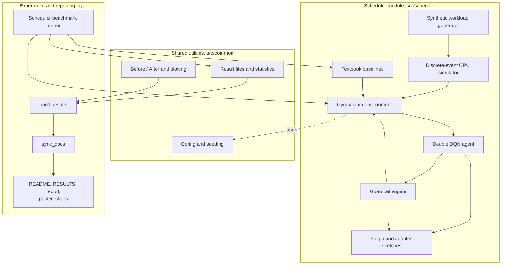
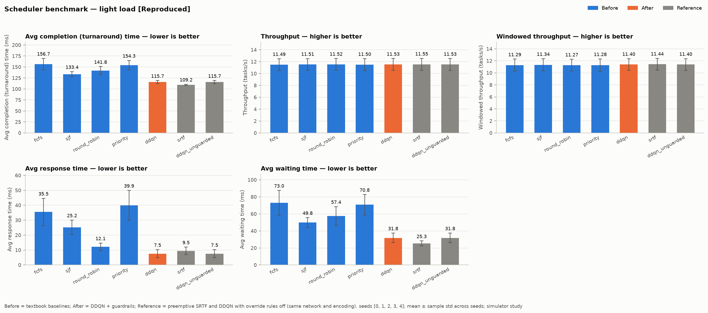
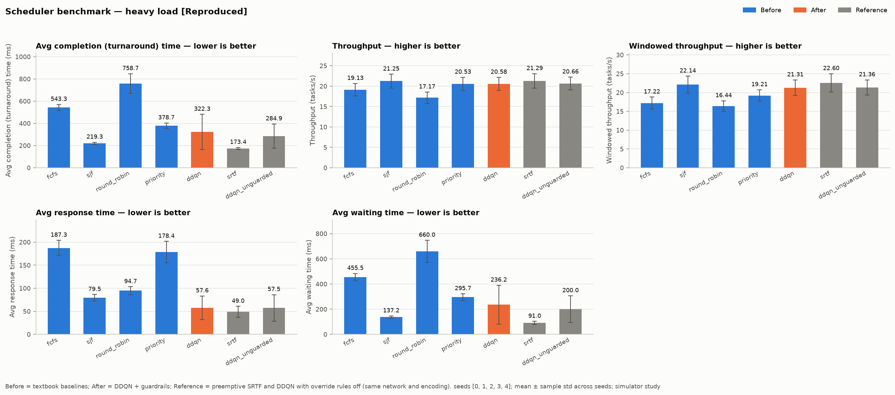
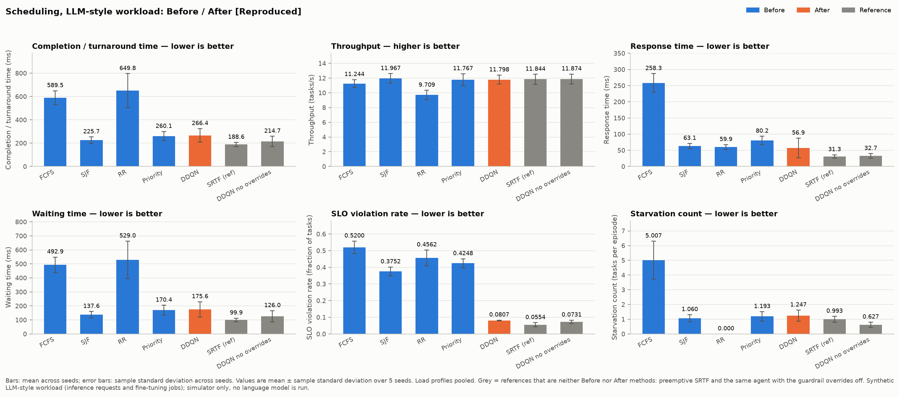
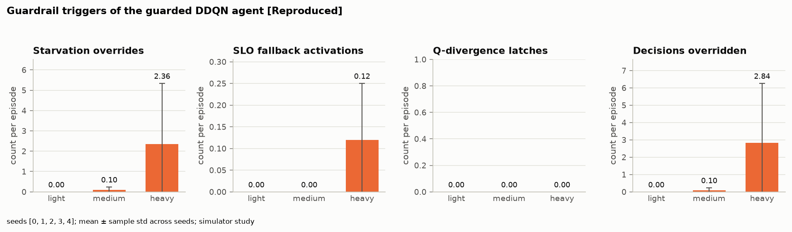

# Poster — Learned operating-system scheduling with guardrails: a reference implementation with a Before / After comparison

This file is the exact poster copy, ready to typeset, followed by the layout specification.
Everything between the section headings below is printed on the poster unless a paragraph is
marked *(not printed)*. Every reproduced number on the poster comes from a generated block; the
prose around the blocks states in words what the tables show.

---

## 1. Title block

**Title:** Learned Operating-System Scheduling with Guardrails: A Reference Implementation with
a Before / After Comparison

**Subtitle:** A complete, runnable, reproducible open-source implementation of a Double DQN
operating-system scheduler in a discrete-event simulator, with textbook baselines, a
preemptive reference, guardrails and a plugin interface sketch, for researchers who want to
try, benchmark and extend the method

**Author:** Fan Guo

**Status:** Draft reference implementation — values printed in the source paper are shown for reference only; see RESULTS.md for the values this code produces and the conditions under which it produces them.

*(not printed)* RESULTS.md is
[experiments/results/RESULTS.md](../../experiments/results/RESULTS.md); on the printed poster,
the QR code in section 10 leads to it.

---

## 2. Problem

Which task should run next on a CPU? Textbook rules each serve one goal: First-Come-First-Serve
(FCFS) is simple, Shortest Job First (SJF) keeps completion times short, Round Robin starts
every task quickly. A learned policy could adapt to the load, but it must also stay safe when
it misbehaves. This repository is a complete, runnable reference implementation of a Double
DQN scheduler, following the method described by Sun et al. (2025), with four textbook
baselines, a preemptive reference, guardrails, and a Before / After comparison measured under
one documented protocol: three load profiles, five reporting seeds held out from development,
and the same workloads for every method. The companion project `federated-privacy-adult` is a
separate repository with its own code and results; the two share the same direction and the
same reporting conventions.

---

## 3. Method in one diagram

**What to draw.** One diagram in three regions, matching
[docs/architecture/01-system-overview.md](../architecture/01-system-overview.md):

- **Top region, "Scheduler (simulator), src/scheduler".** A vertical chain of boxes:
  "Synthetic workload generator" → "Discrete-event CPU simulator" → "Gymnasium environment" →
  "Double DQN agent" → "Guardrail engine", with an arrow from the guardrail engine back to the
  environment labelled "executed decision". A box "Textbook baselines (FCFS, SJF, Round Robin,
  Priority; SRTF reference)" has an arrow into the environment and the note "no guardrails".
  A dashed box "Plugin and adapter sketches" receives arrows from the agent and the guardrail
  engine and carries the tag "sketch — not deployed".
- **Middle band, "Shared utilities, src/common".** Boxes "Config and seeding", "Result files
  and statistics", "Before / After and plotting", with a dashed arrow from the environment to
  "Config and seeding".
- **Bottom strip, "Reporting".** "Scheduler benchmark runner" → "build_results" →
  "sync_docs" → "README, RESULTS, report, poster, slides".
- Print under the diagram: "One simulated CPU, synthetic workloads, every method on the same
  workloads; no real operating system, no deployment and no large-language-model component in
  this draft."

The same diagram as rendered Mermaid source (for the digital version of the poster):

<!-- BEGIN GENERATED: diagram_system_overview -->

<!-- END GENERATED: diagram_system_overview -->

**Caption.** System overview of the repository. It shows modules and data flow; it does not
show a deployment, a real operating system or a real job queue, because none exists.

**The method in four lines (print as is).**

- *Simulator.* One CPU with CPU-bound, memory-bound and I/O-bound tasks, memory thrashing,
  context switches and I/O blocking; it agrees exactly with independent reference
  implementations that share no code with it, and those cross-checks are kept as tests.
- *Agent.* Standard Double DQN (van Hasselt et al., 2016) over a window of ready tasks ordered
  by aged priority, with masked actions: run a task for a short or long time slice or to the
  end of its burst, or change its priority.
- *Reward.* Waiting, time in system, response time and deadline misses are penalties;
  completions and utilisation earn a bonus.
- *Guardrails.* A Q-divergence latch, an SLO fallback to Round Robin and a starvation
  override filter every decision inside the environment step (section 8).

---

## 4. Key results panel 1 — Before / After, loads pooled

**Panel source label (print in the panel's top-right corner):** [Reproduced] — single-CPU
discrete-event simulator, synthetic workloads, light / medium / heavy load pooled, 5 reporting
seeds (0–4), mean ± sample standard deviation. [Reproduced] means obtained by running this
repository's code under these documented conditions; it does not mean that a number printed in
a paper was reproduced.

**Before** = the best of FCFS, SJF, Round Robin and Priority on each metric. **After** = Double
DQN with guardrails on.

<!-- BEGIN GENERATED: before_after_compact -->
Source label: [Reproduced]. Before = best of FCFS / SJF / Round Robin / Priority per metric; After = Double DQN (guardrails on).

| Metric | Before Method | Before Value | After Method | After Value | Delta (absolute) | Improvement % | Source Label |
|---|---|---|---|---|---|---|---|
| Completion / turnaround time | SJF | 178.0 ± 8.0 | Double DQN (guardrails on) | 198.2 ± 54.6 | +20.2 | -11.3% | [Reproduced] |
| Throughput | SJF | 16.468 ± 0.956 | Double DQN (guardrails on) | 16.216 ± 0.884 | -0.253 | -1.5% | [Reproduced] |
| Response time | Round Robin | 48.8 ± 7.6 | Double DQN (guardrails on) | 27.7 ± 10.3 | -21.0 | +43.1% | [Reproduced] |
| Waiting time | SJF | 94.9 ± 7.3 | Double DQN (guardrails on) | 113.4 ± 53.2 | +18.5 | -19.5% | [Reproduced] |
| SLO violation rate | SJF | 0.1539 ± 0.0174 | Double DQN (guardrails on) | 0.0828 ± 0.0270 | -0.0711 | +46.2% | [Reproduced] |
| Starvation count | Round Robin | 0.000 ± 0.000 | Double DQN (guardrails on) | 0.567 ± 0.629 | +0.567 | N/A — baseline zero / not comparable | [Reproduced] |

- Starvation count, Round Robin → Double DQN (guardrails on): Before is zero or near zero (|Before| <= 0.05 tasks per episode), so a percentage would be meaningless.

A positive Improvement % always means better after; a negative value is a regression.
<!-- END GENERATED: before_after_compact -->

A positive Improvement % always means better after; a negative value is a regression.

**Chart caption.** Mean over five seeds with sample standard deviation as error bars; blue =
Before baselines, orange = the Double DQN agent, grey = references that are not Before
methods (preemptive SRTF and the same agent with the guardrail overrides off). Simulator only,
synthetic workloads, one CPU; it does not show a real operating system or real jobs.

**Interpretation (print as is).** The comparison is mixed. Against the best baseline per
metric the agent is better on response time and on the SLO violation rate, and worse on
completion time and waiting time; the throughput difference is small and within the
seed-to-seed spread, and on starvation the agent starves some tasks while Round Robin starves
none, so that row has no percentage. The preemptive SRTF reference (grey), which is not a
Before method, is better than the agent on every metric shown here, which suggests that most
of the agent's advantage over SJF comes from being able to preempt, not from learning. Where
response time and deadlines matter most, the agent is a candidate research baseline, to be
compared with SRTF.

---

## 5. Key results panel 2 — By load, and the heavy-load tail

**Panel source label (top-right corner):** [Reproduced] — the same reference run as panel 1,
shown separately for the light and heavy load profiles, 5 reporting seeds (0–4), mean ±
sample standard deviation.

**Table (print as a pointer, not as a table).** The full Before / After table by load profile
(`before_after_by_load`: every baseline against the agent, six metrics, three loads) is too
long for the poster at the minimum table font size. Print instead: "Full table by load:
RESULTS.md, Before / After by load profile (QR code, section 10)." *(not printed: the table is
in [experiments/results/RESULTS.md](../../experiments/results/RESULTS.md).)*

**Chart caption.** Light load (top) and heavy load (bottom), same colours as panel 1; error
bars are the sample standard deviation over five seeds, and the y axes of the two charts have
different scales. Simulator only, synthetic workloads, one CPU, every method given the exact
length of the current CPU burst; it does not show a real operating system, and the medium
load, which behaves like the light load for turnaround, is in RESULTS.md.

**Interpretation (print as is).** In this implementation, with the documented configuration
and five seeds, the agent's average turnaround time is lower than SJF's at light and medium
load and higher at heavy load; pooled over the three loads it is higher, which is where the
pooled regression in panel 1 comes from. The heavy-load regression is a tail result: on most
heavy workloads the agent is competitive with SJF, and its median heavy-load turnaround is
below SJF's, but on a few workloads it takes more than twice as long as SJF, and those
workloads dominate its average and its wide error bar. The development seeds did not show
this; the held-out reporting seeds did. The preemptive SRTF reference has a lower average
turnaround than the agent at every load. A user who cares most about turnaround under heavy
load should prefer SJF or a preemptive shortest-remaining-time rule. *(not printed: the
per-workload distribution, the paired win counts and the five worst workloads are in the
generated block `tail_analysis` in RESULTS.md.)*

---

## 6. Key results panel 3 — The same benchmark on an LLM-style workload

**Panel source label (top-right corner):** [Reproduced] — the LLM-style workload profile
(`configs/scheduler_llm_workload.yaml`), same simulated node, load profiles, protocol and
seeds (0–4) as panels 1 and 2, light / medium / heavy load pooled, mean ± sample standard
deviation.

**What the workload is (print as is).** Two synthetic task classes shaped like the work of an
LLM platform: many short, latency-sensitive inference requests and a few long, memory-heavy
fine-tuning jobs, on one processor and one memory budget that stand in for one accelerator
node. No language model is run: the profile is a synthetic task mix, and none of its values was
measured on an LLM system.

<!-- BEGIN GENERATED: llm_before_after_compact -->
Source label: [Reproduced]. Workload: the LLM-style profile of `configs/scheduler_llm_workload.yaml` (synthetic inference requests and fine-tuning jobs on the simulated node; no language model is run). Before = best of FCFS / SJF / Round Robin / Priority per metric; After = Double DQN (guardrails on).

| Metric | Before Method | Before Value | After Method | After Value | Delta (absolute) | Improvement % | Source Label |
|---|---|---|---|---|---|---|---|
| Completion / turnaround time | SJF | 225.7 ± 27.3 | Double DQN (guardrails on) | 266.4 ± 58.1 | +40.7 | -18.0% | [Reproduced] |
| Throughput | SJF | 11.967 ± 0.636 | Double DQN (guardrails on) | 11.798 ± 0.618 | -0.169 | -1.4% | [Reproduced] |
| Response time | Round Robin | 59.9 ± 7.5 | Double DQN (guardrails on) | 56.9 ± 30.6 | -3.0 | +5.0% | [Reproduced] |
| Waiting time | SJF | 137.6 ± 22.3 | Double DQN (guardrails on) | 175.6 ± 53.7 | +38.0 | -27.6% | [Reproduced] |
| SLO violation rate | SJF | 0.3752 ± 0.0269 | Double DQN (guardrails on) | 0.0807 ± 0.0024 | -0.2946 | +78.5% | [Reproduced] |
| Starvation count | Round Robin | 0.000 ± 0.000 | Double DQN (guardrails on) | 1.247 ± 0.371 | +1.247 | N/A — baseline zero / not comparable | [Reproduced] |

- Starvation count, Round Robin → Double DQN (guardrails on): Before is zero or near zero (|Before| <= 0.05 tasks per episode), so a percentage would be meaningless.

A positive Improvement % always means better after; a negative value is a regression.
<!-- END GENERATED: llm_before_after_compact -->

**Chart caption.** Same colours and error bars as panel 1. Synthetic inference requests and
fine-tuning jobs on the simulated node; no language model, no real request and no trace.

**Interpretation (print as is).**

- *One clear gain.* The agent misses far fewer deadlines than each of the four baselines, at
  every load and above all for inference requests.
- *Regressions.* Pooled, its turnaround and waiting time are worse than SJF's (better at light
  and medium load, clearly worse at heavy load), fine-tuning jobs are worse off on every
  per-class metric, and it starves some tasks where Round Robin starves none.
- *Preemptive reference.* SRTF, which is not a Before method, is better than the agent on
  pooled turnaround, response time and deadline misses; with exact burst lengths and
  preemption allowed, it is the better choice on this mix.
- *Guardrails.* With the three override rules off, the same trained network had a lower
  turnaround at every load, and more tasks of both classes waited past the starvation
  threshold with the rules on than off. A post hoc variant that bounds the forced slice of the
  starvation override removed most of that cost; it is exploratory (one value, on seeds whose
  results had been seen) and changes no table here. Full table: RESULTS.md, section 4.8.

---

## 7. Design choices

**Box heading:** Design choices and why

| Design choice | What this implementation does | Why |
|---|---|---|
| Reward | Waiting, turnaround and response time are penalties; a completion earns a bonus | So that finishing work sooner earns more reward |
| Double DQN target | The online network selects the next action, the target network evaluates it | Limits over-estimation of action values |
| Guardrails | Three override rules filter the agent's decisions | So that a misbehaving policy is overridden by a simple rule |
| Paired workloads | Every method runs on the same workloads | So that differences are not due to different workloads |
| SRTF reference | Preemptive shortest-remaining-time is run next to the baselines | The agent may preempt and textbook SJF may not |
| Workload profiles | Task classes come from the config, so a workload profile is a YAML file; the LLM-style profile inherits everything else from the benchmark config | Another workload family can be studied without a code change, and the two studies differ only in the shape of the workload |

**Box text (print as is).** Every other setting (simulator, workload generator, load
profiles, state encoding, action set, reward weights, hyperparameters) is written down in the
configuration as [Assumption — not in paper]. An alternative sign convention for the
response-time term (response time is added instead of subtracted) is kept as the ablation
`reward_paper_sign_as_printed`; it raised response time and the SLO violation rate and left
turnaround within the seed-to-seed spread. Under heavy load the guardrails did not have their
intended effect (section 8).

---

## 8. Safety panel — guardrails and fallback

**Panel heading:** What overrides the agent, and what happened when it mattered

| Guardrail | Fires when | What runs instead | How it ends |
|---|---|---|---|
| Q-divergence latch | a Q-value is NaN, infinite or too large, or the network fails | the fallback baseline (Round Robin by default) | in the benchmark, at the end of the episode; in the plugin, only when an operator clears the latch |
| SLO fallback | 16 of the last 20 completions missed their deadline | Round Robin | after a fixed period |
| Starvation override | a ready task has waited at least the maximum wait | that task, until its burst ends | at the next decision |

**Precedence (print as is).** The latch replaces the agent, an active SLO fallback replaces
that, and the starvation override wins over both. Every decision in the plugin carries a
`decided_by` label (`agent`, `guardrail:starvation`, `guardrail:slo_fallback` or
`fallback:q_divergence`), and `health()` reports unhealthy while the latch is engaged.

**What the reference run showed (print as is).** Unit tests force each rule to fire,
override and release as specified. In the reference run the guardrails did not contain the
failure that actually occurred: at light load they never fired, at medium load they rarely
did, and in the agent's worst heavy-load workloads the overrides fired many times; on the
seeds that contain those workloads the guarded agent's heavy-load average was worse than that
of the same agent with the overrides off, and under heavy load its starvation count was higher
than the unguarded agent's, not lower. Under memory pressure both a forced dispatch and
Round Robin can make an overload worse. A fallback is only as good as the policy it falls back
to, so a team considering a learned scheduler must evaluate the fallback itself under the
overload it fears.

**Caption.** How often each override fired, per load profile, in the reference run. It shows
counts, not benefit, and it does not show any real platform.

---

## 9. Limitations

- The scheduler is a single-CPU simulator with synthetic workloads; no real operating system,
  job queue or trace was used, and the agent and the baselines both see the exact length of the
  current CPU burst, which a real system must estimate.
- The Double DQN result depends strongly on hyperparameters: several ablation variants did
  better than the default on the reporting seeds, and the default was deliberately not changed
  afterwards, because that would be tuning on the test set.
- The discount is applied once per decision, although decisions take different amounts of
  simulated time.
- The guardrails are shown by unit tests to fire as specified, but their benefit is not
  demonstrated by the benchmark.
- The plugin and the Kubernetes-style and Ray-style adapters are sketches: they translate
  dictionaries only, call no API and have never run on a cluster.
- Five seeds per condition; differences smaller than the seed-to-seed spread are not treated
  as observations.
- Not run, and therefore [Target / TBD]: any trace-driven or multi-CPU workload, estimated
  burst lengths, any real platform integration, any integrated demo and any
  large-language-model component.
- The LLM-style workload study runs no language model: its values are hand-chosen, not measured
  on an LLM system or fitted to a trace; time keeps the ratio between a request and a job, not
  production durations; one processor and one memory budget stand in for one node (no
  batching, no multiple accelerators); no retuning and none of the benchmark's ablations on the
  profile, and the one variant that was run is post hoc; an agent is
  trained per profile and transfer between profiles was not tested; five seeds, simulator only.

---

## 10. Repository and references

**Repository:** [fguo10-tech/ddqn-os-scheduling](https://github.com/fguo10-tech/ddqn-os-scheduling)

**References**

- Mnih, V., Kavukcuoglu, K., Silver, D., et al. (2015). Human-level control through deep
  reinforcement learning. Nature. https://doi.org/10.1038/nature14236
- Schrage, L. (1968). A Proof of the Optimality of the Shortest Remaining Processing Time
  Discipline. Operations Research. https://doi.org/10.1287/opre.16.3.687
- Silberschatz, A., Galvin, P. B., & Gagne, G. (2018). Operating System Concepts.
- Sun, X., Duan, Y., Deng, Y., Guo, F., Cai, G., & Peng, Y. (2025). Dynamic Operating System
  Scheduling Using Double DQN: A Reinforcement Learning Approach to Task Optimization. ICAACE
  2025, pp. 1492–1497. https://doi.org/10.1109/ICAACE65325.2025.11020551
- van Hasselt, H., Guez, A., & Silver, D. (2016). Deep Reinforcement Learning with Double
  Q-learning. AAAI 2016. https://doi.org/10.1609/aaai.v30i1.10295

---

## 11. Layout specification *(not printed)*

**Size.** A0 portrait, 841 × 1189 mm, with a 25 mm margin on every side and a 20 mm gutter
between columns. For a 48 × 36 inch landscape board (1219 × 914 mm), use the same sections in
four columns instead of three: column 1 holds sections 2, 3 and 7; column 2 holds section 4;
column 3 holds sections 5 and 6 (panel 2 shrinks to its two charts and its interpretation to
make room for panel 3 below it); column 4 holds sections 8, 9 and 10. Keep every font size
below.

**Grid (A0 portrait, three columns of about 250 mm, heights approximate).**

| Row | Height | Column 1 | Column 2 | Column 3 |
|---|---|---|---|---|
| A | 130 mm | Section 1, title block and status banner, spanning all three columns | | |
| B | 330 mm | Section 2, Problem (130 mm) and Section 7, Design choices (200 mm) | Section 3, Method in one diagram and the four method lines, spanning columns 2 and 3 | |
| C | 400 mm | Section 4, Results panel 1, spanning columns 1 and 2 (table above, chart below, interpretation at the bottom) | | Section 5, Results panel 2: pointer line, light-load and heavy-load charts stacked, interpretation (all of panel 2 now fits in this cell) |
| D | 200 mm | Section 6, Results panel 3, spanning columns 1 and 2 (table left, chart right, the four interpretation bullets below) | | Section 8, Safety panel, in one column (table above, trigger chart below, text at the bottom) |
| E | 150 mm | Section 9, Limitations, spanning columns 1 and 2 | | Section 10, QR code and references |

**Reading order.** Title → Problem → Method diagram → Results panel 1 → Results panel 2 →
Results panel 3 → Design choices → Safety panel → Limitations → QR code and references. Number
the section headings 1–10 on the poster so the order is visible, because the design-choices
box sits physically before the results panels in column 1. The first two results panels sit
side by side in row C so that a reader sees the pooled regression and its heavy-load source
together. Panel 3 takes the two-column cell of row D that the Safety panel used to hold, so
two panels shrink: panel 2 loses its continuation cell in column 3 (print its charts smaller,
never below the minimum font sizes), and the Safety panel moves into the single column 3 cell
of row D, with its table above its chart instead of beside it.

**Minimum font sizes (A0; scale by the same factor for other sizes).**

| Element | Minimum |
|---|---|
| Title | 90 pt |
| Section headings | 48 pt |
| Status banner | 32 pt |
| Body text and interpretation | 28 pt |
| Captions, source labels and the pointer line in panel 2 | 22 pt |
| Table text, including generated tables | 20 pt |
| Axis labels and value labels inside charts (export the charts at a size that reaches this) | 18 pt |
| References | 18 pt |

If a generated table does not fit at 20 pt, print the table at 20 pt across a wider area
rather than shrinking it; never drop rows, and never drop the Delta, Improvement % or Source
Label columns. The source label `[Reproduced]` must be visible in the top-right corner of
all three results panels and in the Source Label column of each table.

**Colour and accessibility.**

- **Before is always blue `#2a78d6` and After is always orange `#eb6834`, in all three
  results panels**, in the charts, in any table shading and in any legend chip. **Grey `#898781` marks
  references** that are neither Before nor After: the SRTF bar and the agent without
  guardrail overrides. The charts already use these colours; do not recolour them.
- **The status banner** is printed in black on a light grey band (`#f0efec` or lighter) across
  the full width of the title block, never in red or another alarm colour.
- **Never encode meaning by colour alone.** Every bar carries a printed method name on the
  axis, the chart legends print the words "Before", "After" and "Reference", every table has a
  Source Label column, and every regression is marked by the minus sign in the Improvement %
  column, never only by a red or green tint (do not tint table cells red or green).
- **Contrast.** Body text is black or near-black on a white or very light background, at least
  7:1. Coloured text is not used for body copy. Bar fills must reach at least 3:1 against the
  background (non-text contrast): against white, `#2a78d6` reaches about 4.4:1, `#eb6834`
  about 3.2:1 and `#898781` about 3.6:1, so keep a white or very light background behind every
  chart. Value labels on bars are printed in black above the bar, not inside it.
- **Colour-vision deficiency.** Blue and orange remain distinguishable under the common red–green
  deficiencies, but they have almost the same lightness, so they are hard to tell apart in
  greyscale and for some viewers with blue–yellow deficiency. Therefore always keep the printed
  method names on the axis, and in a greyscale print add a diagonal hatch to every After bar.
  Check the final file with a colour-vision-deficiency simulator before printing.
