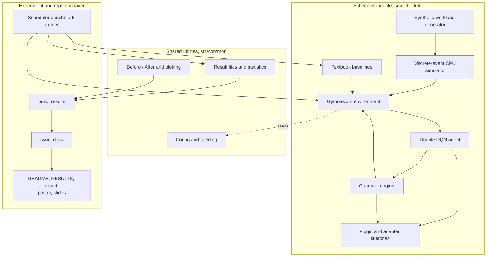
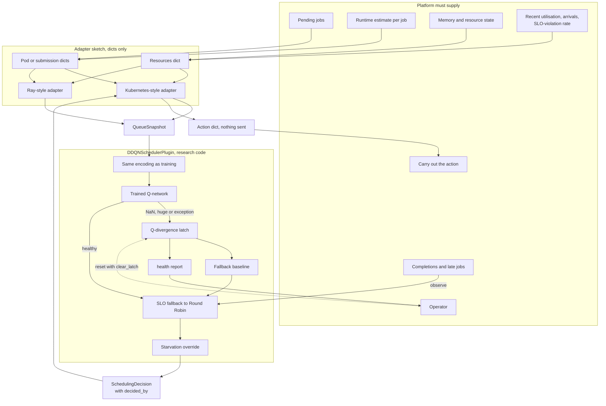
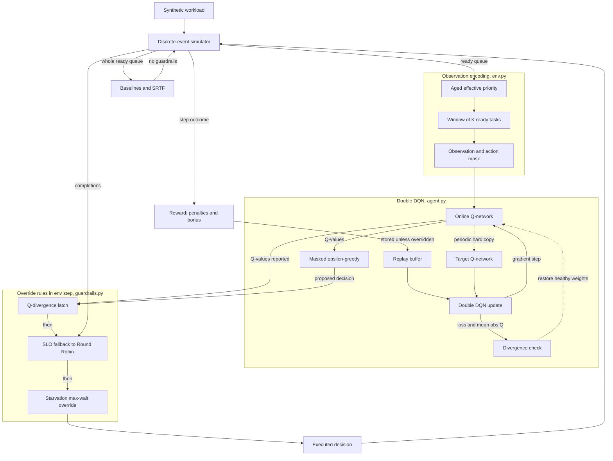
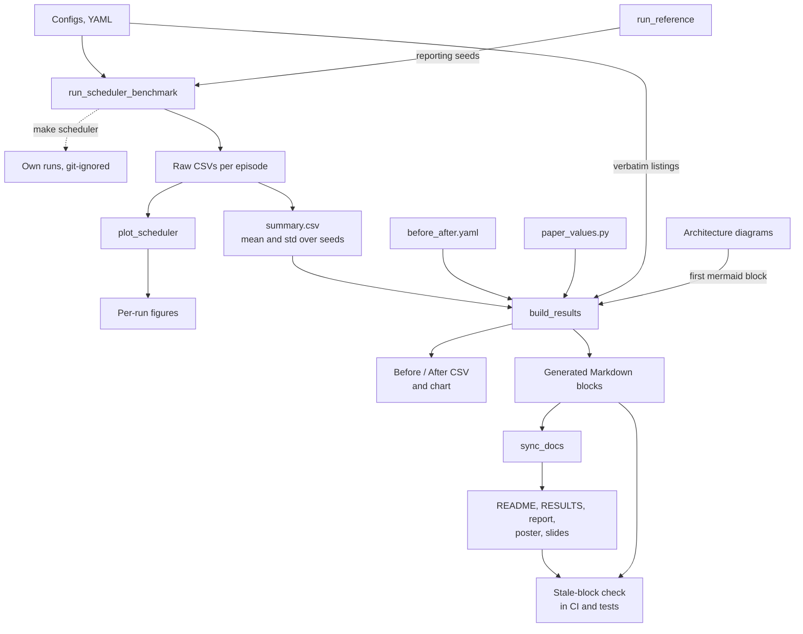
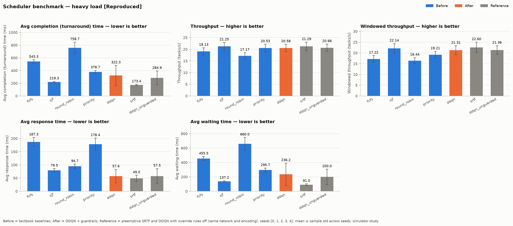
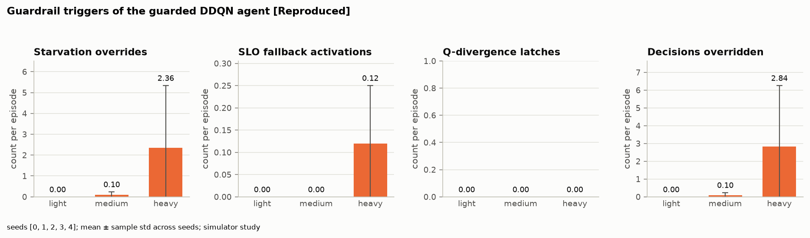
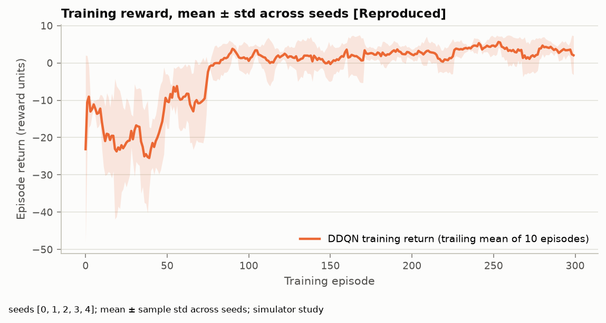
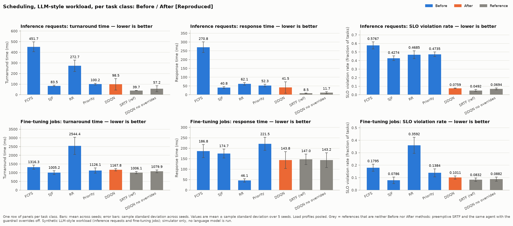

# DDQN OS Scheduling: a reference implementation of Double DQN operating-system scheduling with guardrails, with a Before / After comparison

The ddqn-os-scheduling contributors

Original draft date: 2024-11-19. This updated version removes citations and paper-reported values that were not part of the original draft. Several measured results are regressions against a baseline, and they are shown as such. Repository measurements are labelled `[Reproduced]` or `[Target / TBD]`, and every measured value appears only inside a generated block rebuilt from result files.

## Abstract

This report documents a reference implementation for researchers. The problem is deciding which task runs next on a CPU, under light to heavy load, with a learned policy that must stay safe. It studies a Double DQN scheduling policy under the simulation assumptions and evaluation protocol documented here. The companion project `federated-privacy-adult` is a separate repository with its own data, code and results; the two projects share the same direction and the same reporting conventions. The repository provides a runnable implementation with every setting written down as an explicit assumption, a set of baselines, guardrails, and a Before / After comparison measured under a paired, multi-seed protocol with documented conditions.

The repository contains a discrete-event single-CPU scheduling simulator (not a kernel modification) with synthetic workloads, four textbook baselines (FCFS, SJF, Round Robin, Priority), a preemptive shortest-remaining-burst reference (SRTF), a Double DQN agent whose reward treats response time as a penalty and which uses the standard `argmax` target, three runtime guardrails, and a plugin interface with job-queue adapter sketches. There is no real dataset: every workload is generated from a seed, and Chapter 7 explains why. The agent and the baselines that use burst lengths see the exact length of each task's current CPU burst, which a real system would have to estimate.

The measured results `[Reproduced]` include gains and regressions, and both are shown. In this implementation, with the documented configuration and five seeds, the agent's average turnaround time is lower than SJF's at light and medium load and higher at heavy load; pooled over the three loads it is higher, because on a few heavy-load workloads the agent's turnaround is far worse than SJF's. Pooled over the loads, the agent's response time and SLO violation rate are better than every baseline's; preemptive SRTF, a reference that is not a Before method, has a lower turnaround at every load; and the guardrails did not contain the heavy-load failure: under heavy load the guarded agent's average turnaround is higher than that of the same agent with the override rules off. The repository contains no large-language-model component.

The repository also runs the same benchmark on a second synthetic workload, the LLM-style workload profile: short inference requests and long, memory-heavy fine-tuning jobs on one simulated node. No language model is run in this study; the profile is a task mix for the scheduler, and none of its values was measured on an LLM system. On this profile the agent misses far fewer deadlines than each of the four textbook baselines, and almost all of that gain is in the inference requests. It does not improve the mean completion time: pooled over the loads its turnaround and waiting time are worse than SJF's, its turnaround is clearly worse than SJF's at heavy load, fine-tuning jobs are worse off, the SRTF reference is better still, and under heavy load the guardrail overrides made the agent worse (Section 8.7).

## Executive summary

**What was built.** A single Python package (`src`) with a scheduling sub-package, a shared utility layer, experiment runners, a reference run over the reporting seeds 0 to 4, and a documentation pipeline in which every measured number is generated from result files and injected into the documents by `python -m experiments.sync_docs`. The detailed raw tables are in [RESULTS.md](../../experiments/results/RESULTS.md); the step-by-step walk through the method and its results is [the topic guide](../../docs/investigations/01-ddqn-scheduling-reproduction.md).

**Scheduling results `[Reproduced]`.** The generated observations below summarise the benchmark. In this implementation, with the documented configuration and five seeds, the agent's average turnaround time is lower than SJF's at light and medium load and higher at heavy load; pooled over the three loads it is higher. Response time and the SLO violation rate are better than every baseline's on the pooled average. Read the list together with the tail analysis in Section 8.5: the heavy-load average is driven by a handful of workloads on which the agent performs far worse than SJF, which makes this a tail-risk result rather than a uniform loss. The preemptive SRTF reference, which has the same burst information and the same freedom to preempt as the agent and is not a Before method, has a lower turnaround than the agent at every load, and the comparison with SRTF measures what the learned policy contributes beyond preemption. The guardrails did not help under heavy load: there the guarded agent's average turnaround is higher than that of the same agent with the override rules off.

<!-- BEGIN GENERATED: findings -->
Load profiles pooled:

- **Completion / turnaround time** (lower is better): Double DQN (guardrails on) 198.2 ± 54.6 ms; best baseline SJF 178.0 ± 8.0 ms; Improvement -11.3% (worse). Better than 3 of 4 baselines with a computable percentage (FCFS, Round Robin, Priority). [Reproduced]
- **Throughput** (higher is better): Double DQN (guardrails on) 16.216 ± 0.884 tasks/s; best baseline SJF 16.468 ± 0.956 tasks/s; Improvement -1.5% (worse). Better than 3 of 4 baselines with a computable percentage (FCFS, Round Robin, Priority). [Reproduced]
- **Response time** (lower is better): Double DQN (guardrails on) 27.7 ± 10.3 ms; best baseline Round Robin 48.8 ± 7.6 ms; Improvement +43.1% (better). Better than 4 of 4 baselines with a computable percentage (FCFS, SJF, Round Robin, Priority). [Reproduced]
- **Waiting time** (lower is better): Double DQN (guardrails on) 113.4 ± 53.2 ms; best baseline SJF 94.9 ± 7.3 ms; Improvement -19.5% (worse). Better than 3 of 4 baselines with a computable percentage (FCFS, Round Robin, Priority). [Reproduced]
- **SLO violation rate** (lower is better): Double DQN (guardrails on) 0.0828 ± 0.0270 fraction of tasks; best baseline SJF 0.1539 ± 0.0174 fraction of tasks; Improvement +46.2% (better). Better than 4 of 4 baselines with a computable percentage (FCFS, SJF, Round Robin, Priority). [Reproduced]
- **Starvation count** (lower is better): Double DQN (guardrails on) 0.567 ± 0.629 tasks per episode; best baseline Round Robin 0.000 ± 0.000 tasks per episode; no percentage (N/A — baseline zero / not comparable). Better than 2 of 3 baselines with a computable percentage (FCFS, Priority). [Reproduced]
- Against the best baseline per metric, Double DQN (guardrails on) is better on 2 of 5 metrics with a computable percentage. [Reproduced]

Completion / turnaround time by load profile:

- light: Double DQN (guardrails on) 115.7 ± 3.4 ms; best baseline SJF 133.4 ± 6.0 ms; Improvement +13.3% (better). [Reproduced]
- medium: Double DQN (guardrails on) 156.6 ± 14.0 ms; best baseline SJF 181.4 ± 8.7 ms; Improvement +13.7% (better). [Reproduced]
- heavy: Double DQN (guardrails on) 322.3 ± 159.3 ms; best baseline SJF 219.3 ± 10.6 ms; Improvement -47.0% (worse). [Reproduced]

References that are not Before methods (pooled):

- SRTF (preemptive reference) — Completion / turnaround time: reference 139.5 ± 5.4 versus 198.2 ± 54.6 ms for Double DQN (guardrails on) (Double DQN (guardrails on) is 42.0% worse than the reference); Response time: reference 26.6 ± 4.7 versus 27.7 ± 10.3 ms for Double DQN (guardrails on) (Double DQN (guardrails on) is 4.5% worse than the reference); SLO violation rate: reference 0.0550 ± 0.0135 versus 0.0828 ± 0.0270 fraction of tasks for Double DQN (guardrails on) (Double DQN (guardrails on) is 50.6% worse than the reference). [Reproduced]
  - light: completion / turnaround time reference 109.2 ± 1.4 versus 115.7 ± 3.4 ms (Double DQN (guardrails on) is 6.0% worse than the reference).
  - medium: completion / turnaround time reference 136.0 ± 6.3 versus 156.6 ± 14.0 ms (Double DQN (guardrails on) is 15.1% worse than the reference).
  - heavy: completion / turnaround time reference 173.4 ± 9.9 versus 322.3 ± 159.3 ms (Double DQN (guardrails on) is 85.8% worse than the reference).
- Double DQN (guardrail overrides off) — Completion / turnaround time: reference 185.6 ± 38.7 versus 198.2 ± 54.6 ms for Double DQN (guardrails on) (Double DQN (guardrails on) is 6.8% worse than the reference); Response time: reference 27.7 ± 11.5 versus 27.7 ± 10.3 ms for Double DQN (guardrails on) (Double DQN (guardrails on) is 0.1% worse than the reference); SLO violation rate: reference 0.0815 ± 0.0279 versus 0.0828 ± 0.0270 fraction of tasks for Double DQN (guardrails on) (Double DQN (guardrails on) is 1.6% worse than the reference). [Reproduced]
  - light: completion / turnaround time reference 115.7 ± 3.4 versus 115.7 ± 3.4 ms (Double DQN (guardrails on) is 0.0% worse than the reference).
  - medium: completion / turnaround time reference 156.2 ± 14.4 versus 156.6 ± 14.0 ms (Double DQN (guardrails on) is 0.2% worse than the reference).
  - heavy: completion / turnaround time reference 284.9 ± 109.6 versus 322.3 ± 159.3 ms (Double DQN (guardrails on) is 13.1% worse than the reference).

- Plain throughput differs by at most 11.2% between the five compared methods (pooled). [Reproduced]
<!-- END GENERATED: findings -->

**LLM-style workload study `[Reproduced]`.** The same benchmark was also run on the LLM-style workload profile (`configs/scheduler_llm_workload.yaml`), which replaces the three task classes of the benchmark with two: short, latency-sensitive inference requests and long, memory-heavy fine-tuning jobs. No language model is run: the profile is a synthetic task mix shaped like the work of an LLM platform, and the single simulated processor and its memory budget stand in for one accelerator node. The agent misses far fewer deadlines than each of the four textbook baselines, at every load profile, and almost all of that gain is in the inference requests. The regressions are stated with it: pooled over the loads, the agent's turnaround and waiting time are worse than SJF's; it is better than SJF at light and medium load and clearly worse at heavy load; fine-tuning jobs are worse off than under the best baseline on every per-class metric; the SRTF reference is better than the agent on almost every metric; and under heavy load the guardrail overrides made the agent worse. Section 8.7 gives the tables and Section 9.6 the reading.

**Who it is for.** The primary audience is researchers who want to run, benchmark and extend a learned scheduler under a stated protocol: the simulator is checked against independent reference implementations, every method sees the same workloads, and every setting is in a configuration file. The secondary audience is platform and infrastructure engineers, for whom the `SchedulerPlugin` interface and the adapter sketches show what an integration would have to supply. Chapter 12 describes both routes.

**Related documents.** The [README](../../README.md) is the entry point; [the architecture documents](../architecture/README.md) explain the four diagrams; [the dataset cards](../../data/README.md) describe the synthetic workloads; the [poster](../poster/POSTER.md) and the [slides](../slides/PRESENTATION.md) summarise this report; and two notebooks walk through [the scheduler benchmark](../../notebooks/01_scheduler_reproduction.ipynb) and [the scheduler ablations](../../notebooks/02_scheduler_ablation.ipynb).

**What this does not show.** Nothing here was run on a real operating system or a real job queue. The workloads are synthetic, there is no real dataset, and the machine is a single simulated CPU. The LLM-style workload study runs no language model and uses no real request, prompt, user or trace data. The scheduler sees exact burst lengths, which a real system would have to estimate. Everything not run is `[Target / TBD]`.

## 1. Introduction

Machine learning is increasingly proposed as a replacement for hand-written policies inside computing systems, for example schedulers that learn which task to run next. The promise carries an obvious risk: a learned scheduler can behave well on average and badly in rare situations, and the rare situations are the ones an operator cares about. A reference implementation is useful to researchers here: an executable definition of the method with every setting written down, baselines run on the same inputs, a stated protocol, and a record of the conditions under which the method does well and the conditions under which it does not.

The project behind this codebase states its long-term aim in the following Proposed Endeavor paragraph, quoted verbatim:

> Design and implement advanced machine learning and large language model architectures for secure, reliable system-level optimization in order to enhance the efficiency, reliability, and security of U.S. digital infrastructure and accelerate the deployment of next-generation artificial intelligence (AI) applications.

The scope of this draft is deliberately much narrower than that paragraph. This repository addresses one part of it: machine learning for reliable scheduling with guardrails. It implements a reinforcement-learning scheduler in a simulator, together with the baselines and the runtime safeguards needed to judge it. It contains **no large-language-model component of any kind**: no language model is trained, fine-tuned, called or evaluated, and large language model architectures are listed only under planned work in Section 13. The repository still contains no large-language-model architecture; what it now has is a scheduling study on a synthetic LLM-style workload (Section 8.7), in which the same scheduler and baselines run on a task mix shaped like the inference requests and fine-tuning jobs of an LLM platform. That profile is a workload for the scheduler, not a language model: no language model is run, and none of its values was measured on an LLM system. Nothing in the repository is production-ready, and nothing has been deployed. The phrase "secure, reliable" in the quotation corresponds, in this draft, to two concrete things: runtime guardrails around a learned scheduling policy, with a record of how they behaved, and a refusal to report any result that has not been produced by the code under a stated protocol.

This repository is a reference implementation for researchers. Its contributions are the following.

1. **Documented settings for every part of the method.** The repository defines a complete Markov decision process over a discrete-event single-CPU simulator (a fixed-size window of ready tasks, a masked discrete action space of dispatch and priority actions, and a reward in which response time is a penalty) and the standard Double DQN target in which the online network selects and the target network evaluates. Every such setting is in a YAML file and tagged `[Assumption — not in paper]`, and an alternative sign convention for the response-time term is kept as a switchable ablation. Chapter 3 lists the design choices and the reason for each.
2. **Baselines and a paired evaluation.** Four textbook schedulers and a preemptive SRTF reference run on identical workloads per seed. Training workloads are disjoint from evaluation workloads, reporting seeds are held out from all tuning, and results are reported as mean and sample standard deviation over five seeds, with per-workload tail analysis and paired win counts.
3. **Guardrails in the step path.** A starvation override (with aging as part of the state encoding), an SLO fallback to Round Robin and a Q-divergence latch filter every decision of the agent, and the same engine sits behind a `SchedulerPlugin` interface with Kubernetes-style and Ray-style adapter sketches for platform engineers. The results chapter reports how the guardrails behaved, including where they did not help.
4. **A simulator checked against independent references.** Two test suites compare the simulator, step by step, with reference implementations that share no code with it, for the textbook setting and for the full model with I/O, memory pressure and context-switch costs (Section 5.1). A learned scheduler is only as meaningful as the simulator it is trained in, and this check is what allows the baselines to be read as the textbook policies they are named after.
5. **Before / After reporting with regressions shown.** A single build step turns result files into Before / After tables and charts, a synchronisation step injects them into every document, and a continuous-integration check fails when any table is stale, so a measured number cannot drift between documents. Every regression of the method under study appears in these tables as a negative Improvement %.

The rest of the report is organised as follows. Section 2 gives background. Section 3 lists the design choices and assumptions of this implementation, with the reason for each. Section 4 describes the system design. Section 5 formulates the problem (the simulator, the workloads and the decision process with its reward), and Section 6 describes the methods that act in it (the agent, the baselines with the SRTF reference, and the guardrails). Section 7 explains why there is no real dataset and states the protocol. Section 8 presents the results, including the same benchmark on the LLM-style workload profile (Section 8.7), Section 9 discusses what they show and when the method applies, Section 10 lists threats to validity, Section 11 covers ethics, privacy and safety, Section 12 describes how researchers and platform teams could adopt the code, and Section 13 sets out future work. Appendices hold configuration listings, file schemas, a glossary, a replication checklist and the reference list.

## 2. Background and related work

### 2.1 Operating-system scheduling

A CPU scheduler decides, whenever the processor becomes free, which ready task runs next and for how long. The textbook policies (Silberschatz et al., 2018) differ in the information they use and in whether they may interrupt a running task. *First-Come-First-Serve* (FCFS) runs tasks in arrival order until each CPU burst ends; it is simple and fair in arrival order but lets one long burst delay everything behind it. *Shortest Job First* (SJF) runs the task with the shortest next CPU burst to completion of that burst; it minimises mean waiting time among non-preemptive policies when burst lengths are known, but it needs those lengths and can starve long tasks. *Round Robin* gives each task a fixed quantum in turn, which bounds the time to first service and prevents starvation at the cost of many context switches and a long mean turnaround when work is plentiful. *Priority* scheduling runs the highest-priority task first and, without aging, can starve low-priority work.

A *turnaround time* (also called task completion time) is the time from a task's arrival to its completion; *response time* is the time from arrival to first dispatch; *waiting time* is the time a task spends ready but not running. For a single server and known job lengths, preemptive *Shortest Remaining Processing Time* minimises mean response time in the queueing sense, that is, mean time in system (Schrage, 1968). This classical result matters here: any learned single-CPU scheduler with exact burst information competes against a heuristic that is provably optimal for the mean time in system in the idealised case, and a learned policy that is allowed to preempt should be compared with a preemptive heuristic rather than only with non-preemptive SJF. The simulator in this repository is not the idealised model (it has I/O, memory pressure and context-switch costs), so optimality does not transfer exactly, but the textbook result explains why the SRTF reference is hard to beat.

### 2.2 DQN and Double DQN

Q-learning estimates the action value $Q(s,a)$, the expected discounted return of taking action $a$ in state $s$ and acting well afterwards (Sutton and Barto, 2018). Deep Q-networks (DQN) approximate $Q$ with a neural network trained on minibatches drawn from a replay buffer, towards a target computed with a periodically copied target network (Mnih et al., 2015). Because the target takes a maximum over noisy estimates, DQN overestimates action values. Double Q-learning (van Hasselt, 2010) and its deep variant, Double DQN (van Hasselt et al., 2016), decouple selection from evaluation: the online network chooses the maximising action and the target network supplies its value. Environments are commonly exposed through the Gymnasium interface (Towers et al., 2024), which this repository uses; the agent's networks are written in PyTorch (Paszke et al., 2019).

### 2.3 Learned schedulers

Reinforcement learning has been applied to resource management and cluster scheduling, for example by learning packing policies for multi-resource jobs (Mao et al., 2016), by learning scheduling policies for data-processing job graphs (Mao et al., 2019), and by deep reinforcement agents for high-performance computing batch schedulers (Fan et al., 2021; Fan et al., 2022). These systems work at the level of jobs and clusters, with real or trace-driven workloads. This implementation studies scheduling at the level of a single CPU and does not claim to compete with the cluster-level systems.

## 3. Design choices and assumptions

The table lists the main design choices of this implementation, what each one does and why it was made, with the section that describes it in detail. Every setting chosen by this repository is in a YAML file and tagged `[Assumption — not in paper]`; the configuration files are listed verbatim in Appendix A. The architectural decisions, with the alternative considered for each, are in Section 4.3.

| Design choice | What this implementation does | Why |
|---|---|---|
| Simulated machine | A discrete-event single-CPU simulator with I/O waits, a soft memory constraint and a context-switch cost (Section 5.1) | A single CPU keeps the decision process small and verifiable against independent reference implementations; the soft memory constraint lets overload happen and be measured |
| Workloads | Synthetic workloads generated from seeds, in three load profiles: light, medium and heavy (Chapter 7) | A seeded generator provides each task's bursts, I/O waits, memory, priority and deadline, produces new workloads on demand for training while the evaluation workloads stay fixed, and makes every workload reproducible from its seed |
| Learning mode | Online learning in the simulator, 300 episodes per seed, each episode's load profile drawn uniformly (Section 6.1) | — |
| State | The top ten ready tasks by effective priority, each with its own features, plus global features, every feature normalised by a constant from YAML (Section 5.2) | A fixed-size window gives a fixed `Discrete` action space that standard DQN can use; tasks outside the window are invisible to the agent |
| Actions | A masked discrete space of dispatch actions (three time slices per slot) and priority actions, with at most two consecutive priority actions per dispatch (Section 5.2) | The masks exclude empty slots and out-of-range priorities, and the limit on priority actions keeps the agent from looping on free actions |
| Reward | Waiting, turnaround and response time and deadline misses are penalties, and a completed task earns a bonus; an alternative sign convention for the response-time term is kept as the ablation `reward_paper_sign_as_printed` (Section 5.3) | Finishing work sooner earns more reward; summed over an episode, the turnaround term equals the sum of all turnaround times, so it targets the average turnaround directly |
| Double DQN target | The online network selects the next action by `argmax` over valid actions and the target network evaluates it (Section 6.1) | Decoupling selection from evaluation limits over-estimation of action values |
| Q-network | A slot-shared network that scores every slot with the same weights; a plain MLP is the ablation `network_mlp` (Section 6.1) | A rule such as "prefer the shortest burst" is learned once for all slots; on development seeds it learned a shortest-first ordering quickly |
| Hyperparameters | Every value in `configs/scheduler_ddqn.yaml`, chosen on development seeds 100 to 104 and never on the reporting seeds 0 to 4 (Section 7.3) | The reported default is then a held-out estimate of the method as configured before the test |
| Guardrails | A starvation override, an SLO fallback to Round Robin and a Q-divergence latch filter every decision of the agent, in training, evaluation and the plugin; overridden transitions are not stored (Section 6.3) | A misbehaving policy is overridden by a simple rule; the agent's experience is shaped by the guardrails it will run with, and a stored action must be the one that produced the next state |
| Baselines | FCFS, SJF, Round Robin and Priority with documented tie-breaking, all on the whole ready queue (Section 6.2) | Textbook policies that differ in the information they use and in whether they may interrupt a running task |
| SRTF reference | A preemptive shortest-remaining-burst rule with the agent's shortest slice, reported next to the Before / After comparison but not as a Before method (Section 6.2) | The agent may preempt and textbook SJF may not; SRTF has the same information and the same freedom, so the gap to SRTF shows how much of any gain over SJF is just preemption |
| Evaluation protocol | Every method on the same paired workloads, ten per load profile and seed, over five reporting seeds; results per load profile and pooled (Section 7.2) | Differences between methods are not due to different workloads, and the per-load results show where the agent does well and where it does not |
| Throughput | Two definitions: completed tasks over the makespan, and tasks completed by the last arrival over the arrival span (Section 7.2) | In a stable queue, plain throughput depends mostly on the arrival rate and very little on the scheduler |
| Burst information | The agent, SJF and SRTF see the exact remaining length of each task's current CPU burst; total remaining work only in the ablation `oracle_total_remaining` (Section 5.4) | The oracle is the same for every method that uses burst lengths, which keeps the comparison fair; a real system would have to estimate it (Section 10.1) |
| Task classes | The task classes are the keys of `workload.task_types` in the config, in file order; the observation has one one-hot column per class (Section 5.1) | Another workload family can be studied without a code change |
| LLM-style workload profile | `configs/scheduler_llm_workload.yaml` inherits everything from `configs/scheduler_ddqn.yaml` and replaces only the task classes, with two classes: inference requests and fine-tuning jobs (Section 5.1) | The two studies then differ only in the shape of the workload |
| Per-class reporting | With `--class-metrics` the runner also writes turnaround, response, waiting, SLO violation rate, starvation count and longest wait per task class (Section 8.7) | A pooled average hides the trade between short requests and long jobs |
| Class-specific priorities in the profile | Inference requests are drawn on the two upper priority levels and fine-tuning jobs on the two lower levels (Section 5.1) | A platform marks interactive work as more urgent than batch work |

Four of these choices shape how the results in Chapter 8 should be read. The effect of the reward's sign convention can be read directly from the ablation table in Section 8.6. The per-load table in Section 8.3 is the one that shows where the agent does well and where it does not. Plain throughput is treated as weakly informative throughout Chapter 8. And the SRTF reference, which is not a Before method, is the most demanding comparison in this report.

## 4. System design

### 4.1 Architecture

The repository is one importable package, `src`, with two sub-packages and an experiment layer around them. `src/scheduler` holds the method: the workload generator (`tasks.py`), the discrete-event simulator (`simulator.py`), the Gymnasium environment and observation encoding (`env.py`), the reward (`reward.py`), the Double DQN agent (`agent.py`), the guardrail engine (`guardrails.py`), the baselines and the SRTF reference (`baselines.py`), the training and evaluation loops (`training.py`), episode metrics (`metrics.py`), configuration parsing (`config.py`), and the plugin interface with adapter sketches (`plugin.py`, `adapters.py`). `src/common` holds configuration loading, seed derivation, metric helpers, the Before / After computation, the reference values shown in Section 8.2 (`paper_values.py`), result I/O and plotting. The experiment scripts under `experiments/` run the benchmark (`run_scheduler_benchmark.py`), draw its figures (`plot_scheduler.py`), re-create the reference run (`run_reference.py`), build the generated tables (`build_results.py`), synchronise them into the documents (`sync_docs.py`) and execute the notebooks (`run_notebooks.py`). The diagram below is the generated system overview; the four architecture documents under [docs/architecture/](../architecture/01-system-overview.md) explain each diagram, list its assumptions and record the alternatives that were considered.

<!-- BEGIN GENERATED: diagram_system_overview -->

<!-- END GENERATED: diagram_system_overview -->

*Figure 1. System overview: the scheduler module, the shared utilities and the reporting pipeline. It shows module boundaries and data flow; it does not show any result, and the plugin and adapter sketches it draws have never run against a real platform.*

### 4.2 Interfaces

**`Policy`.** A structural protocol with a `name`, a `reset()` method and a `decide(view) -> Decision` method. A `SimView` is the read-only state at a decision point: the current time, the ready tasks as `TaskView` records (identifier, arrival time, current burst remaining, memory, priority, wait so far, ready-queue sequence number and similar fields) and machine-level quantities. A `Decision` is either `dispatch(task_id, time_slice_ms)`, where `None` means "until the burst ends", or `adjust_priority(task_id, ±1)`. FCFS, SJF, Round Robin, Priority and SRTF all implement this protocol.

**`SchedulerEnv`.** A Gymnasium environment around the simulator. `reset(seed, options)` generates a workload for a load profile; `step(action)` converts an action index into a `Decision`, passes it through the guardrail engine, executes what comes back, and returns the observation, the reward, the termination and truncation flags and an `info` dictionary with the action mask, the guardrail rule that fired and whether the decision was overridden. `step_decision(decision)` executes a decision directly and is how the baselines are run, without any guardrail filtering, through the same code path.

**`GuardrailEngine`.** A stateful filter between the agent and the simulator. The agent reports its Q-values before acting (`report_q_values`), the environment reports completions and whether each was late (`record_completions`), and `filter(view, proposed)` returns a `GuardrailResult` naming the decision to execute, the rule that produced it and whether it differs from the proposal.

**`SchedulerPlugin`.** A protocol for platform engineers with `reset()`, `decide(snapshot) -> SchedulingDecision`, `observe(feedback)` and `health()`. A `QueueSnapshot` carries one `JobView` per waiting job and a `ResourceState`. `DDQNSchedulerPlugin` converts the snapshot into a `SimView` and then calls exactly the functions the environment calls (`build_decision_state`, `action_to_decision` and the guardrail engine), so the observation is built by one code path and there is no train/serve skew; `tests/test_scheduler_plugin.py` checks that the plugin makes the same decisions as the agent inside the environment. `KubernetesStyleQueueAdapter` and `RayStyleQueueAdapter` translate plain dictionaries shaped like pending Pods or Ray job submissions into snapshots and decisions back into dictionaries. They import neither `kubernetes` nor `ray`, call no API and have never run against a cluster; they are adapter sketches, not production integrations. [The deployment sketch](../architecture/04-deployment-sketch.md) describes what a platform would have to supply.

The diagram below is the generated deployment sketch. It shows what a platform would have to supply to the plugin and the order in which the plugin's own safeguards act.

<!-- BEGIN GENERATED: diagram_deployment_sketch -->

<!-- END GENERATED: diagram_deployment_sketch -->

*Figure 2. Deployment sketch: the inputs a platform would have to supply, the adapter sketches that turn plain dictionaries into a `QueueSnapshot`, and the fallback rules inside `DDQNSchedulerPlugin`. It is a sketch: the adapters call no API, nothing is sent, and it has never run against a cluster. It does not show how a platform would carry out an action or estimate a runtime.*

### 4.3 Design decisions

The table records the main design decisions, the alternative that was considered for each, and the trade-off accepted.

| Decision | Alternative considered | Trade-off accepted |
|---|---|---|
| Single CPU in the simulator | Multi-core machine model | Keeps the MDP small and verifiable against reference implementations; results say nothing about multi-core load balancing |
| Soft memory constraint (thrashing slowdown when resident memory exceeds capacity) | Hard admission control that refuses tasks that do not fit | Lets overload happen and be measured, which is how the heavy-load failure mode was found; a real kernel would combine both |
| Window-based action space over the top K ready tasks | One action per task identifier, or a pointer network | A fixed `Discrete` space with masks that standard DQN can use; tasks outside the window are invisible to the agent, while baselines see the whole queue |
| Guardrails inside the environment step | Guardrails only at serving time | The same engine filters training, evaluation and the plugin, and overridden transitions are not stored; the agent's experience is shaped by the guardrails it will run with |
| `src` as the import package | A distinct import name such as `ddqn_os_scheduling` | Short imports and no rename during the draft phase; the name is generic, collides with any other project that also installs a package called `src` (one virtual environment per project avoids this), and would need changing before any release on a package index |
| Paired workloads derived from child seeds | Fixed workload files stored in the repository | Every method sees identical workloads without any data file, and any workload can be regenerated from its seed; the workloads exist only as long as the generator and its configuration do not change |
| Generated documentation blocks | Hand-typed result tables | A reproduced number cannot drift between documents and a stale table fails CI; prose must describe results in words, which makes some sentences longer |

## 5. Problem formulation: simulator, workloads and decision process

This chapter defines the problem that the agent and the baselines solve: the simulated machine, the workloads it runs, and the decision process that the agent sees, including its reward. Chapter 6 describes the methods that act in this problem. Every setting in this chapter and the next that this repository chose is tagged `[Assumption — not in paper]`; the values live in `configs/scheduler_ddqn.yaml` and `configs/scheduler_baselines.yaml`, which are listed verbatim in Appendix A.

### 5.1 Simulator and workloads

The simulator models one CPU. A *decision point* is any moment at which the CPU is free and at least one task is ready; exactly one decision is executed at each decision point. A dispatch runs a task for the chosen slice or until its current CPU burst ends. Each task alternates CPU bursts and I/O waits; while waiting for I/O it is blocked and does not compete for the CPU. A task's memory becomes resident on its first dispatch and is released when it finishes. When resident memory exceeds the configured capacity, execution slows down in proportion to the excess (a soft memory constraint that models thrashing), and the slowdown is fixed at dispatch time for the duration of the slice. Switching to a different task costs a fixed context-switch time; a priority adjustment costs a small overhead and runs nothing. Ties at equal timestamps are broken deterministically: arrivals first, then I/O returns, then the just-preempted task, each entry into the ready queue taking the next sequence number.

Workloads are synthetic. Each workload has between 40 and 60 tasks drawn from three types (CPU-bound, memory-bound, I/O-bound) with log-normal total CPU demand, a type-dependent number of I/O operations, uniform memory requirements and uniform static priorities over four levels. Inter-arrival times are exponential with a mean chosen so that the expected CPU utilisation equals the target of the load profile: 0.5 for light, 0.75 for medium and 0.95 for heavy load. Each task has a deadline equal to its arrival time plus a type-dependent multiple of its total CPU and I/O time plus a fixed slack; a completion after the deadline is an SLO violation. All these distributions are assumptions of this repository.

**Workload profiles.** The task classes are not fixed in the code. They are the keys of `workload.task_types` in the configuration, in file order, and the observation has one one-hot column per class, so the width of the observation depends on the number of classes. `workload.priority_level_weights` is either one list for all classes or one list per class. A configuration may inherit from another one, and a child configuration may list `replace_keys`, so that its mapping replaces the parent's instead of being merged into it. The benchmark configuration `configs/scheduler_ddqn.yaml` is unchanged by this mechanism, and its reference results were re-run after the change and are byte-identical.

**The LLM-style workload profile.** `configs/scheduler_llm_workload.yaml` inherits everything from `configs/scheduler_ddqn.yaml` (machine, load profiles, observation, actions, reward, guardrails, agent hyperparameters, training and evaluation protocol, seeds) and uses `replace_keys` to replace only the task classes. It has two classes. *Inference requests* are short, latency-sensitive tasks with one compute burst, sometimes two with a wait in between, a small memory footprint and a tight deadline. *Fine-tuning jobs* are long compute segments separated by data-loading or checkpoint waits, with a memory footprint that fills most of the simulated node and a loose deadline; two jobs held in memory at once can exceed the memory budget. Requests are drawn on the two upper priority levels and jobs on the two lower levels. The single processor and the memory budget of the simulator stand in for one accelerator node. Every value was chosen by hand to give the mix its shape and carries the tag `[Assumption — not in paper]`; none was measured on an LLM system or fitted to a trace, and no language model is run. Time is in simulator milliseconds: the profile keeps the ratio between a request and a job, not the absolute durations of a production system. The table below lists the settings of the two classes and the mix that the generator produced for the evaluation workloads; the full file is in Appendix A.4.

<!-- BEGIN GENERATED: llm_workload_profile -->
Every value in this table is read from `configs/scheduler_llm_workload.yaml`, where each key carries the tag `[Assumption — not in paper]`: the values were chosen by hand to give the mix its shape and were not measured on an LLM system or fitted to a trace. Machine: one processor, 4096 MB of memory, 0.5 ms per context switch (inherited from `configs/scheduler_ddqn.yaml`).

| Setting | Inference requests | Fine-tuning jobs |
|---|---|---|
| Config key under `workload.task_types` | `inference_request` | `finetune_job` |
| Share of tasks (mixture weight) | 0.85 | 0.15 |
| Compute demand per task | lognormal, median 12 ms, sigma 0.7, clipped to 2 to 80 ms | lognormal, median 250 ms, sigma 0.5, clipped to 80 to 800 ms |
| Waits inside a task | 0 to 1 | 1 to 4 |
| Length of one wait | 5 to 30 ms | 10 to 60 ms |
| Memory footprint | 64 to 512 MB | 1536 to 3072 MB |
| Deadline | arrival + 2 × (compute + waits) + 20 ms | arrival + 6 × (compute + waits) + 20 ms |
| Priority level weights (level 0 lowest) | [0, 0, 0.5, 0.5] | [0.5, 0.5, 0, 0] |

**The mix the generator produced** [Reproduced] — computed from the 150 evaluation workloads of the reporting seeds (0, 1, 2, 3, 4; 10 workloads per load profile and seed); `all` pools the load profiles. These are properties of the generated input, not results of a scheduler.

| Load profile | Task class | Tasks per workload | Share of tasks | Share of compute demand | Compute demand per task (ms) | Memory per task (MB) |
|---|---|---|---|---|---|---|
| light | Inference requests | 41.1 | 84.1% | 22.6% | 15.6 | 288 |
| light | Fine-tuning jobs | 7.7 | 15.9% | 77.4% | 285.0 | 2310 |
| medium | Inference requests | 43.1 | 85.1% | 23.3% | 15.1 | 287 |
| medium | Fine-tuning jobs | 7.5 | 14.9% | 76.7% | 285.2 | 2297 |
| heavy | Inference requests | 44.0 | 86.0% | 24.3% | 14.9 | 288 |
| heavy | Fine-tuning jobs | 7.1 | 14.0% | 75.7% | 286.9 | 2346 |
| all | Inference requests | 42.7 | 85.1% | 23.4% | 15.2 | 288 |
| all | Fine-tuning jobs | 7.5 | 14.9% | 76.6% | 285.7 | 2317 |
<!-- END GENERATED: llm_workload_profile -->

*Table. The two task classes of the LLM-style workload profile, as read from the configuration, and the mix of the generated evaluation workloads. It describes the synthetic input; it does not show any scheduling result.*

The simulator is verified against two independent reference implementations that share no code with it. `tests/test_scheduler_reference_crosscheck.py` checks the textbook setting (one burst per task, no I/O) for FCFS, SJF, Round Robin, Priority and SRTF on 1,500 random workloads, with exact agreement on every finish and first-dispatch time. `tests/test_scheduler_reference_full.py` checks I/O blocking, memory thrashing, context-switch cost, priority-adjust overhead, arbitrary time slices and a random policy, with agreement after every step on time, ready-queue order, resident memory, per-task waits, the accrual integrals the reward is built from, deadline misses, context switches and the episode metrics.

### 5.2 Decision process: state, actions and masks

This repository defines the following Markov decision process (MDP).

**State.** The observation is a flat vector of $G + K \times F$ features: $G$ global features (ready-queue length, blocked tasks, free memory fraction, recent CPU utilisation, total current-burst work of ready tasks, mean and maximum ready wait, SLO pressure, recent arrival rate and recent SLO-violation rate, and further fields listed in the table) and, for each of $K = 10$ slots, $F$ features of the task in that slot. The slots hold the top $K$ ready tasks ordered by effective priority (descending) and ready-queue sequence (ascending), where effective priority includes aging. Empty slots are zero. Every feature is normalised by a constant from YAML and clipped. The agent sees the exact remaining time of each visible task's *current* CPU burst, which is the same oracle the SJF and SRTF baselines use, but by default nothing about the task's future bursts; the total remaining CPU work is revealed only in the ablation `oracle_total_remaining`. The task type is visible as a one-hot feature, which is an indirect hint about future bursts that the baselines do not use. The full list of dimensions, generated from the same feature tables the code uses:

<!-- BEGIN GENERATED: scheduler_state_table -->
| Index | Name | Description | Normalisation | Constants (from YAML) |
|---:|---|---|---|---|
| 0 | `ready_queue_length` | number of READY tasks | / observation.count_norm | `observation.count_norm` = 10.0; then clipped to ±`observation.clip` = 10 |
| 1 | `blocked_tasks` | number of tasks blocked on I/O | / observation.count_norm | `observation.count_norm` = 10.0; then clipped to ±`observation.clip` = 10 |
| 2 | `free_memory_fraction` | 1 − resident / capacity (negative when over-committed) | clipped to [-1, 1] | then clipped to ±`observation.clip` = 10 |
| 3 | `recent_cpu_utilisation` | exponentially decaying busy fraction | none (already in [0, 1]) | then clipped to ±`observation.clip` = 10 |
| 4 | `ready_current_burst_work` | sum of the remaining current CPU bursts of READY tasks | / (observation.work_norm_ms × observation.count_norm) | `observation.work_norm_ms` = 100.0; `observation.count_norm` = 10.0; then clipped to ±`observation.clip` = 10 |
| 5 | `mean_ready_wait` | mean continuous waiting time of READY tasks | / observation.wait_norm_ms | `observation.wait_norm_ms` = 500.0; then clipped to ±`observation.clip` = 10 |
| 6 | `max_ready_wait` | max continuous waiting time of READY tasks | / observation.wait_norm_ms | `observation.wait_norm_ms` = 500.0; then clipped to ±`observation.clip` = 10 |
| 7 | `slo_pressure` | fraction of READY tasks with deadline slack below observation.slo_slack_threshold_ms | none (fraction) | then clipped to ±`observation.clip` = 10 |
| 8 | `recent_arrival_rate` | exponentially decaying arrival rate (tasks/s) | / observation.arrival_rate_norm_per_s | `observation.arrival_rate_norm_per_s` = 50.0; then clipped to ±`observation.clip` = 10 |
| 9 | `recent_slo_violation_rate` | late fraction of the last observation.recent_completions completions | none (fraction) | then clipped to ±`observation.clip` = 10 |
| 10 | `priority_adjust_budget` | remaining consecutive priority actions before a dispatch is forced | / actions.max_priority_adjusts_per_dispatch (0 if that is 0) | `actions.max_priority_adjusts_per_dispatch` = 2; then clipped to ±`observation.clip` = 10 |
| 11 | `slot0.occupied` | 1 if the slot holds a task (0 if the slot is empty) | none | then clipped to ±`observation.clip` = 10 |
| 12 | `slot0.current_burst_remaining` | remaining time of the current CPU burst (0 if the slot is empty) | / observation.work_norm_ms | `observation.work_norm_ms` = 100.0; then clipped to ±`observation.clip` = 10 |
| 13 | `slot0.memory_fraction` | memory request / capacity (0 if the slot is empty) | / machine.memory_capacity_mb | `machine.memory_capacity_mb` = 4096; then clipped to ±`observation.clip` = 10 |
| 14 | `slot0.started` | 1 if the task already holds its memory (0 if the slot is empty) | none | then clipped to ±`observation.clip` = 10 |
| 15 | `slot0.current_wait` | continuous waiting time in the ready queue (0 if the slot is empty) | / observation.wait_norm_ms | `observation.wait_norm_ms` = 500.0; then clipped to ±`observation.clip` = 10 |
| 16 | `slot0.time_in_system` | now − arrival (0 if the slot is empty) | / observation.wait_norm_ms | `observation.wait_norm_ms` = 500.0; then clipped to ±`observation.clip` = 10 |
| 17 | `slot0.effective_priority` | priority + agent offset + aging boost (0 if the slot is empty) | / (levels − 1 + aging max_boost when aging is on) | divisor = 6 (`machine.num_priority_levels` = 4, `guardrails.aging.max_boost` = 3 when aging is on); then clipped to ±`observation.clip` = 10 |
| 18 | `slot0.deadline_slack` | deadline − now − current burst remaining (− total remaining CPU with the oracle flag) (0 if the slot is empty) | / observation.slack_norm_ms | `observation.slack_norm_ms` = 500.0; then clipped to ±`observation.clip` = 10 |
| 19 | `slot0.type_cpu_bound` | 1 if the task is cpu-bound (0 if the slot is empty) | none (one-hot) | then clipped to ±`observation.clip` = 10 |
| 20 | `slot0.type_memory_bound` | 1 if the task is memory-bound (0 if the slot is empty) | none (one-hot) | then clipped to ±`observation.clip` = 10 |
| 21 | `slot0.type_io_bound` | 1 if the task is io-bound (0 if the slot is empty) | none (one-hot) | then clipped to ±`observation.clip` = 10 |
| 22 | `slot1.occupied` | 1 if the slot holds a task (0 if the slot is empty) | none | then clipped to ±`observation.clip` = 10 |
| 23 | `slot1.current_burst_remaining` | remaining time of the current CPU burst (0 if the slot is empty) | / observation.work_norm_ms | `observation.work_norm_ms` = 100.0; then clipped to ±`observation.clip` = 10 |
| 24 | `slot1.memory_fraction` | memory request / capacity (0 if the slot is empty) | / machine.memory_capacity_mb | `machine.memory_capacity_mb` = 4096; then clipped to ±`observation.clip` = 10 |
| 25 | `slot1.started` | 1 if the task already holds its memory (0 if the slot is empty) | none | then clipped to ±`observation.clip` = 10 |
| 26 | `slot1.current_wait` | continuous waiting time in the ready queue (0 if the slot is empty) | / observation.wait_norm_ms | `observation.wait_norm_ms` = 500.0; then clipped to ±`observation.clip` = 10 |
| 27 | `slot1.time_in_system` | now − arrival (0 if the slot is empty) | / observation.wait_norm_ms | `observation.wait_norm_ms` = 500.0; then clipped to ±`observation.clip` = 10 |
| 28 | `slot1.effective_priority` | priority + agent offset + aging boost (0 if the slot is empty) | / (levels − 1 + aging max_boost when aging is on) | divisor = 6 (`machine.num_priority_levels` = 4, `guardrails.aging.max_boost` = 3 when aging is on); then clipped to ±`observation.clip` = 10 |
| 29 | `slot1.deadline_slack` | deadline − now − current burst remaining (− total remaining CPU with the oracle flag) (0 if the slot is empty) | / observation.slack_norm_ms | `observation.slack_norm_ms` = 500.0; then clipped to ±`observation.clip` = 10 |
| 30 | `slot1.type_cpu_bound` | 1 if the task is cpu-bound (0 if the slot is empty) | none (one-hot) | then clipped to ±`observation.clip` = 10 |
| 31 | `slot1.type_memory_bound` | 1 if the task is memory-bound (0 if the slot is empty) | none (one-hot) | then clipped to ±`observation.clip` = 10 |
| 32 | `slot1.type_io_bound` | 1 if the task is io-bound (0 if the slot is empty) | none (one-hot) | then clipped to ±`observation.clip` = 10 |
| 33 | `slot2.occupied` | 1 if the slot holds a task (0 if the slot is empty) | none | then clipped to ±`observation.clip` = 10 |
| 34 | `slot2.current_burst_remaining` | remaining time of the current CPU burst (0 if the slot is empty) | / observation.work_norm_ms | `observation.work_norm_ms` = 100.0; then clipped to ±`observation.clip` = 10 |
| 35 | `slot2.memory_fraction` | memory request / capacity (0 if the slot is empty) | / machine.memory_capacity_mb | `machine.memory_capacity_mb` = 4096; then clipped to ±`observation.clip` = 10 |
| 36 | `slot2.started` | 1 if the task already holds its memory (0 if the slot is empty) | none | then clipped to ±`observation.clip` = 10 |
| 37 | `slot2.current_wait` | continuous waiting time in the ready queue (0 if the slot is empty) | / observation.wait_norm_ms | `observation.wait_norm_ms` = 500.0; then clipped to ±`observation.clip` = 10 |
| 38 | `slot2.time_in_system` | now − arrival (0 if the slot is empty) | / observation.wait_norm_ms | `observation.wait_norm_ms` = 500.0; then clipped to ±`observation.clip` = 10 |
| 39 | `slot2.effective_priority` | priority + agent offset + aging boost (0 if the slot is empty) | / (levels − 1 + aging max_boost when aging is on) | divisor = 6 (`machine.num_priority_levels` = 4, `guardrails.aging.max_boost` = 3 when aging is on); then clipped to ±`observation.clip` = 10 |
| 40 | `slot2.deadline_slack` | deadline − now − current burst remaining (− total remaining CPU with the oracle flag) (0 if the slot is empty) | / observation.slack_norm_ms | `observation.slack_norm_ms` = 500.0; then clipped to ±`observation.clip` = 10 |
| 41 | `slot2.type_cpu_bound` | 1 if the task is cpu-bound (0 if the slot is empty) | none (one-hot) | then clipped to ±`observation.clip` = 10 |
| 42 | `slot2.type_memory_bound` | 1 if the task is memory-bound (0 if the slot is empty) | none (one-hot) | then clipped to ±`observation.clip` = 10 |
| 43 | `slot2.type_io_bound` | 1 if the task is io-bound (0 if the slot is empty) | none (one-hot) | then clipped to ±`observation.clip` = 10 |
| 44 | `slot3.occupied` | 1 if the slot holds a task (0 if the slot is empty) | none | then clipped to ±`observation.clip` = 10 |
| 45 | `slot3.current_burst_remaining` | remaining time of the current CPU burst (0 if the slot is empty) | / observation.work_norm_ms | `observation.work_norm_ms` = 100.0; then clipped to ±`observation.clip` = 10 |
| 46 | `slot3.memory_fraction` | memory request / capacity (0 if the slot is empty) | / machine.memory_capacity_mb | `machine.memory_capacity_mb` = 4096; then clipped to ±`observation.clip` = 10 |
| 47 | `slot3.started` | 1 if the task already holds its memory (0 if the slot is empty) | none | then clipped to ±`observation.clip` = 10 |
| 48 | `slot3.current_wait` | continuous waiting time in the ready queue (0 if the slot is empty) | / observation.wait_norm_ms | `observation.wait_norm_ms` = 500.0; then clipped to ±`observation.clip` = 10 |
| 49 | `slot3.time_in_system` | now − arrival (0 if the slot is empty) | / observation.wait_norm_ms | `observation.wait_norm_ms` = 500.0; then clipped to ±`observation.clip` = 10 |
| 50 | `slot3.effective_priority` | priority + agent offset + aging boost (0 if the slot is empty) | / (levels − 1 + aging max_boost when aging is on) | divisor = 6 (`machine.num_priority_levels` = 4, `guardrails.aging.max_boost` = 3 when aging is on); then clipped to ±`observation.clip` = 10 |
| 51 | `slot3.deadline_slack` | deadline − now − current burst remaining (− total remaining CPU with the oracle flag) (0 if the slot is empty) | / observation.slack_norm_ms | `observation.slack_norm_ms` = 500.0; then clipped to ±`observation.clip` = 10 |
| 52 | `slot3.type_cpu_bound` | 1 if the task is cpu-bound (0 if the slot is empty) | none (one-hot) | then clipped to ±`observation.clip` = 10 |
| 53 | `slot3.type_memory_bound` | 1 if the task is memory-bound (0 if the slot is empty) | none (one-hot) | then clipped to ±`observation.clip` = 10 |
| 54 | `slot3.type_io_bound` | 1 if the task is io-bound (0 if the slot is empty) | none (one-hot) | then clipped to ±`observation.clip` = 10 |
| 55 | `slot4.occupied` | 1 if the slot holds a task (0 if the slot is empty) | none | then clipped to ±`observation.clip` = 10 |
| 56 | `slot4.current_burst_remaining` | remaining time of the current CPU burst (0 if the slot is empty) | / observation.work_norm_ms | `observation.work_norm_ms` = 100.0; then clipped to ±`observation.clip` = 10 |
| 57 | `slot4.memory_fraction` | memory request / capacity (0 if the slot is empty) | / machine.memory_capacity_mb | `machine.memory_capacity_mb` = 4096; then clipped to ±`observation.clip` = 10 |
| 58 | `slot4.started` | 1 if the task already holds its memory (0 if the slot is empty) | none | then clipped to ±`observation.clip` = 10 |
| 59 | `slot4.current_wait` | continuous waiting time in the ready queue (0 if the slot is empty) | / observation.wait_norm_ms | `observation.wait_norm_ms` = 500.0; then clipped to ±`observation.clip` = 10 |
| 60 | `slot4.time_in_system` | now − arrival (0 if the slot is empty) | / observation.wait_norm_ms | `observation.wait_norm_ms` = 500.0; then clipped to ±`observation.clip` = 10 |
| 61 | `slot4.effective_priority` | priority + agent offset + aging boost (0 if the slot is empty) | / (levels − 1 + aging max_boost when aging is on) | divisor = 6 (`machine.num_priority_levels` = 4, `guardrails.aging.max_boost` = 3 when aging is on); then clipped to ±`observation.clip` = 10 |
| 62 | `slot4.deadline_slack` | deadline − now − current burst remaining (− total remaining CPU with the oracle flag) (0 if the slot is empty) | / observation.slack_norm_ms | `observation.slack_norm_ms` = 500.0; then clipped to ±`observation.clip` = 10 |
| 63 | `slot4.type_cpu_bound` | 1 if the task is cpu-bound (0 if the slot is empty) | none (one-hot) | then clipped to ±`observation.clip` = 10 |
| 64 | `slot4.type_memory_bound` | 1 if the task is memory-bound (0 if the slot is empty) | none (one-hot) | then clipped to ±`observation.clip` = 10 |
| 65 | `slot4.type_io_bound` | 1 if the task is io-bound (0 if the slot is empty) | none (one-hot) | then clipped to ±`observation.clip` = 10 |
| 66 | `slot5.occupied` | 1 if the slot holds a task (0 if the slot is empty) | none | then clipped to ±`observation.clip` = 10 |
| 67 | `slot5.current_burst_remaining` | remaining time of the current CPU burst (0 if the slot is empty) | / observation.work_norm_ms | `observation.work_norm_ms` = 100.0; then clipped to ±`observation.clip` = 10 |
| 68 | `slot5.memory_fraction` | memory request / capacity (0 if the slot is empty) | / machine.memory_capacity_mb | `machine.memory_capacity_mb` = 4096; then clipped to ±`observation.clip` = 10 |
| 69 | `slot5.started` | 1 if the task already holds its memory (0 if the slot is empty) | none | then clipped to ±`observation.clip` = 10 |
| 70 | `slot5.current_wait` | continuous waiting time in the ready queue (0 if the slot is empty) | / observation.wait_norm_ms | `observation.wait_norm_ms` = 500.0; then clipped to ±`observation.clip` = 10 |
| 71 | `slot5.time_in_system` | now − arrival (0 if the slot is empty) | / observation.wait_norm_ms | `observation.wait_norm_ms` = 500.0; then clipped to ±`observation.clip` = 10 |
| 72 | `slot5.effective_priority` | priority + agent offset + aging boost (0 if the slot is empty) | / (levels − 1 + aging max_boost when aging is on) | divisor = 6 (`machine.num_priority_levels` = 4, `guardrails.aging.max_boost` = 3 when aging is on); then clipped to ±`observation.clip` = 10 |
| 73 | `slot5.deadline_slack` | deadline − now − current burst remaining (− total remaining CPU with the oracle flag) (0 if the slot is empty) | / observation.slack_norm_ms | `observation.slack_norm_ms` = 500.0; then clipped to ±`observation.clip` = 10 |
| 74 | `slot5.type_cpu_bound` | 1 if the task is cpu-bound (0 if the slot is empty) | none (one-hot) | then clipped to ±`observation.clip` = 10 |
| 75 | `slot5.type_memory_bound` | 1 if the task is memory-bound (0 if the slot is empty) | none (one-hot) | then clipped to ±`observation.clip` = 10 |
| 76 | `slot5.type_io_bound` | 1 if the task is io-bound (0 if the slot is empty) | none (one-hot) | then clipped to ±`observation.clip` = 10 |
| 77 | `slot6.occupied` | 1 if the slot holds a task (0 if the slot is empty) | none | then clipped to ±`observation.clip` = 10 |
| 78 | `slot6.current_burst_remaining` | remaining time of the current CPU burst (0 if the slot is empty) | / observation.work_norm_ms | `observation.work_norm_ms` = 100.0; then clipped to ±`observation.clip` = 10 |
| 79 | `slot6.memory_fraction` | memory request / capacity (0 if the slot is empty) | / machine.memory_capacity_mb | `machine.memory_capacity_mb` = 4096; then clipped to ±`observation.clip` = 10 |
| 80 | `slot6.started` | 1 if the task already holds its memory (0 if the slot is empty) | none | then clipped to ±`observation.clip` = 10 |
| 81 | `slot6.current_wait` | continuous waiting time in the ready queue (0 if the slot is empty) | / observation.wait_norm_ms | `observation.wait_norm_ms` = 500.0; then clipped to ±`observation.clip` = 10 |
| 82 | `slot6.time_in_system` | now − arrival (0 if the slot is empty) | / observation.wait_norm_ms | `observation.wait_norm_ms` = 500.0; then clipped to ±`observation.clip` = 10 |
| 83 | `slot6.effective_priority` | priority + agent offset + aging boost (0 if the slot is empty) | / (levels − 1 + aging max_boost when aging is on) | divisor = 6 (`machine.num_priority_levels` = 4, `guardrails.aging.max_boost` = 3 when aging is on); then clipped to ±`observation.clip` = 10 |
| 84 | `slot6.deadline_slack` | deadline − now − current burst remaining (− total remaining CPU with the oracle flag) (0 if the slot is empty) | / observation.slack_norm_ms | `observation.slack_norm_ms` = 500.0; then clipped to ±`observation.clip` = 10 |
| 85 | `slot6.type_cpu_bound` | 1 if the task is cpu-bound (0 if the slot is empty) | none (one-hot) | then clipped to ±`observation.clip` = 10 |
| 86 | `slot6.type_memory_bound` | 1 if the task is memory-bound (0 if the slot is empty) | none (one-hot) | then clipped to ±`observation.clip` = 10 |
| 87 | `slot6.type_io_bound` | 1 if the task is io-bound (0 if the slot is empty) | none (one-hot) | then clipped to ±`observation.clip` = 10 |
| 88 | `slot7.occupied` | 1 if the slot holds a task (0 if the slot is empty) | none | then clipped to ±`observation.clip` = 10 |
| 89 | `slot7.current_burst_remaining` | remaining time of the current CPU burst (0 if the slot is empty) | / observation.work_norm_ms | `observation.work_norm_ms` = 100.0; then clipped to ±`observation.clip` = 10 |
| 90 | `slot7.memory_fraction` | memory request / capacity (0 if the slot is empty) | / machine.memory_capacity_mb | `machine.memory_capacity_mb` = 4096; then clipped to ±`observation.clip` = 10 |
| 91 | `slot7.started` | 1 if the task already holds its memory (0 if the slot is empty) | none | then clipped to ±`observation.clip` = 10 |
| 92 | `slot7.current_wait` | continuous waiting time in the ready queue (0 if the slot is empty) | / observation.wait_norm_ms | `observation.wait_norm_ms` = 500.0; then clipped to ±`observation.clip` = 10 |
| 93 | `slot7.time_in_system` | now − arrival (0 if the slot is empty) | / observation.wait_norm_ms | `observation.wait_norm_ms` = 500.0; then clipped to ±`observation.clip` = 10 |
| 94 | `slot7.effective_priority` | priority + agent offset + aging boost (0 if the slot is empty) | / (levels − 1 + aging max_boost when aging is on) | divisor = 6 (`machine.num_priority_levels` = 4, `guardrails.aging.max_boost` = 3 when aging is on); then clipped to ±`observation.clip` = 10 |
| 95 | `slot7.deadline_slack` | deadline − now − current burst remaining (− total remaining CPU with the oracle flag) (0 if the slot is empty) | / observation.slack_norm_ms | `observation.slack_norm_ms` = 500.0; then clipped to ±`observation.clip` = 10 |
| 96 | `slot7.type_cpu_bound` | 1 if the task is cpu-bound (0 if the slot is empty) | none (one-hot) | then clipped to ±`observation.clip` = 10 |
| 97 | `slot7.type_memory_bound` | 1 if the task is memory-bound (0 if the slot is empty) | none (one-hot) | then clipped to ±`observation.clip` = 10 |
| 98 | `slot7.type_io_bound` | 1 if the task is io-bound (0 if the slot is empty) | none (one-hot) | then clipped to ±`observation.clip` = 10 |
| 99 | `slot8.occupied` | 1 if the slot holds a task (0 if the slot is empty) | none | then clipped to ±`observation.clip` = 10 |
| 100 | `slot8.current_burst_remaining` | remaining time of the current CPU burst (0 if the slot is empty) | / observation.work_norm_ms | `observation.work_norm_ms` = 100.0; then clipped to ±`observation.clip` = 10 |
| 101 | `slot8.memory_fraction` | memory request / capacity (0 if the slot is empty) | / machine.memory_capacity_mb | `machine.memory_capacity_mb` = 4096; then clipped to ±`observation.clip` = 10 |
| 102 | `slot8.started` | 1 if the task already holds its memory (0 if the slot is empty) | none | then clipped to ±`observation.clip` = 10 |
| 103 | `slot8.current_wait` | continuous waiting time in the ready queue (0 if the slot is empty) | / observation.wait_norm_ms | `observation.wait_norm_ms` = 500.0; then clipped to ±`observation.clip` = 10 |
| 104 | `slot8.time_in_system` | now − arrival (0 if the slot is empty) | / observation.wait_norm_ms | `observation.wait_norm_ms` = 500.0; then clipped to ±`observation.clip` = 10 |
| 105 | `slot8.effective_priority` | priority + agent offset + aging boost (0 if the slot is empty) | / (levels − 1 + aging max_boost when aging is on) | divisor = 6 (`machine.num_priority_levels` = 4, `guardrails.aging.max_boost` = 3 when aging is on); then clipped to ±`observation.clip` = 10 |
| 106 | `slot8.deadline_slack` | deadline − now − current burst remaining (− total remaining CPU with the oracle flag) (0 if the slot is empty) | / observation.slack_norm_ms | `observation.slack_norm_ms` = 500.0; then clipped to ±`observation.clip` = 10 |
| 107 | `slot8.type_cpu_bound` | 1 if the task is cpu-bound (0 if the slot is empty) | none (one-hot) | then clipped to ±`observation.clip` = 10 |
| 108 | `slot8.type_memory_bound` | 1 if the task is memory-bound (0 if the slot is empty) | none (one-hot) | then clipped to ±`observation.clip` = 10 |
| 109 | `slot8.type_io_bound` | 1 if the task is io-bound (0 if the slot is empty) | none (one-hot) | then clipped to ±`observation.clip` = 10 |
| 110 | `slot9.occupied` | 1 if the slot holds a task (0 if the slot is empty) | none | then clipped to ±`observation.clip` = 10 |
| 111 | `slot9.current_burst_remaining` | remaining time of the current CPU burst (0 if the slot is empty) | / observation.work_norm_ms | `observation.work_norm_ms` = 100.0; then clipped to ±`observation.clip` = 10 |
| 112 | `slot9.memory_fraction` | memory request / capacity (0 if the slot is empty) | / machine.memory_capacity_mb | `machine.memory_capacity_mb` = 4096; then clipped to ±`observation.clip` = 10 |
| 113 | `slot9.started` | 1 if the task already holds its memory (0 if the slot is empty) | none | then clipped to ±`observation.clip` = 10 |
| 114 | `slot9.current_wait` | continuous waiting time in the ready queue (0 if the slot is empty) | / observation.wait_norm_ms | `observation.wait_norm_ms` = 500.0; then clipped to ±`observation.clip` = 10 |
| 115 | `slot9.time_in_system` | now − arrival (0 if the slot is empty) | / observation.wait_norm_ms | `observation.wait_norm_ms` = 500.0; then clipped to ±`observation.clip` = 10 |
| 116 | `slot9.effective_priority` | priority + agent offset + aging boost (0 if the slot is empty) | / (levels − 1 + aging max_boost when aging is on) | divisor = 6 (`machine.num_priority_levels` = 4, `guardrails.aging.max_boost` = 3 when aging is on); then clipped to ±`observation.clip` = 10 |
| 117 | `slot9.deadline_slack` | deadline − now − current burst remaining (− total remaining CPU with the oracle flag) (0 if the slot is empty) | / observation.slack_norm_ms | `observation.slack_norm_ms` = 500.0; then clipped to ±`observation.clip` = 10 |
| 118 | `slot9.type_cpu_bound` | 1 if the task is cpu-bound (0 if the slot is empty) | none (one-hot) | then clipped to ±`observation.clip` = 10 |
| 119 | `slot9.type_memory_bound` | 1 if the task is memory-bound (0 if the slot is empty) | none (one-hot) | then clipped to ±`observation.clip` = 10 |
| 120 | `slot9.type_io_bound` | 1 if the task is io-bound (0 if the slot is empty) | none (one-hot) | then clipped to ±`observation.clip` = 10 |
<!-- END GENERATED: scheduler_state_table -->

*Table. Every dimension of the scheduler observation, with its normalisation. It shows the encoding; it does not show how informative each feature is, which was not measured.*

**Actions.** With $J$ time slices ($J = 3$: 10 ms, 40 ms and "until the burst ends"), the action space is $\text{Discrete}(K J + 2K)$. Index $kJ + j$ means "dispatch the task in slot $k$ with slice $j$"; index $KJ + 2k + d$ means "raise ($d = 0$) or lower ($d = 1$) the priority offset of the task in slot $k$". An action is masked (invalid) when its slot is empty, when a priority change would leave the permitted range, or when two consecutive priority actions have already been taken since the last dispatch, so that the agent cannot loop on free actions. An invalid action passed to `step` is replaced by the first valid dispatch and penalised.

<!-- BEGIN GENERATED: scheduler_action_table -->
| Index | Family | Slot | Time slice (ms) / priority delta | Meaning | Masked when |
|---:|---|---:|---|---|---|
| 0 | DISPATCH | 0 | 10.0 | run slot 0 for 10.0 ms | slot 0 is empty |
| 1 | DISPATCH | 0 | 40.0 | run slot 0 for 40.0 ms | slot 0 is empty |
| 2 | DISPATCH | 0 | until burst ends | run slot 0 until its burst ends | slot 0 is empty |
| 3 | DISPATCH | 1 | 10.0 | run slot 1 for 10.0 ms | slot 1 is empty |
| 4 | DISPATCH | 1 | 40.0 | run slot 1 for 40.0 ms | slot 1 is empty |
| 5 | DISPATCH | 1 | until burst ends | run slot 1 until its burst ends | slot 1 is empty |
| 6 | DISPATCH | 2 | 10.0 | run slot 2 for 10.0 ms | slot 2 is empty |
| 7 | DISPATCH | 2 | 40.0 | run slot 2 for 40.0 ms | slot 2 is empty |
| 8 | DISPATCH | 2 | until burst ends | run slot 2 until its burst ends | slot 2 is empty |
| 9 | DISPATCH | 3 | 10.0 | run slot 3 for 10.0 ms | slot 3 is empty |
| 10 | DISPATCH | 3 | 40.0 | run slot 3 for 40.0 ms | slot 3 is empty |
| 11 | DISPATCH | 3 | until burst ends | run slot 3 until its burst ends | slot 3 is empty |
| 12 | DISPATCH | 4 | 10.0 | run slot 4 for 10.0 ms | slot 4 is empty |
| 13 | DISPATCH | 4 | 40.0 | run slot 4 for 40.0 ms | slot 4 is empty |
| 14 | DISPATCH | 4 | until burst ends | run slot 4 until its burst ends | slot 4 is empty |
| 15 | DISPATCH | 5 | 10.0 | run slot 5 for 10.0 ms | slot 5 is empty |
| 16 | DISPATCH | 5 | 40.0 | run slot 5 for 40.0 ms | slot 5 is empty |
| 17 | DISPATCH | 5 | until burst ends | run slot 5 until its burst ends | slot 5 is empty |
| 18 | DISPATCH | 6 | 10.0 | run slot 6 for 10.0 ms | slot 6 is empty |
| 19 | DISPATCH | 6 | 40.0 | run slot 6 for 40.0 ms | slot 6 is empty |
| 20 | DISPATCH | 6 | until burst ends | run slot 6 until its burst ends | slot 6 is empty |
| 21 | DISPATCH | 7 | 10.0 | run slot 7 for 10.0 ms | slot 7 is empty |
| 22 | DISPATCH | 7 | 40.0 | run slot 7 for 40.0 ms | slot 7 is empty |
| 23 | DISPATCH | 7 | until burst ends | run slot 7 until its burst ends | slot 7 is empty |
| 24 | DISPATCH | 8 | 10.0 | run slot 8 for 10.0 ms | slot 8 is empty |
| 25 | DISPATCH | 8 | 40.0 | run slot 8 for 40.0 ms | slot 8 is empty |
| 26 | DISPATCH | 8 | until burst ends | run slot 8 until its burst ends | slot 8 is empty |
| 27 | DISPATCH | 9 | 10.0 | run slot 9 for 10.0 ms | slot 9 is empty |
| 28 | DISPATCH | 9 | 40.0 | run slot 9 for 40.0 ms | slot 9 is empty |
| 29 | DISPATCH | 9 | until burst ends | run slot 9 until its burst ends | slot 9 is empty |
| 30 | PRIORITY | 0 | +1 | raise priority of slot 0 | slot 0 is empty; or the task's priority + offset is already 3 (range 0..3, `machine.num_priority_levels`); or 2 consecutive priority actions were taken since the last dispatch (`actions.max_priority_adjusts_per_dispatch`) |
| 31 | PRIORITY | 0 | -1 | lower priority of slot 0 | slot 0 is empty; or the task's priority + offset is already 0 (range 0..3, `machine.num_priority_levels`); or 2 consecutive priority actions were taken since the last dispatch (`actions.max_priority_adjusts_per_dispatch`) |
| 32 | PRIORITY | 1 | +1 | raise priority of slot 1 | slot 1 is empty; or the task's priority + offset is already 3 (range 0..3, `machine.num_priority_levels`); or 2 consecutive priority actions were taken since the last dispatch (`actions.max_priority_adjusts_per_dispatch`) |
| 33 | PRIORITY | 1 | -1 | lower priority of slot 1 | slot 1 is empty; or the task's priority + offset is already 0 (range 0..3, `machine.num_priority_levels`); or 2 consecutive priority actions were taken since the last dispatch (`actions.max_priority_adjusts_per_dispatch`) |
| 34 | PRIORITY | 2 | +1 | raise priority of slot 2 | slot 2 is empty; or the task's priority + offset is already 3 (range 0..3, `machine.num_priority_levels`); or 2 consecutive priority actions were taken since the last dispatch (`actions.max_priority_adjusts_per_dispatch`) |
| 35 | PRIORITY | 2 | -1 | lower priority of slot 2 | slot 2 is empty; or the task's priority + offset is already 0 (range 0..3, `machine.num_priority_levels`); or 2 consecutive priority actions were taken since the last dispatch (`actions.max_priority_adjusts_per_dispatch`) |
| 36 | PRIORITY | 3 | +1 | raise priority of slot 3 | slot 3 is empty; or the task's priority + offset is already 3 (range 0..3, `machine.num_priority_levels`); or 2 consecutive priority actions were taken since the last dispatch (`actions.max_priority_adjusts_per_dispatch`) |
| 37 | PRIORITY | 3 | -1 | lower priority of slot 3 | slot 3 is empty; or the task's priority + offset is already 0 (range 0..3, `machine.num_priority_levels`); or 2 consecutive priority actions were taken since the last dispatch (`actions.max_priority_adjusts_per_dispatch`) |
| 38 | PRIORITY | 4 | +1 | raise priority of slot 4 | slot 4 is empty; or the task's priority + offset is already 3 (range 0..3, `machine.num_priority_levels`); or 2 consecutive priority actions were taken since the last dispatch (`actions.max_priority_adjusts_per_dispatch`) |
| 39 | PRIORITY | 4 | -1 | lower priority of slot 4 | slot 4 is empty; or the task's priority + offset is already 0 (range 0..3, `machine.num_priority_levels`); or 2 consecutive priority actions were taken since the last dispatch (`actions.max_priority_adjusts_per_dispatch`) |
| 40 | PRIORITY | 5 | +1 | raise priority of slot 5 | slot 5 is empty; or the task's priority + offset is already 3 (range 0..3, `machine.num_priority_levels`); or 2 consecutive priority actions were taken since the last dispatch (`actions.max_priority_adjusts_per_dispatch`) |
| 41 | PRIORITY | 5 | -1 | lower priority of slot 5 | slot 5 is empty; or the task's priority + offset is already 0 (range 0..3, `machine.num_priority_levels`); or 2 consecutive priority actions were taken since the last dispatch (`actions.max_priority_adjusts_per_dispatch`) |
| 42 | PRIORITY | 6 | +1 | raise priority of slot 6 | slot 6 is empty; or the task's priority + offset is already 3 (range 0..3, `machine.num_priority_levels`); or 2 consecutive priority actions were taken since the last dispatch (`actions.max_priority_adjusts_per_dispatch`) |
| 43 | PRIORITY | 6 | -1 | lower priority of slot 6 | slot 6 is empty; or the task's priority + offset is already 0 (range 0..3, `machine.num_priority_levels`); or 2 consecutive priority actions were taken since the last dispatch (`actions.max_priority_adjusts_per_dispatch`) |
| 44 | PRIORITY | 7 | +1 | raise priority of slot 7 | slot 7 is empty; or the task's priority + offset is already 3 (range 0..3, `machine.num_priority_levels`); or 2 consecutive priority actions were taken since the last dispatch (`actions.max_priority_adjusts_per_dispatch`) |
| 45 | PRIORITY | 7 | -1 | lower priority of slot 7 | slot 7 is empty; or the task's priority + offset is already 0 (range 0..3, `machine.num_priority_levels`); or 2 consecutive priority actions were taken since the last dispatch (`actions.max_priority_adjusts_per_dispatch`) |
| 46 | PRIORITY | 8 | +1 | raise priority of slot 8 | slot 8 is empty; or the task's priority + offset is already 3 (range 0..3, `machine.num_priority_levels`); or 2 consecutive priority actions were taken since the last dispatch (`actions.max_priority_adjusts_per_dispatch`) |
| 47 | PRIORITY | 8 | -1 | lower priority of slot 8 | slot 8 is empty; or the task's priority + offset is already 0 (range 0..3, `machine.num_priority_levels`); or 2 consecutive priority actions were taken since the last dispatch (`actions.max_priority_adjusts_per_dispatch`) |
| 48 | PRIORITY | 9 | +1 | raise priority of slot 9 | slot 9 is empty; or the task's priority + offset is already 3 (range 0..3, `machine.num_priority_levels`); or 2 consecutive priority actions were taken since the last dispatch (`actions.max_priority_adjusts_per_dispatch`) |
| 49 | PRIORITY | 9 | -1 | lower priority of slot 9 | slot 9 is empty; or the task's priority + offset is already 0 (range 0..3, `machine.num_priority_levels`); or 2 consecutive priority actions were taken since the last dispatch (`actions.max_priority_adjusts_per_dispatch`) |
<!-- END GENERATED: scheduler_action_table -->

*Table. Every action index, its meaning and its masking condition. It shows the action space; it does not show how often each action was used.*

**Transitions and episodes.** One environment step executes one decision and advances the simulator to the next decision point, so a step can span very different amounts of simulated time. An episode ends when all tasks have finished (termination) or after a maximum number of steps (truncation).

### 5.3 Reward

Waiting time, turnaround time and response time are penalties and a completed task earns a bonus, so that finishing work sooner earns more reward. For a step of duration $D_t$ with time scale $\tau$ the reward is:

$$
r_t = -\,w_{\text{wait}} \frac{W_t}{\tau} \;-\; w_{\text{turn}} \frac{S_t}{\tau} \;-\; w_{\text{resp}} \frac{R_t}{\tau} \;-\; w_{\text{slo}}\, M_t \;+\; w_{\text{comp}}\, C_t \;+\; w_{\text{util}} \frac{B_t}{D_t}
$$

Here $W_t$ is the waiting time accrued by ready tasks during the step, $S_t$ the time-in-system accrued by all arrived, unfinished tasks, $R_t$ the response-waiting time accrued by tasks that have not yet been dispatched for the first time, $M_t$ the number of deadline misses, $C_t$ the number of completions and $B_t$ the CPU busy time. These are integrals over the step, so summed over an episode $\sum_t S_t$ equals the sum of all turnaround times, and the turnaround weight targets the average turnaround time directly. Every time term is a penalty. The defaults are $w_{\text{wait}} = 0.5$, $w_{\text{turn}} = 1$, $w_{\text{resp}} = 0.25$, $w_{\text{slo}} = 0.5$, $w_{\text{comp}} = 0.1$, $w_{\text{util}} = 0.05$ and $\tau = 1000$ ms, all assumptions that were not tuned.

An alternative sign convention for the response-time term is kept as the ablation `reward_paper_sign_as_printed`. It computes exactly $w_{\text{util}} \frac{B_t}{D_t} - w_{\text{turn}} \frac{S_t}{\tau} + w_{\text{resp}} \frac{R_t}{\tau}$, that is, the utilisation, turnaround and response-time terms only, with a plus sign on the response-time term and none of the waiting, SLO and completion terms. `tests/test_scheduler_reward.py` checks both forms.

### 5.4 Information available to each method

The comparison in Chapter 8 is only meaningful if it is clear what each method knows and what it is allowed to do. The table collects what Sections 5.1 to 5.3 and Chapter 6 say about this.

| Method | Ready tasks it sees | Current-burst length | Task type | Future bursts | May preempt a running burst |
|---|---|---|---|---|---|
| FCFS | The whole ready queue | Not used | Not used | No | No |
| SJF | The whole ready queue | Exact (oracle) | Not used | No | No |
| Round Robin | The whole ready queue | Not used | Not used | No | Yes, at the end of each quantum |
| Priority | The whole ready queue | Not used | Not used | No | No |
| SRTF (reference) | The whole ready queue | Exact (oracle) | Not used | No | Yes, at the end of each quantum |
| Double DQN agent | The top ten ready tasks by effective priority | Exact (oracle) | One-hot feature | No by default; total remaining work only in the ablation `oracle_total_remaining` | Yes, by choosing a short time slice |

Three asymmetries follow from this table. The agent sees fewer tasks than the baselines, because tasks outside its window are invisible to it. It sees the task type, which is an indirect hint about future bursts that no baseline uses. And, unlike SJF, it may preempt, which is why SRTF, with the same oracle and the same freedom to preempt, is the comparison that isolates what learning contributes. All methods that use burst lengths use the exact current-burst length; a real system would have to estimate it, which is a limitation of every result in this report (Section 10.1).

## 6. Agent, baselines and guardrails

This chapter describes the methods that act in the decision process of Chapter 5: the Double DQN agent, the four baselines with the SRTF reference, and the three guardrails that filter the agent's decisions. The plugin interface, which exposes the same engine to platform code, is described in Section 4.2.

### 6.1 Double DQN agent: target, network and training

The agent uses the standard Double DQN target (van Hasselt et al., 2016): the online network selects the next action with an `argmax` and the target network evaluates it, which limits over-estimation of action values. The target is restricted to the valid actions $\mathcal{A}(s')$ of the next state:

$$
a^{*} = \operatorname*{arg\,max}_{a \in \mathcal{A}(s')} Q_{\theta}(s', a), \qquad
y = r + \gamma \,(1 - d)\, Q_{\bar{\theta}}(s', a^{*}),
$$

where $\theta$ are the online weights, $\bar{\theta}$ the target weights, and $d = 1$ only on termination; truncated steps bootstrap normally, and a next state with no valid action contributes zero. The online network is trained on uniform minibatches from a replay buffer with the Huber loss $\mathcal{L}(\theta) = \text{Huber}\big(Q_{\theta}(s, a) - y\big)$, Adam, gradient-norm clipping, and a hard copy $\bar{\theta} \leftarrow \theta$ every fixed number of gradient steps. Exploration is ε-greedy over valid actions only, with ε decaying linearly over the first environment steps; evaluation is greedy. A vanilla DQN target $y = r + \gamma (1-d) \max_{a \in \mathcal{A}(s')} Q_{\bar{\theta}}(s', a)$ is implemented for comparison in tests.

The default Q-network is *slot-shared*: one small network scores every slot from the global features, that slot's features and the mean of the occupied slots' features, and outputs one value per time slice plus two priority values for that slot. Because the weights are shared across slots, a rule such as "prefer the shortest burst" is learned once. A plain MLP over the flat observation is the ablation `network_mlp`. The slot-shared network was chosen on development seeds because it learned a shortest-first ordering quickly; it was not compared with the MLP at full scale before the reference run, and the ablation measures that comparison after the fact.

Training is online in the simulator, for 300 episodes per seed, with each episode's load profile drawn uniformly from the three profiles. The guardrails are active during training, and a transition whose decision a guardrail overrode is not stored, because the stored action would not be the one that produced the next state. If the loss or the Q-values diverge, training stops and the last healthy weights are restored.

### 6.2 Baselines and the SRTF reference

All baselines see the whole ready queue and the same current-burst information as the agent. None of them uses guardrails.

| Method | Role | Rule | Tie-break | Preemptive |
|---|---|---|---|---|
| FCFS | Before baseline | Ready task with the smallest ready-queue sequence number, until its burst ends | Sequence number is unique | No |
| SJF | Before baseline | Ready task with the shortest remaining current CPU burst, until its burst ends | Smallest sequence number | No |
| Round Robin | Before baseline | Smallest sequence number, for one quantum of 20 ms | Sequence number is unique | Yes, at quantum end |
| Priority | Before baseline | Highest effective priority, until its burst ends; static priorities in the shipped config | Smallest sequence number | No |
| SRTF | Reference, not a Before baseline | Shortest remaining current burst, for one quantum of 10 ms (the agent's shortest slice) | Smallest sequence number | Yes, at quantum end |

SRTF exists because the agent may choose short slices and so can preempt, whereas textbook SJF cannot. SRTF has the same information and the same freedom as the agent, so the gap between the agent and SRTF shows how much of any gain over SJF is just preemption. It is drawn in grey in every chart.

### 6.3 Guardrails

Three override rules filter the agent's decision inside the environment step. A master switch turns all three off and nothing else.

| Rule | Trigger | Action | Release | Default |
|---|---|---|---|---|
| Starvation override | A ready task has waited continuously for at least the maximum wait | Dispatch the longest-waiting such task until its burst ends | At the next decision | Maximum wait 1,000 ms |
| SLO fallback | At least the threshold number of the last window of completions missed their deadline | Hand control to Round Robin | After a fixed period of simulated time; the window is then cleared | 16 of the last 20, held for 200 ms |
| Q-divergence latch | Any Q-value is NaN or infinite, or the largest absolute Q-value over valid actions exceeds a limit | Hand control to a fallback baseline (Round Robin) | In the benchmark, at the end of the episode; in the plugin, only when an operator clears it | Limit 1,000 |

When several rules apply, the latch replaces the agent, an active SLO fallback replaces that, and the starvation override is applied last and wins. *Aging* is not an override: it raises the effective priority of a long-waiting task by one level per interval and so changes which tasks appear in the agent's window. It is part of the state encoding and stays on in both the guarded agent and the unguarded variant `ddqn_unguarded`, which is the same trained network with the same encoding and the three override rules off.

The SLO-fallback default is deliberately conservative. A first, more aggressive setting (6 of the last 10 completions, 500 ms) fired often under heavy load on development seeds and made things worse, because Round Robin starts many memory-heavy tasks and the machine thrashes; it is kept as the ablation `slo_fallback_aggressive`, whose behaviour on the reporting seeds is in Section 8.6. The conservative default was set by principle rather than search, at a violation rate above what the baselines themselves show under heavy load. The starvation metric's threshold equals the starvation override's maximum wait, so the guarded agent's starvation count is tied to the override by construction and is not a learned property. The override does not bound that count: it acts only at decision points, so a task can cross the limit while another task's burst is running, and it serves one starving task at a time. It forces a dispatch of the longest-waiting task once the limit is reached; it does not guarantee that no task ever waits longer. In the reference run the guarded agent's starvation count is non-zero and, under heavy load, higher than the unguarded agent's. Unit tests in `tests/test_scheduler_guardrails.py` force each rule to fire and check that it triggers, overrides and releases as specified.

<!-- BEGIN GENERATED: diagram_scheduler_detail -->

<!-- END GENERATED: diagram_scheduler_detail -->

*Figure 3. Scheduler detail: observation encoding, Double DQN update, and the order in which the three override rules filter a proposed decision. It shows the code path; it does not show how often each path is taken, which Chapter 8 reports.*

## 7. Datasets and experimental setup

There is no real dataset in this repository. This chapter explains why, describes the synthetic workloads that take the place of a dataset, and states the protocol. The dataset card for the workloads is in [data/README.md](../../data/README.md).

### 7.1 No real dataset: synthetic workloads only

This repository uses synthetic workloads only. There is no real scheduling dataset in the repository and none is claimed. There are two reasons for this choice.

First, the simulator needs more than a log of tasks: it needs each task's alternation of CPU bursts and I/O waits, a memory footprint, a static priority and a deadline, and it needs new workloads on demand for training while the evaluation workloads stay fixed. A generator driven by seeds provides all of this and makes every workload reproducible from its seed. Second, the paired protocol of Section 7.2 requires every method to see exactly the same workloads, which a seeded generator guarantees by construction.

The price of this choice is external validity. Nothing in this repository was run on a trace from a real system, every workload setting is an assumption, and the absolute numbers in milliseconds and tasks per second are properties of the chosen distributions; they are not comparable with any real system. Section 10 returns to this, and a trace-driven loader is future work (Section 13).

The workload generator (Section 5.1) produces deterministic workloads from seeds. The table summarises its settings; the exact values are in the configuration listing in Appendix A.1.

| Workload attribute | How it is generated |
|---|---|
| Number of tasks | Uniform between 40 and 60 per workload |
| Task type | A weighted mixture of CPU-bound, memory-bound and I/O-bound |
| Total CPU demand | Log-normal, clipped to a per-type range |
| I/O operations | A type-dependent number, which splits the demand into one more CPU burst than there are I/O waits |
| Memory footprint | Uniform; the memory-bound type is large enough to make the machine thrash when several such tasks run together |
| Static priority | Uniform over four levels |
| Inter-arrival time | Exponential, with a mean chosen so that the expected CPU utilisation equals the target of the load profile |
| Deadline | Arrival time plus a type-dependent multiple of the task's own CPU and I/O time plus a fixed slack |

| Load profile | Target CPU utilisation | Evaluation workloads per seed |
|---|---|---|
| light | 0.5 | 10 |
| medium | 0.75 | 10 |
| heavy | 0.95 | 10 |

The three profiles differ only in how densely tasks arrive.

There are now two synthetic workload definitions: the benchmark's three task classes in `configs/scheduler_ddqn.yaml`, and the LLM-style workload profile in `configs/scheduler_llm_workload.yaml`, which replaces those classes with inference requests and fine-tuning jobs and keeps the load profiles and everything else (Section 5.1). Both are generated from seeds by the same generator. Neither uses real data of any kind: there is no real request, prompt, user or trace data in the repository, and the LLM-style profile was not fitted to any trace.

To inspect one workload as a CSV file, run the generator on its own:

```bash
python data/synthetic/generate_scheduler_workload.py --load heavy --seed 100 \
    --out experiments/results/runs/workload_heavy_100.csv
```

### 7.2 Paired evaluation protocol and metrics

For each reporting seed $s \in \{0, 1, 2, 3, 4\}$ the evaluation workloads are generated once from child seeds derived from $s$, the load profile and the episode index, ten per load profile, and every method (the four baselines, SRTF, the guarded agent and the unguarded agent) is evaluated on exactly those workloads through the same environment code. Training workloads use disjoint child seeds, so evaluation workloads cannot influence training. Per-episode metrics are averaged within each seed first, and the reported value is the mean and sample standard deviation of the five per-seed values. Because all methods see identical workloads, paired per-workload comparisons (win counts and per-workload distributions) are also reported. A separate internal review pass (not a review by an outside party) confirmed that the training loop stores the right transitions, that all methods see identical workloads per seed, that results are byte-identical for different worker counts, and that the observation contains nothing about tasks that have not arrived. Settings were chosen on development seeds 100 to 104 only, never on the reporting seeds.

The metrics are average turnaround time (task completion time), plain throughput (completed tasks over the makespan), windowed throughput (tasks completed by the last arrival over the arrival span, reported because plain throughput barely depends on the scheduler in a stable queue), response time, waiting time, SLO violation rate, starvation count (tasks whose longest continuous wait exceeds the threshold), the 95th percentile of turnaround, CPU utilisation, the longest wait, the number of priority actions and the number of guardrail overrides. In truncated episodes unfinished tasks are charged up to the truncation time, and averages are always over all tasks.

### 7.3 Configuration, seeds and statistical reporting

| Item | Setting |
|---|---|
| Configs | `configs/scheduler_ddqn.yaml` (simulator, workloads, MDP, guardrails, agent, training, evaluation, ablations), `configs/scheduler_baselines.yaml` (baselines and the SRTF reference), `configs/before_after.yaml` (reporting only) |
| Reporting seeds | 0, 1, 2, 3, 4 |
| Development seeds (all tuning) | 100 to 104 |
| Unit of replication | One seed: one trained agent, ten evaluation workloads per load profile |
| Reported statistic | Mean ± sample standard deviation over the five per-seed means |
| Ablations | One setting changed per variant, same seeds and workloads |

Every setting was fixed on development seeds before the reference run: the slot-shared network, 300 training episodes (600 changed nothing on a development seed) and the conservative SLO-fallback setting. Reward weights and guardrail thresholds were not tuned beyond that. No setting was selected on the reporting seeds, and the default was not changed after the reference run (Section 8.6).

The standard deviation is the sample standard deviation over five seeds. Five seeds are few. A difference smaller than the spread between seeds should be read as no evidence of a difference, and none of the tables carries a significance test. Paired per-workload counts are reported for the scheduler because they use the pairing that the design provides.

### 7.4 How the results were produced

The reference run behind every `[Reproduced]` number was produced by `python -m experiments.run_reference`, which runs the benchmark over the reporting seeds and every ablation into `experiments/results/reference/scheduler/`. The build step `python -m experiments.build_results` turns the result CSV files into the generated Markdown blocks and the Before / After chart, and `python -m experiments.sync_docs` injects the blocks into the documents. Your own runs go to `experiments/results/runs/`, which is git-ignored, and never overwrite the reference. No download is needed at any step.

A second reference run covers the LLM-style workload profile. It was produced by `python -m experiments.run_reference --only llm_workload` into `experiments/results/reference/scheduler_llm/`, over the reporting seeds 0–4 with five worker processes, and with `--class-metrics`, so that it also contains `class_episodes.csv` and `class_summary.csv`. The process was as follows. The values of the profile were written down before any run and were not changed afterwards. A run on the development seeds 100, 101 and 102 was used only to check that episodes finish and that training stays stable. The reporting seeds 0–4 were then run once. No hyperparameter of the agent, the reward or the guardrails was retuned for this profile: the agent was trained from scratch on it with the settings of the benchmark config. None of the benchmark's ablations was run on this profile. One variant of the profile, `starvation_bounded_slice`, was defined and run after these results had been seen; it is a post hoc analysis and is reported separately, at the end of Section 8.7. Adding it to the profile's config changed the saved configuration of the reference run, which lists the profile's ablations, so that run was re-created; its result files are byte-identical to those of the first run. The benchmark's own reference results were re-run after the code change that made task classes configurable and compared with the earlier files by SHA-256: they are byte-identical.

```bash
make install        # editable install with every optional extra
make test           # full test suite; no network and no dataset are needed
make smoke          # tiny end-to-end run of the benchmark, well under a minute
make scheduler      # the benchmark over the five reporting seeds, into experiments/results/runs/
make smoke-llm      # tiny run on the LLM-style workload profile, a few seconds
make scheduler-llm  # the LLM-style workload profile over the five reporting seeds, with per-class metrics
make docs-check     # fail if any generated table in the documentation is stale
```

<!-- BEGIN GENERATED: reference_run_info -->
| Reference run | Created (UTC) | Seeds | Environment | Wall-clock time |
|---|---|---|---|---|
| scheduler | 2024-11-20T04:50:12Z | 0, 1, 2, 3, 4 | Python 3.12.14 on macOS-26.6.2-arm64-arm-64bit; gymnasium 1.4.0, matplotlib 3.11.2, numpy 2.5.5, pyyaml 6.0.3, torch 2.15.0 | 48 s with 5 worker processes |
| scheduler_llm | 2024-11-20T23:57:26Z | 0, 1, 2, 3, 4 | Python 3.12.14 on macOS-26.6.2-arm64-arm-64bit; gymnasium 1.4.0, matplotlib 3.11.2, numpy 2.5.5, pyyaml 6.0.3, torch 2.15.0 | 48 s with 5 worker processes |
<!-- END GENERATED: reference_run_info -->

*Table. When and where each reference run was made, its seeds, software versions and wall-clock time. It describes one machine; timings on other hardware will differ.*

<!-- BEGIN GENERATED: diagram_experiment_flow -->

<!-- END GENERATED: diagram_experiment_flow -->

*Figure 4. Experiment and reporting flow from configuration files to the generated blocks in the documents. It shows the pipeline; it does not show any result.*

## 8. Results

Every value in this chapter's tables is generated from the reference run and is `[Reproduced]`. The text describes the tables in words. Raw tables for every method, metric and condition are in [RESULTS.md](../../experiments/results/RESULTS.md).

### 8.1 How to read the Before / After tables

Each Before / After row compares one *Before* method (a baseline) with one *After* method (the method under study) on one metric, under the same configuration, workloads and seeds. The columns are defined as follows.

| Metric | Unit | Direction | Before Method | Before Value | After Method | After Value | Delta (absolute) | Improvement % | Source Label |
|---|---|---|---|---|---|---|---|---|---|
| What is measured | Its unit | Whether higher or lower is better | The baseline | Mean ± sample standard deviation over 5 seeds | The method under study | Mean ± sample standard deviation over 5 seeds | After − Before, in the metric's own unit | Signed relative change, positive when After is better | `[Reproduced]` for every row |

The Improvement % is computed from unrounded means. For a metric where higher is better,

$$
\text{Improvement \%} = \frac{\text{After} - \text{Before}}{\lvert \text{Before} \rvert} \times 100,
$$

and for a metric where lower is better,

$$
\text{Improvement \%} = \frac{\text{Before} - \text{After}}{\lvert \text{Before} \rvert} \times 100 .
$$


A positive Improvement % always means better after, and a negative Improvement % is a regression. The Delta keeps the raw sign, $\text{Delta} = \text{After} - \text{Before}$, so for a lower-is-better metric a negative Delta is an improvement. When the Before value is zero or near zero, no percentage is computed and the row says why. An Improvement % says that the After method did better on this benchmark, under this protocol, by this much on average; it does not say that the difference is larger than the seed-to-seed spread, which the reader has to check against the two standard deviations, and it says nothing about other workloads or machines.

### 8.2 Scope of reported results

This report presents measurements produced by this repository under the documented benchmark protocol. It does not compare them with external paper-reported values; results from different workloads, metrics and experimental setups are not treated as directly comparable.

In the benchmark results in Section 8.3, SJF has a lower pooled turnaround than the agent, the agent has the lowest response time of the five Before and After methods, and Round Robin has the highest turnaround of all methods because, under heavy load, it starts many memory-heavy tasks and the machine thrashes. Plain throughput differs far less between methods than turnaround does, as expected for work-conserving schedulers in a stable queue, with one caveat: under heavy load this simulator is not strictly work-conserving, because thrashing and context switches make the total service time depend on the scheduler, which is why plain throughput still differs somewhat between methods.

### 8.3 Full Before / After comparison

<!-- BEGIN GENERATED: before_after_full -->
Source label: [Reproduced]. Before = FCFS, SJF, Round Robin and Priority; After = Double DQN (guardrails on). Load profiles light, medium and heavy are pooled. Values are mean ± sample standard deviation over 5 seeds. Underlying CSV: `experiments/results/reference/before_after/scheduling.csv`.

| Metric | Unit | Direction | Before Method | Before Value | After Method | After Value | Delta (absolute) | Improvement % | Source Label |
|---|---|---|---|---|---|---|---|---|---|
| Completion / turnaround time | ms | Lower is better | FCFS | 333.3 ± 20.9 | Double DQN (guardrails on) | 198.2 ± 54.6 | -135.2 | +40.5% | [Reproduced] |
| Completion / turnaround time | ms | Lower is better | SJF | 178.0 ± 8.0 | Double DQN (guardrails on) | 198.2 ± 54.6 | +20.2 | -11.3% | [Reproduced] |
| Completion / turnaround time | ms | Lower is better | Round Robin | 402.3 ± 64.9 | Double DQN (guardrails on) | 198.2 ± 54.6 | -204.2 | +50.7% | [Reproduced] |
| Completion / turnaround time | ms | Lower is better | Priority | 259.0 ± 13.7 | Double DQN (guardrails on) | 198.2 ± 54.6 | -60.8 | +23.5% | [Reproduced] |
| Throughput | tasks/s | Higher is better | FCFS | 15.586 ± 0.833 | Double DQN (guardrails on) | 16.216 ± 0.884 | +0.630 | +4.0% | [Reproduced] |
| Throughput | tasks/s | Higher is better | SJF | 16.468 ± 0.956 | Double DQN (guardrails on) | 16.216 ± 0.884 | -0.253 | -1.5% | [Reproduced] |
| Throughput | tasks/s | Higher is better | Round Robin | 14.807 ± 0.892 | Double DQN (guardrails on) | 16.216 ± 0.884 | +1.409 | +9.5% | [Reproduced] |
| Throughput | tasks/s | Higher is better | Priority | 16.154 ± 0.889 | Double DQN (guardrails on) | 16.216 ± 0.884 | +0.061 | +0.4% | [Reproduced] |
| Response time | ms | Lower is better | FCFS | 106.9 ± 10.6 | Double DQN (guardrails on) | 27.7 ± 10.3 | -79.1 | +74.0% | [Reproduced] |
| Response time | ms | Lower is better | SJF | 52.8 ± 5.4 | Double DQN (guardrails on) | 27.7 ± 10.3 | -25.0 | +47.4% | [Reproduced] |
| Response time | ms | Lower is better | Round Robin | 48.8 ± 7.6 | Double DQN (guardrails on) | 27.7 ± 10.3 | -21.0 | +43.1% | [Reproduced] |
| Response time | ms | Lower is better | Priority | 104.2 ± 11.0 | Double DQN (guardrails on) | 27.7 ± 10.3 | -76.4 | +73.4% | [Reproduced] |
| Waiting time | ms | Lower is better | FCFS | 247.7 ± 21.3 | Double DQN (guardrails on) | 113.4 ± 53.2 | -134.3 | +54.2% | [Reproduced] |
| Waiting time | ms | Lower is better | SJF | 94.9 ± 7.3 | Double DQN (guardrails on) | 113.4 ± 53.2 | +18.5 | -19.5% | [Reproduced] |
| Waiting time | ms | Lower is better | Round Robin | 311.9 ± 63.5 | Double DQN (guardrails on) | 113.4 ± 53.2 | -198.5 | +63.7% | [Reproduced] |
| Waiting time | ms | Lower is better | Priority | 175.5 ± 15.1 | Double DQN (guardrails on) | 113.4 ± 53.2 | -62.1 | +35.4% | [Reproduced] |
| SLO violation rate | fraction of tasks | Lower is better | FCFS | 0.3606 ± 0.0364 | Double DQN (guardrails on) | 0.0828 ± 0.0270 | -0.2778 | +77.0% | [Reproduced] |
| SLO violation rate | fraction of tasks | Lower is better | SJF | 0.1539 ± 0.0174 | Double DQN (guardrails on) | 0.0828 ± 0.0270 | -0.0711 | +46.2% | [Reproduced] |
| SLO violation rate | fraction of tasks | Lower is better | Round Robin | 0.3141 ± 0.0399 | Double DQN (guardrails on) | 0.0828 ± 0.0270 | -0.2313 | +73.6% | [Reproduced] |
| SLO violation rate | fraction of tasks | Lower is better | Priority | 0.2621 ± 0.0245 | Double DQN (guardrails on) | 0.0828 ± 0.0270 | -0.1793 | +68.4% | [Reproduced] |
| Starvation count | tasks per episode | Lower is better | FCFS | 0.933 ± 0.535 | Double DQN (guardrails on) | 0.567 ± 0.629 | -0.367 | +39.3% | [Reproduced] |
| Starvation count | tasks per episode | Lower is better | SJF | 0.227 ± 0.064 | Double DQN (guardrails on) | 0.567 ± 0.629 | +0.340 | -150.0% | [Reproduced] |
| Starvation count | tasks per episode | Lower is better | Round Robin | 0.000 ± 0.000 | Double DQN (guardrails on) | 0.567 ± 0.629 | +0.567 | N/A — baseline zero / not comparable | [Reproduced] |
| Starvation count | tasks per episode | Lower is better | Priority | 1.060 ± 0.435 | Double DQN (guardrails on) | 0.567 ± 0.629 | -0.493 | +46.5% | [Reproduced] |

- Starvation count, Round Robin → Double DQN (guardrails on): Before is zero or near zero (|Before| <= 0.05 tasks per episode), so a percentage would be meaningless.

Improvement % convention: a positive value always means better after. For higher-is-better metrics, Improvement % = (After − Before) / |Before| × 100; for lower-is-better metrics, Improvement % = (Before − After) / |Before| × 100. Delta = After − Before in the metric's own unit. Both are computed from unrounded means measured under the same config, dataset, workload and seeds; a regression shows as a negative Improvement %.
<!-- END GENERATED: before_after_full -->


*Figure 5. Before / After: the four baselines (blue), the guarded Double DQN agent (orange) and two grey references (preemptive SRTF and the same agent with the override rules off), six metrics, load profiles pooled, mean and sample standard deviation over five seeds. It shows simulator results on synthetic workloads only; it does not show the per-load split, in which the heavy-load loss is concentrated, or the per-workload tail.*

Pooled over the three load profiles, the agent is better than every one of the four baselines on response time and on the SLO violation rate, and better than FCFS, Round Robin and Priority on turnaround time, waiting time and throughput. It is worse than SJF on turnaround time, waiting time and throughput. On the starvation count it is better than FCFS and Priority, worse than SJF, and worse than Round Robin, which never starves a task and for which no percentage is computed. The full table is the most demanding reading because every baseline appears, including the best one per metric.

The improvements over FCFS, Round Robin and Priority show that the learned policy is far from a naive scheduler on these workloads. They do not show that learning is needed to get there: SJF, which uses the same burst oracle and no learning, already beats those three baselines on turnaround time. The response-time and SLO improvements over all four baselines are the agent's clearest advantage, and they come largely from preemption: the agent dispatches short slices, so newly arrived tasks start quickly and short tasks finish before their deadlines. The SRTF reference, which preempts with the same shortest slice and no learning, is about as good on response time and better on turnaround time and on the SLO violation rate (Sections 8.4 and 8.5). The throughput difference between the agent and SJF is small relative to its spread and should not be read as evidence either way.

The per-load version of the same table:

<!-- BEGIN GENERATED: before_after_by_load -->
Source label: [Reproduced]. One table per load profile. Values are mean ± sample standard deviation over 5 seeds.

**Load profile: light**

| Metric | Unit | Direction | Before Method | Before Value | After Method | After Value | Delta (absolute) | Improvement % | Source Label |
|---|---|---|---|---|---|---|---|---|---|
| Completion / turnaround time | ms | Lower is better | FCFS | 156.7 ± 12.9 | Double DQN (guardrails on) | 115.7 ± 3.4 | -41.0 | +26.1% | [Reproduced] |
| Completion / turnaround time | ms | Lower is better | SJF | 133.4 ± 6.0 | Double DQN (guardrails on) | 115.7 ± 3.4 | -17.7 | +13.3% | [Reproduced] |
| Completion / turnaround time | ms | Lower is better | Round Robin | 141.8 ± 9.1 | Double DQN (guardrails on) | 115.7 ± 3.4 | -26.1 | +18.4% | [Reproduced] |
| Completion / turnaround time | ms | Lower is better | Priority | 154.3 ± 10.6 | Double DQN (guardrails on) | 115.7 ± 3.4 | -38.6 | +25.0% | [Reproduced] |
| Throughput | tasks/s | Higher is better | FCFS | 11.490 ± 0.999 | Double DQN (guardrails on) | 11.532 ± 0.988 | +0.042 | +0.4% | [Reproduced] |
| Throughput | tasks/s | Higher is better | SJF | 11.514 ± 1.001 | Double DQN (guardrails on) | 11.532 ± 0.988 | +0.018 | +0.2% | [Reproduced] |
| Throughput | tasks/s | Higher is better | Round Robin | 11.521 ± 1.002 | Double DQN (guardrails on) | 11.532 ± 0.988 | +0.011 | +0.1% | [Reproduced] |
| Throughput | tasks/s | Higher is better | Priority | 11.499 ± 1.004 | Double DQN (guardrails on) | 11.532 ± 0.988 | +0.033 | +0.3% | [Reproduced] |
| Response time | ms | Lower is better | FCFS | 35.5 ± 9.1 | Double DQN (guardrails on) | 7.5 ± 2.7 | -28.0 | +78.8% | [Reproduced] |
| Response time | ms | Lower is better | SJF | 25.2 ± 4.8 | Double DQN (guardrails on) | 7.5 ± 2.7 | -17.7 | +70.1% | [Reproduced] |
| Response time | ms | Lower is better | Round Robin | 12.1 ± 2.6 | Double DQN (guardrails on) | 7.5 ± 2.7 | -4.6 | +37.6% | [Reproduced] |
| Response time | ms | Lower is better | Priority | 39.9 ± 10.1 | Double DQN (guardrails on) | 7.5 ± 2.7 | -32.3 | +81.1% | [Reproduced] |
| Waiting time | ms | Lower is better | FCFS | 73.0 ± 14.6 | Double DQN (guardrails on) | 31.8 ± 5.7 | -41.2 | +56.4% | [Reproduced] |
| Waiting time | ms | Lower is better | SJF | 49.8 ± 5.7 | Double DQN (guardrails on) | 31.8 ± 5.7 | -18.0 | +36.2% | [Reproduced] |
| Waiting time | ms | Lower is better | Round Robin | 57.4 ± 11.1 | Double DQN (guardrails on) | 31.8 ± 5.7 | -25.6 | +44.6% | [Reproduced] |
| Waiting time | ms | Lower is better | Priority | 70.8 ± 11.9 | Double DQN (guardrails on) | 31.8 ± 5.7 | -38.9 | +55.0% | [Reproduced] |
| SLO violation rate | fraction of tasks | Lower is better | FCFS | 0.1282 ± 0.0363 | Double DQN (guardrails on) | 0.0104 ± 0.0069 | -0.1178 | +91.9% | [Reproduced] |
| SLO violation rate | fraction of tasks | Lower is better | SJF | 0.0658 ± 0.0231 | Double DQN (guardrails on) | 0.0104 ± 0.0069 | -0.0554 | +84.2% | [Reproduced] |
| SLO violation rate | fraction of tasks | Lower is better | Round Robin | 0.0792 ± 0.0380 | Double DQN (guardrails on) | 0.0104 ± 0.0069 | -0.0688 | +86.9% | [Reproduced] |
| SLO violation rate | fraction of tasks | Lower is better | Priority | 0.1136 ± 0.0310 | Double DQN (guardrails on) | 0.0104 ± 0.0069 | -0.1032 | +90.8% | [Reproduced] |
| Starvation count | tasks per episode | Lower is better | FCFS | 0.000 ± 0.000 | Double DQN (guardrails on) | 0.000 ± 0.000 | +0.000 | N/A — baseline zero / not comparable | [Reproduced] |
| Starvation count | tasks per episode | Lower is better | SJF | 0.020 ± 0.045 | Double DQN (guardrails on) | 0.000 ± 0.000 | -0.020 | N/A — baseline zero / not comparable | [Reproduced] |
| Starvation count | tasks per episode | Lower is better | Round Robin | 0.000 ± 0.000 | Double DQN (guardrails on) | 0.000 ± 0.000 | +0.000 | N/A — baseline zero / not comparable | [Reproduced] |
| Starvation count | tasks per episode | Lower is better | Priority | 0.180 ± 0.217 | Double DQN (guardrails on) | 0.000 ± 0.000 | -0.180 | +100.0% | [Reproduced] |

- Starvation count, FCFS → Double DQN (guardrails on): Before is zero or near zero (|Before| <= 0.05 tasks per episode), so a percentage would be meaningless.
- Starvation count, SJF → Double DQN (guardrails on): Before is zero or near zero (|Before| <= 0.05 tasks per episode), so a percentage would be meaningless.
- Starvation count, Round Robin → Double DQN (guardrails on): Before is zero or near zero (|Before| <= 0.05 tasks per episode), so a percentage would be meaningless.

**Load profile: medium**

| Metric | Unit | Direction | Before Method | Before Value | After Method | After Value | Delta (absolute) | Improvement % | Source Label |
|---|---|---|---|---|---|---|---|---|---|
| Completion / turnaround time | ms | Lower is better | FCFS | 300.1 ± 37.7 | Double DQN (guardrails on) | 156.6 ± 14.0 | -143.5 | +47.8% | [Reproduced] |
| Completion / turnaround time | ms | Lower is better | SJF | 181.4 ± 8.7 | Double DQN (guardrails on) | 156.6 ± 14.0 | -24.9 | +13.7% | [Reproduced] |
| Completion / turnaround time | ms | Lower is better | Round Robin | 306.5 ± 122.6 | Double DQN (guardrails on) | 156.6 ± 14.0 | -149.9 | +48.9% | [Reproduced] |
| Completion / turnaround time | ms | Lower is better | Priority | 244.0 ± 19.1 | Double DQN (guardrails on) | 156.6 ± 14.0 | -87.5 | +35.8% | [Reproduced] |
| Throughput | tasks/s | Higher is better | FCFS | 16.142 ± 1.428 | Double DQN (guardrails on) | 16.536 ± 1.416 | +0.394 | +2.4% | [Reproduced] |
| Throughput | tasks/s | Higher is better | SJF | 16.645 ± 1.547 | Double DQN (guardrails on) | 16.536 ± 1.416 | -0.109 | -0.7% | [Reproduced] |
| Throughput | tasks/s | Higher is better | Round Robin | 15.731 ± 1.261 | Double DQN (guardrails on) | 16.536 ± 1.416 | +0.805 | +5.1% | [Reproduced] |
| Throughput | tasks/s | Higher is better | Priority | 16.437 ± 1.457 | Double DQN (guardrails on) | 16.536 ± 1.416 | +0.099 | +0.6% | [Reproduced] |
| Response time | ms | Lower is better | FCFS | 97.8 ± 16.0 | Double DQN (guardrails on) | 18.1 ± 6.2 | -79.7 | +81.5% | [Reproduced] |
| Response time | ms | Lower is better | SJF | 53.6 ± 7.5 | Double DQN (guardrails on) | 18.1 ± 6.2 | -35.5 | +66.2% | [Reproduced] |
| Response time | ms | Lower is better | Round Robin | 39.5 ± 16.5 | Double DQN (guardrails on) | 18.1 ± 6.2 | -21.4 | +54.2% | [Reproduced] |
| Response time | ms | Lower is better | Priority | 94.2 ± 16.5 | Double DQN (guardrails on) | 18.1 ± 6.2 | -76.1 | +80.8% | [Reproduced] |
| Waiting time | ms | Lower is better | FCFS | 214.5 ± 38.5 | Double DQN (guardrails on) | 72.1 ± 15.6 | -142.5 | +66.4% | [Reproduced] |
| Waiting time | ms | Lower is better | SJF | 97.6 ± 8.0 | Double DQN (guardrails on) | 72.1 ± 15.6 | -25.5 | +26.2% | [Reproduced] |
| Waiting time | ms | Lower is better | Round Robin | 218.2 ± 120.5 | Double DQN (guardrails on) | 72.1 ± 15.6 | -146.2 | +67.0% | [Reproduced] |
| Waiting time | ms | Lower is better | Priority | 159.9 ± 20.5 | Double DQN (guardrails on) | 72.1 ± 15.6 | -87.9 | +54.9% | [Reproduced] |
| SLO violation rate | fraction of tasks | Lower is better | FCFS | 0.3525 ± 0.0585 | Double DQN (guardrails on) | 0.0577 ± 0.0283 | -0.2949 | +83.6% | [Reproduced] |
| SLO violation rate | fraction of tasks | Lower is better | SJF | 0.1704 ± 0.0183 | Double DQN (guardrails on) | 0.0577 ± 0.0283 | -0.1127 | +66.2% | [Reproduced] |
| SLO violation rate | fraction of tasks | Lower is better | Round Robin | 0.2780 ± 0.0853 | Double DQN (guardrails on) | 0.0577 ± 0.0283 | -0.2203 | +79.3% | [Reproduced] |
| SLO violation rate | fraction of tasks | Lower is better | Priority | 0.2596 ± 0.0307 | Double DQN (guardrails on) | 0.0577 ± 0.0283 | -0.2020 | +77.8% | [Reproduced] |
| Starvation count | tasks per episode | Lower is better | FCFS | 0.140 ± 0.313 | Double DQN (guardrails on) | 0.100 ± 0.141 | -0.040 | +28.6% | [Reproduced] |
| Starvation count | tasks per episode | Lower is better | SJF | 0.160 ± 0.089 | Double DQN (guardrails on) | 0.100 ± 0.141 | -0.060 | +37.5% | [Reproduced] |
| Starvation count | tasks per episode | Lower is better | Round Robin | 0.000 ± 0.000 | Double DQN (guardrails on) | 0.100 ± 0.141 | +0.100 | N/A — baseline zero / not comparable | [Reproduced] |
| Starvation count | tasks per episode | Lower is better | Priority | 0.500 ± 0.274 | Double DQN (guardrails on) | 0.100 ± 0.141 | -0.400 | +80.0% | [Reproduced] |

- Starvation count, Round Robin → Double DQN (guardrails on): Before is zero or near zero (|Before| <= 0.05 tasks per episode), so a percentage would be meaningless.

**Load profile: heavy**

| Metric | Unit | Direction | Before Method | Before Value | After Method | After Value | Delta (absolute) | Improvement % | Source Label |
|---|---|---|---|---|---|---|---|---|---|
| Completion / turnaround time | ms | Lower is better | FCFS | 543.3 ± 27.7 | Double DQN (guardrails on) | 322.3 ± 159.3 | -221.0 | +40.7% | [Reproduced] |
| Completion / turnaround time | ms | Lower is better | SJF | 219.3 ± 10.6 | Double DQN (guardrails on) | 322.3 ± 159.3 | +103.0 | -47.0% | [Reproduced] |
| Completion / turnaround time | ms | Lower is better | Round Robin | 758.7 ± 88.9 | Double DQN (guardrails on) | 322.3 ± 159.3 | -436.4 | +57.5% | [Reproduced] |
| Completion / turnaround time | ms | Lower is better | Priority | 378.7 ± 25.0 | Double DQN (guardrails on) | 322.3 ± 159.3 | -56.4 | +14.9% | [Reproduced] |
| Throughput | tasks/s | Higher is better | FCFS | 19.126 ± 1.540 | Double DQN (guardrails on) | 20.579 ± 1.589 | +1.453 | +7.6% | [Reproduced] |
| Throughput | tasks/s | Higher is better | SJF | 21.246 ± 1.694 | Double DQN (guardrails on) | 20.579 ± 1.589 | -0.667 | -3.1% | [Reproduced] |
| Throughput | tasks/s | Higher is better | Round Robin | 17.168 ± 1.394 | Double DQN (guardrails on) | 20.579 ± 1.589 | +3.410 | +19.9% | [Reproduced] |
| Throughput | tasks/s | Higher is better | Priority | 20.527 ± 1.649 | Double DQN (guardrails on) | 20.579 ± 1.589 | +0.052 | +0.3% | [Reproduced] |
| Response time | ms | Lower is better | FCFS | 187.3 ± 16.7 | Double DQN (guardrails on) | 57.6 ± 25.8 | -129.7 | +69.3% | [Reproduced] |
| Response time | ms | Lower is better | SJF | 79.5 ± 6.8 | Double DQN (guardrails on) | 57.6 ± 25.8 | -22.0 | +27.6% | [Reproduced] |
| Response time | ms | Lower is better | Round Robin | 94.7 ± 8.6 | Double DQN (guardrails on) | 57.6 ± 25.8 | -37.2 | +39.2% | [Reproduced] |
| Response time | ms | Lower is better | Priority | 178.4 ± 23.2 | Double DQN (guardrails on) | 57.6 ± 25.8 | -120.9 | +67.7% | [Reproduced] |
| Waiting time | ms | Lower is better | FCFS | 455.5 ± 28.7 | Double DQN (guardrails on) | 236.2 ± 154.7 | -219.3 | +48.1% | [Reproduced] |
| Waiting time | ms | Lower is better | SJF | 137.2 ± 9.4 | Double DQN (guardrails on) | 236.2 ± 154.7 | +99.0 | -72.1% | [Reproduced] |
| Waiting time | ms | Lower is better | Round Robin | 660.0 ± 87.5 | Double DQN (guardrails on) | 236.2 ± 154.7 | -423.8 | +64.2% | [Reproduced] |
| Waiting time | ms | Lower is better | Priority | 295.7 ± 27.3 | Double DQN (guardrails on) | 236.2 ± 154.7 | -59.5 | +20.1% | [Reproduced] |
| SLO violation rate | fraction of tasks | Lower is better | FCFS | 0.6012 ± 0.0368 | Double DQN (guardrails on) | 0.1803 ± 0.0556 | -0.4208 | +70.0% | [Reproduced] |
| SLO violation rate | fraction of tasks | Lower is better | SJF | 0.2256 ± 0.0168 | Double DQN (guardrails on) | 0.1803 ± 0.0556 | -0.0453 | +20.1% | [Reproduced] |
| SLO violation rate | fraction of tasks | Lower is better | Round Robin | 0.5851 ± 0.0408 | Double DQN (guardrails on) | 0.1803 ± 0.0556 | -0.4047 | +69.2% | [Reproduced] |
| SLO violation rate | fraction of tasks | Lower is better | Priority | 0.4131 ± 0.0200 | Double DQN (guardrails on) | 0.1803 ± 0.0556 | -0.2327 | +56.3% | [Reproduced] |
| Starvation count | tasks per episode | Lower is better | FCFS | 2.660 ± 1.503 | Double DQN (guardrails on) | 1.600 ± 1.857 | -1.060 | +39.8% | [Reproduced] |
| Starvation count | tasks per episode | Lower is better | SJF | 0.500 ± 0.200 | Double DQN (guardrails on) | 1.600 ± 1.857 | +1.100 | -220.0% | [Reproduced] |
| Starvation count | tasks per episode | Lower is better | Round Robin | 0.000 ± 0.000 | Double DQN (guardrails on) | 1.600 ± 1.857 | +1.600 | N/A — baseline zero / not comparable | [Reproduced] |
| Starvation count | tasks per episode | Lower is better | Priority | 2.500 ± 1.269 | Double DQN (guardrails on) | 1.600 ± 1.857 | -0.900 | +36.0% | [Reproduced] |

- Starvation count, Round Robin → Double DQN (guardrails on): Before is zero or near zero (|Before| <= 0.05 tasks per episode), so a percentage would be meaningless.

Improvement % convention: a positive value always means better after. For higher-is-better metrics, Improvement % = (After − Before) / |Before| × 100; for lower-is-better metrics, Improvement % = (Before − After) / |Before| × 100. Delta = After − Before in the metric's own unit. Both are computed from unrounded means measured under the same config, dataset, workload and seeds; a regression shows as a negative Improvement %.
<!-- END GENERATED: before_after_by_load -->

Under light and medium load the agent has a lower average turnaround than SJF; under heavy load it has a much higher average turnaround than SJF with a very large standard deviation across seeds. The pooled loss to SJF is therefore a heavy-load effect. This repository's own expectation for the scheduler, a lower turnaround than the best baseline, is met at light and medium load and not met at heavy load or on the pooled average.

### 8.4 Every method, every load profile

<!-- BEGIN GENERATED: all_methods -->
Source label: [Reproduced]. Every cell is mean ± sample standard deviation across seeds; `all` pools the three load profiles.

| Load | Method | Completion / turnaround time (ms) | Throughput (tasks/s) | Response time (ms) | Waiting time (ms) | SLO violation rate (fraction of tasks) | Starvation count (tasks per episode) | p95 turnaround (ms) | Windowed throughput (tasks/s) | CPU utilisation (fraction) | Longest wait (ms) | Priority actions (per episode) | Guardrail overrides (per episode) |
|---|---|---|---|---|---|---|---|---|---|---|---|---|---|
| all | FCFS | 333.3 ± 20.9 | 15.586 ± 0.833 | 106.9 ± 10.6 | 247.7 ± 21.3 | 0.3606 ± 0.0364 | 0.933 ± 0.535 | 832.2 ± 50.3 | 14.569 ± 0.943 | 0.695 ± 0.019 | 384.5 ± 25.1 | 0.0 ± 0.0 | 0.00 ± 0.00 |
| all | SJF | 178.0 ± 8.0 | 16.468 ± 0.956 | 52.8 ± 5.4 | 94.9 ± 7.3 | 0.1539 ± 0.0174 | 0.227 ± 0.064 | 478.5 ± 20.5 | 16.648 ± 1.066 | 0.691 ± 0.020 | 551.6 ± 53.6 | 0.0 ± 0.0 | 0.00 ± 0.00 |
| all | Round Robin | 402.3 ± 64.9 | 14.807 ± 0.892 | 48.8 ± 7.6 | 311.9 ± 63.5 | 0.3141 ± 0.0399 | 0.000 ± 0.000 | 917.6 ± 123.4 | 14.309 ± 0.950 | 0.703 ± 0.018 | 154.7 ± 22.3 | 0.0 ± 0.0 | 0.00 ± 0.00 |
| all | Priority | 259.0 ± 13.7 | 16.154 ± 0.889 | 104.2 ± 11.0 | 175.5 ± 15.1 | 0.2621 ± 0.0245 | 1.060 ± 0.435 | 759.6 ± 40.2 | 15.455 ± 0.860 | 0.687 ± 0.020 | 698.3 ± 59.7 | 0.0 ± 0.0 | 0.00 ± 0.00 |
| all | Double DQN (guardrails on) | 198.2 ± 54.6 | 16.216 ± 0.884 | 27.7 ± 10.3 | 113.4 ± 53.2 | 0.0828 ± 0.0270 | 0.567 ± 0.629 | 537.3 ± 104.6 | 16.398 ± 1.016 | 0.690 ± 0.020 | 324.6 ± 73.2 | 68.9 ± 35.8 | 0.98 ± 1.15 |
| all | SRTF (preemptive reference) | 139.5 ± 5.4 | 16.515 ± 0.962 | 26.6 ± 4.7 | 56.0 ± 6.7 | 0.0550 ± 0.0135 | 0.220 ± 0.112 | 401.2 ± 27.5 | 16.926 ± 1.143 | 0.692 ± 0.020 | 512.1 ± 81.1 | 0.0 ± 0.0 | 0.00 ± 0.00 |
| all | Double DQN (guardrail overrides off) | 185.6 ± 38.7 | 16.243 ± 0.905 | 27.7 ± 11.5 | 101.2 ± 38.0 | 0.0815 ± 0.0279 | 0.293 ± 0.424 | 518.0 ± 85.6 | 16.417 ± 1.011 | 0.690 ± 0.020 | 344.2 ± 121.0 | 72.6 ± 33.0 | 0.00 ± 0.00 |
| light | FCFS | 156.7 ± 12.9 | 11.490 ± 0.999 | 35.5 ± 9.1 | 73.0 ± 14.6 | 0.1282 ± 0.0363 | 0.000 ± 0.000 | 432.8 ± 47.1 | 11.291 ± 1.000 | 0.488 ± 0.024 | 251.8 ± 39.0 | 0.0 ± 0.0 | 0.00 ± 0.00 |
| light | SJF | 133.4 ± 6.0 | 11.514 ± 1.001 | 25.2 ± 4.8 | 49.8 ± 5.7 | 0.0658 ± 0.0231 | 0.020 ± 0.045 | 350.8 ± 26.8 | 11.337 ± 1.023 | 0.488 ± 0.023 | 301.3 ± 60.2 | 0.0 ± 0.0 | 0.00 ± 0.00 |
| light | Round Robin | 141.8 ± 9.1 | 11.521 ± 1.002 | 12.1 ± 2.6 | 57.4 ± 11.1 | 0.0792 ± 0.0380 | 0.000 ± 0.000 | 386.5 ± 34.6 | 11.273 ± 0.992 | 0.492 ± 0.024 | 69.5 ± 10.5 | 0.0 ± 0.0 | 0.00 ± 0.00 |
| light | Priority | 154.3 ± 10.6 | 11.499 ± 1.004 | 39.9 ± 10.1 | 70.8 ± 11.9 | 0.1136 ± 0.0310 | 0.180 ± 0.217 | 443.1 ± 53.1 | 11.283 ± 1.045 | 0.487 ± 0.022 | 419.8 ± 78.6 | 0.0 ± 0.0 | 0.00 ± 0.00 |
| light | Double DQN (guardrails on) | 115.7 ± 3.4 | 11.532 ± 0.988 | 7.5 ± 2.7 | 31.8 ± 5.7 | 0.0104 ± 0.0069 | 0.000 ± 0.000 | 300.1 ± 35.9 | 11.400 ± 0.973 | 0.489 ± 0.022 | 145.7 ± 30.6 | 17.0 ± 13.9 | 0.00 ± 0.00 |
| light | SRTF (preemptive reference) | 109.2 ± 1.4 | 11.552 ± 1.000 | 9.5 ± 2.5 | 25.3 ± 2.9 | 0.0111 ± 0.0043 | 0.020 ± 0.045 | 263.1 ± 22.8 | 11.443 ± 0.968 | 0.489 ± 0.022 | 216.5 ± 60.7 | 0.0 ± 0.0 | 0.00 ± 0.00 |
| light | Double DQN (guardrail overrides off) | 115.7 ± 3.4 | 11.532 ± 0.988 | 7.5 ± 2.7 | 31.8 ± 5.7 | 0.0104 ± 0.0069 | 0.000 ± 0.000 | 300.1 ± 35.9 | 11.400 ± 0.973 | 0.489 ± 0.022 | 145.7 ± 30.6 | 17.0 ± 13.9 | 0.00 ± 0.00 |
| medium | FCFS | 300.1 ± 37.7 | 16.142 ± 1.428 | 97.8 ± 16.0 | 214.5 ± 38.5 | 0.3525 ± 0.0585 | 0.140 ± 0.313 | 770.6 ± 81.7 | 15.197 ± 1.273 | 0.731 ± 0.026 | 360.0 ± 50.1 | 0.0 ± 0.0 | 0.00 ± 0.00 |
| medium | SJF | 181.4 ± 8.7 | 16.645 ± 1.547 | 53.6 ± 7.5 | 97.6 ± 8.0 | 0.1704 ± 0.0183 | 0.160 ± 0.089 | 470.5 ± 28.3 | 16.471 ± 1.469 | 0.725 ± 0.032 | 532.9 ± 94.9 | 0.0 ± 0.0 | 0.00 ± 0.00 |
| medium | Round Robin | 306.5 ± 122.6 | 15.731 ± 1.261 | 39.5 ± 16.5 | 218.2 ± 120.5 | 0.2780 ± 0.0853 | 0.000 ± 0.000 | 736.5 ± 230.5 | 15.212 ± 1.375 | 0.738 ± 0.031 | 137.3 ± 42.2 | 0.0 ± 0.0 | 0.00 ± 0.00 |
| medium | Priority | 244.0 ± 19.1 | 16.437 ± 1.457 | 94.2 ± 16.5 | 159.9 ± 20.5 | 0.2596 ± 0.0307 | 0.500 ± 0.274 | 712.8 ± 75.4 | 15.872 ± 1.576 | 0.722 ± 0.029 | 660.2 ± 85.6 | 0.0 ± 0.0 | 0.00 ± 0.00 |
| medium | Double DQN (guardrails on) | 156.6 ± 14.0 | 16.536 ± 1.416 | 18.1 ± 6.2 | 72.1 ± 15.6 | 0.0577 ± 0.0283 | 0.100 ± 0.141 | 475.6 ± 85.1 | 16.489 ± 1.449 | 0.724 ± 0.030 | 296.3 ± 102.0 | 59.1 ± 34.4 | 0.10 ± 0.14 |
| medium | SRTF (preemptive reference) | 136.0 ± 6.3 | 16.703 ± 1.497 | 21.2 ± 5.0 | 51.7 ± 7.9 | 0.0440 ± 0.0169 | 0.120 ± 0.110 | 371.0 ± 54.9 | 16.732 ± 1.515 | 0.727 ± 0.029 | 485.8 ± 137.7 | 0.0 ± 0.0 | 0.00 ± 0.00 |
| medium | Double DQN (guardrail overrides off) | 156.2 ± 14.4 | 16.537 ± 1.416 | 18.2 ± 6.7 | 71.7 ± 15.8 | 0.0557 ± 0.0280 | 0.080 ± 0.110 | 477.4 ± 86.2 | 16.489 ± 1.449 | 0.725 ± 0.030 | 318.7 ± 128.0 | 60.0 ± 33.6 | 0.00 ± 0.00 |
| heavy | FCFS | 543.3 ± 27.7 | 19.126 ± 1.540 | 187.3 ± 16.7 | 455.5 ± 28.7 | 0.6012 ± 0.0368 | 2.660 ± 1.503 | 1293.3 ± 87.0 | 17.219 ± 1.572 | 0.865 ± 0.034 | 541.9 ± 54.1 | 0.0 ± 0.0 | 0.00 ± 0.00 |
| heavy | SJF | 219.3 ± 10.6 | 21.246 ± 1.694 | 79.5 ± 6.8 | 137.2 ± 9.4 | 0.2256 ± 0.0168 | 0.500 ± 0.200 | 614.3 ± 32.5 | 22.136 ± 2.234 | 0.860 ± 0.034 | 820.6 ± 65.3 | 0.0 ± 0.0 | 0.00 ± 0.00 |
| heavy | Round Robin | 758.7 ± 88.9 | 17.168 ± 1.394 | 94.7 ± 8.6 | 660.0 ± 87.5 | 0.5851 ± 0.0408 | 0.000 ± 0.000 | 1629.7 ± 157.8 | 16.441 ± 1.385 | 0.878 ± 0.026 | 257.3 ± 27.4 | 0.0 ± 0.0 | 0.00 ± 0.00 |
| heavy | Priority | 378.7 ± 25.0 | 20.527 ± 1.649 | 178.4 ± 23.2 | 295.7 ± 27.3 | 0.4131 ± 0.0200 | 2.500 ± 1.269 | 1122.8 ± 77.9 | 19.209 ± 1.537 | 0.852 ± 0.032 | 1014.7 ± 90.1 | 0.0 ± 0.0 | 0.00 ± 0.00 |
| heavy | Double DQN (guardrails on) | 322.3 ± 159.3 | 20.579 ± 1.589 | 57.6 ± 25.8 | 236.2 ± 154.7 | 0.1803 ± 0.0556 | 1.600 ± 1.857 | 836.2 ± 293.4 | 21.305 ± 2.057 | 0.856 ± 0.032 | 531.9 ± 131.8 | 130.7 ± 64.0 | 2.84 ± 3.43 |
| heavy | SRTF (preemptive reference) | 173.4 ± 9.9 | 21.290 ± 1.779 | 49.0 ± 11.8 | 91.0 ± 12.6 | 0.1099 ± 0.0252 | 0.520 ± 0.295 | 569.5 ± 89.9 | 22.603 ± 2.425 | 0.861 ± 0.033 | 834.0 ± 92.7 | 0.0 ± 0.0 | 0.00 ± 0.00 |
| heavy | Double DQN (guardrail overrides off) | 284.9 ± 109.6 | 20.661 ± 1.569 | 57.5 ± 28.7 | 200.0 ± 106.7 | 0.1783 ± 0.0567 | 0.800 ± 1.198 | 776.5 ± 223.9 | 21.362 ± 2.021 | 0.856 ± 0.029 | 568.3 ± 223.5 | 140.7 ± 57.9 | 0.00 ± 0.00 |
<!-- END GENERATED: all_methods -->

This table adds metrics that are not in the Before / After comparison. Two details matter for interpretation. First, the agent takes many priority actions per episode; given their small cost and the absence of any visible benefit, they look more like noise than strategy. Second, the guardrail override column is zero under light load and small under medium load: the overrides are almost never triggered except under heavy load.



*Figure 6. Scheduler metrics under heavy load only, every method, mean and sample standard deviation over five seeds. It shows where the agent's average loss to SJF comes from; it does not show the per-workload distribution, which Section 8.5 gives.*



*Figure 7. Guardrail triggers of the guarded agent per load profile: starvation overrides, SLO-fallback activations, Q-divergence latches and decisions overridden per episode. It shows that the overrides fire essentially only under heavy load and that the Q-divergence latch never fired; it does not show whether an override helped, which this benchmark does not establish.*

### 8.5 Tail analysis and the failure that occurred

<!-- BEGIN GENERATED: tail_analysis -->
Source label: [Reproduced]. All values are average turnaround times in ms, computed from `experiments/results/reference/scheduler/raw_episodes.csv`.

**Per seed, heavy load** (mean over that seed's evaluation workloads):

| Method | Seed 0 | Seed 1 | Seed 2 | Seed 3 | Seed 4 | Mean ± std across seeds |
|---|---|---|---|---|---|---|
| FCFS | 511.9 | 542.8 | 544.5 | 587.0 | 530.1 | 543.3 ± 27.7 |
| SJF | 231.9 | 207.6 | 214.5 | 228.9 | 213.4 | 219.3 ± 10.6 |
| Round Robin | 775.2 | 646.6 | 825.8 | 856.2 | 689.7 | 758.7 ± 88.9 |
| Priority | 338.2 | 387.8 | 386.7 | 405.4 | 375.2 | 378.7 ± 25.0 |
| Double DQN (guardrails on) | 212.3 | 197.9 | 224.3 | 555.8 | 421.2 | 322.3 ± 159.3 |
| SRTF (preemptive reference) | 174.1 | 161.9 | 185.6 | 179.9 | 165.5 | 173.4 ± 9.9 |
| Double DQN (guardrail overrides off) | 212.2 | 196.0 | 224.3 | 453.1 | 339.1 | 284.9 ± 109.6 |

**Distribution over single evaluation workloads, heavy load** (all seeds together):

| Method | Workloads | Median | 90th percentile | Maximum |
|---|---|---|---|---|
| FCFS | 50 | 391.1 | 981.6 | 1693.9 |
| SJF | 50 | 209.1 | 275.7 | 412.7 |
| Round Robin | 50 | 351.7 | 1733.6 | 3816.9 |
| Priority | 50 | 339.4 | 627.9 | 978.3 |
| Double DQN (guardrails on) | 50 | 190.5 | 341.1 | 3334.7 |
| SRTF (preemptive reference) | 50 | 163.5 | 229.0 | 298.9 |
| Double DQN (guardrail overrides off) | 50 | 190.5 | 330.9 | 2395.0 |

**Paired comparison on identical workloads** — in how many evaluation workloads does Double DQN (guardrails on) have a lower turnaround than the other method:

| Load | Workloads | Lower than SJF | Lower than SRTF (preemptive reference) | More than twice SJF |
|---|---|---|---|---|
| light | 50 | 50 of 50 | 1 of 50 | 0 |
| medium | 50 | 45 of 50 | 0 of 50 | 0 |
| heavy | 50 | 33 of 50 | 0 of 50 | 3 |

**The five worst heavy-load workloads of Double DQN (guardrails on):**

| Seed | Workload | Tasks | Turnaround, Double DQN (guardrails on) | Turnaround, SJF | Guardrail overrides | SLO-fallback activations | Starvation triggers |
|---|---|---|---|---|---|---|---|
| 3 | 1 | 47 | 3334.7 | 412.7 | 59 | 2 | 58 |
| 4 | 7 | 57 | 2638.7 | 353.7 | 49 | 2 | 44 |
| 3 | 6 | 49 | 504.7 | 248.9 | 16 | 1 | 4 |
| 3 | 4 | 45 | 476.5 | 259.3 | 4 | 0 | 4 |
| 1 | 6 | 60 | 342.4 | 273.1 | 5 | 0 | 5 |
<!-- END GENERATED: tail_analysis -->

This analysis is the key to the scheduling result. Under heavy load the agent's per-seed means are close to SJF's on most seeds and far worse on the remaining ones. Over the single heavy-load workloads, the agent's median turnaround is lower than SJF's, but its 90th percentile and especially its maximum are much higher: the maximum is several times SJF's maximum. In the paired comparison the agent beats SJF on every light-load workload, on most medium-load workloads and on a smaller majority of heavy-load workloads, and on a few heavy-load workloads its turnaround is more than twice SJF's. The agent is therefore typically competitive with SJF, occasionally far worse, and so worse on average under heavy load. This is a tail-risk result, and an average alone would hide it.

The five worst workloads show what happened. In the worst of them the guardrail overrides fired dozens of times, nearly all of them starvation overrides, together with SLO-fallback activations. The starvation override forces the longest-waiting task to run to the end of its burst, and the SLO fallback hands control to Round Robin, which starts many tasks; under memory pressure both can push the machine further into thrashing and make an overload worse. On the seeds that contain these workloads the guarded agent's heavy-load mean is worse than the unguarded agent's, and the unguarded agent's maximum is lower, although still far above SJF's. As specified and configured, **the guardrails did not contain the failure mode that actually occurred**, and on these workloads they appear to have deepened it. What the unit tests demonstrate is narrower: each rule fires, overrides and releases exactly as specified. That a rule behaves as specified is not evidence that the specification is safe.

The SRTF reference is better than the agent on essentially every workload: the agent beats it on almost no light-load workload and on none of the medium-load or heavy-load workloads, and SRTF's worst heavy-load workload is better than the agent's 90th percentile. Since SRTF has the same burst oracle and the same freedom to preempt, the summary is that, in this simulator, the learned policy has not yet matched a simple preemptive heuristic, and that its advantage over the four textbook baselines on response time and SLO violations is mostly the advantage of preemption.

The development seeds 100 to 104 flattered the agent: there it was stable under heavy load. On the reporting seeds it is not. This is the reason reporting seeds are held out from all choices, and it is itself an observation: five development seeds did not reveal a failure mode that some of the five reporting seeds contain.

### 8.6 Ablations

<!-- BEGIN GENERATED: ablations -->
Source label: [Reproduced]. Each variant retrains the agent on the same seeds with one setting changed and evaluates **Double DQN (guardrails on)** on the same paired workloads as the reference run; mean ± sample standard deviation across seeds. In the last column a positive value means the variant has a lower pooled turnaround than the default, a negative value a higher one. A variant that was not run shows TBD. The baselines are not affected by any of these settings.

| Variant | What changed | Turnaround, pooled (ms) | Turnaround, heavy load (ms) | Response time, pooled (ms) | SLO violation rate, pooled (fraction) | Starvation count, pooled (tasks/episode) | Guardrail overrides, pooled (decisions/episode) | Pooled turnaround versus default |
|---|---|---|---|---|---|---|---|---|
| default (reference run) | nothing | 198.2 ± 54.6 | 322.3 ± 159.3 | 27.7 ± 10.3 | 0.0828 ± 0.0270 | 0.567 ± 0.629 | 0.98 ± 1.15 | reference |
| `reward_paper_sign_as_printed` | `reward.paper_sign_as_printed` = `True` | 193.9 ± 47.9 | 301.6 ± 145.4 | 38.9 ± 11.4 | 0.1007 ± 0.0196 | 0.487 ± 0.604 | 0.97 ± 1.20 | +2.2% |
| `reward_turnaround_only` | `reward.w_wait` = `0.0`; `reward.w_response` = `0.0`; `reward.w_slo_violation` = `0.0`; `reward.w_completion` = `0.0`; `reward.w_utilisation` = `0.0` | 173.4 ± 9.4 | 233.5 ± 28.8 | 28.4 ± 5.6 | 0.1063 ± 0.0169 | 0.207 ± 0.297 | 0.33 ± 0.43 | +12.5% |
| `reward_responsive` | `reward.w_response` = `1.0`; `reward.w_slo_violation` = `2.0` | 198.1 ± 45.6 | 311.1 ± 122.0 | 31.8 ± 13.9 | 0.0971 ± 0.0214 | 0.573 ± 0.545 | 1.37 ± 0.82 | +0.0% |
| `gamma_low` | `agent.gamma` = `0.9` | 195.4 ± 52.2 | 308.1 ± 140.2 | 29.6 ± 10.5 | 0.0920 ± 0.0291 | 0.480 ± 0.465 | 0.70 ± 0.67 | +1.4% |
| `gamma_high` | `agent.gamma` = `0.995` | 175.0 ± 22.0 | 257.0 ± 62.4 | 28.9 ± 10.1 | 0.0756 ± 0.0163 | 0.433 ± 0.415 | 0.53 ± 0.53 | +11.7% |
| `lr_low` | `agent.learning_rate` = `0.0001` | 163.6 ± 16.6 | 218.5 ± 39.6 | 20.3 ± 3.2 | 0.0735 ± 0.0160 | 0.160 ± 0.157 | 0.16 ± 0.16 | +17.5% |
| `lr_high` | `agent.learning_rate` = `0.002` | 193.0 ± 30.1 | 299.5 ± 86.5 | 33.7 ± 7.7 | 0.0890 ± 0.0190 | 0.567 ± 0.416 | 0.75 ± 0.57 | +2.6% |
| `network_mlp` | `agent.network.type` = `mlp`; `agent.network.hidden_sizes` = `[256, 256]` | 254.6 ± 45.1 | 452.4 ± 102.1 | 40.8 ± 9.6 | 0.1571 ± 0.0337 | 0.980 ± 0.577 | 2.79 ± 1.11 | -28.5% |
| `slo_fallback_aggressive` | `guardrails.slo_fallback.window_completions` = `10`; `guardrails.slo_fallback.violation_threshold` = `6`; `guardrails.slo_fallback.fallback_duration_ms` = `500.0` | 191.1 ± 21.1 | 294.0 ± 50.0 | 28.2 ± 8.5 | 0.0967 ± 0.0204 | 0.093 ± 0.123 | 6.89 ± 2.44 | +3.6% |
| `slo_fallback_off` | `guardrails.slo_fallback.enabled` = `False` | 178.7 ± 25.7 | 258.7 ± 67.0 | 26.1 ± 6.9 | 0.0844 ± 0.0211 | 0.427 ± 0.362 | 0.49 ± 0.45 | +9.8% |
| `aging_off` | `guardrails.aging.enabled` = `False` | 174.2 ± 27.3 | 249.2 ± 74.6 | 25.9 ± 3.9 | 0.0812 ± 0.0166 | 0.393 ± 0.413 | 0.56 ± 0.68 | +12.1% |
| `oracle_total_remaining` | `observation.reveal_total_remaining_cpu` = `True` | 185.4 ± 45.3 | 285.0 ± 128.2 | 24.5 ± 6.9 | 0.0782 ± 0.0199 | 0.473 ± 0.555 | 0.72 ± 0.91 | +6.4% |
| `no_guardrails_in_training` | `training.guardrails_in_training` = `False` | 199.3 ± 51.4 | 324.7 ± 152.6 | 33.3 ± 18.0 | 0.0856 ± 0.0198 | 0.627 ± 0.697 | 1.15 ± 1.16 | -0.6% |
<!-- END GENERATED: ablations -->

Each variant retrains the agent with one setting changed and is evaluated on the same paired workloads. Several variants have a lower pooled turnaround than the default, among them the lower learning rate (which is also better on heavy load, response time, the SLO violation rate and the number of overrides), the turnaround-only reward, the higher discount factor, aging switched off and the SLO fallback switched off. The plain MLP network is clearly worse than the slot-shared default. The variant with the alternative sign convention for the response-time term, `reward_paper_sign_as_printed`, gives a turnaround within the spread of the default but a worse response time and SLO violation rate. It does not produce the opposite behaviour, because the two rewards are not opposites: in this simulator the alternative form still penalises time in system more heavily than it rewards response delay, and it also drops the waiting, SLO and completion terms. A reward that rewards response delay instead of penalising it yields slower first responses, which is the visible effect of the sign on the response-time term. Training without guardrails changes little.

**The default was not changed after the reference run.** The default settings were fixed on development seeds before any reporting-seed result existed. Switching to the variant that looks best on the reporting seeds, for example the lower learning rate, would be tuning on the test set, and the result would no longer be a held-out estimate. The ablations are reported as a sensitivity analysis: the result depends strongly on hyperparameters, and because rare catastrophic workloads drive the averages, differences between variants on five seeds may be chance. Nothing in this report should be read as "the tuned agent achieves" a better number. A fair test of the lower learning rate would fix it in advance and evaluate it on fresh seeds; that is `[Target / TBD]`. The fact that turning off the SLO fallback or aging improves the average is consistent with the tail analysis, but on five seeds it is suggestive, not established.



*Figure 8. Training curves of the agent on the reporting seeds. It shows that training ran to the configured length; it does not show evaluation performance, and a smooth training curve did not prevent the heavy-load failures in evaluation.*

### 8.7 The same benchmark on an LLM-style workload

The sections above use one workload shape: three task classes of broadly similar size. This section asks whether the picture holds when the shape changes to many short, latency-sensitive inference requests next to a few long, memory-heavy fine-tuning jobs, the mix described in Section 5.1. No language model is run: the profile is a synthetic task mix shaped like the work of an LLM platform, the simulated node has one processor and one memory budget, and none of the profile's values was measured on an LLM system. Everything except the task classes is inherited from the benchmark config, the agent was trained from scratch on the profile with the benchmark's settings, and the methods are the same: the Before methods are FCFS, SJF, Round Robin and Priority, the After method is Double DQN (guardrails on), and SRTF (preemptive reference) and Double DQN (guardrail overrides off) are references, not Before or After methods. The run also reports every metric per task class. The table against every baseline and the table of every method under every load profile are in section 4 of [RESULTS.md](../../experiments/results/RESULTS.md); this section shows the comparison against the best baseline on each metric, which is the most demanding one.

<!-- BEGIN GENERATED: llm_before_after_summary -->
Source label: [Reproduced]. Workload: the LLM-style profile of `configs/scheduler_llm_workload.yaml` (synthetic inference requests and fine-tuning jobs on the simulated node; no language model is run). For each metric the Before method is the **best of the four baselines on that metric**, which is the most demanding comparison: if the After method loses to it, the row shows a negative Improvement %. The table against every baseline is in `experiments/results/RESULTS.md`. Values are mean ± sample standard deviation over 5 seeds.

| Metric | Unit | Direction | Before Method | Before Value | After Method | After Value | Delta (absolute) | Improvement % | Source Label |
|---|---|---|---|---|---|---|---|---|---|
| Completion / turnaround time | ms | Lower is better | SJF | 225.7 ± 27.3 | Double DQN (guardrails on) | 266.4 ± 58.1 | +40.7 | -18.0% | [Reproduced] |
| Throughput | tasks/s | Higher is better | SJF | 11.967 ± 0.636 | Double DQN (guardrails on) | 11.798 ± 0.618 | -0.169 | -1.4% | [Reproduced] |
| Response time | ms | Lower is better | Round Robin | 59.9 ± 7.5 | Double DQN (guardrails on) | 56.9 ± 30.6 | -3.0 | +5.0% | [Reproduced] |
| Waiting time | ms | Lower is better | SJF | 137.6 ± 22.3 | Double DQN (guardrails on) | 175.6 ± 53.7 | +38.0 | -27.6% | [Reproduced] |
| SLO violation rate | fraction of tasks | Lower is better | SJF | 0.3752 ± 0.0269 | Double DQN (guardrails on) | 0.0807 ± 0.0024 | -0.2946 | +78.5% | [Reproduced] |
| Starvation count | tasks per episode | Lower is better | Round Robin | 0.000 ± 0.000 | Double DQN (guardrails on) | 1.247 ± 0.371 | +1.247 | N/A — baseline zero / not comparable | [Reproduced] |

- Starvation count, Round Robin → Double DQN (guardrails on): Before is zero or near zero (|Before| <= 0.05 tasks per episode), so a percentage would be meaningless.

Improvement % convention: a positive value always means better after. For higher-is-better metrics, Improvement % = (After − Before) / |Before| × 100; for lower-is-better metrics, Improvement % = (Before − After) / |Before| × 100. Delta = After − Before in the metric's own unit. Both are computed from unrounded means measured under the same config, dataset, workload and seeds; a regression shows as a negative Improvement %.
<!-- END GENERATED: llm_before_after_summary -->


*Figure 9. Before / After on the LLM-style workload profile: the four baselines (blue), the guarded Double DQN agent (orange) and two grey references (preemptive SRTF and the same agent with the override rules off), six metrics, load profiles pooled, mean and sample standard deviation over five seeds. It shows simulator results on a synthetic workload; no language model is run, and it does not show the per-load or per-class split.*

Pooled over the three load profiles, the agent's SLO violation rate is far lower than that of the best baseline on that metric, and so lower than that of each of the four baselines. This is the one clear gain of the study. Three of the four baselines never preempt a running burst and Round Robin does not look at the task class, which is consistent with this result: under those rules a short request with a tight deadline can wait behind a long burst of a fine-tuning job. The mean times do not improve. The agent's turnaround time and waiting time are worse than SJF's. Its response time is slightly better than that of the best baseline, Round Robin, but the difference is small next to the spread across seeds, and throughput is about level. In the chart the SRTF reference is better than the agent on pooled turnaround, response time and SLO violation rate.

<!-- BEGIN GENERATED: llm_before_after_by_load -->
Source label: [Reproduced]. Workload: the LLM-style profile of `configs/scheduler_llm_workload.yaml` (synthetic inference requests and fine-tuning jobs on the simulated node; no language model is run). One table per load profile. Values are mean ± sample standard deviation over 5 seeds.

**Load profile: light**

| Metric | Unit | Direction | Before Method | Before Value | After Method | After Value | Delta (absolute) | Improvement % | Source Label |
|---|---|---|---|---|---|---|---|---|---|
| Completion / turnaround time | ms | Lower is better | FCFS | 225.4 ± 74.5 | Double DQN (guardrails on) | 134.9 ± 41.6 | -90.5 | +40.2% | [Reproduced] |
| Completion / turnaround time | ms | Lower is better | SJF | 157.2 ± 33.1 | Double DQN (guardrails on) | 134.9 ± 41.6 | -22.4 | +14.2% | [Reproduced] |
| Completion / turnaround time | ms | Lower is better | Round Robin | 249.6 ± 89.5 | Double DQN (guardrails on) | 134.9 ± 41.6 | -114.8 | +46.0% | [Reproduced] |
| Completion / turnaround time | ms | Lower is better | Priority | 164.5 ± 40.8 | Double DQN (guardrails on) | 134.9 ± 41.6 | -29.6 | +18.0% | [Reproduced] |
| Throughput | tasks/s | Higher is better | FCFS | 8.714 ± 1.225 | Double DQN (guardrails on) | 8.747 ± 1.153 | +0.033 | +0.4% | [Reproduced] |
| Throughput | tasks/s | Higher is better | SJF | 8.757 ± 1.120 | Double DQN (guardrails on) | 8.747 ± 1.153 | -0.010 | -0.1% | [Reproduced] |
| Throughput | tasks/s | Higher is better | Round Robin | 8.311 ± 1.269 | Double DQN (guardrails on) | 8.747 ± 1.153 | +0.436 | +5.2% | [Reproduced] |
| Throughput | tasks/s | Higher is better | Priority | 8.759 ± 1.155 | Double DQN (guardrails on) | 8.747 ± 1.153 | -0.012 | -0.1% | [Reproduced] |
| Response time | ms | Lower is better | FCFS | 74.3 ± 30.4 | Double DQN (guardrails on) | 16.5 ± 11.8 | -57.7 | +77.7% | [Reproduced] |
| Response time | ms | Lower is better | SJF | 30.7 ± 5.9 | Double DQN (guardrails on) | 16.5 ± 11.8 | -14.1 | +46.1% | [Reproduced] |
| Response time | ms | Lower is better | Round Robin | 19.9 ± 6.6 | Double DQN (guardrails on) | 16.5 ± 11.8 | -3.3 | +16.7% | [Reproduced] |
| Response time | ms | Lower is better | Priority | 34.4 ± 9.1 | Double DQN (guardrails on) | 16.5 ± 11.8 | -17.9 | +51.9% | [Reproduced] |
| Waiting time | ms | Lower is better | FCFS | 136.8 ± 64.5 | Double DQN (guardrails on) | 48.5 ± 32.1 | -88.3 | +64.5% | [Reproduced] |
| Waiting time | ms | Lower is better | SJF | 70.2 ± 24.2 | Double DQN (guardrails on) | 48.5 ± 32.1 | -21.7 | +30.9% | [Reproduced] |
| Waiting time | ms | Lower is better | Round Robin | 150.1 ± 74.3 | Double DQN (guardrails on) | 48.5 ± 32.1 | -101.6 | +67.7% | [Reproduced] |
| Waiting time | ms | Lower is better | Priority | 77.2 ± 31.6 | Double DQN (guardrails on) | 48.5 ± 32.1 | -28.6 | +37.1% | [Reproduced] |
| SLO violation rate | fraction of tasks | Lower is better | FCFS | 0.3094 ± 0.0374 | Double DQN (guardrails on) | 0.0263 ± 0.0150 | -0.2831 | +91.5% | [Reproduced] |
| SLO violation rate | fraction of tasks | Lower is better | SJF | 0.2524 ± 0.0306 | Double DQN (guardrails on) | 0.0263 ± 0.0150 | -0.2261 | +89.6% | [Reproduced] |
| SLO violation rate | fraction of tasks | Lower is better | Round Robin | 0.2260 ± 0.0703 | Double DQN (guardrails on) | 0.0263 ± 0.0150 | -0.1997 | +88.4% | [Reproduced] |
| SLO violation rate | fraction of tasks | Lower is better | Priority | 0.2640 ± 0.0326 | Double DQN (guardrails on) | 0.0263 ± 0.0150 | -0.2377 | +90.0% | [Reproduced] |
| Starvation count | tasks per episode | Lower is better | FCFS | 0.640 ± 1.266 | Double DQN (guardrails on) | 0.240 ± 0.537 | -0.400 | +62.5% | [Reproduced] |
| Starvation count | tasks per episode | Lower is better | SJF | 0.340 ± 0.329 | Double DQN (guardrails on) | 0.240 ± 0.537 | -0.100 | +29.4% | [Reproduced] |
| Starvation count | tasks per episode | Lower is better | Round Robin | 0.000 ± 0.000 | Double DQN (guardrails on) | 0.240 ± 0.537 | +0.240 | N/A — baseline zero / not comparable | [Reproduced] |
| Starvation count | tasks per episode | Lower is better | Priority | 0.200 ± 0.292 | Double DQN (guardrails on) | 0.240 ± 0.537 | +0.040 | -20.0% | [Reproduced] |

- Starvation count, Round Robin → Double DQN (guardrails on): Before is zero or near zero (|Before| <= 0.05 tasks per episode), so a percentage would be meaningless.

**Load profile: medium**

| Metric | Unit | Direction | Before Method | Before Value | After Method | After Value | Delta (absolute) | Improvement % | Source Label |
|---|---|---|---|---|---|---|---|---|---|
| Completion / turnaround time | ms | Lower is better | FCFS | 530.7 ± 71.7 | Double DQN (guardrails on) | 186.9 ± 34.5 | -343.8 | +64.8% | [Reproduced] |
| Completion / turnaround time | ms | Lower is better | SJF | 221.9 ± 25.9 | Double DQN (guardrails on) | 186.9 ± 34.5 | -35.0 | +15.8% | [Reproduced] |
| Completion / turnaround time | ms | Lower is better | Round Robin | 693.9 ± 238.7 | Double DQN (guardrails on) | 186.9 ± 34.5 | -507.0 | +73.1% | [Reproduced] |
| Completion / turnaround time | ms | Lower is better | Priority | 248.9 ± 20.4 | Double DQN (guardrails on) | 186.9 ± 34.5 | -62.0 | +24.9% | [Reproduced] |
| Throughput | tasks/s | Higher is better | FCFS | 12.018 ± 0.789 | Double DQN (guardrails on) | 12.553 ± 1.131 | +0.535 | +4.5% | [Reproduced] |
| Throughput | tasks/s | Higher is better | SJF | 12.648 ± 0.784 | Double DQN (guardrails on) | 12.553 ± 1.131 | -0.095 | -0.7% | [Reproduced] |
| Throughput | tasks/s | Higher is better | Round Robin | 10.361 ± 0.507 | Double DQN (guardrails on) | 12.553 ± 1.131 | +2.192 | +21.2% | [Reproduced] |
| Throughput | tasks/s | Higher is better | Priority | 12.617 ± 0.841 | Double DQN (guardrails on) | 12.553 ± 1.131 | -0.065 | -0.5% | [Reproduced] |
| Response time | ms | Lower is better | FCFS | 228.7 ± 58.0 | Double DQN (guardrails on) | 29.7 ± 4.7 | -199.0 | +87.0% | [Reproduced] |
| Response time | ms | Lower is better | SJF | 60.6 ± 8.9 | Double DQN (guardrails on) | 29.7 ± 4.7 | -30.9 | +51.0% | [Reproduced] |
| Response time | ms | Lower is better | Round Robin | 58.4 ± 17.3 | Double DQN (guardrails on) | 29.7 ± 4.7 | -28.7 | +49.1% | [Reproduced] |
| Response time | ms | Lower is better | Priority | 79.5 ± 13.0 | Double DQN (guardrails on) | 29.7 ± 4.7 | -49.8 | +62.7% | [Reproduced] |
| Waiting time | ms | Lower is better | FCFS | 435.6 ± 72.7 | Double DQN (guardrails on) | 100.5 ± 28.7 | -335.1 | +76.9% | [Reproduced] |
| Waiting time | ms | Lower is better | SJF | 134.9 ± 23.7 | Double DQN (guardrails on) | 100.5 ± 28.7 | -34.4 | +25.5% | [Reproduced] |
| Waiting time | ms | Lower is better | Round Robin | 568.6 ± 227.6 | Double DQN (guardrails on) | 100.5 ± 28.7 | -468.1 | +82.3% | [Reproduced] |
| Waiting time | ms | Lower is better | Priority | 161.3 ± 21.7 | Double DQN (guardrails on) | 100.5 ± 28.7 | -60.8 | +37.7% | [Reproduced] |
| SLO violation rate | fraction of tasks | Lower is better | FCFS | 0.5480 ± 0.0698 | Double DQN (guardrails on) | 0.0728 ± 0.0284 | -0.4752 | +86.7% | [Reproduced] |
| SLO violation rate | fraction of tasks | Lower is better | SJF | 0.3905 ± 0.0500 | Double DQN (guardrails on) | 0.0728 ± 0.0284 | -0.3177 | +81.4% | [Reproduced] |
| SLO violation rate | fraction of tasks | Lower is better | Round Robin | 0.4828 ± 0.0923 | Double DQN (guardrails on) | 0.0728 ± 0.0284 | -0.4100 | +84.9% | [Reproduced] |
| SLO violation rate | fraction of tasks | Lower is better | Priority | 0.4460 ± 0.0551 | Double DQN (guardrails on) | 0.0728 ± 0.0284 | -0.3732 | +83.7% | [Reproduced] |
| Starvation count | tasks per episode | Lower is better | FCFS | 3.600 ± 1.283 | Double DQN (guardrails on) | 0.460 ± 0.602 | -3.140 | +87.2% | [Reproduced] |
| Starvation count | tasks per episode | Lower is better | SJF | 0.900 ± 0.224 | Double DQN (guardrails on) | 0.460 ± 0.602 | -0.440 | +48.9% | [Reproduced] |
| Starvation count | tasks per episode | Lower is better | Round Robin | 0.000 ± 0.000 | Double DQN (guardrails on) | 0.460 ± 0.602 | +0.460 | N/A — baseline zero / not comparable | [Reproduced] |
| Starvation count | tasks per episode | Lower is better | Priority | 0.940 ± 0.055 | Double DQN (guardrails on) | 0.460 ± 0.602 | -0.480 | +51.1% | [Reproduced] |

- Starvation count, Round Robin → Double DQN (guardrails on): Before is zero or near zero (|Before| <= 0.05 tasks per episode), so a percentage would be meaningless.

**Load profile: heavy**

| Metric | Unit | Direction | Before Method | Before Value | After Method | After Value | Delta (absolute) | Improvement % | Source Label |
|---|---|---|---|---|---|---|---|---|---|
| Completion / turnaround time | ms | Lower is better | FCFS | 1012.5 ± 129.3 | Double DQN (guardrails on) | 477.3 ± 167.8 | -535.2 | +52.9% | [Reproduced] |
| Completion / turnaround time | ms | Lower is better | SJF | 298.0 ± 35.8 | Double DQN (guardrails on) | 477.3 ± 167.8 | +179.3 | -60.2% | [Reproduced] |
| Completion / turnaround time | ms | Lower is better | Round Robin | 1005.9 ± 318.3 | Double DQN (guardrails on) | 477.3 ± 167.8 | -528.6 | +52.6% | [Reproduced] |
| Completion / turnaround time | ms | Lower is better | Priority | 367.0 ± 74.9 | Double DQN (guardrails on) | 477.3 ± 167.8 | +110.3 | -30.1% | [Reproduced] |
| Throughput | tasks/s | Higher is better | FCFS | 13.002 ± 1.013 | Double DQN (guardrails on) | 14.095 ± 1.146 | +1.093 | +8.4% | [Reproduced] |
| Throughput | tasks/s | Higher is better | SJF | 14.497 ± 1.375 | Double DQN (guardrails on) | 14.095 ± 1.146 | -0.401 | -2.8% | [Reproduced] |
| Throughput | tasks/s | Higher is better | Round Robin | 10.454 ± 1.072 | Double DQN (guardrails on) | 14.095 ± 1.146 | +3.641 | +34.8% | [Reproduced] |
| Throughput | tasks/s | Higher is better | Priority | 13.925 ± 1.788 | Double DQN (guardrails on) | 14.095 ± 1.146 | +0.170 | +1.2% | [Reproduced] |
| Response time | ms | Lower is better | FCFS | 472.1 ± 69.9 | Double DQN (guardrails on) | 124.5 ± 82.6 | -347.6 | +73.6% | [Reproduced] |
| Response time | ms | Lower is better | SJF | 98.1 ± 16.1 | Double DQN (guardrails on) | 124.5 ± 82.6 | +26.4 | -26.9% | [Reproduced] |
| Response time | ms | Lower is better | Round Robin | 101.4 ± 19.7 | Double DQN (guardrails on) | 124.5 ± 82.6 | +23.1 | -22.8% | [Reproduced] |
| Response time | ms | Lower is better | Priority | 126.6 ± 22.3 | Double DQN (guardrails on) | 124.5 ± 82.6 | -2.1 | +1.7% | [Reproduced] |
| Waiting time | ms | Lower is better | FCFS | 906.3 ± 123.1 | Double DQN (guardrails on) | 377.8 ± 161.5 | -528.5 | +58.3% | [Reproduced] |
| Waiting time | ms | Lower is better | SJF | 207.8 ± 29.1 | Double DQN (guardrails on) | 377.8 ± 161.5 | +170.0 | -81.8% | [Reproduced] |
| Waiting time | ms | Lower is better | Round Robin | 868.3 ± 301.6 | Double DQN (guardrails on) | 377.8 ± 161.5 | -490.5 | +56.5% | [Reproduced] |
| Waiting time | ms | Lower is better | Priority | 272.9 ± 63.2 | Double DQN (guardrails on) | 377.8 ± 161.5 | +104.9 | -38.5% | [Reproduced] |
| SLO violation rate | fraction of tasks | Lower is better | FCFS | 0.7025 ± 0.0422 | Double DQN (guardrails on) | 0.1429 ± 0.0266 | -0.5596 | +79.7% | [Reproduced] |
| SLO violation rate | fraction of tasks | Lower is better | SJF | 0.4829 ± 0.0141 | Double DQN (guardrails on) | 0.1429 ± 0.0266 | -0.3400 | +70.4% | [Reproduced] |
| SLO violation rate | fraction of tasks | Lower is better | Round Robin | 0.6598 ± 0.0457 | Double DQN (guardrails on) | 0.1429 ± 0.0266 | -0.5169 | +78.3% | [Reproduced] |
| SLO violation rate | fraction of tasks | Lower is better | Priority | 0.5643 ± 0.0194 | Double DQN (guardrails on) | 0.1429 ± 0.0266 | -0.4214 | +74.7% | [Reproduced] |
| Starvation count | tasks per episode | Lower is better | FCFS | 10.780 ± 3.038 | Double DQN (guardrails on) | 3.040 ± 1.050 | -7.740 | +71.8% | [Reproduced] |
| Starvation count | tasks per episode | Lower is better | SJF | 1.940 ± 0.351 | Double DQN (guardrails on) | 3.040 ± 1.050 | +1.100 | -56.7% | [Reproduced] |
| Starvation count | tasks per episode | Lower is better | Round Robin | 0.000 ± 0.000 | Double DQN (guardrails on) | 3.040 ± 1.050 | +3.040 | N/A — baseline zero / not comparable | [Reproduced] |
| Starvation count | tasks per episode | Lower is better | Priority | 2.440 ± 0.723 | Double DQN (guardrails on) | 3.040 ± 1.050 | +0.600 | -24.6% | [Reproduced] |

- Starvation count, Round Robin → Double DQN (guardrails on): Before is zero or near zero (|Before| <= 0.05 tasks per episode), so a percentage would be meaningless.

Improvement % convention: a positive value always means better after. For higher-is-better metrics, Improvement % = (After − Before) / |Before| × 100; for lower-is-better metrics, Improvement % = (Before − After) / |Before| × 100. Delta = After − Before in the metric's own unit. Both are computed from unrounded means measured under the same config, dataset, workload and seeds; a regression shows as a negative Improvement %.
<!-- END GENERATED: llm_before_after_by_load -->

The per-load tables show that the deadline gain holds at every load profile: at light, medium and heavy load the agent's SLO violation rate is lower than each baseline's. The turnaround result depends on the load. At light and medium load the agent's turnaround is better than SJF's; at heavy load it is clearly worse, with a large standard deviation across seeds. The pooled loss to SJF on turnaround is therefore, as in the benchmark, a heavy-load effect. The table of every method in section 4 of RESULTS.md shows that SRTF and the agent are about level on turnaround at light and medium load and that the gap opens at heavy load.

<!-- BEGIN GENERATED: llm_by_class -->
Source label: [Reproduced]. Workload: the LLM-style profile of `configs/scheduler_llm_workload.yaml` (synthetic inference requests and fine-tuning jobs on the simulated node; no language model is run). The same run, with every metric computed separately for the tasks of one class. For each class and metric the Before method is the **best of the four baselines on that metric**; After = Double DQN (guardrails on). Load profiles light, medium and heavy are pooled. Values are mean ± sample standard deviation over 5 seeds. A workload that happens to contain no task of a class contributes nothing to that class. Underlying CSV: `experiments/results/reference/before_after/scheduling_llm_by_class.csv`.

| Metric | Unit | Direction | Before Method | Before Value | After Method | After Value | Delta (absolute) | Improvement % | Source Label |
|---|---|---|---|---|---|---|---|---|---|
| Inference requests: turnaround time | ms | Lower is better | SJF | 83.5 ± 6.1 | Double DQN (guardrails on) | 98.5 ± 53.2 | +15.0 | -17.9% | [Reproduced] |
| Inference requests: response time | ms | Lower is better | SJF | 40.8 ± 5.4 | Double DQN (guardrails on) | 41.5 ± 32.4 | +0.8 | -1.9% | [Reproduced] |
| Inference requests: SLO violation rate | fraction of tasks | Lower is better | SJF | 0.4274 ± 0.0279 | Double DQN (guardrails on) | 0.0759 ± 0.0038 | -0.3515 | +82.2% | [Reproduced] |
| Fine-tuning jobs: turnaround time | ms | Lower is better | SJF | 1005.2 ± 104.9 | Double DQN (guardrails on) | 1167.8 ± 66.5 | +162.6 | -16.2% | [Reproduced] |
| Fine-tuning jobs: response time | ms | Lower is better | Round Robin | 46.1 ± 7.9 | Double DQN (guardrails on) | 143.8 ± 40.2 | +97.7 | -212.1% | [Reproduced] |
| Fine-tuning jobs: SLO violation rate | fraction of tasks | Lower is better | SJF | 0.0786 ± 0.0262 | Double DQN (guardrails on) | 0.1011 ± 0.0131 | +0.0225 | -28.6% | [Reproduced] |

Improvement % convention: a positive value always means better after. For higher-is-better metrics, Improvement % = (After − Before) / |Before| × 100; for lower-is-better metrics, Improvement % = (Before − After) / |Before| × 100. Delta = After − Before in the metric's own unit. Both are computed from unrounded means measured under the same config, dataset, workload and seeds; a regression shows as a negative Improvement %.

**Every method per task class, load profiles pooled** (mean ± sample standard deviation across seeds):

| Method | Inference requests: turnaround time (ms) | Inference requests: response time (ms) | Inference requests: SLO violation rate (fraction of tasks) | Fine-tuning jobs: turnaround time (ms) | Fine-tuning jobs: response time (ms) | Fine-tuning jobs: SLO violation rate (fraction of tasks) |
|---|---|---|---|---|---|---|
| FCFS | 451.7 ± 46.0 | 270.8 ± 29.9 | 0.5767 ± 0.0413 | 1316.3 ± 117.6 | 186.8 ± 31.2 | 0.1795 ± 0.0281 |
| SJF | 83.5 ± 6.1 | 40.8 ± 5.4 | 0.4274 ± 0.0279 | 1005.2 ± 104.9 | 174.7 ± 21.3 | 0.0786 ± 0.0262 |
| Round Robin | 272.7 ± 53.2 | 62.1 ± 7.8 | 0.4685 ± 0.0464 | 2544.4 ± 492.4 | 46.1 ± 7.9 | 0.3592 ± 0.0647 |
| Priority | 100.2 ± 8.5 | 52.3 ± 7.5 | 0.4735 ± 0.0271 | 1126.1 ± 152.3 | 221.5 ± 31.2 | 0.1384 ± 0.0325 |
| Double DQN (guardrails on) | 98.5 ± 53.2 | 41.5 ± 32.4 | 0.0759 ± 0.0038 | 1167.8 ± 66.5 | 143.8 ± 40.2 | 0.1011 ± 0.0131 |
| SRTF (preemptive reference) | 39.7 ± 1.9 | 8.5 ± 1.6 | 0.0492 ± 0.0121 | 1006.1 ± 64.4 | 147.0 ± 25.2 | 0.0832 ± 0.0133 |
| Double DQN (guardrail overrides off) | 57.2 ± 28.2 | 11.7 ± 5.5 | 0.0694 ± 0.0109 | 1079.9 ± 80.3 | 143.2 ± 35.4 | 0.0882 ± 0.0165 |

**Every method per task class, heavy load only** (mean ± sample standard deviation across seeds):

| Method | Inference requests: turnaround time (ms) | Inference requests: response time (ms) | Inference requests: SLO violation rate (fraction of tasks) | Fine-tuning jobs: turnaround time (ms) | Fine-tuning jobs: response time (ms) | Fine-tuning jobs: SLO violation rate (fraction of tasks) |
|---|---|---|---|---|---|---|
| FCFS | 825.5 ± 112.2 | 497.0 ± 79.2 | 0.7568 ± 0.0442 | 2025.1 ± 255.7 | 326.1 ± 58.9 | 0.3248 ± 0.0718 |
| SJF | 101.2 ± 10.5 | 53.9 ± 9.1 | 0.5344 ± 0.0199 | 1428.2 ± 151.0 | 326.4 ± 59.9 | 0.1541 ± 0.0533 |
| Round Robin | 472.9 ± 176.6 | 105.4 ± 20.9 | 0.6683 ± 0.0508 | 3838.7 ± 940.5 | 74.4 ± 16.0 | 0.5585 ± 0.0807 |
| Priority | 129.9 ± 13.1 | 72.9 ± 11.7 | 0.6054 ± 0.0188 | 1693.1 ± 308.2 | 410.2 ± 53.2 | 0.2758 ± 0.0710 |
| Double DQN (guardrails on) | 210.3 ± 159.6 | 105.3 ± 96.5 | 0.1292 ± 0.0242 | 1910.9 ± 324.6 | 252.0 ± 76.0 | 0.2055 ± 0.0551 |
| SRTF (preemptive reference) | 47.5 ± 5.1 | 12.9 ± 3.9 | 0.0885 ± 0.0149 | 1412.4 ± 113.1 | 284.2 ± 81.2 | 0.1679 ± 0.0312 |
| Double DQN (guardrail overrides off) | 95.2 ± 85.6 | 21.6 ± 17.5 | 0.1217 ± 0.0317 | 1689.5 ± 296.5 | 248.8 ± 58.1 | 0.1890 ± 0.0736 |
<!-- END GENERATED: llm_by_class -->



*Figure 10. The same comparison per task class: one row of panels for inference requests and one for fine-tuning jobs, three metrics each, load profiles pooled, mean and sample standard deviation over five seeds. It shows simulator results on a synthetic workload; no language model is run, and it does not show the per-load split, which the second table of the block above gives for heavy load.*

The per-class table shows where the gain sits: in one place, the deadline-miss rate of inference requests, which is far lower for the agent than for the best baseline. In the other five per-class comparisons the best baseline is better. For inference requests the agent's mean turnaround is worse than SJF's and its response time is about equal to SJF's, marginally worse. For fine-tuning jobs all three metrics are worse than the best baseline's; Round Robin gives fine-tuning jobs a much shorter response time because it starts every task quickly. The pooled deadline gain is therefore a gain for the short requests, paid for in part by the long jobs. SRTF, which uses the same burst information and preempts without learning, is better than the agent on all three metrics of inference requests; for fine-tuning jobs it is better on turnaround and SLO violation rate and about equal on response time.

<!-- BEGIN GENERATED: llm_guardrails -->
Source label: [Reproduced]. Workload: the LLM-style profile of `configs/scheduler_llm_workload.yaml` (synthetic inference requests and fine-tuning jobs on the simulated node; no language model is run). Counts are for Double DQN (guardrails on): how often each override rule fired in one evaluation workload, mean ± sample standard deviation across seeds. The last two columns put the turnaround of that agent next to the same trained network evaluated with the three override rules off; `all` pools the load profiles.

| Load | Starvation overrides (per episode) | SLO-fallback activations (per episode) | Q-divergence latches (per episode) | Decisions overridden (per episode) | Turnaround, Double DQN (guardrails on) (ms) | Turnaround, Double DQN (guardrail overrides off) (ms) |
|---|---|---|---|---|---|---|
| light | 0.26 ± 0.58 | 0.00 ± 0.00 | 0.00 ± 0.00 | 0.24 ± 0.54 | 134.9 ± 41.6 | 129.6 ± 30.4 |
| medium | 0.74 ± 1.16 | 0.02 ± 0.04 | 0.00 ± 0.00 | 0.74 ± 1.16 | 186.9 ± 34.5 | 175.0 ± 18.3 |
| heavy | 5.32 ± 1.57 | 0.18 ± 0.11 | 0.00 ± 0.00 | 6.10 ± 1.79 | 477.3 ± 167.8 | 339.5 ± 129.8 |
| all | 2.11 ± 0.64 | 0.07 ± 0.02 | 0.00 ± 0.00 | 2.36 ± 0.54 | 266.4 ± 58.1 | 214.7 ± 44.1 |

**Tasks that waited longer than the starvation threshold, per task class** (tasks per evaluation workload whose longest continuous wait exceeded `metrics.starvation_threshold_ms`; mean ± sample standard deviation across seeds):

| Load | Inference requests, Double DQN (guardrails on) | Inference requests, Double DQN (guardrail overrides off) | Fine-tuning jobs, Double DQN (guardrails on) | Fine-tuning jobs, Double DQN (guardrail overrides off) |
|---|---|---|---|---|
| light | 0.10 ± 0.22 | 0.00 ± 0.00 | 0.14 ± 0.31 | 0.04 ± 0.09 |
| medium | 0.04 ± 0.09 | 0.00 ± 0.00 | 0.42 ± 0.54 | 0.24 ± 0.30 |
| heavy | 1.46 ± 1.20 | 0.32 ± 0.55 | 1.58 ± 0.30 | 1.28 ± 0.28 |
| all | 0.53 ± 0.43 | 0.11 ± 0.18 | 0.71 ± 0.14 | 0.52 ± 0.04 |
<!-- END GENERATED: llm_guardrails -->

The guardrail table compares the guarded agent with the same trained network evaluated with the three override rules off. With the overrides off the turnaround is lower at every load profile, and the gap is largest at heavy load, where the starvation override fires several times per workload. The lower table is the more important one: with the overrides on, more inference requests and more fine-tuning jobs wait longer than the starvation threshold than with the overrides off. Most overridden decisions came from the starvation rule, so on this profile that rule, as configured, did not do what it is there for. A plausible mechanism, inferred from the configuration, is the following. The override runs the longest-waiting task to the end of its current burst (`guardrails.starvation.forced_time_slice_ms: null`), and in this profile that task is often a fine-tuning job with a long burst, during which short requests queue up behind it. The reference run cannot test this. A variant with a bounded forced slice was run afterwards to check it; it is reported at the end of this section.

<!-- BEGIN GENERATED: llm_tail_analysis -->
Source label: [Reproduced]. Workload: the LLM-style profile of `configs/scheduler_llm_workload.yaml` (synthetic inference requests and fine-tuning jobs on the simulated node; no language model is run). All values are average turnaround times in ms, computed from `experiments/results/reference/scheduler_llm/raw_episodes.csv`.

**Per seed, heavy load** (mean over that seed's evaluation workloads):

| Method | Seed 0 | Seed 1 | Seed 2 | Seed 3 | Seed 4 | Mean ± std across seeds |
|---|---|---|---|---|---|---|
| FCFS | 1037.9 | 1007.3 | 931.6 | 872.9 | 1212.8 | 1012.5 ± 129.3 |
| SJF | 294.1 | 334.9 | 260.4 | 266.1 | 334.3 | 298.0 ± 35.8 |
| Round Robin | 1233.3 | 947.6 | 693.6 | 729.6 | 1425.7 | 1005.9 ± 318.3 |
| Priority | 329.8 | 443.1 | 278.3 | 336.6 | 447.2 | 367.0 ± 74.9 |
| Double DQN (guardrails on) | 690.6 | 597.1 | 333.5 | 298.5 | 466.7 | 477.3 ± 167.8 |
| SRTF (preemptive reference) | 267.2 | 241.9 | 209.3 | 242.1 | 286.9 | 249.5 ± 29.3 |
| Double DQN (guardrail overrides off) | 556.0 | 280.6 | 241.1 | 256.7 | 363.0 | 339.5 ± 129.8 |

**Distribution over single evaluation workloads, heavy load** (all seeds together):

| Method | Workloads | Median | 90th percentile | Maximum |
|---|---|---|---|---|
| FCFS | 50 | 638.8 | 2314.7 | 5279.5 |
| SJF | 50 | 239.9 | 467.6 | 1239.4 |
| Round Robin | 50 | 608.9 | 1995.5 | 5972.8 |
| Priority | 50 | 269.6 | 595.3 | 1642.6 |
| Double DQN (guardrails on) | 50 | 171.9 | 1201.7 | 4801.2 |
| SRTF (preemptive reference) | 50 | 203.7 | 475.7 | 853.4 |
| Double DQN (guardrail overrides off) | 50 | 171.4 | 701.1 | 3496.0 |

**Paired comparison on identical workloads** — in how many evaluation workloads does Double DQN (guardrails on) have a lower turnaround than the other method:

| Load | Workloads | Lower than SJF | Lower than SRTF (preemptive reference) | More than twice SJF |
|---|---|---|---|---|
| light | 50 | 46 of 50 | 22 of 50 | 0 |
| medium | 50 | 43 of 50 | 19 of 50 | 0 |
| heavy | 50 | 35 of 50 | 22 of 50 | 8 |

**The five worst heavy-load workloads of Double DQN (guardrails on):**

| Seed | Workload | Tasks | Turnaround, Double DQN (guardrails on) | Turnaround, SJF | Guardrail overrides | SLO-fallback activations | Starvation triggers |
|---|---|---|---|---|---|---|---|
| 0 | 4 | 59 | 4801.2 | 916.5 | 66 | 2 | 57 |
| 1 | 6 | 60 | 4350.4 | 1239.4 | 64 | 2 | 64 |
| 4 | 0 | 57 | 1539.2 | 461.1 | 22 | 1 | 22 |
| 4 | 7 | 57 | 1528.7 | 679.4 | 24 | 0 | 24 |
| 2 | 4 | 53 | 1307.7 | 415.0 | 31 | 0 | 32 |
<!-- END GENERATED: llm_tail_analysis -->

The tail analysis shows the same pattern as the benchmark's. At heavy load the agent has a lower turnaround than SJF on most single workloads, and its median over workloads is lower than SJF's; its mean is worse because of a few workloads in which its turnaround is several times SJF's. In those workloads the starvation override fired dozens of times. The spread across training seeds is much larger for the agent than for SJF or SRTF, so the trained agent itself varies from seed to seed. A learned policy that is good in the median and poor in the worst case is again the risk profile, and on this profile the guardrails are part of the worst case rather than a defence against it.

**A post hoc ablation: a bounded forced slice.** One variant of the profile changes exactly the setting that the mechanism above points to. `starvation_bounded_slice` hands the processor to the longest-waiting task for one Round Robin quantum and then returns the task to the queue; everything else is the reference configuration, and the agent is retrained, because the override rules are active during training. The variant was defined after the results of this section had been seen and was run on the reporting seeds, so it is weaker evidence than the reference run and is kept apart from it: the Before / After tables, the charts, the After method and the reference configuration are unchanged. Three things were fixed before it was run. The slice has one value, the quantum of the Round Robin baseline and of the SLO fallback rule, and no other value was tried. The rule for reading the result is written in `configs/before_after.yaml` and applied by the script that builds the table, so the verdict line is computed. And the reporting seeds were run once for the variant, after a tiny run on development seeds that only checked the pipeline.

<!-- BEGIN GENERATED: llm_ablation -->
Source label: [Reproduced]. Workload: the LLM-style profile of `configs/scheduler_llm_workload.yaml` (synthetic inference requests and fine-tuning jobs on the simulated node; no language model is run). Post hoc variant `starvation_bounded_slice`: `guardrails.starvation.forced_time_slice_ms` = `20.0` (reference run: `null`). It was added after the reference results of this profile had been seen and is not part of the Before / After tables above. The agent is retrained on the same seeds with this one setting changed, in training and in evaluation, and is evaluated on the same paired workloads, with the override rules on and with them off. Mean ± sample standard deviation across seeds. The gap is the per-seed difference between the agent with the override rules on and the same trained network with them off, on identical workloads: a positive gap means the rules cost that much. `all` pools the load profiles.

**Turnaround of Double DQN (guardrails on) with the override rules on and off (ms):**

| Run | Load | Starvation overrides (per episode) | Decisions overridden (per episode) | Rules on | Rules off | Gap, on − off | Seeds with a higher value with the rules on |
|---|---|---|---|---|---|---|---|
| Reference run | heavy | 5.32 ± 1.57 | 6.10 ± 1.79 | 477.3 ± 167.8 | 339.5 ± 129.8 | +137.8 ± 105.3 | 5 of 5 |
| Reference run | all | 2.11 ± 0.64 | 2.36 ± 0.54 | 266.4 ± 58.1 | 214.7 ± 44.1 | +51.7 ± 39.1 | 5 of 5 |
| Variant `starvation_bounded_slice` | heavy | 2.54 ± 2.92 | 3.60 ± 3.52 | 374.4 ± 163.0 | 364.8 ± 134.1 | +9.6 ± 33.9 | 3 of 5 |
| Variant `starvation_bounded_slice` | all | 1.03 ± 0.85 | 1.45 ± 1.07 | 236.8 ± 60.2 | 235.7 ± 53.1 | +1.1 ± 12.9 | 2 of 5 |

**Tasks that waited longer than the starvation threshold** (tasks per evaluation workload whose longest continuous wait exceeded `metrics.starvation_threshold_ms`):

| Run | Load | Rules on | Rules off | Gap, on − off | Seeds with a higher value with the rules on |
|---|---|---|---|---|---|
| Reference run | heavy | 3.04 ± 1.05 | 1.60 ± 0.68 | +1.44 ± 0.65 | 5 of 5 |
| Reference run | all | 1.25 ± 0.37 | 0.63 ± 0.18 | +0.62 ± 0.35 | 5 of 5 |
| Variant `starvation_bounded_slice` | heavy | 0.98 ± 0.74 | 0.98 ± 0.65 | +0.00 ± 0.19 | 1 of 5 |
| Variant `starvation_bounded_slice` | all | 0.43 ± 0.15 | 0.46 ± 0.12 | -0.03 ± 0.09 | 1 of 5 |

**Reading rule, fixed before the variant was run** (`scheduling_llm.ablation` in `configs/before_after.yaml`). On the `heavy` load profile, the explanation — the length of the forced dispatch is what makes the override rules costly on this profile — counts as supported on a quantity when the gap in the variant is smaller than 0.5 × the gap in the reference run:

| Quantity | Gap, reference run | Gap, variant | Variant gap ÷ reference gap | Below 0.5? |
|---|---|---|---|---|
| Turnaround (ms) | +137.8 | +9.6 | 0.07 | yes |
| Tasks waiting past the starvation threshold (per episode) | +1.44 | +0.00 | 0.00 | yes |

**By this rule the explanation is supported.** [Reproduced]

**Double DQN (guardrails on) in the variant, next to the reference run, the best baseline and the two references.** The baselines and SRTF do not use this setting, so their values are those of the reference run; the guardrail-overrides-off column is the network of the reference run evaluated with the rules off. In the two percentage columns a positive value means the variant is better, a negative value worse. Both runs use the same seeds and the same evaluation workloads, so the column between them counts the seeds in which the per-seed mean of the variant is the better one. Underlying CSV (variant against reference run): `experiments/results/reference/before_after/scheduling_llm_ablation.csv`.

| Metric | Scope | Best baseline | SRTF (preemptive reference) | Double DQN (guardrail overrides off), reference run | Double DQN (guardrails on), reference run | Double DQN (guardrails on), variant | Variant versus reference run | Seeds in which the variant is better | Variant versus best baseline |
|---|---|---|---|---|---|---|---|---|---|
| Completion / turnaround time (ms) | all loads | SJF 225.7 ± 27.3 | 188.6 ± 18.1 | 214.7 ± 44.1 | 266.4 ± 58.1 | 236.8 ± 60.2 | +11.1% | 4 of 5 | -4.9% |
| Throughput (tasks/s) | all loads | SJF 11.967 ± 0.636 | 11.844 ± 0.671 | 11.874 ± 0.673 | 11.798 ± 0.618 | 11.876 ± 0.637 | +0.7% | 4 of 5 | -0.8% |
| Response time (ms) | all loads | Round Robin 59.9 ± 7.5 | 31.3 ± 5.0 | 32.7 ± 7.2 | 56.9 ± 30.6 | 30.1 ± 5.0 | +47.2% | 5 of 5 | +49.8% |
| Waiting time (ms) | all loads | SJF 137.6 ± 22.3 | 99.9 ± 13.0 | 126.0 ± 39.7 | 175.6 ± 53.7 | 147.5 ± 57.3 | +16.0% | 4 of 5 | -7.2% |
| SLO violation rate (fraction of tasks) | all loads | SJF 0.3752 ± 0.0269 | 0.0554 ± 0.0122 | 0.0731 ± 0.0099 | 0.0807 ± 0.0024 | 0.0826 ± 0.0293 | -2.4% | 2 of 5 | +78.0% |
| Starvation count (tasks per episode) | all loads | Round Robin 0.000 ± 0.000 | 0.993 ± 0.202 | 0.627 ± 0.175 | 1.247 ± 0.371 | 0.433 ± 0.155 | +65.2% | 5 of 5 | N/A — baseline zero / not comparable |
| Completion / turnaround time (ms) | light load | SJF 157.2 ± 33.1 | 132.8 ± 32.0 | 129.6 ± 30.4 | 134.9 ± 41.6 | 133.7 ± 32.9 | +0.9% | 3 of 5 | +15.0% |
| Completion / turnaround time (ms) | medium load | SJF 221.9 ± 25.9 | 183.4 ± 14.5 | 175.0 ± 18.3 | 186.9 ± 34.5 | 202.5 ± 101.4 | -8.3% | 4 of 5 | +8.7% |
| Completion / turnaround time (ms) | heavy load | SJF 298.0 ± 35.8 | 249.5 ± 29.3 | 339.5 ± 129.8 | 477.3 ± 167.8 | 374.4 ± 163.0 | +21.6% | 4 of 5 | -25.6% |
| Turnaround time (ms) | inference requests, all loads | SJF 83.5 ± 6.1 | 39.7 ± 1.9 | 57.2 ± 28.2 | 98.5 ± 53.2 | 76.9 ± 46.7 | +21.9% | 5 of 5 | +7.9% |
| Response time (ms) | inference requests, all loads | SJF 40.8 ± 5.4 | 8.5 ± 1.6 | 11.7 ± 5.5 | 41.5 ± 32.4 | 12.9 ± 6.1 | +69.0% | 5 of 5 | +68.4% |
| SLO violation rate (fraction of tasks) | inference requests, all loads | SJF 0.4274 ± 0.0279 | 0.0492 ± 0.0121 | 0.0694 ± 0.0109 | 0.0759 ± 0.0038 | 0.0807 ± 0.0309 | -6.3% | 2 of 5 | +81.1% |
| Turnaround time (ms) | fine-tuning jobs, all loads | SJF 1005.2 ± 104.9 | 1006.1 ± 64.4 | 1079.9 ± 80.3 | 1167.8 ± 66.5 | 1102.0 ± 123.5 | +5.6% | 3 of 5 | -9.6% |
| Response time (ms) | fine-tuning jobs, all loads | Round Robin 46.1 ± 7.9 | 147.0 ± 25.2 | 143.2 ± 35.4 | 143.8 ± 40.2 | 121.8 ± 20.9 | +15.3% | 3 of 5 | -164.5% |
| SLO violation rate (fraction of tasks) | fine-tuning jobs, all loads | SJF 0.0786 ± 0.0262 | 0.0832 ± 0.0133 | 0.0882 ± 0.0165 | 0.1011 ± 0.0131 | 0.0859 ± 0.0208 | +15.1% | 4 of 5 | -9.2% |
<!-- END GENERATED: llm_ablation -->

By the rule fixed in advance, the explanation is supported. With the bounded slice the cost of the override rules under heavy load almost disappears: the turnaround of the agent with the rules on is about level with the same network with the rules off, the remaining difference is small next to the spread across seeds and no longer has the same sign in every seed, and the rules no longer leave more tasks waiting past the starvation threshold. Against the reference run, the agent with guardrails on moves in the right direction. The starvation count drops clearly; response time is better in every seed, and pooled turnaround, waiting time and the heavy-load turnaround are better in most seeds, but each of these differences in means is smaller than the larger spread across seeds and should therefore be read, by the rule of Section 7.3, as no evidence of a difference.

Several things do not change. The agent's mean is still worse than SJF's on pooled turnaround and waiting time, and worse at heavy load. The means of fine-tuning jobs are still worse than the best baseline's on all three per-class metrics, clearly so for response time. SRTF is still better on pooled turnaround, waiting time and deadline misses, and on all three metrics of inference requests; on pooled response time the two are now about level. Two things are not better: the deadline-miss rate is about the same on average, with a larger spread across seeds, and at medium load the mean turnaround is somewhat worse than in the reference run, with a much larger spread, although it is better in most seeds.

One confound has to be kept in mind. The variant retrains the agent, so its network is not the network of the reference run. With the rules off, the variant's network has a higher mean turnaround than the reference network, pooled and at heavy load, so part of the smaller gap comes from a weaker rules-off side and not only from a better rules-on side. Of the four agent configurations in the table, the reference network with the rules off still has the lowest pooled mean turnaround. The result is exploratory: one value, chosen once, on seeds whose results had already been seen.

### 8.8 Failure cases and what was not run

The table lists the failures that the reference run shows and the experiments that were not run. A row that was not run carries no value.

| Item | Status |
|---|---|
| Heavy-load catastrophic workloads of the scheduling agent | Observed on a minority of reporting seeds (see the tail analysis); not contained by the guardrails |
| Agent versus SRTF | The agent loses on essentially every workload |
| Q-divergence latch in evaluation | Never fired; its behaviour is shown only by unit tests |
| Lower learning rate fixed in advance, evaluated on fresh seeds | `[Target / TBD]` |
| Semi-Markov discounting for the scheduler | `[Target / TBD]` |
| Estimated (non-oracle) burst lengths for the agent and the baselines | Not run; `[Target / TBD]` |
| Trace-driven or multi-core workloads | Not run; `[Target / TBD]` |
| Plugin and adapter sketches against a real queue or cluster | Never run; `[Target / TBD]` |
| LLM-style workload profile: starvation override under heavy load | Observed in the second reference run (Section 8.7): with the overrides on, more tasks of both classes wait longer than the starvation threshold than with the overrides off |
| The benchmark's ablations on the LLM-style workload profile | Not run; `[Target / TBD]` |
| Bounded forced slice for the starvation override (`guardrails.starvation.forced_time_slice_ms` set to a finite value) | One value was run post hoc on the reporting seeds (Section 8.7). A repeat fixed in advance on fresh seeds, and other slice lengths: not run; `[Target / TBD]` |
| Calibration of the LLM-style profile against a public LLM-serving trace | Not run; `[Target / TBD]` |
| More than one node, request batching, model-loading cost | Not run; one simulated node only; `[Target / TBD]` |
| Transfer of a trained agent between workload profiles | Not run; `[Target / TBD]` |

The first three rows and the row on the starvation override are measured facts of the reference runs; the others are experiments that would change how far the results can be generalised, and they appear in the roadmap of Chapter 13.

## 9. Discussion: what the results show and when the method applies

This chapter turns the measured results into applicability conditions and selection guidance. Each piece of guidance is stated next to the measured fact it rests on, and none of it extends beyond the documented conditions: a single simulated CPU and synthetic workloads.

### 9.1 What the results show and when the agent applies

In this implementation, with the documented configuration and five seeds, the agent's average turnaround time is lower than SJF's at light and medium load and higher at heavy load; pooled over the three loads it is higher. On the pooled average its response time and SLO violation rate are better than every baseline's, and preemptive SRTF, a reference that is not a Before method, has a lower turnaround than the agent at every load. The Before / After tables in Section 8.3 give the values. These measurements suggest the following applicability conditions.

- **Light and medium load, with response time or deadlines as the main concern.** Here the agent starts tasks quickly, misses fewer deadlines than the four textbook schedulers and has a lower average turnaround than SJF. A user in this regime can use the agent as a research baseline for learned scheduling, with SRTF as the reference to beat, since SRTF has a lower turnaround at these loads as well.
- **Heavy load.** Under heavy load in this implementation SJF gives a lower average turnaround than the agent, and on a few workloads the agent's turnaround is more than twice SJF's. A user who cares most about turnaround under heavy load should prefer SJF or a preemptive shortest-remaining-time rule such as SRTF.
- **When preemption is allowed.** SRTF, which preempts with the agent's shortest slice and uses no learning, beats the agent on essentially every workload (Section 8.5). Where a platform can preempt and estimate burst lengths, SRTF is the simpler choice, and a learned policy should be compared with it rather than only with non-preemptive SJF.
- **When safety depends on the guardrails.** In the reference run the guardrails did not contain the heavy-load failure, and on the worst workloads they appear to have deepened it. A user should not treat the three override rules, as configured, as a safety mechanism under memory pressure.

### 9.2 Tail risk: good in the median, poor in the worst case

The pattern of the result is more informative than its averages. The agent is a policy that usually behaves like a preemptive shortest-first scheduler, with a learned mixture of slice lengths, and occasionally enters a regime in which the machine is overloaded with resident memory, the starvation override keeps forcing long-waiting tasks to run to the end of their bursts, and turnaround grows to many times SJF's. A policy that is good in the median and catastrophic in the tail is the typical risk profile of learned controllers, and it is exactly the profile that an average over a few seeds can hide or exaggerate: with only a handful of bad workloads among the fifty heavy-load workloads, the heavy-load mean is dominated by that handful. For this reason the report leads with the tail analysis rather than with the mean, and argues that a scheduler intended for real use would need an evaluation of its worst case, not its average, before anything else.

### 9.3 The guardrail result

The guardrail result deserves particular attention because guardrails are often presented as the answer to exactly this risk. The three rules here were specified in advance with plausible thresholds and verified by unit tests, and still, in the situation where they were needed, two of them appear to have made the overload worse. The likely reason lies not in the implementation of the rules but in their specification: a fallback is only as good as the policy it falls back to, and both Round Robin and a forced run-to-completion are poor responses to memory thrashing. The lesson for practitioners is that guardrails must be evaluated on the failure modes that actually occur, and that a guardrail that forces activity can be harmful when the underlying problem is too much concurrent activity. A memory-aware fallback, or a guardrail that limits admission rather than forcing dispatch, would be a natural next design to test.

### 9.4 Sensitivity to hyperparameters

The ablations show that the agent's behaviour is highly sensitive to its hyperparameters, and several variants look better than the default on the reporting seeds. We deliberately did not adopt any of them. The practical consequence is that the reported default is a held-out estimate of the method as configured before the test, and that the method's potential is uncertain in both directions. The fact that the plain MLP is much worse than the slot-shared network suggests that the architecture matters more than the reward details, which is plausible for a problem whose good solutions are permutation-invariant over tasks. A researcher extending the agent should therefore start from the slot-shared network and should fix any new setting before evaluating it on fresh seeds.

### 9.5 Selection guidance

The methodological point of this benchmark is that a learned scheduler becomes a precise, runnable reference implementation once every setting is written down, and that its result is then a measurement under documented conditions, with every assumption visible and every regression reported. The table below collects the selection guidance of this chapter.

| Situation | Measured fact in this implementation | Suggested choice |
|---|---|---|
| Single-CPU scheduling, light or medium load, response time or deadlines matter | The agent has better response time and SLO violation rate than every baseline and lower turnaround than SJF; SRTF has lower turnaround still | The agent as a research baseline, compared with SRTF |
| Single-CPU scheduling, heavy load, turnaround matters | The agent's average turnaround is higher than SJF's, with a few catastrophic workloads | SJF or SRTF |
| Preemption available and burst lengths known or estimated | SRTF beats the agent on essentially every workload | SRTF |
| Guardrails expected to contain overload | The guardrails did not contain the heavy-load failure | Do not rely on the shipped override rules; test memory-aware fallbacks |

### 9.6 What the LLM-style workload study adds

The LLM-style workload study changes one thing, the shape of the workload, and keeps everything else. Three observations follow from Section 8.7.

**What changes when the workload shape changes.** In the benchmark the agent's gains were in response time and in the SLO violation rate. On the LLM-style profile the gain moves almost entirely to the deadline compliance of the short requests: the agent misses far fewer deadlines than each of the four baselines, and nearly all of that gain is in the inference requests. Mean completion time does not improve: pooled over the loads, turnaround and waiting time are worse than SJF's, and the turnaround of inference requests is worse than SJF's too. The long jobs pay: fine-tuning jobs are worse off than under the best baseline on every per-class metric. A pooled average would show a deadline gain and a modest turnaround loss; the per-class view shows that the two fall on different tasks. This is the reason the study reports metrics per class.

**Why the guardrail result matters.** On this profile, under heavy load, the guarded agent has a higher turnaround than the same network with the overrides off, and the starvation override, whose purpose is to reduce long waits, was followed by more tasks of both classes waiting past the threshold. The override rules and their thresholds were set on the benchmark's workload and carried over unchanged. The result is that a rule set for one workload shape did not carry over to another. The mechanism given in Section 8.7, that the override runs a waiting fine-tuning job to the end of a long burst while short requests queue behind it, was inferred from the configuration. A post hoc variant with a bounded forced slice was then run to check it (Section 8.7). By a rule fixed before the run it supports the explanation, and most of the cost of the override rules disappears, although the agent stays behind SJF on mean turnaround and behind SRTF. The variant is exploratory: one value, on seeds whose results had already been seen. The general lesson is the one of Section 9.3, made sharper: a guardrail has to be evaluated on each workload shape it will face, not only on the one it was designed with.

**Selection guidance for this kind of mix.** The guidance below holds for the simulated node and the synthetic profile only.

| Situation | Measured fact in this implementation | Suggested choice |
|---|---|---|
| Short requests and long jobs on one node, burst lengths known, preemption allowed | SRTF is better than the agent on pooled turnaround, response time and SLO violation rate, and on every metric of inference requests | SRTF |
| Deadline compliance of short requests matters more than mean completion time, light to medium load | The agent misses far fewer deadlines than the four baselines and has a lower turnaround than SJF at these loads; fine-tuning jobs are worse off | The learned policy is an option among the textbook policies; SRTF remains the reference to beat |
| Heavy load | The agent's turnaround is clearly worse than SJF's, and the guardrail overrides made it worse | Revisit the tested guardrail settings before use, starting with a bounded forced slice for the starvation override. One value was tried post hoc and removed most of the cost of the rules (Section 8.7); a run fixed in advance has yet to confirm it `[Target / TBD]` |

## 10. Limitations and threats to validity

The table summarises the main threats; the sections below explain them.

| Validity | Threat in this benchmark |
|---|---|
| Internal | Default hyperparameters chosen on five development seeds that did not reveal the heavy-load failure; per-decision discounting over steps of very different duration; priority actions that look like noise |
| External | Simulator only; synthetic workloads and no real dataset; single CPU; every workload setting an assumption; the LLM-style profile hand-chosen, not fitted to a trace, and one node without batching |
| Construct | Oracle burst lengths for agent and baselines; starvation metric tied to the guardrail threshold; plain throughput weakly informative |
| Statistical | Five seeds; averages dominated by a few workloads; no significance tests |

### 10.1 Threats specific to the scheduling benchmark

**Simulator realism.** The simulator is an abstraction of a single CPU with a soft memory constraint, a fixed context-switch cost and I/O modelled as fixed waits. It is verified against two independent reference implementations, which shows that it implements its model correctly, not that the model resembles a real kernel. Caches, interrupts, multiple cores, kernel threads, real I/O devices and real memory management are all absent. Under heavy load it is not strictly work-conserving, because thrashing and context switches make total service time depend on the scheduler.

**Oracle burst lengths.** The agent and the baselines see the exact remaining time of each task's current CPU burst. A real operating system has to estimate it, usually from past bursts. The oracle is the same for every method, which makes the comparison fair, but it is a limitation of every result in this report: all methods would get worse with estimated lengths, and not necessarily by the same amount. The agent also sees the task type, an indirect hint about future bursts that the baselines do not use, and sees only the top ten ready tasks while the baselines see the whole queue.

**Single CPU and synthetic workloads.** The workloads are drawn from distributions chosen for this repository, with 40 to 60 tasks per episode. Nothing has been run on a trace from a real system. The absolute numbers in milliseconds and tasks per second are properties of these distributions and are not comparable with any real system.

**Discounting.** The discount factor is applied per decision, although decisions take very different amounts of simulated time; a semi-Markov formulation that discounts by elapsed time would be more principled and is future work. The change seen with the larger γ in the ablations (the smaller γ changed little) may be partly due to this.

**Guardrail evaluation.** With the conservative default the overrides fire almost only under heavy load, so the benchmark contains little evidence about their benefit, and the evidence it does contain is unfavourable. The starvation count of the guarded agent is tied to the guardrail threshold by construction, and the override does not bound it.

**Statistics.** Five seeds and fifty evaluation workloads per load profile are enough to see the tail but not to estimate it precisely. Averages under heavy load are dominated by a few workloads; differences between ablation variants may be chance.

**The LLM-style workload study.** No language model is run in it. The profile's values were chosen by hand to give the mix its shape; they were not measured on an LLM system and not fitted to a trace. Time is in simulator milliseconds, and the profile keeps the ratio between a request and a job, not the absolute durations of a production system. One processor and one memory budget stand in for one node: there is no batching of requests, no multiple accelerators and no model-loading cost beyond the context-switch cost of the benchmark config. The baselines are the textbook policies of the benchmark, not the policies of an LLM-serving system. Nothing was retuned for this profile, and none of the benchmark's ablations was run on it; the one variant that was run is post hoc and exploratory. An agent is trained per profile, because the width of the observation depends on the number of task classes, and transfer of a trained agent between profiles was not tested. The study has five seeds and runs in the simulator only.

### 10.2 Scope and process

Every result here depends on assumptions documented in this repository. Separate internal review passes found defects in this code that were fixed before the reference run; other defects may remain, and no outside party has reviewed the code. The plugin and the adapter sketches have never been run against a real queue or cluster, so nothing is known about their behaviour outside the unit tests.

The scope of the draft is also narrower than the Proposed Endeavor quoted in Section 1. The repository still contains no large-language-model architecture; what it now has is a scheduling study on a synthetic LLM-style workload (Section 8.7), which is a workload for the scheduler and not a language model. There is also no integrated demonstration with another project. Large language model architectures and the integrated demonstration are planned and not implemented (Section 13).

## 11. Ethics, privacy and safety considerations

**Data.** The repository contains no real medical, financial or personal data, and no real dataset of any kind. Every workload is synthetic and is generated from a seed by the repository's own code; a task is a set of numbers (burst lengths, I/O waits, a memory footprint, a priority and a deadline) and describes no person or real job. The same holds for the LLM-style workload profile: its inference requests and fine-tuning jobs are synthetic tasks, and there is no real request, prompt, user or trace data in the repository.

**Privacy.** Because the benchmark processes no personal data, it raises no privacy question of its own. A platform that ran the plugin on a real queue would pass job metadata through `QueueSnapshot`; what that metadata contains and how it is protected would be the platform's responsibility, and nothing in this repository addresses it.

**Safety of learned control.** The scheduling results show a learned controller that is usually good and occasionally catastrophic, and guardrails that did not contain the catastrophe. That is the main safety observation of this repository. The plugin and the adapter sketches exist so that platform engineers can study the interface, not so that the agent can be deployed: they call no API, they have not been run against any cluster, and the agent was trained on synthetic single-CPU workloads. The plugin reports which rule produced every decision and exposes a health status and an operator-cleared latch, which are the minimum a real integration would need, but they are not evidence of safety.

**Claims and attribution.** The report claims no collaborator, endorsement, funding, affiliation, user or deployment.

## 12. Collaboration and adoption

This chapter describes how the codebase could be picked up, first by researchers and then by platform and infrastructure teams. It contains the only named person in this report, who is named only as an illustrative example of the kind of researcher the code is aimed at.

### 12.1 What researchers can do with the code alone

A researcher can reproduce the reference run, replace one component behind a stable interface, and compare against the same seeds and the same generated Before / After tables. The natural extension points are: the workload generator and machine model of the simulator (a trace loader, multiple cores, estimated rather than oracle burst lengths); the observation encoding and the action space in `env.py`, whose feature tables also generate the state and action tables of Section 5.2; the reward and the guardrail rules (each a small, tested module); the Q-network (a registry of two architectures); the baselines, which implement the `Policy` protocol of Section 4.2, so that a new heuristic is one class evaluated on the same paired workloads; and the `SchedulerPlugin` interface. The [replication report and benchmark submission templates](../../.github/ISSUE_TEMPLATE/) and [CONTRIBUTING.md](../../CONTRIBUTING.md) describe how to report a replication or submit a benchmark result. Every study proposed in this chapter is `[Target / TBD]`: none has been started.

Several researcher types could use the code without changing its structure. A reinforcement-learning researcher interested in safe or constrained learning could replace the guardrail engine with a learned or constrained alternative and evaluate it on the heavy-load workloads that the tail analysis identifies. An operating-systems researcher could replace the burst oracle with an estimator and measure how each method degrades. A researcher in queueing or scheduling theory could use the simulator, which is checked against independent reference implementations, to compare heuristics such as SRTF with learned policies under memory pressure, which the idealised single-server model does not include.

### 12.2 Illustrative target user and potential contact (not a collaborator)

> **Disclaimer.** The researcher named below is an illustrative target user and potential contact only, and is not a collaborator, co-author, endorser or advisor of this project. The researcher has not been contacted about it and has not seen this repository. The profile states only facts confirmed on official or first-party pages, and the study shape describes work that a researcher of this type could pick up from this codebase alone, with no claim that the named person has agreed to it, seen it or been asked about it.

**Zhiling Lan** — *illustrative profile; not a collaborator, co-author, endorser or advisor; not contacted.* Zhiling Lan is a Professor of Computer Science at the University of Illinois Chicago, was at Illinois Institute of Technology from 2002 to 2023, holds a joint appointment with Argonne National Laboratory and co-leads the SPEAR team. Zhiling Lan is the senior author of DRAS (Fan et al., 2022) and an author of the deep reinforcement agent for HPC scheduling (Fan et al., 2021). A researcher with this profile would probably run the scheduler benchmark and the tail analysis first, and would be immediately interested in the heavy-load failures and in the comparison with SRTF. They would change the workload source from synthetic distributions to job traces and the machine model from one CPU to a resource pool. The repository would become worth citing for them if its guardrail and paired-evaluation protocol transferred to trace-driven HPC workloads and exposed tail behaviour that averages hide. *Joint-study shape `[Target / TBD]`:* a trace-driven HPC workload loader for the simulator and a comparison of the Double DQN agent and its guardrails with the four baselines on that trace.

| Profile (illustrative only) | Research type | Component they would replace | Study shape | Status |
|---|---|---|---|---|
| Zhiling Lan | HPC and reinforcement-learning scheduling | Workload source and machine model | Trace-driven HPC loader, agent and guardrails versus baselines | [Target / TBD] |

The person in this table is not a collaborator, co-author, endorser or advisor, and has not been contacted.

### 12.3 Platform and infrastructure teams

For platform engineers the relevant artefacts are the `SchedulerPlugin` interface, the two adapter sketches and the deployment sketch. A team could wrap its own queue in a `QueueSnapshot`, run the `BaselineSchedulerPlugin` with a textbook policy as a control, and run the `DDQNSchedulerPlugin` in shadow mode, logging its decisions and their `decided_by` labels without acting on them. Before any such experiment the team would need a runtime estimate per job (the simulator gives an oracle), a completion and lateness feedback path (the SLO rule depends on it), a definition of a decision point that matches its platform, and its own notion of preemption. The results of this report argue for caution: the agent was trained on synthetic single-CPU workloads, it fails badly on some heavy-load workloads, and its guardrails did not contain that failure. The adapters are sketches; they call no API and have never been run against a cluster.

The deployment sketch in Figure 2 lists what a platform would have to supply. The plugin's `health()` report and the operator-cleared Q-divergence latch are the hooks that a shadow-mode trial would monitor; whether they are sufficient for a real platform is unknown, because no such trial has been run.

## 13. Future work and roadmap

The roadmap is ordered by what would most change the conclusions. Every item is `[Target / TBD]`.

1. **Worst-case evaluation and better guardrails for the scheduler.** Report tail metrics as first-class results, test memory-aware fallbacks and admission control in place of forced dispatch, and evaluate any guardrail on the failure modes that actually occur.
2. **Fresh-seed confirmation of the sensitivity results.** Fix the most promising ablation settings (for example the lower learning rate) in advance and evaluate them on new reporting seeds, so that a better default can be adopted without tuning on the test set.
3. **Estimated burst lengths.** Replace the burst oracle with an exponential-average estimator for both the agent and the baselines and measure how the comparison changes.
4. **Semi-Markov discounting.** Discount by elapsed simulated time instead of per decision.
5. **Trace-driven and multi-core workloads.** A trace loader and a multi-resource machine model, so that results can be related to real systems.
6. **A shadow-mode trial of the plugin.** Run the `DDQNSchedulerPlugin` next to a `BaselineSchedulerPlugin` on a real queue, logging decisions without acting on them, to learn whether the snapshot, feedback and health interfaces are sufficient in practice.
7. **Planned, not implemented: large language model architectures.** The Proposed Endeavor mentions large language model architectures for system-level optimisation. This draft contains none. A future version could study, for example, language-model-based policies or explanations for scheduling decisions, evaluated under the same paired protocol and guardrails; nothing of the kind exists in the repository today. The LLM-style workload study of Section 8.7 does not change this: it schedules synthetic tasks shaped like the work of an LLM platform, and no language model is run.
8. **An integrated demonstration.** This repository and its companion project `federated-privacy-adult` are independent. A combined demonstration that joins the two projects is planned and not implemented.
9. **Confirm the bounded forced slice, then the other ablations on the LLM-style workload profile.** The post hoc variant of Section 8.7 used one slice length on seeds whose results had already been seen. Repeat it on fresh seeds with the settings and the reading rule fixed in advance, try other slice lengths, and then run the other ablations of the benchmark config on the profile. `[Target / TBD]`
10. **Calibration of the LLM-style profile against a public LLM-serving trace.** Fit the request and job distributions to a public trace instead of choosing them by hand, and report how far the conclusions move. `[Target / TBD]`
11. **More than one node, request batching and a model-loading cost.** Extend the machine model so that the profile can express several accelerators, batched inference requests and the cost of loading a model before a job or request runs. `[Target / TBD]`
12. **Transfer of a trained agent between profiles.** Test whether an agent trained on one workload profile can be used on another; today an agent is trained per profile, because the observation width depends on the number of task classes. `[Target / TBD]`

## Appendix A. Configuration listings

All values below are `[Assumption — not in paper]` unless their comment says otherwise. They are generated verbatim from the configuration files.

### A.1 Scheduler: Double DQN, environment and workloads

<!-- BEGIN GENERATED: config_scheduler_ddqn -->
`configs/scheduler_ddqn.yaml` (verbatim; comments carry the provenance tag of every key):

```yaml
# Double DQN scheduler: simulator, workload, MDP, guardrails, agent, training, evaluation.
#
# Every hyperparameter, the state encoding, the action count, the simulator and the workload
# distribution are chosen by this repository. Unless a comment says otherwise every value
# below is [Assumption — not in paper]. Values were chosen by hand and
# checked on development seeds >= 100 only; the reporting seeds 0-4 were never used for tuning.
# Units: time in milliseconds (ms), memory in megabytes (MB).

# Reporting seeds for the reference benchmark (run once, later). Integers. [Assumption — not in paper]
seeds: [0, 1, 2, 3, 4]

# Synthetic workload generator (section).
workload:
  # Minimum number of tasks per episode (count, inclusive). [Assumption — not in paper]
  n_tasks_min: 40
  # Maximum number of tasks per episode (count, inclusive). [Assumption — not in paper]
  n_tasks_max: 60
  # Smallest CPU burst after splitting a task's demand into bursts (ms). [Assumption — not in paper]
  min_burst_ms: 0.5
  # Fixed slack added to every deadline: deadline = arrival + slo_factor*(CPU + I/O) + slack (ms). [Assumption — not in paper]
  slo_slack_ms: 20.0
  # Sampling weights of priority levels 0 (lowest) .. 3 (highest); length must equal machine.num_priority_levels (unitless). [Assumption — not in paper]
  priority_level_weights: [0.25, 0.25, 0.25, 0.25]
  # Target CPU utilisation rho per load profile; inter-arrival ~ Exponential(mean = mean CPU demand / rho) (fraction). [Assumption — not in paper]
  load_profiles:
    # Light load: target CPU utilisation (fraction). [Assumption — not in paper]
    light: 0.5
    # Medium load: target CPU utilisation (fraction). [Assumption — not in paper]
    medium: 0.75
    # Heavy load: target CPU utilisation (fraction). [Assumption — not in paper]
    heavy: 0.95
  # Per task type (every number is an assumption).
  task_types:
    # CPU-bound tasks (numbers below are assumptions).
    cpu_bound:
      # Mixture weight of this type (unitless, normalised over types). [Assumption — not in paper]
      weight: 0.4
      # Median of the lognormal total CPU demand (ms). [Assumption — not in paper]
      cpu_median_ms: 40.0
      # Sigma of the lognormal CPU demand (log-space, unitless). [Assumption — not in paper]
      cpu_sigma: 1.0
      # Lower clip of the CPU demand (ms). [Assumption — not in paper]
      cpu_min_ms: 2.0
      # Upper clip of the CPU demand (ms). [Assumption — not in paper]
      cpu_max_ms: 400.0
      # Minimum number of I/O operations (count; bursts = I/O ops + 1). [Assumption — not in paper]
      io_ops_min: 0
      # Maximum number of I/O operations (count). [Assumption — not in paper]
      io_ops_max: 1
      # Shortest I/O wait (ms). [Assumption — not in paper]
      io_wait_min_ms: 5.0
      # Longest I/O wait (ms). [Assumption — not in paper]
      io_wait_max_ms: 20.0
      # Smallest memory footprint (MB). [Assumption — not in paper]
      memory_min_mb: 64.0
      # Largest memory footprint (MB). [Assumption — not in paper]
      memory_max_mb: 512.0
      # Deadline budget as a multiple of the task's own CPU + I/O time (unitless). [Assumption — not in paper]
      slo_factor: 3.0
    # Memory-bound tasks (numbers below are assumptions).
    memory_bound:
      # Mixture weight of this type (unitless). [Assumption — not in paper]
      weight: 0.3
      # Median CPU demand (ms). [Assumption — not in paper]
      cpu_median_ms: 30.0
      # Lognormal sigma (unitless). [Assumption — not in paper]
      cpu_sigma: 0.8
      # Lower clip (ms). [Assumption — not in paper]
      cpu_min_ms: 2.0
      # Upper clip (ms). [Assumption — not in paper]
      cpu_max_ms: 300.0
      # Minimum I/O operations (count). [Assumption — not in paper]
      io_ops_min: 0
      # Maximum I/O operations (count). [Assumption — not in paper]
      io_ops_max: 2
      # Shortest I/O wait (ms). [Assumption — not in paper]
      io_wait_min_ms: 5.0
      # Longest I/O wait (ms). [Assumption — not in paper]
      io_wait_max_ms: 30.0
      # Smallest memory footprint (MB); 1-2 GB against a 4 GB machine. [Assumption — not in paper]
      memory_min_mb: 1024.0
      # Largest memory footprint (MB). [Assumption — not in paper]
      memory_max_mb: 2048.0
      # Deadline budget multiple (unitless). [Assumption — not in paper]
      slo_factor: 3.0
    # I/O-bound tasks (numbers below are assumptions).
    io_bound:
      # Mixture weight of this type (unitless). [Assumption — not in paper]
      weight: 0.3
      # Median CPU demand (ms). [Assumption — not in paper]
      cpu_median_ms: 15.0
      # Lognormal sigma (unitless). [Assumption — not in paper]
      cpu_sigma: 0.6
      # Lower clip (ms). [Assumption — not in paper]
      cpu_min_ms: 2.0
      # Upper clip (ms). [Assumption — not in paper]
      cpu_max_ms: 100.0
      # Minimum I/O operations (count): 2..7 I/O ops = 3..8 short bursts. [Assumption — not in paper]
      io_ops_min: 2
      # Maximum I/O operations (count). [Assumption — not in paper]
      io_ops_max: 7
      # Shortest I/O wait (ms). [Assumption — not in paper]
      io_wait_min_ms: 5.0
      # Longest I/O wait (ms). [Assumption — not in paper]
      io_wait_max_ms: 40.0
      # Smallest memory footprint (MB). [Assumption — not in paper]
      memory_min_mb: 32.0
      # Largest memory footprint (MB). [Assumption — not in paper]
      memory_max_mb: 256.0
      # Deadline budget multiple (unitless). [Assumption — not in paper]
      slo_factor: 4.0

# Single-CPU machine model (section).
machine:
  # Physical memory before thrashing starts (MB). [Assumption — not in paper]
  memory_capacity_mb: 4096.0
  # Thrashing slowdown = 1 + penalty * max(0, resident/capacity - 1) (unitless). [Assumption — not in paper]
  thrash_penalty: 1.0
  # Wall time of a context switch to a different task (ms). [Assumption — not in paper]
  context_switch_ms: 0.5
  # Wall time of one priority adjustment, no task progress (ms). [Assumption — not in paper]
  priority_adjust_overhead_ms: 0.1
  # Number of priority levels, 0 = lowest (count). [Assumption — not in paper]
  num_priority_levels: 4

# Episode-metric settings (section).
metrics:
  # A task counts as starved if its longest continuous wait exceeds this (ms). [Assumption — not in paper]
  starvation_threshold_ms: 1000.0

# Observation layout and normalisation (section).
observation:
  # K: number of visible READY-task slots (count). [Assumption — not in paper]
  num_slots: 10
  # Every feature is clipped to [-clip, clip] (unitless). [Assumption — not in paper]
  clip: 10.0
  # Divisor for task counts (tasks). [Assumption — not in paper]
  count_norm: 10.0
  # Divisor for CPU work and burst lengths (ms). [Assumption — not in paper]
  work_norm_ms: 100.0
  # Divisor for waiting times and time in system (ms). [Assumption — not in paper]
  wait_norm_ms: 500.0
  # Divisor for deadline slack (ms). [Assumption — not in paper]
  slack_norm_ms: 500.0
  # A READY task with slack below this counts toward "SLO pressure" (ms). [Assumption — not in paper]
  slo_slack_threshold_ms: 50.0
  # Divisor for the recent arrival rate (tasks per second). [Assumption — not in paper]
  arrival_rate_norm_per_s: 50.0
  # Time constant of the decaying recent utilisation / arrival-rate estimates (ms). [Assumption — not in paper]
  recent_time_constant_ms: 200.0
  # Number of most recent completions for the recent SLO-violation rate (count). [Assumption — not in paper]
  recent_completions: 10
  # ORACLE switch (bool): true reveals each task's total remaining CPU work over all future bursts (and the queue total; slack then subtracts it). The baselines do not have this information, so the default is false: the agent sees only current-burst remaining time, like SJF/SRTF. [Assumption — not in paper]
  reveal_total_remaining_cpu: false

# Action space (section).
actions:
  # J time slices for DISPATCH(slot, slice) (ms); null = run until the current CPU burst ends. [Assumption — not in paper]
  time_slices_ms: [10.0, 40.0, null]
  # Consecutive PRIORITY actions allowed before only DISPATCH is valid (count). [Assumption — not in paper]
  max_priority_adjusts_per_dispatch: 2

# Reward weights (section; see src/scheduler/reward.py for the formula).
reward:
  # tau: time terms are divided by this (ms). [Assumption — not in paper]
  time_scale_ms: 1000.0
  # Penalty weight on summed READY waiting time per step (per tau). [Assumption — not in paper]
  w_wait: 0.5
  # Penalty weight on summed time-in-system per step (per tau). [Assumption — not in paper]
  w_turnaround: 1.0
  # Penalty weight on waiting of never-dispatched tasks (per tau). [Assumption — not in paper]
  w_response: 0.25
  # Penalty per task whose deadline passes unfinished during the step (per task). [Assumption — not in paper]
  w_slo_violation: 0.5
  # Bonus per completed task (per task). [Assumption — not in paper]
  w_completion: 0.1
  # Bonus weight on busy fraction of the step (unitless). [Assumption — not in paper]
  w_utilisation: 0.05
  # Penalty when an external caller sends an invalid action (per action). [Assumption — not in paper]
  invalid_action_penalty: 1.0
  # true = alternative sign convention for the response-time term (U - T + R: response time is added instead of subtracted, the form printed in the source paper), kept as an ablation (bool). [Assumption — not in paper]
  paper_sign_as_printed: false

# Guardrails (section).
guardrails:
  # Master switch of the three OVERRIDE rules only (starvation override, SLO fallback, Q-divergence latch); does not affect aging or the observation encoding (bool). [Assumption — not in paper]
  enabled: true
  # Priority aging (sub-section).
  aging:
    # Raise effective priority with continuous waiting (bool). Part of the OBSERVATION ENCODING (window order, priority feature divisor), independent of guardrails.enabled; changing it changes what the network sees, so it needs retraining (ablation aging_off). [Assumption — not in paper]
    enabled: true
    # One priority level per this much continuous waiting (ms). [Assumption — not in paper]
    interval_ms: 200.0
    # Maximum aging boost (levels). [Assumption — not in paper]
    max_boost: 3
  # Max-wait starvation override (sub-section).
  starvation:
    # Max-wait override on/off (bool). [Assumption — not in paper]
    enabled: true
    # Force-dispatch any READY task that has waited this long continuously (ms). [Assumption — not in paper]
    max_wait_ms: 1000.0
    # Slice of the forced dispatch (ms); null = until the burst ends. [Assumption — not in paper]
    forced_time_slice_ms: null
  # SLO fallback to Round Robin (sub-section).
  # Principle (set before looking at agent results): the fallback is a last-resort safety net, so
  # it must not fire at SLO-violation rates the textbook baselines themselves show under heavy
  # load (FCFS / RR reach about 50% late on development seeds). It therefore needs 80% late
  # completions in a 20-completion window and hands control back after a short period.
  slo_fallback:
    # SLO fallback to Round Robin on/off (bool). [Assumption — not in paper]
    enabled: true
    # Number of most recent completions inspected (count). [Assumption — not in paper]
    window_completions: 20
    # Trigger when at least this many of them were late (count; 16 of 20 = 80%). [Assumption — not in paper]
    violation_threshold: 16
    # Round Robin quantum during the fallback (ms). [Assumption — not in paper]
    fallback_quantum_ms: 20.0
    # Length of the fallback period (ms of simulated time). [Assumption — not in paper]
    fallback_duration_ms: 200.0
  # Q-divergence / NaN latch (sub-section).
  q_divergence:
    # Q-divergence / NaN latch on/off (bool). [Assumption — not in paper]
    enabled: true
    # Latch when max |Q| exceeds this (reward units; returns here are O(10)). [Assumption — not in paper]
    q_abs_limit: 1000.0
    # Baseline used while latched (one of fcfs, sjf, round_robin, priority). [Assumption — not in paper]
    fallback_policy: round_robin
    # Quantum if the fallback is round_robin (ms). [Assumption — not in paper]
    fallback_quantum_ms: 20.0

# Double DQN hyperparameters (section).
agent:
  # Q-network architecture (sub-section).
  network:
    # Q-network type: slot_shared (one network scores every slot) or mlp (flat). [Assumption — not in paper]
    type: slot_shared
    # Hidden layer widths (units). [Assumption — not in paper]
    hidden_sizes: [64, 64]
  # Adam learning rate (per gradient step). [Assumption — not in paper]
  learning_rate: 5.0e-4
  # Discount per decision step (unitless). [Assumption — not in paper]
  gamma: 0.98
  # Minibatch size (transitions). [Assumption — not in paper]
  batch_size: 64
  # Replay buffer capacity (transitions). [Assumption — not in paper]
  replay_capacity: 50000
  # Hard target-network update period (gradient steps). [Assumption — not in paper]
  target_update_interval: 500
  # Initial exploration rate (probability). [Assumption — not in paper]
  epsilon_start: 1.0
  # Final exploration rate (probability). [Assumption — not in paper]
  epsilon_end: 0.05
  # Environment steps over which epsilon decays linearly (steps). [Assumption — not in paper]
  epsilon_decay_steps: 20000
  # Environment steps before the first gradient step (steps). [Assumption — not in paper]
  learning_starts: 1000
  # One gradient step every this many environment steps (steps). [Assumption — not in paper]
  train_every: 2
  # TD loss: huber or mse. [Assumption — not in paper]
  loss: huber
  # Gradient-norm clip (L2 norm). [Assumption — not in paper]
  grad_clip_norm: 10.0
  # Stop training if a minibatch loss exceeds this (loss units). [Assumption — not in paper]
  divergence_loss_limit: 10000.0
  # Stop training if mean |Q| of a minibatch exceeds this (reward units). [Assumption — not in paper]
  divergence_q_limit: 10000.0

# Training loop (section).
training:
  # Training episodes per seed (episodes); chosen for the compute budget. [Assumption — not in paper]
  episodes: 300
  # Load profile of each training episode is drawn uniformly from this list. [Assumption — not in paper]
  load_profiles: [light, medium, heavy]
  # Truncate an episode after this many decisions (steps); also applies at evaluation. [Assumption — not in paper]
  max_steps_per_episode: 3000
  # Keep the three override rules active while training (bool); overridden transitions are not stored. Aging and the encoding are unaffected. [Assumption — not in paper]
  guardrails_in_training: true

# Evaluation protocol (section).
evaluation:
  # Evaluation workloads per load profile and seed (episodes). [Assumption — not in paper]
  episodes_per_load: 10
  # Load profiles evaluated. [Assumption — not in paper]
  load_profiles: [light, medium, heavy]
  # Exploration rate during evaluation (probability; 0 = greedy). [Assumption — not in paper]
  epsilon: 0.0

# Named ablations: name -> {dotted.key: value}. Run with --ablation NAME into <out>/ablations/NAME/.
ablations:
  # Alternative sign convention for the response-time term (response time is added instead of subtracted, the form printed in the source paper), kept as an ablation.
  reward_paper_sign_as_printed:
    # Use U - T + R (bool). [Assumption — not in paper]
    reward.paper_sign_as_printed: true
  # Reward-weight variant 1: only the time-in-system penalty (pure mean-turnaround objective).
  reward_turnaround_only:
    # Waiting penalty off (per tau). [Assumption — not in paper]
    reward.w_wait: 0.0
    # Response penalty off (per tau). [Assumption — not in paper]
    reward.w_response: 0.0
    # SLO penalty off (per task). [Assumption — not in paper]
    reward.w_slo_violation: 0.0
    # Completion bonus off (per task). [Assumption — not in paper]
    reward.w_completion: 0.0
    # Utilisation bonus off (unitless). [Assumption — not in paper]
    reward.w_utilisation: 0.0
  # Reward-weight variant 2: stronger response-time and deadline penalties.
  reward_responsive:
    # Response penalty (per tau). [Assumption — not in paper]
    reward.w_response: 1.0
    # SLO penalty (per task). [Assumption — not in paper]
    reward.w_slo_violation: 2.0
  # Lower discount.
  gamma_low:
    # Discount per step (unitless). [Assumption — not in paper]
    agent.gamma: 0.9
  # Higher discount.
  gamma_high:
    # Discount per step (unitless). [Assumption — not in paper]
    agent.gamma: 0.995
  # Lower learning rate.
  lr_low:
    # Adam learning rate. [Assumption — not in paper]
    agent.learning_rate: 1.0e-4
  # Higher learning rate.
  lr_high:
    # Adam learning rate. [Assumption — not in paper]
    agent.learning_rate: 2.0e-3
  # The other network type: a flat MLP over the whole observation.
  network_mlp:
    # Network type (mlp or slot_shared). [Assumption — not in paper]
    agent.network.type: mlp
    # Hidden widths for the flat MLP (units). [Assumption — not in paper]
    agent.network.hidden_sizes: [256, 256]
  # Previous, aggressive SLO fallback (6 late of 10 completions, 500 ms of Round Robin).
  slo_fallback_aggressive:
    # Completions inspected (count). [Assumption — not in paper]
    guardrails.slo_fallback.window_completions: 10
    # Late completions that trigger the fallback (count). [Assumption — not in paper]
    guardrails.slo_fallback.violation_threshold: 6
    # Fallback period (ms). [Assumption — not in paper]
    guardrails.slo_fallback.fallback_duration_ms: 500.0
  # SLO fallback rule switched off (other guardrails unchanged), in training and evaluation.
  slo_fallback_off:
    # SLO fallback on/off (bool). [Assumption — not in paper]
    guardrails.slo_fallback.enabled: false
  # Retrain without priority aging (changes the observation encoding: window order and priority divisor).
  aging_off:
    # Aging on/off (bool). [Assumption — not in paper]
    guardrails.aging.enabled: false
  # Give the agent the oracle total-remaining-CPU features the baselines do not have.
  oracle_total_remaining:
    # Reveal future-burst work (bool). [Assumption — not in paper]
    observation.reveal_total_remaining_cpu: true
  # Train without the three override rules (aging and encoding unchanged); evaluation still reports ddqn with and without overrides.
  no_guardrails_in_training:
    # Guardrails during training (bool). [Assumption — not in paper]
    training.guardrails_in_training: false

# Merged over the config with --smoke: tiny CI-scale run (well under 30 s). Development seeds only.
smoke_overrides:
  # Development seeds for the smoke run (never the reporting seeds). [Assumption — not in paper]
  seeds: [100, 101]
  # Smaller episodes for the smoke run (sub-section).
  workload:
    # Fewer tasks per episode (count). [Assumption — not in paper]
    n_tasks_min: 12
    # Fewer tasks per episode (count). [Assumption — not in paper]
    n_tasks_max: 16
  # Agent settings for the smoke run (sub-section).
  agent:
    # Smaller buffer (transitions). [Assumption — not in paper]
    replay_capacity: 5000
    # Start learning early (steps). [Assumption — not in paper]
    learning_starts: 64
    # Short exploration schedule (steps). [Assumption — not in paper]
    epsilon_decay_steps: 300
    # Frequent target sync (gradient steps). [Assumption — not in paper]
    target_update_interval: 50
  # Training settings for the smoke run (sub-section).
  training:
    # A handful of episodes (episodes). [Assumption — not in paper]
    episodes: 6
  # Evaluation settings for the smoke run (sub-section).
  evaluation:
    # One workload per load profile (episodes). [Assumption — not in paper]
    episodes_per_load: 1
```
<!-- END GENERATED: config_scheduler_ddqn -->

### A.2 Scheduler: baselines and SRTF reference

<!-- BEGIN GENERATED: config_scheduler_baselines -->
`configs/scheduler_baselines.yaml` (verbatim; comments carry the provenance tag of every key):

```yaml
# Textbook baseline schedulers evaluated next to the Double DQN agent.
#
# FCFS, SJF and Round Robin are textbook baselines; Priority scheduling is added by this
# repository. The simulator, workload and metrics come from configs/scheduler_ddqn.yaml so that
# every method runs on identical workloads.

# Baselines to evaluate, in this order (any of fcfs, sjf, round_robin, priority); priority is [Assumption — not in paper]
methods: [fcfs, sjf, round_robin, priority]

# Reference policies evaluated on the same paired workloads but NOT part of the Before / After comparison (list; only srtf). [Assumption — not in paper]
reference_methods: [srtf]

# Round Robin baseline (section).
round_robin:
  # Time quantum (ms). [Assumption — not in paper]
  quantum_ms: 20.0

# Priority baseline (section; added by this repository).
priority:
  # Use aging in the Priority baseline (bool); false = textbook static priorities. [Assumption — not in paper]
  use_aging: false
  # One priority level per this much continuous waiting, if use_aging (ms). [Assumption — not in paper]
  aging_interval_ms: 200.0
  # Maximum aging boost, if use_aging (levels). [Assumption — not in paper]
  aging_max_boost: 3

# Preemptive SRTF reference (section). It exists because the agent may preempt with short slices while textbook SJF may not; SRTF has the same information and the same freedom.
srtf:
  # Quantum (ms); set equal to the agent's shortest time slice (actions.time_slices_ms[0] = 10 ms in scheduler_ddqn.yaml) so both preempt at the same granularity. [Assumption — not in paper]
  quantum_ms: 10.0

# Nothing to shrink for the smoke run: baselines are cheap. (mapping; empty)
smoke_overrides: {}
```
<!-- END GENERATED: config_scheduler_baselines -->

### A.3 Before / After definitions

<!-- BEGIN GENERATED: config_before_after -->
`configs/before_after.yaml` (verbatim; comments carry the provenance tag of every key):

```yaml
# Before / After comparison definitions.
#
# These are reporting settings — which methods are compared, how metrics are named, oriented
# and rounded. They are not model hyperparameters and they change no measured value.
# `python -m experiments.build_results` reads this file and the summary CSV files of the
# reference run, and writes every Before / After table, CSV and chart from them.
#
# Rules applied to every row (implemented in src/common/before_after.py):
#   Delta = After − Before, in the metric's own unit.
#   Higher is better: Improvement % = (After − Before) / |Before| × 100.
#   Lower is better:  Improvement % = (Before − After) / |Before| × 100.
#   |Before| <= near_zero  ->  "N/A — baseline zero / not comparable" instead of a percentage.
#   A side that has not been run -> TBD. A regression is shown as a negative percentage.

# Folder that holds the reference run (relative to the repository root).
reference_root: experiments/results/reference
# Where the generated Markdown blocks are written (injected into the docs by sync_docs).
generated_dir: experiments/results/reference/generated
# Where the Before / After CSV and chart are written, side by side.
before_after_dir: experiments/results/reference/before_after
# Where header-only CSV schema templates are written.
templates_dir: experiments/results/templates

scheduling:
  # Heading used for the table and the chart.
  title: "Scheduling"
  # Summary CSV of the reference run, relative to reference_root.
  summary_csv: scheduler/summary.csv
  # Row group of the headline table: "all" = light, medium and heavy load pooled.
  load_profile: all
  # Load profiles that get their own supplementary table.
  per_load_profiles: [light, medium, heavy]
  # The After method: the Double DQN agent evaluated with guardrails on.
  after_method: ddqn
  # The Before methods: the four textbook baselines.
  before_methods: [fcfs, sjf, round_robin, priority]
  # Shown in grey in the chart for context; never a Before or After method. SRTF is the
  # preemptive shortest-remaining-burst heuristic: the like-for-like reference for an agent
  # that is allowed to preempt, which textbook SJF is not.
  reference_methods: [srtf, ddqn_unguarded]
  # Display names.
  method_labels:
    fcfs: FCFS
    sjf: SJF
    round_robin: Round Robin
    priority: Priority
    ddqn: Double DQN (guardrails on)
    ddqn_unguarded: Double DQN (guardrail overrides off)
    srtf: SRTF (preemptive reference)
  # key = column prefix in summary.csv; near_zero is in the metric's own unit.
  metrics:
    - {key: avg_turnaround_ms, label: Completion / turnaround time, unit: ms, higher_is_better: false, near_zero: 1.0e-9, digits: 1, scale: 1.0}
    - {key: throughput_tasks_per_s, label: Throughput, unit: tasks/s, higher_is_better: true, near_zero: 1.0e-9, digits: 3, scale: 1.0}
    - {key: avg_response_ms, label: Response time, unit: ms, higher_is_better: false, near_zero: 1.0e-9, digits: 1, scale: 1.0}
    - {key: avg_waiting_ms, label: Waiting time, unit: ms, higher_is_better: false, near_zero: 1.0e-9, digits: 1, scale: 1.0}
    # A rate below half a percentage point is treated as "near zero": a ratio of two such
    # numbers is noise, not an improvement.
    - {key: slo_violation_rate, label: SLO violation rate, unit: fraction of tasks, higher_is_better: false, near_zero: 0.005, digits: 4, scale: 1.0}
    # Fewer than one starving task per twenty episodes is treated as "near zero".
    - {key: starvation_count, label: Starvation count, unit: tasks per episode, higher_is_better: false, near_zero: 0.05, digits: 3, scale: 1.0}

# The same benchmark on the LLM-style workload profile (synthetic inference requests and
# fine-tuning jobs; no language model is run). Every key that is not listed here — the load
# profile settings, the After, Before and reference methods, the display names and the metric
# definitions — is taken from the scheduling section above, so both studies are reported with
# exactly the same methods, units, orientation and rounding.
scheduling_llm:
  # Heading used for the tables and the charts.
  title: "Scheduling, LLM-style workload"
  # Config of the workload profile, relative to the repository root.
  workload_config: configs/scheduler_llm_workload.yaml
  # Summary CSV of the reference run of this profile, relative to reference_root.
  summary_csv: scheduler_llm/summary.csv
  # Per-task-class summary CSV of the same run, relative to reference_root.
  class_summary_csv: scheduler_llm/class_summary.csv
  # Display names of the task classes, in the order of the tables.
  class_labels:
    inference_request: Inference requests
    finetune_job: Fine-tuning jobs
  # Metrics reported per task class: key = a metric of the scheduling section (its unit,
  # orientation, near-zero rule and rounding are reused); label = short name used next to the
  # class name.
  class_metrics:
    - {key: avg_turnaround_ms, label: turnaround time}
    - {key: avg_response_ms, label: response time}
    - {key: slo_violation_rate, label: SLO violation rate}
  # Post hoc ablation of this study: one variant of the profile, run after the reference results
  # had been seen, to check one explanation of them. The three keys below are the reading rule;
  # they were written down before the variant was run and were not changed afterwards.
  ablation:
    # Name of the variant in the `ablations:` section of workload_config; its run is read from
    # <folder of summary_csv>/ablations/<name>/.
    name: starvation_bounded_slice
    # Load profile on which the rule is read: the one where the starvation override fires most.
    check_load_profile: heavy
    # The explanation counts as supported on a quantity (turnaround, tasks waiting past the
    # starvation threshold) when the gap between the agent with the override rules on and the
    # same network with them off is, in the variant, smaller than this fraction of the same gap
    # in the reference run. Supported on both quantities: "supported"; on one: "partly
    # supported"; on none: "not supported".
    max_gap_ratio: 0.5
```
<!-- END GENERATED: config_before_after -->

### A.4 LLM-style workload profile

The profile inherits every key that it does not list from `configs/scheduler_ddqn.yaml` (Appendix A.1) and replaces the task classes through `replace_keys`. Every value is hand-chosen; none was measured on an LLM system.

<!-- BEGIN GENERATED: config_scheduler_llm_workload -->
`configs/scheduler_llm_workload.yaml` (verbatim; comments carry the provenance tag of every key):

```yaml
# LLM-style workload profile for the scheduling benchmark.
#
# What it is: a synthetic task mix shaped like the work an LLM platform puts on one shared
# accelerator node — many short, latency-sensitive inference requests next to a few long,
# memory-heavy fine-tuning jobs. The single processor and the memory budget of the simulator
# stand in for that node.
# What it is not: no language model is run anywhere in this repository, and no value below was
# measured on an LLM system or fitted to a trace. Every value is [Assumption — not in paper],
# chosen by hand to give the mix its shape.
#
# Time is in the simulator milliseconds of configs/scheduler_ddqn.yaml. The profile keeps the
# ratio between a request and a job (about 1 : 20 at the median), not the absolute durations of
# a production system, where a fine-tuning job runs for minutes to hours.
#
# Everything that is not listed here — machine model, load profiles, observation, actions,
# reward, guardrails, agent hyperparameters, training and evaluation protocol, seeds, ablations
# and smoke settings — is inherited unchanged from the base config, so the two studies differ
# only in the shape of the workload. The agent is trained from scratch on this profile; no
# hyperparameter was retuned for it.
#
# The `ablations:` section at the end of this file adds one single-setting variant to the ones
# inherited from the base config. It is post hoc: it was added after the reference results of
# this profile had been seen, to check one explanation of them, and it is reported separately
# from the Before / After tables (run it with `--ablation starvation_bounded_slice`).
#
# Run it with:
#   python -m experiments.run_scheduler_benchmark --config configs/scheduler_llm_workload.yaml \
#       --baselines-config configs/scheduler_baselines.yaml --class-metrics --out <folder>

# Config this profile inherits from (path relative to this file). [Assumption — not in paper]
base_config: scheduler_ddqn.yaml
# Keys whose value in the base config is dropped before merging, so the two task classes below replace the three classes of the base config instead of being added to them (list of dotted keys). [Assumption — not in paper]
replace_keys: [workload.task_types]

# Synthetic workload generator (section): only the task classes and their priorities change.
workload:
  # Sampling weights of priority levels 0 (lowest) .. 3 (highest), one list per task class (unitless): the platform marks interactive requests as more urgent than batch jobs.
  priority_level_weights:
    # Inference requests are interactive: levels 2 and 3 only (unitless). [Assumption — not in paper]
    inference_request: [0.0, 0.0, 0.5, 0.5]
    # Fine-tuning jobs are batch work: levels 0 and 1 only (unitless). [Assumption — not in paper]
    finetune_job: [0.5, 0.5, 0.0, 0.0]
  # Per task class (every number is an assumption).
  task_types:
    # Inference request: one short generation burst, sometimes two with a wait in between (a retrieval or tool call), a small per-request memory footprint and a tight deadline.
    inference_request:
      # Mixture weight of this class (unitless, normalised over classes): most tasks are requests. [Assumption — not in paper]
      weight: 0.85
      # Median of the lognormal total compute demand (ms). [Assumption — not in paper]
      cpu_median_ms: 12.0
      # Sigma of the lognormal compute demand (log-space, unitless): output lengths are skewed. [Assumption — not in paper]
      cpu_sigma: 0.7
      # Lower clip of the compute demand (ms). [Assumption — not in paper]
      cpu_min_ms: 2.0
      # Upper clip of the compute demand (ms). [Assumption — not in paper]
      cpu_max_ms: 80.0
      # Minimum number of waits inside a request (count; bursts = waits + 1). [Assumption — not in paper]
      io_ops_min: 0
      # Maximum number of waits inside a request (count): at most one retrieval or tool call. [Assumption — not in paper]
      io_ops_max: 1
      # Shortest such wait (ms). [Assumption — not in paper]
      io_wait_min_ms: 5.0
      # Longest such wait (ms). [Assumption — not in paper]
      io_wait_max_ms: 30.0
      # Smallest per-request memory footprint (MB): request state, not the model weights. [Assumption — not in paper]
      memory_min_mb: 64.0
      # Largest per-request memory footprint (MB). [Assumption — not in paper]
      memory_max_mb: 512.0
      # Deadline budget as a multiple of the request's own compute + wait time (unitless): tight, a latency target. [Assumption — not in paper]
      slo_factor: 2.0
    # Fine-tuning job: long compute segments separated by data-loading or checkpoint waits, a memory footprint that fills most of the node, and a loose deadline.
    finetune_job:
      # Mixture weight of this class (unitless): few tasks, most of the compute. [Assumption — not in paper]
      weight: 0.15
      # Median of the lognormal total compute demand (ms): about twenty times a request. [Assumption — not in paper]
      cpu_median_ms: 250.0
      # Sigma of the lognormal compute demand (log-space, unitless). [Assumption — not in paper]
      cpu_sigma: 0.5
      # Lower clip of the compute demand (ms). [Assumption — not in paper]
      cpu_min_ms: 80.0
      # Upper clip of the compute demand (ms). [Assumption — not in paper]
      cpu_max_ms: 800.0
      # Minimum number of data-loading / checkpoint waits (count; compute segments = waits + 1). [Assumption — not in paper]
      io_ops_min: 1
      # Maximum number of data-loading / checkpoint waits (count). [Assumption — not in paper]
      io_ops_max: 4
      # Shortest such wait (ms). [Assumption — not in paper]
      io_wait_min_ms: 10.0
      # Longest such wait (ms). [Assumption — not in paper]
      io_wait_max_ms: 60.0
      # Smallest memory footprint (MB): 1.5 GB of the 4 GB node (machine.memory_capacity_mb). [Assumption — not in paper]
      memory_min_mb: 1536.0
      # Largest memory footprint (MB): 3 GB, so two jobs held in memory at once can exceed the node and slow everything down. [Assumption — not in paper]
      memory_max_mb: 3072.0
      # Deadline budget as a multiple of the job's own compute + wait time (unitless): loose, a batch target. [Assumption — not in paper]
      slo_factor: 6.0

# Named ablations of this profile, added to the ones inherited from the base config: name -> {dotted.key: value}. Run with --ablation NAME into <out>/ablations/NAME/.
ablations:
  # Post hoc variant (added after the reference results of this profile had been seen; not part of the study as fixed in advance): the starvation override hands the processor to the longest-waiting task for one bounded slice instead of until the end of its burst. It checks whether the length of that forced dispatch is what makes the override rules cost turnaround on this profile. One value, fixed before the variant was run; no other value was tried.
  starvation_bounded_slice:
    # Slice of the forced dispatch (ms): one Round Robin quantum, the value of round_robin.quantum_ms in configs/scheduler_baselines.yaml and of guardrails.slo_fallback.fallback_quantum_ms. [Assumption — not in paper]
    guardrails.starvation.forced_time_slice_ms: 20.0
```
<!-- END GENERATED: config_scheduler_llm_workload -->

## Appendix B. Result file schemas

<!-- BEGIN GENERATED: csv_schemas -->
Column lists are read from the header line of each CSV in `experiments/results/reference/`; header-only copies are in `experiments/results/templates/`.

| File | Columns |
|---|---|
| `before_after/scheduling.csv` | `track`, `metric_key`, `metric`, `unit`, `direction`, `before_method`, `before_mean`, `before_std`, `before_n`, `after_method`, `after_mean`, `after_std`, `after_n`, `delta`, `improvement_pct`, `status`, `source_label`, `note` |
| `before_after/scheduling_llm.csv` | `track`, `metric_key`, `metric`, `unit`, `direction`, `before_method`, `before_mean`, `before_std`, `before_n`, `after_method`, `after_mean`, `after_std`, `after_n`, `delta`, `improvement_pct`, `status`, `source_label`, `note` |
| `before_after/scheduling_llm_ablation.csv` | `track`, `metric_key`, `metric`, `unit`, `direction`, `before_method`, `before_mean`, `before_std`, `before_n`, `after_method`, `after_mean`, `after_std`, `after_n`, `delta`, `improvement_pct`, `status`, `source_label`, `note` |
| `before_after/scheduling_llm_by_class.csv` | `track`, `metric_key`, `metric`, `unit`, `direction`, `before_method`, `before_mean`, `before_std`, `before_n`, `after_method`, `after_mean`, `after_std`, `after_n`, `delta`, `improvement_pct`, `status`, `source_label`, `note` |
| `scheduler/raw_episodes.csv` | `seed`, `method`, `load_profile`, `episode`, `workload_seed`, `n_tasks`, `n_completed`, `truncated`, `avg_turnaround_ms`, `p95_turnaround_ms`, `avg_response_ms`, `avg_waiting_ms`, `throughput_tasks_per_s`, `windowed_throughput_tasks_per_s`, `cpu_utilisation`, `makespan_ms`, `starvation_count`, `max_wait_ms`, `slo_violation_rate`, `decisions`, `context_switches`, `priority_adjustments`, `preemptions`, `episode_return`, `steps`, `guardrail_starvation_triggers`, `guardrail_slo_fallback_activations`, `guardrail_slo_fallback_decisions`, `guardrail_q_divergence_latches`, `guardrail_q_divergence_decisions`, `guardrail_overrides`, `invalid_actions` |
| `scheduler/summary.csv` | `method`, `load_profile`, `n_seeds`, `avg_turnaround_ms_mean`, `avg_turnaround_ms_std`, `p95_turnaround_ms_mean`, `p95_turnaround_ms_std`, `avg_response_ms_mean`, `avg_response_ms_std`, `avg_waiting_ms_mean`, `avg_waiting_ms_std`, `throughput_tasks_per_s_mean`, `throughput_tasks_per_s_std`, `windowed_throughput_tasks_per_s_mean`, `windowed_throughput_tasks_per_s_std`, `cpu_utilisation_mean`, `cpu_utilisation_std`, `makespan_ms_mean`, `makespan_ms_std`, `starvation_count_mean`, `starvation_count_std`, `max_wait_ms_mean`, `max_wait_ms_std`, `slo_violation_rate_mean`, `slo_violation_rate_std`, `context_switches_mean`, `context_switches_std`, `priority_adjustments_mean`, `priority_adjustments_std`, `episode_return_mean`, `episode_return_std`, `n_completed_mean`, `n_completed_std`, `guardrail_starvation_triggers_mean`, `guardrail_starvation_triggers_std`, `guardrail_slo_fallback_activations_mean`, `guardrail_slo_fallback_activations_std`, `guardrail_slo_fallback_decisions_mean`, `guardrail_slo_fallback_decisions_std`, `guardrail_q_divergence_latches_mean`, `guardrail_q_divergence_latches_std`, `guardrail_q_divergence_decisions_mean`, `guardrail_q_divergence_decisions_std`, `guardrail_overrides_mean`, `guardrail_overrides_std`, `invalid_actions_mean`, `invalid_actions_std` |
| `scheduler/training_log.csv` | `seed`, `episode`, `load_profile`, `workload_seed`, `episode_return`, `steps`, `stored_transitions`, `env_steps_total`, `epsilon`, `mean_loss`, `mean_abs_q`, `guardrail_starvation_triggers`, `guardrail_slo_fallback_activations`, `guardrail_q_divergence_latches`, `guardrail_overrides`, `avg_turnaround_ms`, `diverged`, `wall_seconds` |
| `scheduler_llm/class_episodes.csv` | `seed`, `method`, `load_profile`, `episode`, `workload_seed`, `task_class`, `n_tasks`, `n_completed`, `avg_turnaround_ms`, `avg_response_ms`, `avg_waiting_ms`, `slo_violation_rate`, `starvation_count`, `max_wait_ms` |
| `scheduler_llm/class_summary.csv` | `method`, `load_profile`, `task_class`, `n_seeds`, `n_tasks_mean`, `n_tasks_std`, `avg_turnaround_ms_mean`, `avg_turnaround_ms_std`, `avg_response_ms_mean`, `avg_response_ms_std`, `avg_waiting_ms_mean`, `avg_waiting_ms_std`, `slo_violation_rate_mean`, `slo_violation_rate_std`, `starvation_count_mean`, `starvation_count_std`, `max_wait_ms_mean`, `max_wait_ms_std` |
| `scheduler_llm/raw_episodes.csv` | `seed`, `method`, `load_profile`, `episode`, `workload_seed`, `n_tasks`, `n_completed`, `truncated`, `avg_turnaround_ms`, `p95_turnaround_ms`, `avg_response_ms`, `avg_waiting_ms`, `throughput_tasks_per_s`, `windowed_throughput_tasks_per_s`, `cpu_utilisation`, `makespan_ms`, `starvation_count`, `max_wait_ms`, `slo_violation_rate`, `decisions`, `context_switches`, `priority_adjustments`, `preemptions`, `episode_return`, `steps`, `guardrail_starvation_triggers`, `guardrail_slo_fallback_activations`, `guardrail_slo_fallback_decisions`, `guardrail_q_divergence_latches`, `guardrail_q_divergence_decisions`, `guardrail_overrides`, `invalid_actions` |
| `scheduler_llm/summary.csv` | `method`, `load_profile`, `n_seeds`, `avg_turnaround_ms_mean`, `avg_turnaround_ms_std`, `p95_turnaround_ms_mean`, `p95_turnaround_ms_std`, `avg_response_ms_mean`, `avg_response_ms_std`, `avg_waiting_ms_mean`, `avg_waiting_ms_std`, `throughput_tasks_per_s_mean`, `throughput_tasks_per_s_std`, `windowed_throughput_tasks_per_s_mean`, `windowed_throughput_tasks_per_s_std`, `cpu_utilisation_mean`, `cpu_utilisation_std`, `makespan_ms_mean`, `makespan_ms_std`, `starvation_count_mean`, `starvation_count_std`, `max_wait_ms_mean`, `max_wait_ms_std`, `slo_violation_rate_mean`, `slo_violation_rate_std`, `context_switches_mean`, `context_switches_std`, `priority_adjustments_mean`, `priority_adjustments_std`, `episode_return_mean`, `episode_return_std`, `n_completed_mean`, `n_completed_std`, `guardrail_starvation_triggers_mean`, `guardrail_starvation_triggers_std`, `guardrail_slo_fallback_activations_mean`, `guardrail_slo_fallback_activations_std`, `guardrail_slo_fallback_decisions_mean`, `guardrail_slo_fallback_decisions_std`, `guardrail_q_divergence_latches_mean`, `guardrail_q_divergence_latches_std`, `guardrail_q_divergence_decisions_mean`, `guardrail_q_divergence_decisions_std`, `guardrail_overrides_mean`, `guardrail_overrides_std`, `invalid_actions_mean`, `invalid_actions_std` |
| `scheduler_llm/training_log.csv` | `seed`, `episode`, `load_profile`, `workload_seed`, `episode_return`, `steps`, `stored_transitions`, `env_steps_total`, `epsilon`, `mean_loss`, `mean_abs_q`, `guardrail_starvation_triggers`, `guardrail_slo_fallback_activations`, `guardrail_q_divergence_latches`, `guardrail_overrides`, `avg_turnaround_ms`, `diverged`, `wall_seconds` |
<!-- END GENERATED: csv_schemas -->

## Appendix C. Glossary

| Term | Meaning in this report |
|---|---|
| Aging | Raising a waiting task's effective priority by one level per interval; part of the scheduler's state encoding, not an override |
| Before / After | A comparison of a baseline (Before) with the method under study (After) on one metric under the same protocol |
| Decision point | A moment at which the simulated CPU is free and at least one task is ready |
| Double DQN | DQN in which the online network selects the next action and the target network evaluates it |
| Fine-tuning job | In the LLM-style workload profile, a long, memory-heavy synthetic task with compute segments separated by data-loading or checkpoint waits and a loose deadline |
| Guardrail | An override rule that replaces the agent's decision when a condition holds |
| Inference request | In the LLM-style workload profile, a short, latency-sensitive synthetic task with one or two compute bursts, a small memory footprint and a tight deadline |
| Load profile | One of light, medium or heavy: the target CPU utilisation (0.5, 0.75 or 0.95) from which the workload generator sets the arrival rate |
| LLM-style workload profile | `configs/scheduler_llm_workload.yaml`: the benchmark config with its task classes replaced by inference requests and fine-tuning jobs; a synthetic task mix for the scheduler, with no language model involved |
| MDP | Markov decision process: states, actions, transitions and a reward; here, the decision process of Section 5.2 |
| Oracle burst length | The exact remaining length of a task's current CPU burst, available to the agent, SJF and SRTF in the simulator; a real system would have to estimate it |
| Paired evaluation | Evaluating every method on the same workloads per seed |
| `[Assumption — not in paper]` | A setting chosen by this repository and recorded in a configuration file |
| Reporting seeds | Seeds 0 to 4, used only for the reference run and never for tuning |
| `[Reproduced]` | A value obtained by running this repository's code under the documented conditions (the config, seeds, dataset and workload named next to it). The label says where a number comes from; it does not say that a number printed in a paper was reproduced |
| Response time | Time from a task's arrival to its first dispatch |
| SLO violation | A task that completes after its deadline |
| SRTF | Preemptive shortest-remaining-burst-first with a fixed quantum; a reference, not a Before baseline |
| Starvation count | Number of tasks whose longest continuous wait exceeds the threshold |
| Task class | One key of `workload.task_types` in the config; each class has its own generator settings and one one-hot column in the observation |
| `[Target / TBD]` | A result that has not been produced; no value is given |
| Turnaround time | Time from a task's arrival to its completion; also called task completion time |
| Workload profile | A configuration that defines the task classes of the synthetic workloads; it may inherit everything else from another configuration |

## Appendix D. Replication checklist

| Step | Command or check | Expected outcome |
|---|---|---|
| Install | `make install` | Editable install with all extras |
| Tests | `make test` | All tests pass; no network and no dataset are needed |
| Smoke run | `make smoke` | The benchmark finishes at tiny scale in well under a minute |
| Benchmark | `make scheduler` | Results under `experiments/results/runs/scheduler/` |
| Reference run | `make reference` | Overwrites `experiments/results/reference/` and rebuilds the documents; only for maintainers |
| Documentation | `make docs-check` | No stale generated block |
| Compare | Your `summary.csv` against the reference | Same seeds give identical scheduler results; small floating-point differences are possible on other hardware or library versions |
| Report | Replication report issue template | Environment, commands, differences |
| LLM-style smoke run | `make smoke-llm` | The LLM-style workload profile finishes at tiny scale in a few seconds, with per-class files |
| LLM-style run | `make scheduler-llm` | Results under `experiments/results/runs/scheduler_llm/`, including `class_episodes.csv` and `class_summary.csv` |
| LLM-style reference run | `python -m experiments.run_reference --only llm_workload`, then `make results` | Overwrites `experiments/results/reference/scheduler_llm/` and rebuilds the generated tables; only for maintainers |
| Compare (LLM-style) | Your `raw_episodes.csv`, `summary.csv`, `class_episodes.csv` and `class_summary.csv` against those in `experiments/results/reference/scheduler_llm/` | Same seeds give identical results; small floating-point differences are possible on other hardware or library versions |

```bash
python -m experiments.run_scheduler_benchmark --config configs/scheduler_ddqn.yaml \
    --baselines-config configs/scheduler_baselines.yaml --seeds 0 1 2 3 4 --out experiments/results/runs/my_scheduler
python -m experiments.run_scheduler_benchmark --config configs/scheduler_llm_workload.yaml \
    --baselines-config configs/scheduler_baselines.yaml --class-metrics --seeds 0 1 2 3 4 \
    --out experiments/results/runs/my_scheduler_llm
python -m experiments.sync_docs --check
```

## Appendix E. References

All references are taken from [references.bib](references.bib). Authors of the works of the illustrative target researcher are written with initials.

- Fan, Y., Z. Lan, et al. (2021). Deep Reinforcement Agent for Scheduling in HPC. In *2021 IEEE International Parallel and Distributed Processing Symposium (IPDPS)*, pp. 807–816. https://doi.org/10.1109/IPDPS49936.2021.00090
- Fan, Y., Li, B., Favorite, D., Singh, N., Childers, T., Rich, P., Allcock, W., Papka, M. E., and Z. Lan (2022). DRAS: Deep Reinforcement Learning for Cluster Scheduling in High Performance Computing. *IEEE Transactions on Parallel and Distributed Systems*, 33(12), 4903–4917. https://doi.org/10.1109/TPDS.2022.3205325
- Mao, H., Alizadeh, M., Menache, I., and Kandula, S. (2016). Resource Management with Deep Reinforcement Learning. In *Proceedings of the 15th ACM Workshop on Hot Topics in Networks (HotNets)*, pp. 50–56. https://doi.org/10.1145/3005745.3005750
- Mao, H., Schwarzkopf, M., Venkatakrishnan, S. B., Meng, Z., and Alizadeh, M. (2019). Learning Scheduling Algorithms for Data Processing Clusters. In *Proceedings of ACM SIGCOMM*, pp. 270–288. https://doi.org/10.1145/3341302.3342080
- Mnih, V., Kavukcuoglu, K., Silver, D., et al. (2015). Human-level control through deep reinforcement learning. *Nature*, 518, 529–533. https://doi.org/10.1038/nature14236
- Paszke, A., et al. (2019). PyTorch: An Imperative Style, High-Performance Deep Learning Library. In *Advances in Neural Information Processing Systems 32 (NeurIPS)*.
- Schrage, L. (1968). A Proof of the Optimality of the Shortest Remaining Processing Time Discipline. *Operations Research*, 16(3), 687–690. https://doi.org/10.1287/opre.16.3.687
- Silberschatz, A., Galvin, P. B., and Gagne, G. (2018). *Operating System Concepts*, 10th edition. Wiley.
- Sutton, R. S. and Barto, A. G. (2018). *Reinforcement Learning: An Introduction*, 2nd edition. MIT Press.
- Towers, M., et al. (2024). Gymnasium: A Standard Interface for Reinforcement Learning Environments. arXiv:2407.17032.
- van Hasselt, H. (2010). Double Q-learning. In *Advances in Neural Information Processing Systems 23 (NIPS)*.
- van Hasselt, H., Guez, A., and Silver, D. (2016). Deep Reinforcement Learning with Double Q-learning. In *Proceedings of the AAAI Conference on Artificial Intelligence*, 30(1). https://doi.org/10.1609/aaai.v30i1.10295. arXiv:1509.06461.
