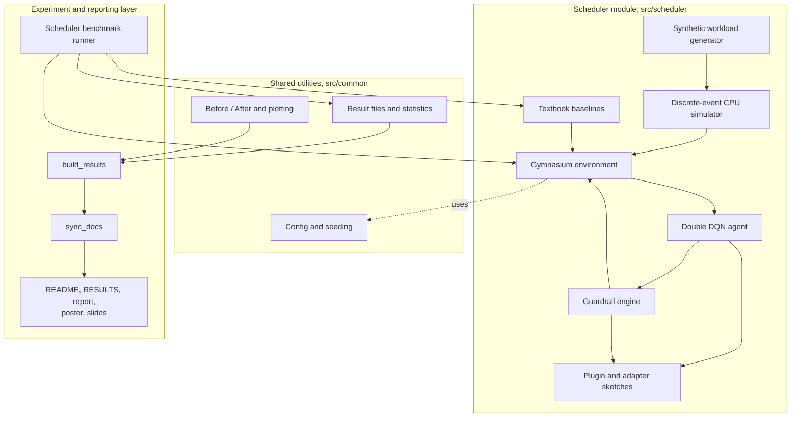
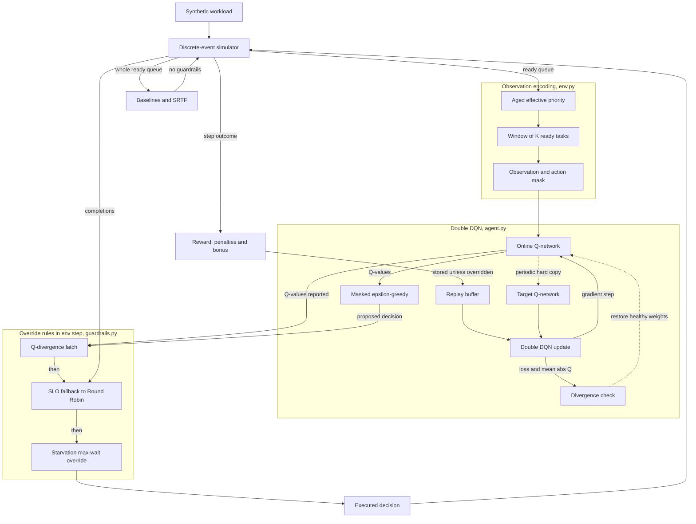
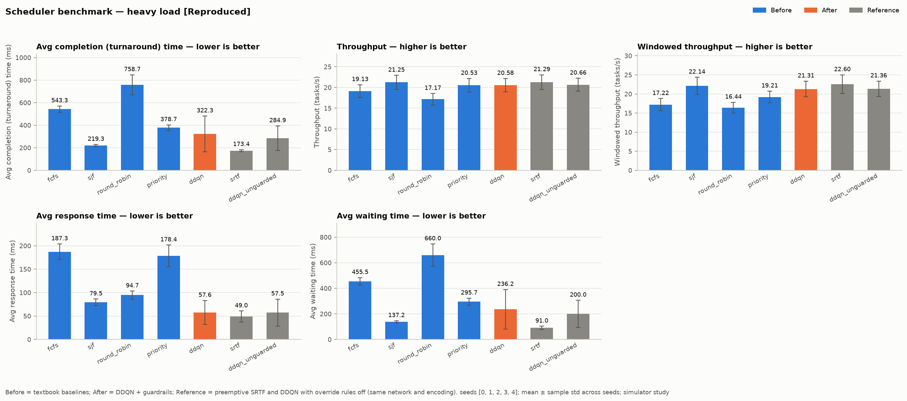
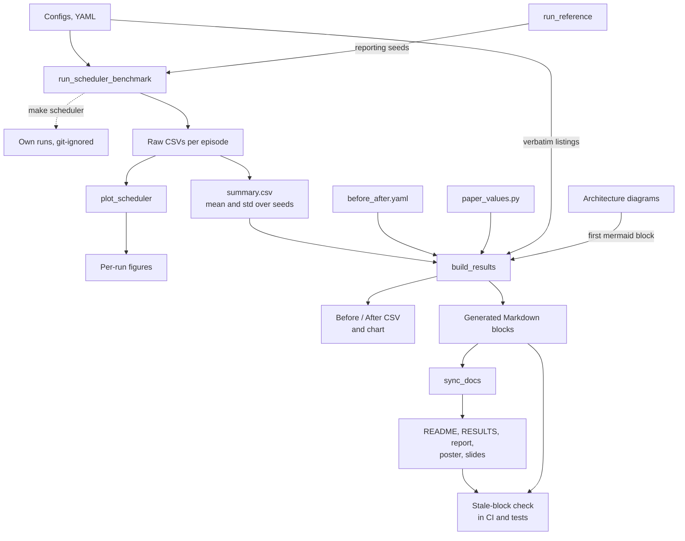
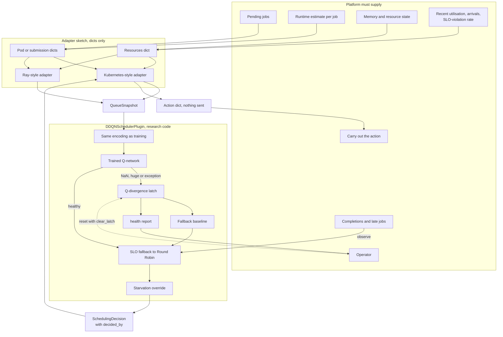
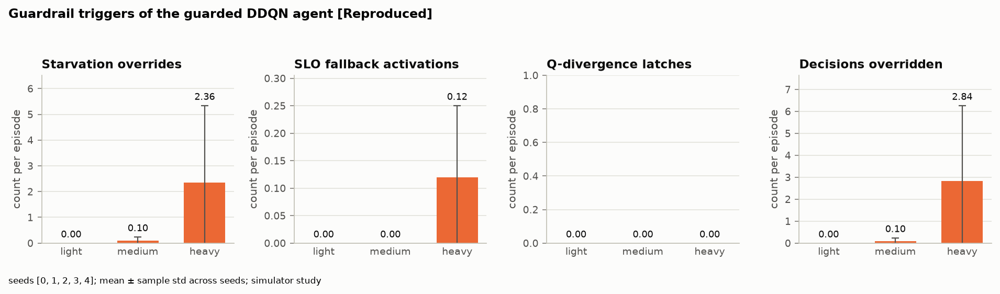

# Presentation — Learned operating-system scheduling with guardrails: a reference implementation with a Before / After comparison

Slide outline for a 20-minute research talk (16 slides), followed by a separate five-slide
version for platform and infrastructure audiences. Each slide gives a title, the bullets to show
(full sentences), the figure or diagram to show, and the speaker notes. Every reproduced number
on a slide comes from a generated block; the bullets and the notes describe those tables in
words and never type a reproduced value. The speaker notes contain no number measured by this
code.

Author: Fan Guo.

Colour rule for every slide: **Before is always blue `#2a78d6`, After is always orange
`#eb6834`, and grey `#898781` marks references** that are neither, such as the SRTF bar.

---

## Main deck

### Slide 1 — Problem: which task should run next, and can a learned policy stay safe?

- An operating-system scheduler decides which ready task runs next on the CPU, and the right rule depends on the load and on what the system cares about most.
- Textbook rules each serve one goal: FCFS is simple, SJF keeps completion times short, and Round Robin starts every task quickly.
- A learned policy could adapt to the load, but it must stay safe when it misbehaves, so it needs rules that can take control away from it.
- This repository is a complete, runnable reference implementation of a Double DQN scheduler, following the method described by Sun et al. (2025), with guardrails and a Before / After comparison measured under one documented protocol.

**Figure:** the status line as a full-width strip: "Draft reference implementation — values printed in the source paper are shown for reference only; see RESULTS.md for the values this code produces and the conditions under which it produces them." No chart.

**Speaker notes.** This talk is about a practical question: which task should run next on a CPU, under light to heavy load, and can a learned policy do that job while staying safe? The textbook rules each optimise one thing, and none adapts to the load. A learned policy might, but a scheduler that occasionally misbehaves needs a simple rule that can override it. This repository implements a Double DQN scheduler in a simulator, with baselines, guardrails and a Before / After comparison on held-out seeds. The companion project `federated-privacy-adult` is a separate repository with its own code and results and the same reporting conventions. The results are mixed, and I will show the regressions as plainly as the gains.

### Slide 2 — The Proposed Endeavor this work serves

> Design and implement advanced machine learning and large language model architectures for secure, reliable system-level optimization in order to enhance the efficiency, reliability, and security of U.S. digital infrastructure and accelerate the deployment of next-generation artificial intelligence (AI) applications.

- The quotation above is the endeavor this repository is a first, partial step towards.
- This repository addresses machine learning for reliable scheduling with guardrails: a Double DQN scheduler in a simulator, with rules that override it when it misbehaves.
- The repository still contains no large-language-model architecture; that remains planned work.
- What it now has is a scheduling study on a synthetic LLM-style workload of inference requests and fine-tuning jobs, in which no language model is run.
- Nothing in the repository is deployed, integrated with a production system, or production-ready.

**Figure:** the quotation set as a single block, with the word "Implemented" over a bracket reaching "machine learning … system-level optimization" and the word "Planned" over a bracket reaching "large language model architectures"; a third, smaller mark "Workload study (synthetic)" is an arrow that starts at the "Implemented" bracket and points towards the words "large language model architectures", stopping short of them and kept visually distinct from both brackets, so that it does not read as implemented work on those architectures.

**Speaker notes.** This is the endeavor statement, quoted word for word, because the rest of the talk should be judged against it. I want to separate the part this draft actually addresses from the parts it does not. It addresses machine learning for system-level optimisation, through a learned scheduler, and reliability, through guardrails that override the model when it misbehaves. It still contains no large language model architecture. What it now has is the same scheduler tested on a synthetic workload shaped like an LLM platform's requests and jobs; no language model is run. It also contains no deployment. Everything runs in a simulator on one machine.

### Slide 3 — Design choices and assumptions

- Waiting, turnaround and response time are penalties in the reward and a completed task earns a bonus, so that finishing work sooner earns more reward.
- The online network selects the next action and the target network evaluates it, which limits over-estimation of action values.
- Three guardrails filter the agent's decisions, so that a misbehaving policy is overridden by a simple rule.
- Every method is evaluated on the same paired workloads, and a preemptive shortest-remaining-time policy runs as a reference, because the agent may preempt and textbook SJF may not.
- The simulator, the workload, the three load profiles, the state encoding, the action set and every hyperparameter are this implementation's choices, each tagged [Assumption — not in paper].

**Figure:** a three-column table "Design choice", "What this implementation does", "Why", one row each for the reward, the Double DQN target, the guardrails, the paired workloads and the SRTF reference.

**Speaker notes.** This slide lists the design choices that shape every result that follows, each with the engineering reason behind it. The reward makes slow work costly, so the agent is paid for finishing sooner. The standard Double DQN target separates choosing an action from valuing it, which keeps value estimates from drifting upward. The guardrails exist because a learned policy can fail, and a plain rule should then take over. Pairing the workloads means differences come from the scheduler, not from luck. The preemptive reference shows what learning adds beyond preemption. Every other setting is written in the configuration files as a labelled assumption that anyone can change.

### Slide 4 — System overview

- The repository has three parts: the scheduler module, a small package of shared utilities, and an experiment and reporting layer.
- The scheduler module holds the workload generator, the simulator, the environment, the agent, the guardrails, the baselines and the plugin sketches.
- Every result flows from a configuration file to raw CSV files, summary tables, the Before / After table and chart, and generated blocks in the documents.
- Every reproduced number on these slides is inserted from a generated block, so no number is typed by hand.

**Figure:** the system overview diagram (block `diagram_system_overview`, from `docs/architecture/01-system-overview.md`).

<!-- BEGIN GENERATED: diagram_system_overview -->

<!-- END GENERATED: diagram_system_overview -->

**Speaker notes.** This is the whole system on one slide. At the top is the scheduler module: a synthetic workload generator, a discrete-event simulator of one CPU, a Gymnasium environment, the Double DQN agent, a guardrail engine, the textbook baselines, and the plugin sketches for platform teams. In the middle is a small shared package for configuration, seeding, statistics and the Before / After rules; it knows nothing about scheduling. At the bottom is the reporting pipeline, which is why every table in this talk is generated rather than typed, and why the documents cannot silently drift from the results. A continuous-integration check fails if they do.

### Slide 5 — Method, part 1: simulator, agent, guardrails

- The simulator models one CPU with CPU-bound, memory-bound and I/O-bound tasks, memory thrashing, context switches and I/O blocking; it is not a kernel modification.
- The agent is a standard Double DQN with a target network and a replay buffer (van Hasselt et al., 2016), trained online in the simulator.
- Four Before baselines (FCFS, SJF, Round Robin, Priority) and a preemptive SRTF reference, drawn in grey, run on the identical workloads for every seed.
- Three guardrails filter every decision inside the environment step: a Q-divergence latch, an SLO fallback to Round Robin, and a starvation override.
- The simulator agrees exactly with independent reference implementations that share no code with it, and those cross-checks are kept as tests.

**Figure:** the scheduler detail diagram (block `diagram_scheduler_detail`, from `docs/architecture/02-scheduler-detail.md`).

<!-- BEGIN GENERATED: diagram_scheduler_detail -->

<!-- END GENERATED: diagram_scheduler_detail -->

**Speaker notes.** The scheduler is a simulator, deliberately. That lets us check the simulator itself: independent implementations agree with it exactly on many random workloads. One fairness point matters for everything that follows. The agent can choose short time slices, so it can preempt; textbook SJF cannot. That is why we added preemptive shortest-remaining-time-first as a grey reference. It is not one of the four Before baselines, but if the agent only beats non-preemptive SJF, the learning has not been shown to add anything. Both the agent and the baselines see the exact current burst length, which a real system must estimate. The guardrails sit inside the step, so training knows which decisions were overridden.

### Slide 6 — Method, part 2: what the agent sees, does and is rewarded for

- The agent sees a window of ready tasks ordered by aged effective priority, plus a few machine-wide features such as free memory, recent utilisation and recent SLO violations.
- Each action either runs one task in the window for a short slice, a long slice or until its burst ends, or changes one task's priority; invalid actions are masked.
- The reward used here penalises waiting, time in system, response time and deadline misses, and gives a bonus for completions and utilisation.
- Aging is part of the encoding, not a guardrail, so it stays on for both the guarded and the unguarded agent and the comparison between them isolates the override rules.

**Figure:** the generated block `scheduler_action_table` (every action, with its slot, time slice or priority change, and when it is masked); the observation is listed in `scheduler_state_table` on platform slide 2.

<!-- BEGIN GENERATED: scheduler_action_table -->
| Index | Family | Slot | Time slice (ms) / priority delta | Meaning | Masked when |
|---:|---|---:|---|---|---|
| 0 | DISPATCH | 0 | 10.0 | run slot 0 for 10.0 ms | slot 0 is empty |
| 1 | DISPATCH | 0 | 40.0 | run slot 0 for 40.0 ms | slot 0 is empty |
| 2 | DISPATCH | 0 | until burst ends | run slot 0 until its burst ends | slot 0 is empty |
| 3 | DISPATCH | 1 | 10.0 | run slot 1 for 10.0 ms | slot 1 is empty |
| 4 | DISPATCH | 1 | 40.0 | run slot 1 for 40.0 ms | slot 1 is empty |
| 5 | DISPATCH | 1 | until burst ends | run slot 1 until its burst ends | slot 1 is empty |
| 6 | DISPATCH | 2 | 10.0 | run slot 2 for 10.0 ms | slot 2 is empty |
| 7 | DISPATCH | 2 | 40.0 | run slot 2 for 40.0 ms | slot 2 is empty |
| 8 | DISPATCH | 2 | until burst ends | run slot 2 until its burst ends | slot 2 is empty |
| 9 | DISPATCH | 3 | 10.0 | run slot 3 for 10.0 ms | slot 3 is empty |
| 10 | DISPATCH | 3 | 40.0 | run slot 3 for 40.0 ms | slot 3 is empty |
| 11 | DISPATCH | 3 | until burst ends | run slot 3 until its burst ends | slot 3 is empty |
| 12 | DISPATCH | 4 | 10.0 | run slot 4 for 10.0 ms | slot 4 is empty |
| 13 | DISPATCH | 4 | 40.0 | run slot 4 for 40.0 ms | slot 4 is empty |
| 14 | DISPATCH | 4 | until burst ends | run slot 4 until its burst ends | slot 4 is empty |
| 15 | DISPATCH | 5 | 10.0 | run slot 5 for 10.0 ms | slot 5 is empty |
| 16 | DISPATCH | 5 | 40.0 | run slot 5 for 40.0 ms | slot 5 is empty |
| 17 | DISPATCH | 5 | until burst ends | run slot 5 until its burst ends | slot 5 is empty |
| 18 | DISPATCH | 6 | 10.0 | run slot 6 for 10.0 ms | slot 6 is empty |
| 19 | DISPATCH | 6 | 40.0 | run slot 6 for 40.0 ms | slot 6 is empty |
| 20 | DISPATCH | 6 | until burst ends | run slot 6 until its burst ends | slot 6 is empty |
| 21 | DISPATCH | 7 | 10.0 | run slot 7 for 10.0 ms | slot 7 is empty |
| 22 | DISPATCH | 7 | 40.0 | run slot 7 for 40.0 ms | slot 7 is empty |
| 23 | DISPATCH | 7 | until burst ends | run slot 7 until its burst ends | slot 7 is empty |
| 24 | DISPATCH | 8 | 10.0 | run slot 8 for 10.0 ms | slot 8 is empty |
| 25 | DISPATCH | 8 | 40.0 | run slot 8 for 40.0 ms | slot 8 is empty |
| 26 | DISPATCH | 8 | until burst ends | run slot 8 until its burst ends | slot 8 is empty |
| 27 | DISPATCH | 9 | 10.0 | run slot 9 for 10.0 ms | slot 9 is empty |
| 28 | DISPATCH | 9 | 40.0 | run slot 9 for 40.0 ms | slot 9 is empty |
| 29 | DISPATCH | 9 | until burst ends | run slot 9 until its burst ends | slot 9 is empty |
| 30 | PRIORITY | 0 | +1 | raise priority of slot 0 | slot 0 is empty; or the task's priority + offset is already 3 (range 0..3, `machine.num_priority_levels`); or 2 consecutive priority actions were taken since the last dispatch (`actions.max_priority_adjusts_per_dispatch`) |
| 31 | PRIORITY | 0 | -1 | lower priority of slot 0 | slot 0 is empty; or the task's priority + offset is already 0 (range 0..3, `machine.num_priority_levels`); or 2 consecutive priority actions were taken since the last dispatch (`actions.max_priority_adjusts_per_dispatch`) |
| 32 | PRIORITY | 1 | +1 | raise priority of slot 1 | slot 1 is empty; or the task's priority + offset is already 3 (range 0..3, `machine.num_priority_levels`); or 2 consecutive priority actions were taken since the last dispatch (`actions.max_priority_adjusts_per_dispatch`) |
| 33 | PRIORITY | 1 | -1 | lower priority of slot 1 | slot 1 is empty; or the task's priority + offset is already 0 (range 0..3, `machine.num_priority_levels`); or 2 consecutive priority actions were taken since the last dispatch (`actions.max_priority_adjusts_per_dispatch`) |
| 34 | PRIORITY | 2 | +1 | raise priority of slot 2 | slot 2 is empty; or the task's priority + offset is already 3 (range 0..3, `machine.num_priority_levels`); or 2 consecutive priority actions were taken since the last dispatch (`actions.max_priority_adjusts_per_dispatch`) |
| 35 | PRIORITY | 2 | -1 | lower priority of slot 2 | slot 2 is empty; or the task's priority + offset is already 0 (range 0..3, `machine.num_priority_levels`); or 2 consecutive priority actions were taken since the last dispatch (`actions.max_priority_adjusts_per_dispatch`) |
| 36 | PRIORITY | 3 | +1 | raise priority of slot 3 | slot 3 is empty; or the task's priority + offset is already 3 (range 0..3, `machine.num_priority_levels`); or 2 consecutive priority actions were taken since the last dispatch (`actions.max_priority_adjusts_per_dispatch`) |
| 37 | PRIORITY | 3 | -1 | lower priority of slot 3 | slot 3 is empty; or the task's priority + offset is already 0 (range 0..3, `machine.num_priority_levels`); or 2 consecutive priority actions were taken since the last dispatch (`actions.max_priority_adjusts_per_dispatch`) |
| 38 | PRIORITY | 4 | +1 | raise priority of slot 4 | slot 4 is empty; or the task's priority + offset is already 3 (range 0..3, `machine.num_priority_levels`); or 2 consecutive priority actions were taken since the last dispatch (`actions.max_priority_adjusts_per_dispatch`) |
| 39 | PRIORITY | 4 | -1 | lower priority of slot 4 | slot 4 is empty; or the task's priority + offset is already 0 (range 0..3, `machine.num_priority_levels`); or 2 consecutive priority actions were taken since the last dispatch (`actions.max_priority_adjusts_per_dispatch`) |
| 40 | PRIORITY | 5 | +1 | raise priority of slot 5 | slot 5 is empty; or the task's priority + offset is already 3 (range 0..3, `machine.num_priority_levels`); or 2 consecutive priority actions were taken since the last dispatch (`actions.max_priority_adjusts_per_dispatch`) |
| 41 | PRIORITY | 5 | -1 | lower priority of slot 5 | slot 5 is empty; or the task's priority + offset is already 0 (range 0..3, `machine.num_priority_levels`); or 2 consecutive priority actions were taken since the last dispatch (`actions.max_priority_adjusts_per_dispatch`) |
| 42 | PRIORITY | 6 | +1 | raise priority of slot 6 | slot 6 is empty; or the task's priority + offset is already 3 (range 0..3, `machine.num_priority_levels`); or 2 consecutive priority actions were taken since the last dispatch (`actions.max_priority_adjusts_per_dispatch`) |
| 43 | PRIORITY | 6 | -1 | lower priority of slot 6 | slot 6 is empty; or the task's priority + offset is already 0 (range 0..3, `machine.num_priority_levels`); or 2 consecutive priority actions were taken since the last dispatch (`actions.max_priority_adjusts_per_dispatch`) |
| 44 | PRIORITY | 7 | +1 | raise priority of slot 7 | slot 7 is empty; or the task's priority + offset is already 3 (range 0..3, `machine.num_priority_levels`); or 2 consecutive priority actions were taken since the last dispatch (`actions.max_priority_adjusts_per_dispatch`) |
| 45 | PRIORITY | 7 | -1 | lower priority of slot 7 | slot 7 is empty; or the task's priority + offset is already 0 (range 0..3, `machine.num_priority_levels`); or 2 consecutive priority actions were taken since the last dispatch (`actions.max_priority_adjusts_per_dispatch`) |
| 46 | PRIORITY | 8 | +1 | raise priority of slot 8 | slot 8 is empty; or the task's priority + offset is already 3 (range 0..3, `machine.num_priority_levels`); or 2 consecutive priority actions were taken since the last dispatch (`actions.max_priority_adjusts_per_dispatch`) |
| 47 | PRIORITY | 8 | -1 | lower priority of slot 8 | slot 8 is empty; or the task's priority + offset is already 0 (range 0..3, `machine.num_priority_levels`); or 2 consecutive priority actions were taken since the last dispatch (`actions.max_priority_adjusts_per_dispatch`) |
| 48 | PRIORITY | 9 | +1 | raise priority of slot 9 | slot 9 is empty; or the task's priority + offset is already 3 (range 0..3, `machine.num_priority_levels`); or 2 consecutive priority actions were taken since the last dispatch (`actions.max_priority_adjusts_per_dispatch`) |
| 49 | PRIORITY | 9 | -1 | lower priority of slot 9 | slot 9 is empty; or the task's priority + offset is already 0 (range 0..3, `machine.num_priority_levels`); or 2 consecutive priority actions were taken since the last dispatch (`actions.max_priority_adjusts_per_dispatch`) |
<!-- END GENERATED: scheduler_action_table -->

**Speaker notes.** This slide shows the decision problem the agent actually faces. It does not see the whole queue; it sees a fixed window of tasks, sorted so that tasks that have waited long move into view. The baselines, by contrast, see the whole ready queue, which is an asymmetry in their favour. Actions are discrete: pick a task and a slice, or nudge a priority, with a mask that removes empty slots. The reward makes slow responses and missed deadlines costly. All of these choices are assumptions of this implementation, and each one is written in the configuration file with its provenance.

### Slide 7 — Workloads and protocol

- Every workload is synthetic: each episode draws between 40 and 60 tasks of three types, with arrival times set by a target CPU utilisation, and there is no real scheduling dataset.
- Three load profiles are defined by target utilisations of 0.5, 0.75 and 0.95, all tagged [Assumption — not in paper].
- One agent is trained per seed, and every method is then evaluated on the same ten workloads per load profile and seed.
- The reporting seeds 0–4 were used once, for the reference run; the configuration was fixed on development seeds 100 and above, and nothing was tuned on the reporting seeds.

**Figure:** a small table drawn from the generated block `config_scheduler_ddqn` (workload and evaluation sections): load profile, target utilisation, tasks per episode, evaluation workloads per seed; with the caption "synthetic workloads, one simulated CPU, no trace".

**Speaker notes.** Every setting on this slide is an assumption of this implementation, written in the configuration file. The constants here are configuration values, not results. The heavy profile is set close to saturation on purpose, because that is where scheduling decisions matter most and where a learned policy is most likely to go wrong. Pairing matters: every method faces exactly the same tasks within a seed, so differences come from the scheduler and not from luck in the workload. Holding out the reporting seeds matters too, and the results slides show why: the development seeds did not reveal the failure mode that the reporting seeds did.

### Slide 8 — Results: the Before / After table

- Before is the best of the four baselines on each metric, and After is the Double DQN agent with guardrails on, on a single-CPU simulator with synthetic workloads and the three loads pooled.
- Delta is After minus Before in the metric's own unit, and a positive Improvement % always means better after; a negative value is a regression.
- Every value is the mean ± sample standard deviation over five reporting seeds, labelled [Reproduced], which means it was obtained by running this repository's code under the documented conditions.
- The agent is better on response time and the SLO violation rate, and worse on turnaround, waiting time and, within the spread, throughput; it starves some tasks where Round Robin starves none.

**Figure:** the generated table `before_after_compact`, Before columns tinted blue `#2a78d6`, After columns tinted orange `#eb6834`, with the sign-convention sentence printed under the table on the slide.

<!-- BEGIN GENERATED: before_after_compact -->
Source label: [Reproduced]. Before = best of FCFS / SJF / Round Robin / Priority per metric; After = Double DQN (guardrails on).

| Metric | Before Method | Before Value | After Method | After Value | Delta (absolute) | Improvement % | Source Label |
|---|---|---|---|---|---|---|---|
| Completion / turnaround time | SJF | 178.0 ± 8.0 | Double DQN (guardrails on) | 198.2 ± 54.6 | +20.2 | -11.3% | [Reproduced] |
| Throughput | SJF | 16.468 ± 0.956 | Double DQN (guardrails on) | 16.216 ± 0.884 | -0.253 | -1.5% | [Reproduced] |
| Response time | Round Robin | 48.8 ± 7.6 | Double DQN (guardrails on) | 27.7 ± 10.3 | -21.0 | +43.1% | [Reproduced] |
| Waiting time | SJF | 94.9 ± 7.3 | Double DQN (guardrails on) | 113.4 ± 53.2 | +18.5 | -19.5% | [Reproduced] |
| SLO violation rate | SJF | 0.1539 ± 0.0174 | Double DQN (guardrails on) | 0.0828 ± 0.0270 | -0.0711 | +46.2% | [Reproduced] |
| Starvation count | Round Robin | 0.000 ± 0.000 | Double DQN (guardrails on) | 0.567 ± 0.629 | +0.567 | N/A — baseline zero / not comparable | [Reproduced] |

- Starvation count, Round Robin → Double DQN (guardrails on): Before is zero or near zero (|Before| <= 0.05 tasks per episode), so a percentage would be meaningless.

A positive Improvement % always means better after; a negative value is a regression.
<!-- END GENERATED: before_after_compact -->

A positive Improvement % always means better after; a negative value is a regression.

**Speaker notes.** Every value in this table is [Reproduced], meaning it comes from running this code under the documented conditions, and nothing here is TBD. Read the sign convention first: a positive percentage is always better after, a negative one is a regression. The agent improves response time and the SLO violation rate clearly. It regresses on turnaround and waiting time against SJF, and on throughput by a margin inside the seed-to-seed spread. On starvation it starves some tasks while Round Robin starves none, so that row has no percentage. Each negative sign tells you when to prefer the Before method instead of the agent.

### Slide 9 — Results: the charts

- In the pooled chart, blue bars are the four Before baselines, the orange bar is the agent, and grey bars are the SRTF reference and the agent without guardrail overrides.
- The SRTF reference, which is not a Before method, is lower than the agent on every lower-is-better metric in the pooled chart.
- The heavy-load chart shows the agent's turnaround above SJF's with a much wider error bar, which comes from a few workloads rather than a uniform shortfall.
- Throughput bars differ little between methods, as expected for a queue that drains, and in the heavy-load chart the windowed throughput bars rank the methods in the same order as plain throughput.

**Figure:** `scheduling.png` (Before / After, loads pooled) on the left and `metrics_heavy.png` (every method at heavy load) on the right. Colours: Before blue `#2a78d6`, After orange `#eb6834`, references grey `#898781`; every bar is also labelled with its method name.

Captions: simulator only, synthetic workloads, one CPU, every method given the exact current burst length; neither chart shows a real operating system or real jobs. A positive Improvement % always means better after.

**Speaker notes.** Every value shown on these charts is [Reproduced], the same values as the tables, so I will point at shapes rather than read numbers. In the pooled chart the agent regresses against SJF on turnaround, waiting time and, within the spread, throughput, and it starves some tasks where Round Robin starves none. Compare the orange bar with the grey SRTF bar next to it: SRTF is lower on turnaround, response and waiting time. In the heavy-load chart the orange turnaround bar is above SJF's, with a far wider error bar; the next slide shows that this comes from a handful of workloads. The grey unguarded bar is lower, so the guardrails did not help here.

### Slide 10 — Results: by load, and the tail

- In this implementation the agent's average turnaround is lower than SJF's at light and medium load and higher at heavy load, which is where its pooled regression comes from.
- At heavy load the agent's median workload is competitive with SJF, but a few catastrophic workloads make its average much worse: this is a tail-risk result.
- The preemptive SRTF reference has a lower turnaround than the agent on essentially every workload, which suggests that most of the agent's advantage over SJF comes from preemption.
- The development seeds flattered the agent, which was stable under heavy load there and is not on the held-out reporting seeds.
- A user who cares most about turnaround under heavy load should prefer SJF or a preemptive shortest-remaining-time rule; where response time and deadlines matter more, the agent is a candidate research baseline, to be compared with SRTF.

**Figure:** the generated block `tail_analysis` (per-seed heavy-load values, distribution, paired win counts, five worst workloads); the full table by load profile is the block `before_after_by_load` in RESULTS.md.

<!-- BEGIN GENERATED: tail_analysis -->
Source label: [Reproduced]. All values are average turnaround times in ms, computed from `experiments/results/reference/scheduler/raw_episodes.csv`.

**Per seed, heavy load** (mean over that seed's evaluation workloads):

| Method | Seed 0 | Seed 1 | Seed 2 | Seed 3 | Seed 4 | Mean ± std across seeds |
|---|---|---|---|---|---|---|
| FCFS | 511.9 | 542.8 | 544.5 | 587.0 | 530.1 | 543.3 ± 27.7 |
| SJF | 231.9 | 207.6 | 214.5 | 228.9 | 213.4 | 219.3 ± 10.6 |
| Round Robin | 775.2 | 646.6 | 825.8 | 856.2 | 689.7 | 758.7 ± 88.9 |
| Priority | 338.2 | 387.8 | 386.7 | 405.4 | 375.2 | 378.7 ± 25.0 |
| Double DQN (guardrails on) | 212.3 | 197.9 | 224.3 | 555.8 | 421.2 | 322.3 ± 159.3 |
| SRTF (preemptive reference) | 174.1 | 161.9 | 185.6 | 179.9 | 165.5 | 173.4 ± 9.9 |
| Double DQN (guardrail overrides off) | 212.2 | 196.0 | 224.3 | 453.1 | 339.1 | 284.9 ± 109.6 |

**Distribution over single evaluation workloads, heavy load** (all seeds together):

| Method | Workloads | Median | 90th percentile | Maximum |
|---|---|---|---|---|
| FCFS | 50 | 391.1 | 981.6 | 1693.9 |
| SJF | 50 | 209.1 | 275.7 | 412.7 |
| Round Robin | 50 | 351.7 | 1733.6 | 3816.9 |
| Priority | 50 | 339.4 | 627.9 | 978.3 |
| Double DQN (guardrails on) | 50 | 190.5 | 341.1 | 3334.7 |
| SRTF (preemptive reference) | 50 | 163.5 | 229.0 | 298.9 |
| Double DQN (guardrail overrides off) | 50 | 190.5 | 330.9 | 2395.0 |

**Paired comparison on identical workloads** — in how many evaluation workloads does Double DQN (guardrails on) have a lower turnaround than the other method:

| Load | Workloads | Lower than SJF | Lower than SRTF (preemptive reference) | More than twice SJF |
|---|---|---|---|---|
| light | 50 | 50 of 50 | 1 of 50 | 0 |
| medium | 50 | 45 of 50 | 0 of 50 | 0 |
| heavy | 50 | 33 of 50 | 0 of 50 | 3 |

**The five worst heavy-load workloads of Double DQN (guardrails on):**

| Seed | Workload | Tasks | Turnaround, Double DQN (guardrails on) | Turnaround, SJF | Guardrail overrides | SLO-fallback activations | Starvation triggers |
|---|---|---|---|---|---|---|---|
| 3 | 1 | 47 | 3334.7 | 412.7 | 59 | 2 | 58 |
| 4 | 7 | 57 | 2638.7 | 353.7 | 49 | 2 | 44 |
| 3 | 6 | 49 | 504.7 | 248.9 | 16 | 1 | 4 |
| 3 | 4 | 45 | 476.5 | 259.3 | 4 | 0 | 4 |
| 1 | 6 | 60 | 342.4 | 273.1 | 5 | 0 | 5 |
<!-- END GENERATED: tail_analysis -->

**Speaker notes.** This slide is the centre of the result. Every value shown is [Reproduced], and none is TBD. Look at the heavy-load rows: the agent's median is fine, but its maximum is many times that of SJF, and some seeds contain catastrophic workloads. In those workloads the guardrails fired many times and did not help; on those seeds the unguarded agent did better. The paired counts show the agent rarely beats preemptive SRTF at any load. On our development seeds none of this was visible, which is why reporting seeds are held out. Typically competitive, occasionally far worse, and therefore worse than SJF on average under heavy load and pooled.

### Slide 11 — The same benchmark on an LLM-style workload

- The LLM-style workload profile replaces only the task classes of the benchmark with synthetic inference requests (short, latency-sensitive) and fine-tuning jobs (long, memory-heavy); no language model is run, and none of its values was measured on an LLM system.
- The one clear gain: with guardrails on, the agent misses far fewer deadlines than each of the four baselines, at every load and above all for inference requests.
- The regressions: pooled, its turnaround and waiting time are worse than SJF's, better at light and medium load but clearly worse at heavy load, fine-tuning jobs are worse off on every per-class metric, and it starves some tasks where Round Robin starves none.
- The preemptive SRTF reference is better than the agent on pooled turnaround, response time and deadline misses, and with the three override rules off the same trained network had a lower turnaround at every load.
- A post hoc variant that bounds the forced slice of the starvation override removed most of the cost of the override rules, but left the agent behind SJF on mean turnaround and behind SRTF; it is exploratory and changes no table shown here.

**Figure:** `scheduling_llm.png` (Before / After on the LLM-style profile, loads pooled) and the generated table `llm_before_after_compact`, with the same colours as slide 8 and the sign-convention sentence under the table.

<!-- BEGIN GENERATED: llm_before_after_compact -->
Source label: [Reproduced]. Workload: the LLM-style profile of `configs/scheduler_llm_workload.yaml` (synthetic inference requests and fine-tuning jobs on the simulated node; no language model is run). Before = best of FCFS / SJF / Round Robin / Priority per metric; After = Double DQN (guardrails on).

| Metric | Before Method | Before Value | After Method | After Value | Delta (absolute) | Improvement % | Source Label |
|---|---|---|---|---|---|---|---|
| Completion / turnaround time | SJF | 225.7 ± 27.3 | Double DQN (guardrails on) | 266.4 ± 58.1 | +40.7 | -18.0% | [Reproduced] |
| Throughput | SJF | 11.967 ± 0.636 | Double DQN (guardrails on) | 11.798 ± 0.618 | -0.169 | -1.4% | [Reproduced] |
| Response time | Round Robin | 59.9 ± 7.5 | Double DQN (guardrails on) | 56.9 ± 30.6 | -3.0 | +5.0% | [Reproduced] |
| Waiting time | SJF | 137.6 ± 22.3 | Double DQN (guardrails on) | 175.6 ± 53.7 | +38.0 | -27.6% | [Reproduced] |
| SLO violation rate | SJF | 0.3752 ± 0.0269 | Double DQN (guardrails on) | 0.0807 ± 0.0024 | -0.2946 | +78.5% | [Reproduced] |
| Starvation count | Round Robin | 0.000 ± 0.000 | Double DQN (guardrails on) | 1.247 ± 0.371 | +1.247 | N/A — baseline zero / not comparable | [Reproduced] |

- Starvation count, Round Robin → Double DQN (guardrails on): Before is zero or near zero (|Before| <= 0.05 tasks per episode), so a percentage would be meaningless.

A positive Improvement % always means better after; a negative value is a regression.
<!-- END GENERATED: llm_before_after_compact -->

**Speaker notes.** A natural question is what happens on a mix shaped like an LLM platform's work: many short inference requests next to a few long fine-tuning jobs. So we kept the machine, the agent, the reward, the guardrails and the seeds, and changed only the task classes in the configuration. To be clear, nothing here runs or serves a model; the tasks are synthetic and their shapes are hand-chosen. The agent does one thing much better: deadlines, mostly for requests. It does not shorten completion times overall, and long jobs are worse off. SRTF is better still, and the overrides made the agent worse here. A later check with a bounded forced slice removed most of that cost; it is exploratory.

### Slide 12 — What the topic guide shows

- The result depends strongly on hyperparameters: several one-setting ablations, including a lower learning rate, did better than the default on the reporting seeds, and a flat multilayer network did worse.
- The default was fixed on development seeds and was deliberately not changed afterwards, because choosing the best variant on reporting seeds would be tuning on the test set.
- With an alternative sign convention for the response-time term (response time added instead of subtracted), kept as an ablation, pooled response time and the SLO violation rate are higher than with the default, while turnaround differs by less than the seed-to-seed spread.
- Turning the SLO fallback off gave a lower pooled turnaround than the default, which agrees with the tail analysis, where the fallback appears to have made overloads worse, but it rests on five seeds.

**Figure:** the generated block `ablations`; the topic guide is [docs/investigations/01-ddqn-scheduling-reproduction.md](../investigations/01-ddqn-scheduling-reproduction.md).

<!-- BEGIN GENERATED: ablations -->
Source label: [Reproduced]. Each variant retrains the agent on the same seeds with one setting changed and evaluates **Double DQN (guardrails on)** on the same paired workloads as the reference run; mean ± sample standard deviation across seeds. In the last column a positive value means the variant has a lower pooled turnaround than the default, a negative value a higher one. A variant that was not run shows TBD. The baselines are not affected by any of these settings.

| Variant | What changed | Turnaround, pooled (ms) | Turnaround, heavy load (ms) | Response time, pooled (ms) | SLO violation rate, pooled (fraction) | Starvation count, pooled (tasks/episode) | Guardrail overrides, pooled (decisions/episode) | Pooled turnaround versus default |
|---|---|---|---|---|---|---|---|---|
| default (reference run) | nothing | 198.2 ± 54.6 | 322.3 ± 159.3 | 27.7 ± 10.3 | 0.0828 ± 0.0270 | 0.567 ± 0.629 | 0.98 ± 1.15 | reference |
| `reward_paper_sign_as_printed` | `reward.paper_sign_as_printed` = `True` | 193.9 ± 47.9 | 301.6 ± 145.4 | 38.9 ± 11.4 | 0.1007 ± 0.0196 | 0.487 ± 0.604 | 0.97 ± 1.20 | +2.2% |
| `reward_turnaround_only` | `reward.w_wait` = `0.0`; `reward.w_response` = `0.0`; `reward.w_slo_violation` = `0.0`; `reward.w_completion` = `0.0`; `reward.w_utilisation` = `0.0` | 173.4 ± 9.4 | 233.5 ± 28.8 | 28.4 ± 5.6 | 0.1063 ± 0.0169 | 0.207 ± 0.297 | 0.33 ± 0.43 | +12.5% |
| `reward_responsive` | `reward.w_response` = `1.0`; `reward.w_slo_violation` = `2.0` | 198.1 ± 45.6 | 311.1 ± 122.0 | 31.8 ± 13.9 | 0.0971 ± 0.0214 | 0.573 ± 0.545 | 1.37 ± 0.82 | +0.0% |
| `gamma_low` | `agent.gamma` = `0.9` | 195.4 ± 52.2 | 308.1 ± 140.2 | 29.6 ± 10.5 | 0.0920 ± 0.0291 | 0.480 ± 0.465 | 0.70 ± 0.67 | +1.4% |
| `gamma_high` | `agent.gamma` = `0.995` | 175.0 ± 22.0 | 257.0 ± 62.4 | 28.9 ± 10.1 | 0.0756 ± 0.0163 | 0.433 ± 0.415 | 0.53 ± 0.53 | +11.7% |
| `lr_low` | `agent.learning_rate` = `0.0001` | 163.6 ± 16.6 | 218.5 ± 39.6 | 20.3 ± 3.2 | 0.0735 ± 0.0160 | 0.160 ± 0.157 | 0.16 ± 0.16 | +17.5% |
| `lr_high` | `agent.learning_rate` = `0.002` | 193.0 ± 30.1 | 299.5 ± 86.5 | 33.7 ± 7.7 | 0.0890 ± 0.0190 | 0.567 ± 0.416 | 0.75 ± 0.57 | +2.6% |
| `network_mlp` | `agent.network.type` = `mlp`; `agent.network.hidden_sizes` = `[256, 256]` | 254.6 ± 45.1 | 452.4 ± 102.1 | 40.8 ± 9.6 | 0.1571 ± 0.0337 | 0.980 ± 0.577 | 2.79 ± 1.11 | -28.5% |
| `slo_fallback_aggressive` | `guardrails.slo_fallback.window_completions` = `10`; `guardrails.slo_fallback.violation_threshold` = `6`; `guardrails.slo_fallback.fallback_duration_ms` = `500.0` | 191.1 ± 21.1 | 294.0 ± 50.0 | 28.2 ± 8.5 | 0.0967 ± 0.0204 | 0.093 ± 0.123 | 6.89 ± 2.44 | +3.6% |
| `slo_fallback_off` | `guardrails.slo_fallback.enabled` = `False` | 178.7 ± 25.7 | 258.7 ± 67.0 | 26.1 ± 6.9 | 0.0844 ± 0.0211 | 0.427 ± 0.362 | 0.49 ± 0.45 | +9.8% |
| `aging_off` | `guardrails.aging.enabled` = `False` | 174.2 ± 27.3 | 249.2 ± 74.6 | 25.9 ± 3.9 | 0.0812 ± 0.0166 | 0.393 ± 0.413 | 0.56 ± 0.68 | +12.1% |
| `oracle_total_remaining` | `observation.reveal_total_remaining_cpu` = `True` | 185.4 ± 45.3 | 285.0 ± 128.2 | 24.5 ± 6.9 | 0.0782 ± 0.0199 | 0.473 ± 0.555 | 0.72 ± 0.91 | +6.4% |
| `no_guardrails_in_training` | `training.guardrails_in_training` = `False` | 199.3 ± 51.4 | 324.7 ± 152.6 | 33.3 ± 18.0 | 0.0856 ± 0.0198 | 0.627 ± 0.697 | 1.15 ± 1.16 | -0.6% |
<!-- END GENERATED: ablations -->

**Speaker notes.** Every value in the ablation table is [Reproduced], and each row changes one setting. Several variants did better than our default on the reporting seeds. Two are regressions: the flat multilayer network is worse than the default on every metric, and the alternative reward sign raises response time and the SLO violation rate. We report these as sensitivity, not as a tuned result, because the default was frozen before the reference run, and rare catastrophic workloads drive the averages, so differences over five seeds may be chance. Anyone using this agent should expect to tune it on their own workloads, on development seeds, before trusting a comparison.

### Slide 13 — Limitations

- The scheduler is a single-CPU simulator with synthetic workloads, both the agent and the baselines are given the exact current burst length, which real systems must estimate, and the discount is applied once per decision although decisions take different amounts of simulated time.
- The guardrails are demonstrated to fire as specified by unit tests, but in the reference run they did not contain the failure that occurred.
- The LLM-style workload study runs no language model: its values are hand-chosen, not measured or fitted to a trace, one processor and one memory budget stand in for one node without batching, and there was no retuning, no test of transfer between profiles and only one variant, run post hoc.
- The plugin and the adapters are sketches that translate dictionaries only; they call no API and have never run on a cluster.
- Five seeds per condition mean that differences smaller than the seed-to-seed spread are not treated as observations.

**Figure:** a two-column box, "What this benchmark shows" (behaviour of the agent, the baselines and the guardrails in this simulator, under documented conditions) and "What it does not show" (a real operating system, real traces, estimated burst lengths, multiple CPUs, any deployment).

**Speaker notes.** I want to put the limitations on a slide of their own rather than in small print. The results come from a simulator, with an oracle for burst lengths that both sides share; that keeps the comparison fair but not realistic. The per-decision discount ignores how long each decision takes. The guardrails work as code, but they did not protect the agent where it actually failed. The LLM-style study is a shaped synthetic mix, not a measurement of any LLM system. The integration code has never touched a cluster. And five seeds limit what any small difference can mean, which is why every observation states its spread.

### Slide 14 — An invitation to collaborate

- Researchers in HPC and cluster scheduling could add a trace-driven workload loader and test the agent and its guardrails on public traces [Target / TBD].
- Researchers in reinforcement learning could add a semi-Markov discount, estimated burst lengths, or a different exploration scheme, and rerun the same paired benchmark [Target / TBD].
- Researchers in systems reliability could redesign the fallback rules so that they contain the overload actually observed, and measure them against the unguarded agent [Target / TBD].
- Platform engineers could connect the plugin interface to a simulated queue fed by their own job mix and compare the learned policy with `BaselineSchedulerPlugin` [Target / TBD].

**Figure:** the experiment-flow diagram (block `diagram_experiment_flow`, from `docs/architecture/03-experiment-flow.md`), annotated with the four extension points.

<!-- BEGIN GENERATED: diagram_experiment_flow -->

<!-- END GENERATED: diagram_experiment_flow -->

**Speaker notes.** This codebase is meant to be extended, and this slide describes the kinds of researchers who could pick up a well-defined study from it today. Nobody has agreed to any of these studies, and no collaboration exists; each item is a target, not a result. The experiment flow on the slide shows why extension is cheap: a new method or workload plugs in at the configuration and runner stage, and the same seeds, the same Before / After rules and the same generated tables apply automatically. If you work on scheduling with real traces, on reinforcement learning over variable-length decisions, or on safe fallbacks, there is a concrete first experiment waiting.

### Slide 15 — Roadmap

- Next for the scheduler: a trace-driven workload, estimated rather than oracle burst lengths, and a semi-Markov discount, all currently [Target / TBD].
- Next for the guardrails: rules that are tested against the failure mode actually observed, with the fallback policy itself evaluated under overload.
- Next for platforms: a completion feedback path and a preemption model behind the plugin interface, still in simulation.
- Next for the LLM-style workload profile: a confirmation of the bounded forced slice on fresh seeds with the settings fixed in advance, the benchmark's ablations on the profile, and calibration against a public LLM-serving trace [Target / TBD].
- Further out: large-language-model architectures named in the Proposed Endeavor, and any integrated demonstration, which are planned and not implemented.

**Figure:** the deployment sketch diagram (block `diagram_deployment_sketch`, from `docs/architecture/04-deployment-sketch.md`), with the items not yet built shown as dashed boxes.

<!-- BEGIN GENERATED: diagram_deployment_sketch -->

<!-- END GENERATED: diagram_deployment_sketch -->

**Speaker notes.** The roadmap follows directly from the observations. The most urgent work is not a bigger network; it is making the guardrails contain the failure we actually saw, and replacing oracle burst lengths with estimates, because that is what a real system has. A semi-Markov discount would also make the learning problem more faithful to time. The plugin interface is ready for a feedback path and a preemption model, in simulation only. On the synthetic LLM-style profile, the first step is to bound the starvation override's forced run, then to calibrate the profile against a public serving trace. Language model components and any integrated demonstration are further out; I list them so nobody takes them for things that exist.

### Slide 16 — Closing

- The Double DQN scheduler is now available as a complete, runnable, tested reference implementation, with every setting written down as a labelled assumption.
- In this implementation the Double DQN scheduler improves response time and SLO violations and has a lower turnaround than SJF at light and medium load, but a higher one at heavy load and pooled, and preemptive SRTF is ahead of it at every load.
- The guardrails fire as specified but did not contain the heavy-load failure, so their benefit is not demonstrated by this benchmark.
- Every number in this talk can be regenerated from the repository, and every value is labelled [Reproduced] or [Target / TBD].

**Figure:** the public repository URL and the status line. Repository: https://github.com/fguo10-tech/ddqn-os-scheduling.

**Speaker notes.** To close, the contribution is not a new state of the art; it is a complete, runnable reference implementation of a learned scheduler, with a Before / After comparison measured under documented conditions. The scheduling agent has real strengths on responsiveness and a real weakness under heavy load that its guardrails did not catch, and a simple preemptive heuristic is ahead of it. For heavy-load turnaround, prefer SJF or SRTF; where response time and deadlines matter more, the agent is a candidate worth testing on your own workloads, next to SRTF. To rerun or extend this, start from the repository.

---

## Short version for platform and infrastructure audiences (five slides)

### Platform slide 1 — The scheduler plugin interface

- The platform sends a `QueueSnapshot` at each decision point, containing the time, one `JobView` per waiting job, and a `ResourceState` describing memory and recent load.
- The plugin returns a `SchedulingDecision`: run one job for a time slice, run it until its burst ends, or change its priority, together with a `decided_by` label.
- After acting, the platform reports completions and late jobs through `observe`, and it can poll `health` for the latch state and guardrail counters.
- The plugin calls exactly the encoding and guardrail code used in training, and a test checks that it makes the same decisions as the agent inside the simulator.

**Figure:** the deployment sketch diagram (block `diagram_deployment_sketch`, from `docs/architecture/04-deployment-sketch.md`).

<!-- BEGIN GENERATED: diagram_deployment_sketch -->

<!-- END GENERATED: diagram_deployment_sketch -->

**Speaker notes.** For platform engineers, the useful artefact is the interface in the plugin module. It is small on purpose: a snapshot in, a decision out, feedback after the fact, and a health report. Every decision says who made it, the agent or one of the guardrails, which is what you would log and alert on. The important engineering choice is that the plugin reuses the training environment's own feature encoding and guardrail engine, so there is no separate serving code to drift. A test drives the plugin with simulator snapshots and checks that its decisions match the agent's. All of this is research code, and it has never run on a real platform.

### Platform slide 2 — What goes in: inputs and adapter sketches

- The critical input is the expected length of each job's next burst, which the simulator supplies exactly and a real platform would have to estimate.
- Each job also needs its queue wait, memory request, priority, deadline slack, job class and queue order, and the machine needs recent utilisation, arrival rate and SLO-violation rate.
- Two adapter sketches translate dictionaries shaped like Kubernetes pending Pods and Ray job submissions into snapshots, and decisions back into plain action dictionaries.
- The adapters import neither Kubernetes nor Ray, call no API, read invented annotation keys, and have no path for reporting completions back.

**Figure:** the generated block `scheduler_state_table` (every dimension of the scheduler observation).

<!-- BEGIN GENERATED: scheduler_state_table -->
| Index | Name | Description | Normalisation | Constants (from YAML) |
|---:|---|---|---|---|
| 0 | `ready_queue_length` | number of READY tasks | / observation.count_norm | `observation.count_norm` = 10.0; then clipped to ±`observation.clip` = 10 |
| 1 | `blocked_tasks` | number of tasks blocked on I/O | / observation.count_norm | `observation.count_norm` = 10.0; then clipped to ±`observation.clip` = 10 |
| 2 | `free_memory_fraction` | 1 − resident / capacity (negative when over-committed) | clipped to [-1, 1] | then clipped to ±`observation.clip` = 10 |
| 3 | `recent_cpu_utilisation` | exponentially decaying busy fraction | none (already in [0, 1]) | then clipped to ±`observation.clip` = 10 |
| 4 | `ready_current_burst_work` | sum of the remaining current CPU bursts of READY tasks | / (observation.work_norm_ms × observation.count_norm) | `observation.work_norm_ms` = 100.0; `observation.count_norm` = 10.0; then clipped to ±`observation.clip` = 10 |
| 5 | `mean_ready_wait` | mean continuous waiting time of READY tasks | / observation.wait_norm_ms | `observation.wait_norm_ms` = 500.0; then clipped to ±`observation.clip` = 10 |
| 6 | `max_ready_wait` | max continuous waiting time of READY tasks | / observation.wait_norm_ms | `observation.wait_norm_ms` = 500.0; then clipped to ±`observation.clip` = 10 |
| 7 | `slo_pressure` | fraction of READY tasks with deadline slack below observation.slo_slack_threshold_ms | none (fraction) | then clipped to ±`observation.clip` = 10 |
| 8 | `recent_arrival_rate` | exponentially decaying arrival rate (tasks/s) | / observation.arrival_rate_norm_per_s | `observation.arrival_rate_norm_per_s` = 50.0; then clipped to ±`observation.clip` = 10 |
| 9 | `recent_slo_violation_rate` | late fraction of the last observation.recent_completions completions | none (fraction) | then clipped to ±`observation.clip` = 10 |
| 10 | `priority_adjust_budget` | remaining consecutive priority actions before a dispatch is forced | / actions.max_priority_adjusts_per_dispatch (0 if that is 0) | `actions.max_priority_adjusts_per_dispatch` = 2; then clipped to ±`observation.clip` = 10 |
| 11 | `slot0.occupied` | 1 if the slot holds a task (0 if the slot is empty) | none | then clipped to ±`observation.clip` = 10 |
| 12 | `slot0.current_burst_remaining` | remaining time of the current CPU burst (0 if the slot is empty) | / observation.work_norm_ms | `observation.work_norm_ms` = 100.0; then clipped to ±`observation.clip` = 10 |
| 13 | `slot0.memory_fraction` | memory request / capacity (0 if the slot is empty) | / machine.memory_capacity_mb | `machine.memory_capacity_mb` = 4096; then clipped to ±`observation.clip` = 10 |
| 14 | `slot0.started` | 1 if the task already holds its memory (0 if the slot is empty) | none | then clipped to ±`observation.clip` = 10 |
| 15 | `slot0.current_wait` | continuous waiting time in the ready queue (0 if the slot is empty) | / observation.wait_norm_ms | `observation.wait_norm_ms` = 500.0; then clipped to ±`observation.clip` = 10 |
| 16 | `slot0.time_in_system` | now − arrival (0 if the slot is empty) | / observation.wait_norm_ms | `observation.wait_norm_ms` = 500.0; then clipped to ±`observation.clip` = 10 |
| 17 | `slot0.effective_priority` | priority + agent offset + aging boost (0 if the slot is empty) | / (levels − 1 + aging max_boost when aging is on) | divisor = 6 (`machine.num_priority_levels` = 4, `guardrails.aging.max_boost` = 3 when aging is on); then clipped to ±`observation.clip` = 10 |
| 18 | `slot0.deadline_slack` | deadline − now − current burst remaining (− total remaining CPU with the oracle flag) (0 if the slot is empty) | / observation.slack_norm_ms | `observation.slack_norm_ms` = 500.0; then clipped to ±`observation.clip` = 10 |
| 19 | `slot0.type_cpu_bound` | 1 if the task is cpu-bound (0 if the slot is empty) | none (one-hot) | then clipped to ±`observation.clip` = 10 |
| 20 | `slot0.type_memory_bound` | 1 if the task is memory-bound (0 if the slot is empty) | none (one-hot) | then clipped to ±`observation.clip` = 10 |
| 21 | `slot0.type_io_bound` | 1 if the task is io-bound (0 if the slot is empty) | none (one-hot) | then clipped to ±`observation.clip` = 10 |
| 22 | `slot1.occupied` | 1 if the slot holds a task (0 if the slot is empty) | none | then clipped to ±`observation.clip` = 10 |
| 23 | `slot1.current_burst_remaining` | remaining time of the current CPU burst (0 if the slot is empty) | / observation.work_norm_ms | `observation.work_norm_ms` = 100.0; then clipped to ±`observation.clip` = 10 |
| 24 | `slot1.memory_fraction` | memory request / capacity (0 if the slot is empty) | / machine.memory_capacity_mb | `machine.memory_capacity_mb` = 4096; then clipped to ±`observation.clip` = 10 |
| 25 | `slot1.started` | 1 if the task already holds its memory (0 if the slot is empty) | none | then clipped to ±`observation.clip` = 10 |
| 26 | `slot1.current_wait` | continuous waiting time in the ready queue (0 if the slot is empty) | / observation.wait_norm_ms | `observation.wait_norm_ms` = 500.0; then clipped to ±`observation.clip` = 10 |
| 27 | `slot1.time_in_system` | now − arrival (0 if the slot is empty) | / observation.wait_norm_ms | `observation.wait_norm_ms` = 500.0; then clipped to ±`observation.clip` = 10 |
| 28 | `slot1.effective_priority` | priority + agent offset + aging boost (0 if the slot is empty) | / (levels − 1 + aging max_boost when aging is on) | divisor = 6 (`machine.num_priority_levels` = 4, `guardrails.aging.max_boost` = 3 when aging is on); then clipped to ±`observation.clip` = 10 |
| 29 | `slot1.deadline_slack` | deadline − now − current burst remaining (− total remaining CPU with the oracle flag) (0 if the slot is empty) | / observation.slack_norm_ms | `observation.slack_norm_ms` = 500.0; then clipped to ±`observation.clip` = 10 |
| 30 | `slot1.type_cpu_bound` | 1 if the task is cpu-bound (0 if the slot is empty) | none (one-hot) | then clipped to ±`observation.clip` = 10 |
| 31 | `slot1.type_memory_bound` | 1 if the task is memory-bound (0 if the slot is empty) | none (one-hot) | then clipped to ±`observation.clip` = 10 |
| 32 | `slot1.type_io_bound` | 1 if the task is io-bound (0 if the slot is empty) | none (one-hot) | then clipped to ±`observation.clip` = 10 |
| 33 | `slot2.occupied` | 1 if the slot holds a task (0 if the slot is empty) | none | then clipped to ±`observation.clip` = 10 |
| 34 | `slot2.current_burst_remaining` | remaining time of the current CPU burst (0 if the slot is empty) | / observation.work_norm_ms | `observation.work_norm_ms` = 100.0; then clipped to ±`observation.clip` = 10 |
| 35 | `slot2.memory_fraction` | memory request / capacity (0 if the slot is empty) | / machine.memory_capacity_mb | `machine.memory_capacity_mb` = 4096; then clipped to ±`observation.clip` = 10 |
| 36 | `slot2.started` | 1 if the task already holds its memory (0 if the slot is empty) | none | then clipped to ±`observation.clip` = 10 |
| 37 | `slot2.current_wait` | continuous waiting time in the ready queue (0 if the slot is empty) | / observation.wait_norm_ms | `observation.wait_norm_ms` = 500.0; then clipped to ±`observation.clip` = 10 |
| 38 | `slot2.time_in_system` | now − arrival (0 if the slot is empty) | / observation.wait_norm_ms | `observation.wait_norm_ms` = 500.0; then clipped to ±`observation.clip` = 10 |
| 39 | `slot2.effective_priority` | priority + agent offset + aging boost (0 if the slot is empty) | / (levels − 1 + aging max_boost when aging is on) | divisor = 6 (`machine.num_priority_levels` = 4, `guardrails.aging.max_boost` = 3 when aging is on); then clipped to ±`observation.clip` = 10 |
| 40 | `slot2.deadline_slack` | deadline − now − current burst remaining (− total remaining CPU with the oracle flag) (0 if the slot is empty) | / observation.slack_norm_ms | `observation.slack_norm_ms` = 500.0; then clipped to ±`observation.clip` = 10 |
| 41 | `slot2.type_cpu_bound` | 1 if the task is cpu-bound (0 if the slot is empty) | none (one-hot) | then clipped to ±`observation.clip` = 10 |
| 42 | `slot2.type_memory_bound` | 1 if the task is memory-bound (0 if the slot is empty) | none (one-hot) | then clipped to ±`observation.clip` = 10 |
| 43 | `slot2.type_io_bound` | 1 if the task is io-bound (0 if the slot is empty) | none (one-hot) | then clipped to ±`observation.clip` = 10 |
| 44 | `slot3.occupied` | 1 if the slot holds a task (0 if the slot is empty) | none | then clipped to ±`observation.clip` = 10 |
| 45 | `slot3.current_burst_remaining` | remaining time of the current CPU burst (0 if the slot is empty) | / observation.work_norm_ms | `observation.work_norm_ms` = 100.0; then clipped to ±`observation.clip` = 10 |
| 46 | `slot3.memory_fraction` | memory request / capacity (0 if the slot is empty) | / machine.memory_capacity_mb | `machine.memory_capacity_mb` = 4096; then clipped to ±`observation.clip` = 10 |
| 47 | `slot3.started` | 1 if the task already holds its memory (0 if the slot is empty) | none | then clipped to ±`observation.clip` = 10 |
| 48 | `slot3.current_wait` | continuous waiting time in the ready queue (0 if the slot is empty) | / observation.wait_norm_ms | `observation.wait_norm_ms` = 500.0; then clipped to ±`observation.clip` = 10 |
| 49 | `slot3.time_in_system` | now − arrival (0 if the slot is empty) | / observation.wait_norm_ms | `observation.wait_norm_ms` = 500.0; then clipped to ±`observation.clip` = 10 |
| 50 | `slot3.effective_priority` | priority + agent offset + aging boost (0 if the slot is empty) | / (levels − 1 + aging max_boost when aging is on) | divisor = 6 (`machine.num_priority_levels` = 4, `guardrails.aging.max_boost` = 3 when aging is on); then clipped to ±`observation.clip` = 10 |
| 51 | `slot3.deadline_slack` | deadline − now − current burst remaining (− total remaining CPU with the oracle flag) (0 if the slot is empty) | / observation.slack_norm_ms | `observation.slack_norm_ms` = 500.0; then clipped to ±`observation.clip` = 10 |
| 52 | `slot3.type_cpu_bound` | 1 if the task is cpu-bound (0 if the slot is empty) | none (one-hot) | then clipped to ±`observation.clip` = 10 |
| 53 | `slot3.type_memory_bound` | 1 if the task is memory-bound (0 if the slot is empty) | none (one-hot) | then clipped to ±`observation.clip` = 10 |
| 54 | `slot3.type_io_bound` | 1 if the task is io-bound (0 if the slot is empty) | none (one-hot) | then clipped to ±`observation.clip` = 10 |
| 55 | `slot4.occupied` | 1 if the slot holds a task (0 if the slot is empty) | none | then clipped to ±`observation.clip` = 10 |
| 56 | `slot4.current_burst_remaining` | remaining time of the current CPU burst (0 if the slot is empty) | / observation.work_norm_ms | `observation.work_norm_ms` = 100.0; then clipped to ±`observation.clip` = 10 |
| 57 | `slot4.memory_fraction` | memory request / capacity (0 if the slot is empty) | / machine.memory_capacity_mb | `machine.memory_capacity_mb` = 4096; then clipped to ±`observation.clip` = 10 |
| 58 | `slot4.started` | 1 if the task already holds its memory (0 if the slot is empty) | none | then clipped to ±`observation.clip` = 10 |
| 59 | `slot4.current_wait` | continuous waiting time in the ready queue (0 if the slot is empty) | / observation.wait_norm_ms | `observation.wait_norm_ms` = 500.0; then clipped to ±`observation.clip` = 10 |
| 60 | `slot4.time_in_system` | now − arrival (0 if the slot is empty) | / observation.wait_norm_ms | `observation.wait_norm_ms` = 500.0; then clipped to ±`observation.clip` = 10 |
| 61 | `slot4.effective_priority` | priority + agent offset + aging boost (0 if the slot is empty) | / (levels − 1 + aging max_boost when aging is on) | divisor = 6 (`machine.num_priority_levels` = 4, `guardrails.aging.max_boost` = 3 when aging is on); then clipped to ±`observation.clip` = 10 |
| 62 | `slot4.deadline_slack` | deadline − now − current burst remaining (− total remaining CPU with the oracle flag) (0 if the slot is empty) | / observation.slack_norm_ms | `observation.slack_norm_ms` = 500.0; then clipped to ±`observation.clip` = 10 |
| 63 | `slot4.type_cpu_bound` | 1 if the task is cpu-bound (0 if the slot is empty) | none (one-hot) | then clipped to ±`observation.clip` = 10 |
| 64 | `slot4.type_memory_bound` | 1 if the task is memory-bound (0 if the slot is empty) | none (one-hot) | then clipped to ±`observation.clip` = 10 |
| 65 | `slot4.type_io_bound` | 1 if the task is io-bound (0 if the slot is empty) | none (one-hot) | then clipped to ±`observation.clip` = 10 |
| 66 | `slot5.occupied` | 1 if the slot holds a task (0 if the slot is empty) | none | then clipped to ±`observation.clip` = 10 |
| 67 | `slot5.current_burst_remaining` | remaining time of the current CPU burst (0 if the slot is empty) | / observation.work_norm_ms | `observation.work_norm_ms` = 100.0; then clipped to ±`observation.clip` = 10 |
| 68 | `slot5.memory_fraction` | memory request / capacity (0 if the slot is empty) | / machine.memory_capacity_mb | `machine.memory_capacity_mb` = 4096; then clipped to ±`observation.clip` = 10 |
| 69 | `slot5.started` | 1 if the task already holds its memory (0 if the slot is empty) | none | then clipped to ±`observation.clip` = 10 |
| 70 | `slot5.current_wait` | continuous waiting time in the ready queue (0 if the slot is empty) | / observation.wait_norm_ms | `observation.wait_norm_ms` = 500.0; then clipped to ±`observation.clip` = 10 |
| 71 | `slot5.time_in_system` | now − arrival (0 if the slot is empty) | / observation.wait_norm_ms | `observation.wait_norm_ms` = 500.0; then clipped to ±`observation.clip` = 10 |
| 72 | `slot5.effective_priority` | priority + agent offset + aging boost (0 if the slot is empty) | / (levels − 1 + aging max_boost when aging is on) | divisor = 6 (`machine.num_priority_levels` = 4, `guardrails.aging.max_boost` = 3 when aging is on); then clipped to ±`observation.clip` = 10 |
| 73 | `slot5.deadline_slack` | deadline − now − current burst remaining (− total remaining CPU with the oracle flag) (0 if the slot is empty) | / observation.slack_norm_ms | `observation.slack_norm_ms` = 500.0; then clipped to ±`observation.clip` = 10 |
| 74 | `slot5.type_cpu_bound` | 1 if the task is cpu-bound (0 if the slot is empty) | none (one-hot) | then clipped to ±`observation.clip` = 10 |
| 75 | `slot5.type_memory_bound` | 1 if the task is memory-bound (0 if the slot is empty) | none (one-hot) | then clipped to ±`observation.clip` = 10 |
| 76 | `slot5.type_io_bound` | 1 if the task is io-bound (0 if the slot is empty) | none (one-hot) | then clipped to ±`observation.clip` = 10 |
| 77 | `slot6.occupied` | 1 if the slot holds a task (0 if the slot is empty) | none | then clipped to ±`observation.clip` = 10 |
| 78 | `slot6.current_burst_remaining` | remaining time of the current CPU burst (0 if the slot is empty) | / observation.work_norm_ms | `observation.work_norm_ms` = 100.0; then clipped to ±`observation.clip` = 10 |
| 79 | `slot6.memory_fraction` | memory request / capacity (0 if the slot is empty) | / machine.memory_capacity_mb | `machine.memory_capacity_mb` = 4096; then clipped to ±`observation.clip` = 10 |
| 80 | `slot6.started` | 1 if the task already holds its memory (0 if the slot is empty) | none | then clipped to ±`observation.clip` = 10 |
| 81 | `slot6.current_wait` | continuous waiting time in the ready queue (0 if the slot is empty) | / observation.wait_norm_ms | `observation.wait_norm_ms` = 500.0; then clipped to ±`observation.clip` = 10 |
| 82 | `slot6.time_in_system` | now − arrival (0 if the slot is empty) | / observation.wait_norm_ms | `observation.wait_norm_ms` = 500.0; then clipped to ±`observation.clip` = 10 |
| 83 | `slot6.effective_priority` | priority + agent offset + aging boost (0 if the slot is empty) | / (levels − 1 + aging max_boost when aging is on) | divisor = 6 (`machine.num_priority_levels` = 4, `guardrails.aging.max_boost` = 3 when aging is on); then clipped to ±`observation.clip` = 10 |
| 84 | `slot6.deadline_slack` | deadline − now − current burst remaining (− total remaining CPU with the oracle flag) (0 if the slot is empty) | / observation.slack_norm_ms | `observation.slack_norm_ms` = 500.0; then clipped to ±`observation.clip` = 10 |
| 85 | `slot6.type_cpu_bound` | 1 if the task is cpu-bound (0 if the slot is empty) | none (one-hot) | then clipped to ±`observation.clip` = 10 |
| 86 | `slot6.type_memory_bound` | 1 if the task is memory-bound (0 if the slot is empty) | none (one-hot) | then clipped to ±`observation.clip` = 10 |
| 87 | `slot6.type_io_bound` | 1 if the task is io-bound (0 if the slot is empty) | none (one-hot) | then clipped to ±`observation.clip` = 10 |
| 88 | `slot7.occupied` | 1 if the slot holds a task (0 if the slot is empty) | none | then clipped to ±`observation.clip` = 10 |
| 89 | `slot7.current_burst_remaining` | remaining time of the current CPU burst (0 if the slot is empty) | / observation.work_norm_ms | `observation.work_norm_ms` = 100.0; then clipped to ±`observation.clip` = 10 |
| 90 | `slot7.memory_fraction` | memory request / capacity (0 if the slot is empty) | / machine.memory_capacity_mb | `machine.memory_capacity_mb` = 4096; then clipped to ±`observation.clip` = 10 |
| 91 | `slot7.started` | 1 if the task already holds its memory (0 if the slot is empty) | none | then clipped to ±`observation.clip` = 10 |
| 92 | `slot7.current_wait` | continuous waiting time in the ready queue (0 if the slot is empty) | / observation.wait_norm_ms | `observation.wait_norm_ms` = 500.0; then clipped to ±`observation.clip` = 10 |
| 93 | `slot7.time_in_system` | now − arrival (0 if the slot is empty) | / observation.wait_norm_ms | `observation.wait_norm_ms` = 500.0; then clipped to ±`observation.clip` = 10 |
| 94 | `slot7.effective_priority` | priority + agent offset + aging boost (0 if the slot is empty) | / (levels − 1 + aging max_boost when aging is on) | divisor = 6 (`machine.num_priority_levels` = 4, `guardrails.aging.max_boost` = 3 when aging is on); then clipped to ±`observation.clip` = 10 |
| 95 | `slot7.deadline_slack` | deadline − now − current burst remaining (− total remaining CPU with the oracle flag) (0 if the slot is empty) | / observation.slack_norm_ms | `observation.slack_norm_ms` = 500.0; then clipped to ±`observation.clip` = 10 |
| 96 | `slot7.type_cpu_bound` | 1 if the task is cpu-bound (0 if the slot is empty) | none (one-hot) | then clipped to ±`observation.clip` = 10 |
| 97 | `slot7.type_memory_bound` | 1 if the task is memory-bound (0 if the slot is empty) | none (one-hot) | then clipped to ±`observation.clip` = 10 |
| 98 | `slot7.type_io_bound` | 1 if the task is io-bound (0 if the slot is empty) | none (one-hot) | then clipped to ±`observation.clip` = 10 |
| 99 | `slot8.occupied` | 1 if the slot holds a task (0 if the slot is empty) | none | then clipped to ±`observation.clip` = 10 |
| 100 | `slot8.current_burst_remaining` | remaining time of the current CPU burst (0 if the slot is empty) | / observation.work_norm_ms | `observation.work_norm_ms` = 100.0; then clipped to ±`observation.clip` = 10 |
| 101 | `slot8.memory_fraction` | memory request / capacity (0 if the slot is empty) | / machine.memory_capacity_mb | `machine.memory_capacity_mb` = 4096; then clipped to ±`observation.clip` = 10 |
| 102 | `slot8.started` | 1 if the task already holds its memory (0 if the slot is empty) | none | then clipped to ±`observation.clip` = 10 |
| 103 | `slot8.current_wait` | continuous waiting time in the ready queue (0 if the slot is empty) | / observation.wait_norm_ms | `observation.wait_norm_ms` = 500.0; then clipped to ±`observation.clip` = 10 |
| 104 | `slot8.time_in_system` | now − arrival (0 if the slot is empty) | / observation.wait_norm_ms | `observation.wait_norm_ms` = 500.0; then clipped to ±`observation.clip` = 10 |
| 105 | `slot8.effective_priority` | priority + agent offset + aging boost (0 if the slot is empty) | / (levels − 1 + aging max_boost when aging is on) | divisor = 6 (`machine.num_priority_levels` = 4, `guardrails.aging.max_boost` = 3 when aging is on); then clipped to ±`observation.clip` = 10 |
| 106 | `slot8.deadline_slack` | deadline − now − current burst remaining (− total remaining CPU with the oracle flag) (0 if the slot is empty) | / observation.slack_norm_ms | `observation.slack_norm_ms` = 500.0; then clipped to ±`observation.clip` = 10 |
| 107 | `slot8.type_cpu_bound` | 1 if the task is cpu-bound (0 if the slot is empty) | none (one-hot) | then clipped to ±`observation.clip` = 10 |
| 108 | `slot8.type_memory_bound` | 1 if the task is memory-bound (0 if the slot is empty) | none (one-hot) | then clipped to ±`observation.clip` = 10 |
| 109 | `slot8.type_io_bound` | 1 if the task is io-bound (0 if the slot is empty) | none (one-hot) | then clipped to ±`observation.clip` = 10 |
| 110 | `slot9.occupied` | 1 if the slot holds a task (0 if the slot is empty) | none | then clipped to ±`observation.clip` = 10 |
| 111 | `slot9.current_burst_remaining` | remaining time of the current CPU burst (0 if the slot is empty) | / observation.work_norm_ms | `observation.work_norm_ms` = 100.0; then clipped to ±`observation.clip` = 10 |
| 112 | `slot9.memory_fraction` | memory request / capacity (0 if the slot is empty) | / machine.memory_capacity_mb | `machine.memory_capacity_mb` = 4096; then clipped to ±`observation.clip` = 10 |
| 113 | `slot9.started` | 1 if the task already holds its memory (0 if the slot is empty) | none | then clipped to ±`observation.clip` = 10 |
| 114 | `slot9.current_wait` | continuous waiting time in the ready queue (0 if the slot is empty) | / observation.wait_norm_ms | `observation.wait_norm_ms` = 500.0; then clipped to ±`observation.clip` = 10 |
| 115 | `slot9.time_in_system` | now − arrival (0 if the slot is empty) | / observation.wait_norm_ms | `observation.wait_norm_ms` = 500.0; then clipped to ±`observation.clip` = 10 |
| 116 | `slot9.effective_priority` | priority + agent offset + aging boost (0 if the slot is empty) | / (levels − 1 + aging max_boost when aging is on) | divisor = 6 (`machine.num_priority_levels` = 4, `guardrails.aging.max_boost` = 3 when aging is on); then clipped to ±`observation.clip` = 10 |
| 117 | `slot9.deadline_slack` | deadline − now − current burst remaining (− total remaining CPU with the oracle flag) (0 if the slot is empty) | / observation.slack_norm_ms | `observation.slack_norm_ms` = 500.0; then clipped to ±`observation.clip` = 10 |
| 118 | `slot9.type_cpu_bound` | 1 if the task is cpu-bound (0 if the slot is empty) | none (one-hot) | then clipped to ±`observation.clip` = 10 |
| 119 | `slot9.type_memory_bound` | 1 if the task is memory-bound (0 if the slot is empty) | none (one-hot) | then clipped to ±`observation.clip` = 10 |
| 120 | `slot9.type_io_bound` | 1 if the task is io-bound (0 if the slot is empty) | none (one-hot) | then clipped to ±`observation.clip` = 10 |
<!-- END GENERATED: scheduler_state_table -->

**Speaker notes.** Here is what the scheduler needs from you. Most fields are things a queue already knows: how long a job has waited, its memory request, its priority and deadline. The hard one is the runtime estimate. In the simulator, both the agent and the baselines are given the exact length of the current burst, and every result in this project depends on that oracle. A real platform would have to predict it, and errors there would change the results in ways we have not measured. The two adapters show the shape of an integration, but they only translate dictionaries; they have never touched a cluster, and there is no completion feedback path.

### Platform slide 3 — What happens when the model misbehaves

- If Q-values are NaN, infinite or too large, or the network raises an exception, the plugin latches into the fallback baseline, Round Robin by default, and reports itself unhealthy.
- The latch survives a plugin reset and is cleared only by an explicit operator call, because a diverged model should not resume control without a human decision.
- If 16 of the last 20 completions were late, the SLO fallback hands control to Round Robin for a fixed period, and if a job has waited at least the maximum wait, the starvation override runs it until its burst ends.
- When several rules apply, the latch replaces the agent, an active SLO fallback replaces that, and the starvation override wins over both.

**Figure:** the scheduler detail diagram (block `diagram_scheduler_detail`, from `docs/architecture/02-scheduler-detail.md`), with the three fallback paths highlighted and labelled.

<!-- BEGIN GENERATED: diagram_scheduler_detail -->

<!-- END GENERATED: diagram_scheduler_detail -->

**Speaker notes.** This slide is the failure handling, as it is written in the guardrail module. There are three rules, and the precedence between them is fixed in the code. The Q-divergence latch is the one most like a production circuit breaker: once the model produces non-finite or exploding values, or throws, it stays out of control until an operator clears it, and health reports unhealthy. The SLO fallback is deliberately conservative; on development seeds, a more aggressive version fired often under heavy load and made things worse, and it stays in the ablation table. Unit tests force each rule to fire, override and release. What those tests cannot show is whether the rules help, and that is the next slide.

### Platform slide 4 — What the reference run showed about the guardrails

- In the agent's worst heavy-load workloads the guardrail overrides fired many times, and on the seeds that contain those workloads the guarded agent did worse than the same agent with the overrides off.
- Under memory pressure, forcing a long-waiting job to run to the end of its burst and handing control to Round Robin can both make an overload worse.
- As specified and configured, the guardrails did not contain the failure mode that actually occurred, and their benefit is not demonstrated by the benchmark.
- A fallback is only as good as the policy it falls back to, so anyone considering such a scheduler must test the fallback itself under the overload they fear.
- On the synthetic LLM-style workload profile the same trained network did better with the override rules off, and more tasks of both classes waited past the starvation threshold with the rules on than off; the likely mechanism is a long fine-tuning job forced to the end of its burst while requests queue, and a post hoc variant with a bounded forced slice removed most of that cost (exploratory; RESULTS.md, section 4.8).

**Figure:** `../../experiments/results/reference/scheduler/figures/guardrail_triggers.png` and the generated block `tail_analysis` (the five worst workloads, with override and fallback counts); below them, the generated block `llm_guardrails` (override counts, turnaround with and without overrides, and starved tasks per class on the LLM-style profile; details in section 4.7 of `experiments/results/RESULTS.md`).

<!-- BEGIN GENERATED: tail_analysis -->
Source label: [Reproduced]. All values are average turnaround times in ms, computed from `experiments/results/reference/scheduler/raw_episodes.csv`.

**Per seed, heavy load** (mean over that seed's evaluation workloads):

| Method | Seed 0 | Seed 1 | Seed 2 | Seed 3 | Seed 4 | Mean ± std across seeds |
|---|---|---|---|---|---|---|
| FCFS | 511.9 | 542.8 | 544.5 | 587.0 | 530.1 | 543.3 ± 27.7 |
| SJF | 231.9 | 207.6 | 214.5 | 228.9 | 213.4 | 219.3 ± 10.6 |
| Round Robin | 775.2 | 646.6 | 825.8 | 856.2 | 689.7 | 758.7 ± 88.9 |
| Priority | 338.2 | 387.8 | 386.7 | 405.4 | 375.2 | 378.7 ± 25.0 |
| Double DQN (guardrails on) | 212.3 | 197.9 | 224.3 | 555.8 | 421.2 | 322.3 ± 159.3 |
| SRTF (preemptive reference) | 174.1 | 161.9 | 185.6 | 179.9 | 165.5 | 173.4 ± 9.9 |
| Double DQN (guardrail overrides off) | 212.2 | 196.0 | 224.3 | 453.1 | 339.1 | 284.9 ± 109.6 |

**Distribution over single evaluation workloads, heavy load** (all seeds together):

| Method | Workloads | Median | 90th percentile | Maximum |
|---|---|---|---|---|
| FCFS | 50 | 391.1 | 981.6 | 1693.9 |
| SJF | 50 | 209.1 | 275.7 | 412.7 |
| Round Robin | 50 | 351.7 | 1733.6 | 3816.9 |
| Priority | 50 | 339.4 | 627.9 | 978.3 |
| Double DQN (guardrails on) | 50 | 190.5 | 341.1 | 3334.7 |
| SRTF (preemptive reference) | 50 | 163.5 | 229.0 | 298.9 |
| Double DQN (guardrail overrides off) | 50 | 190.5 | 330.9 | 2395.0 |

**Paired comparison on identical workloads** — in how many evaluation workloads does Double DQN (guardrails on) have a lower turnaround than the other method:

| Load | Workloads | Lower than SJF | Lower than SRTF (preemptive reference) | More than twice SJF |
|---|---|---|---|---|
| light | 50 | 50 of 50 | 1 of 50 | 0 |
| medium | 50 | 45 of 50 | 0 of 50 | 0 |
| heavy | 50 | 33 of 50 | 0 of 50 | 3 |

**The five worst heavy-load workloads of Double DQN (guardrails on):**

| Seed | Workload | Tasks | Turnaround, Double DQN (guardrails on) | Turnaround, SJF | Guardrail overrides | SLO-fallback activations | Starvation triggers |
|---|---|---|---|---|---|---|---|
| 3 | 1 | 47 | 3334.7 | 412.7 | 59 | 2 | 58 |
| 4 | 7 | 57 | 2638.7 | 353.7 | 49 | 2 | 44 |
| 3 | 6 | 49 | 504.7 | 248.9 | 16 | 1 | 4 |
| 3 | 4 | 45 | 476.5 | 259.3 | 4 | 0 | 4 |
| 1 | 6 | 60 | 342.4 | 273.1 | 5 | 0 | 5 |
<!-- END GENERATED: tail_analysis -->

<!-- BEGIN GENERATED: llm_guardrails -->
Source label: [Reproduced]. Workload: the LLM-style profile of `configs/scheduler_llm_workload.yaml` (synthetic inference requests and fine-tuning jobs on the simulated node; no language model is run). Counts are for Double DQN (guardrails on): how often each override rule fired in one evaluation workload, mean ± sample standard deviation across seeds. The last two columns put the turnaround of that agent next to the same trained network evaluated with the three override rules off; `all` pools the load profiles.

| Load | Starvation overrides (per episode) | SLO-fallback activations (per episode) | Q-divergence latches (per episode) | Decisions overridden (per episode) | Turnaround, Double DQN (guardrails on) (ms) | Turnaround, Double DQN (guardrail overrides off) (ms) |
|---|---|---|---|---|---|---|
| light | 0.26 ± 0.58 | 0.00 ± 0.00 | 0.00 ± 0.00 | 0.24 ± 0.54 | 134.9 ± 41.6 | 129.6 ± 30.4 |
| medium | 0.74 ± 1.16 | 0.02 ± 0.04 | 0.00 ± 0.00 | 0.74 ± 1.16 | 186.9 ± 34.5 | 175.0 ± 18.3 |
| heavy | 5.32 ± 1.57 | 0.18 ± 0.11 | 0.00 ± 0.00 | 6.10 ± 1.79 | 477.3 ± 167.8 | 339.5 ± 129.8 |
| all | 2.11 ± 0.64 | 0.07 ± 0.02 | 0.00 ± 0.00 | 2.36 ± 0.54 | 266.4 ± 58.1 | 214.7 ± 44.1 |

**Tasks that waited longer than the starvation threshold, per task class** (tasks per evaluation workload whose longest continuous wait exceeded `metrics.starvation_threshold_ms`; mean ± sample standard deviation across seeds):

| Load | Inference requests, Double DQN (guardrails on) | Inference requests, Double DQN (guardrail overrides off) | Fine-tuning jobs, Double DQN (guardrails on) | Fine-tuning jobs, Double DQN (guardrail overrides off) |
|---|---|---|---|---|
| light | 0.10 ± 0.22 | 0.00 ± 0.00 | 0.14 ± 0.31 | 0.04 ± 0.09 |
| medium | 0.04 ± 0.09 | 0.00 ± 0.00 | 0.42 ± 0.54 | 0.24 ± 0.30 |
| heavy | 1.46 ± 1.20 | 0.32 ± 0.55 | 1.58 ± 0.30 | 1.28 ± 0.28 |
| all | 0.53 ± 0.43 | 0.11 ± 0.18 | 0.71 ± 0.14 | 0.52 ± 0.04 |
<!-- END GENERATED: llm_guardrails -->

**Speaker notes.** This is the slide I most want platform engineers to remember. Every value shown is [Reproduced], from the reference run. In the worst workloads, the guardrails were very busy, and they did not rescue the agent; on those seeds the unguarded agent did better. The reason is mechanical: the starvation override forces a long job to run to the end of its burst, and the Round Robin fallback starts many memory-heavy jobs at once, so both can deepen thrashing. The synthetic LLM-style profile repeats the pattern: there, more tasks starved with the override rules on than off. The lesson is that safety rules need their own evaluation against the real failure mode, not just unit tests.

### Platform slide 5 — What is and is not production-ready

- Nothing in this repository is production-ready: the scheduler has run only in a single-CPU simulator on synthetic workloads, and the adapters have never touched a cluster.
- What is reusable today is the interface, the single encoding path shared with training, the `decided_by` labels, the health report and the operator-cleared latch.
- Before any trial, a platform would need runtime estimates, a completion feedback path, a preemption model, retraining on its own workloads, and an evaluation of the fallbacks under its own overloads.
- `BaselineSchedulerPlugin` wraps any textbook baseline behind the same interface, so a platform can run a plain heuristic and the learned policy side by side in a simulator.

**Figure:** the generated block `before_after_compact`, shown as the summary of what the learned policy achieved in simulation, with the regressions highlighted by their minus signs.

<!-- BEGIN GENERATED: before_after_compact -->
Source label: [Reproduced]. Before = best of FCFS / SJF / Round Robin / Priority per metric; After = Double DQN (guardrails on).

| Metric | Before Method | Before Value | After Method | After Value | Delta (absolute) | Improvement % | Source Label |
|---|---|---|---|---|---|---|---|
| Completion / turnaround time | SJF | 178.0 ± 8.0 | Double DQN (guardrails on) | 198.2 ± 54.6 | +20.2 | -11.3% | [Reproduced] |
| Throughput | SJF | 16.468 ± 0.956 | Double DQN (guardrails on) | 16.216 ± 0.884 | -0.253 | -1.5% | [Reproduced] |
| Response time | Round Robin | 48.8 ± 7.6 | Double DQN (guardrails on) | 27.7 ± 10.3 | -21.0 | +43.1% | [Reproduced] |
| Waiting time | SJF | 94.9 ± 7.3 | Double DQN (guardrails on) | 113.4 ± 53.2 | +18.5 | -19.5% | [Reproduced] |
| SLO violation rate | SJF | 0.1539 ± 0.0174 | Double DQN (guardrails on) | 0.0828 ± 0.0270 | -0.0711 | +46.2% | [Reproduced] |
| Starvation count | Round Robin | 0.000 ± 0.000 | Double DQN (guardrails on) | 0.567 ± 0.629 | +0.567 | N/A — baseline zero / not comparable | [Reproduced] |

- Starvation count, Round Robin → Double DQN (guardrails on): Before is zero or near zero (|Before| <= 0.05 tasks per episode), so a percentage would be meaningless.

A positive Improvement % always means better after; a negative value is a regression.
<!-- END GENERATED: before_after_compact -->

A positive Improvement % always means better after; a negative value is a regression.

**Speaker notes.** To be direct: this is a research prototype, not something to install. Every value in the table is [Reproduced], from the simulator only; it shows real gains on responsiveness and real regressions on completion time, waiting time, throughput and starvation. What carries over is the engineering shape: a narrow interface, one feature path shared with training, labelled decisions, and a circuit breaker that needs a human to reset. If your team wanted to explore this, the sensible first step is to run the baseline plugin and the learned plugin side by side in simulation on your own traces, and to test the fallbacks under your own overloads.
