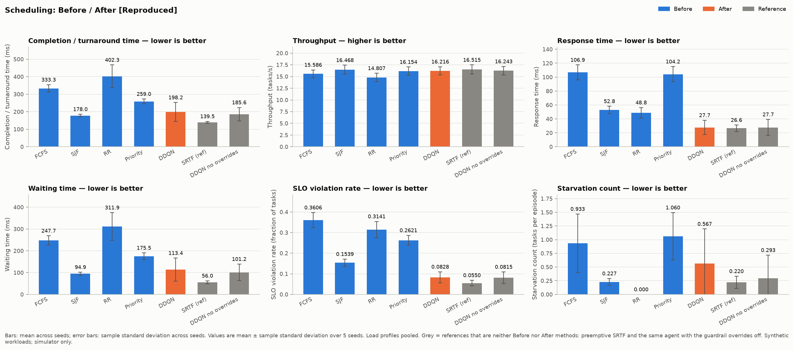
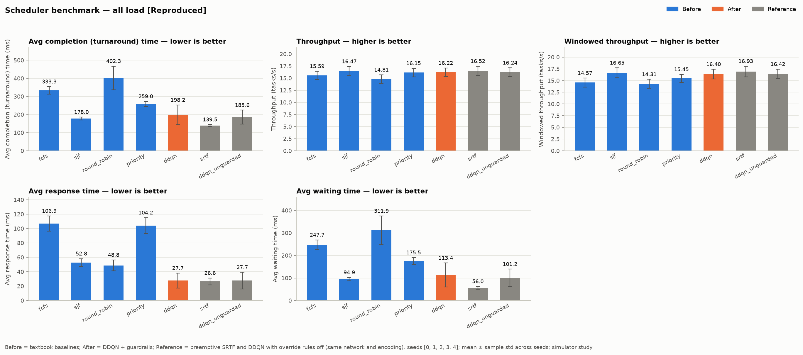
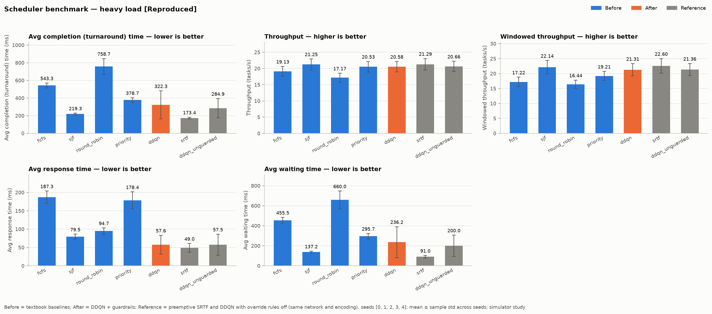
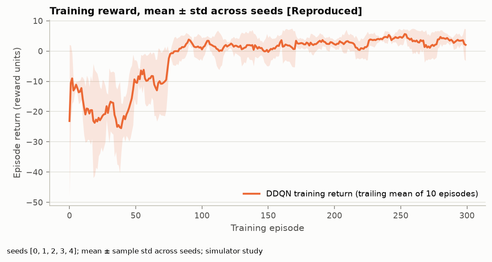
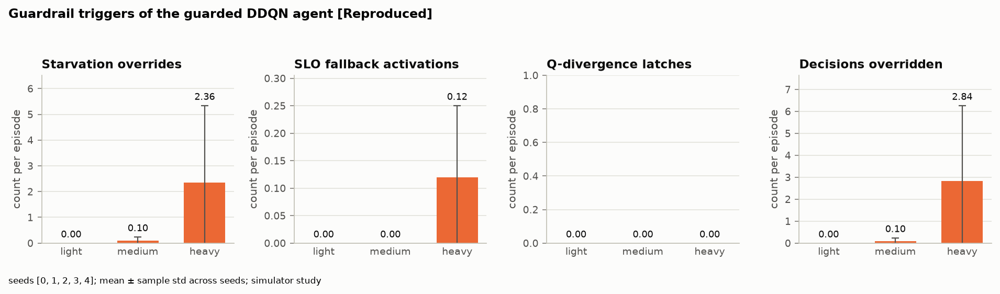
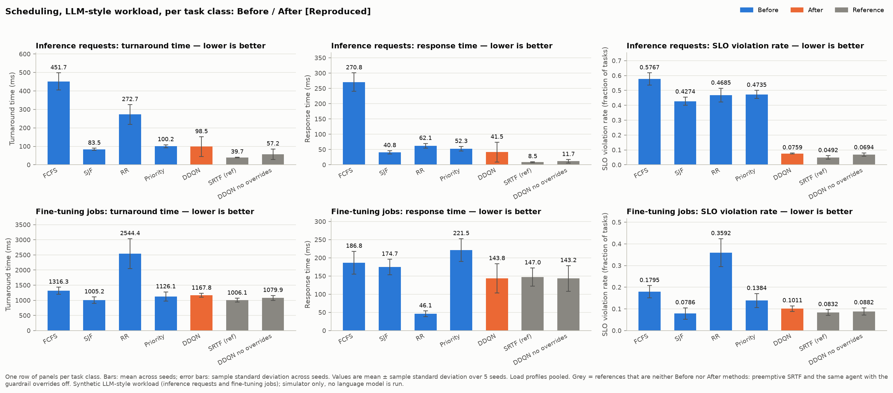
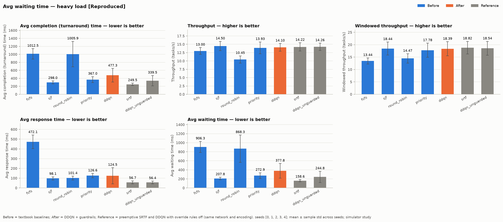
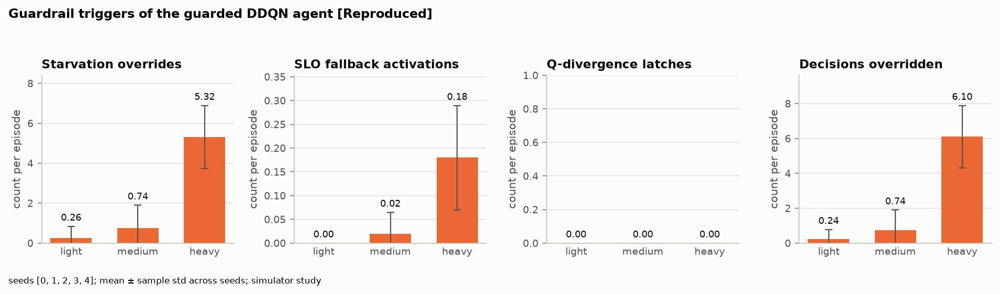

# Results

This file is the single complete record of what this repository has measured. Every reproduced
table that exists is included here, together with the question it answers, the command that
produced it, the configuration and seeds behind it, and the ways in which it can mislead. The
README, the project report, the poster and the slides show shorter versions of the same tables;
because every placement includes the same generated files, a value cannot differ between them.

This repository is a reference implementation for researchers. The method follows the Double
DQN scheduler described by Sun et al. (2025). The repository provides a complete, runnable
version of a Double DQN scheduling agent with every setting written down, a set of baselines,
guardrails, and a Before / After comparison measured under documented conditions; this file is
the record of those measurements. The companion project `federated-privacy-adult` is a separate
repository with its own data, code and results; the two share the same direction and the same
reporting conventions.

Nothing in this draft is production-ready. The benchmark is a discrete-event simulator of one
CPU, not a kernel modification, and it runs on synthetic workloads only; there is no real
scheduling dataset in this repository. This draft contains no large-language-model component
and no integrated demo. What it now has is a second study of the same benchmark on a synthetic
LLM-style workload (Section 4): short inference requests and long fine-tuning jobs sharing one
simulated node. No language model is run: the profile is a synthetic task mix shaped like the
work of an LLM platform, and none of its values was measured on an LLM system.

The reference runs behind every `[Reproduced]` value:

<!-- BEGIN GENERATED: reference_run_info -->
| Reference run | Created (UTC) | Seeds | Environment | Wall-clock time |
|---|---|---|---|---|
| scheduler | 2024-11-20T04:50:12Z | 0, 1, 2, 3, 4 | Python 3.12.14 on macOS-26.6.2-arm64-arm-64bit; gymnasium 1.4.0, matplotlib 3.11.2, numpy 2.5.5, pyyaml 6.0.3, torch 2.15.0 | 48 s with 5 worker processes |
| scheduler_llm | 2024-11-20T23:57:26Z | 0, 1, 2, 3, 4 | Python 3.12.14 on macOS-26.6.2-arm64-arm-64bit; gymnasium 1.4.0, matplotlib 3.11.2, numpy 2.5.5, pyyaml 6.0.3, torch 2.15.0 | 48 s with 5 worker processes |
<!-- END GENERATED: reference_run_info -->

## Contents

1. [How to read this file](#1-how-to-read-this-file)
2. [Scheduling benchmark](#2-scheduling-benchmark)
3. [Ablations](#3-ablations)
4. [LLM-style workload study](#4-llm-style-workload-study)
5. [Experiments specified but not run](#5-experiments-specified-but-not-run)
6. [CSV schemas and templates](#6-csv-schemas-and-templates)
7. [References](#7-references)

## 1. How to read this file

### Labels

Every number in this file carries exactly one of three labels.

| Label | Meaning |
|---|---|
| `[Paper-reported]` | Printed in the source paper (Sun et al., 2025); shown for reference only. It is not a target for this code and is never compared numerically with a value from this code. |
| `[Reproduced]` | Obtained by running this repository's code under the documented conditions (the config, seeds and workload named next to it), in the reference run listed above. The label says where a number comes from; it does not say that a number printed in a paper was reproduced. Such values appear only inside generated tables, never typed by hand. |
| `[Target / TBD]` | Specified but not run. The cell shows `TBD`, never an estimate. |

Settings chosen by this repository carry the tag `[Assumption — not in paper]`. That includes
every simulator and workload setting: the task mix, burst and memory distributions, arrival
rates, load profiles, deadlines, the 5-seed protocol and the evaluation workloads per seed.

### Statistics

Every reproduced value is the mean ± sample standard deviation over the five reporting seeds
0, 1, 2, 3 and 4. The standard deviation is taken over per-seed means: each seed trains its own
agent, generates its own evaluation workloads and evaluates every method on exactly those
workloads. The spread therefore mixes two sources, the randomness of training and the variation
between workload sets, and it is not a measurement error.

Five seeds are few. Treat a difference that is smaller than the larger of the two standard
deviations as "no measurable difference". No significance test is reported anywhere in this file.

Settings were chosen on development seeds (100 and above). The reporting seeds 0–4 were used
once for each reference run, and no setting was changed afterwards. One run is the exception,
and it is labelled as such wherever it appears: the post hoc variant of Section 4.8 was run on
the reporting seeds after the results of the LLM-style workload study had been seen. It changes
no setting and no table of the reference runs.

### The Before / After sign convention

The benchmark has a Before / After table with the columns Metric, Unit, Direction, Before Method,
Before Value, After Method, After Value, Delta (absolute), Improvement % and Source Label.

**A positive Improvement % always means better after; a negative Improvement % is a
regression.** For a higher-is-better metric Improvement % is (After − Before) / |Before| × 100;
for a lower-is-better metric it is (Before − After) / |Before| × 100. Delta is After − Before in
the metric's own unit, so its sign alone does not say whether the change is good: read the
Direction column. When Before is zero or near zero (for example a starvation count of zero), no
percentage is computed and the cell says why.

### Where the raw data is

| What | Where |
|---|---|
| Reference run (per-episode rows, summaries, training log, figures) | [reference/scheduler/](reference/scheduler/) |
| Ablations, one folder per variant | [reference/scheduler/ablations/](reference/scheduler/ablations/) |
| Figures of the reference run (PNG with the CSV behind each) | [reference/scheduler/figures/](reference/scheduler/figures/) |
| Before / After CSV and the grouped bar chart | [reference/before_after/](reference/before_after/) (`scheduling.csv`, `scheduling.png`) |
| LLM-style workload study: reference run (`raw_episodes.csv`, `summary.csv`, `training_log.csv`, the per-class files `class_episodes.csv` and `class_summary.csv`, `config_used.yaml`, `metadata.json`, `figures/`) | [reference/scheduler_llm/](reference/scheduler_llm/) |
| LLM-style workload study: Before / After CSV and charts | [reference/before_after/](reference/before_after/) (`scheduling_llm.csv`, `scheduling_llm.png`, `scheduling_llm_by_class.csv`, `scheduling_llm_by_class.png`) |
| LLM-style workload study: the post hoc variant of Section 4.8 (the same files as its reference run, without figures) | [reference/scheduler_llm/ablations/starvation_bounded_slice/](reference/scheduler_llm/ablations/starvation_bounded_slice/); the variant against the reference run as a CSV: `scheduling_llm_ablation.csv` in [reference/before_after/](reference/before_after/) |
| The Markdown tables included below | [reference/generated/](reference/generated/) |
| Header-only copies of every result CSV | [templates/](templates/) |

Each run folder holds `config_used.yaml` (the fully merged configuration) and `metadata.json`
(seeds, package versions, wall-clock time). The tables are rebuilt from those CSV files with
`make results`; your own runs go to `experiments/results/runs/`, which is git-ignored.

The per-class files of the LLM-style workload study are aggregated in the same way as every
other value: a class metric is first averaged over one seed's evaluation workloads, then the mean
± sample standard deviation is taken across seeds. A workload that contains no task of a class
contributes nothing to that class.

## 2. Scheduling benchmark

### 2.1 Research question and hypothesis

**Question.** On a simulated single-CPU machine with synthetic CPU-bound, memory-bound and
I/O-bound tasks, under which load does this repository's Double DQN scheduling agent
(van Hasselt et al., 2016), with the reward used here (response time is a penalty) and
guardrails, improve on the textbook schedulers FCFS, SJF, Round Robin and Priority?

**Hypothesis H1 (an expectation of this repository).** The guarded agent has a lower average
turnaround (completion) time than the best of the four baselines at every load profile (light,
medium and heavy), and it keeps a meaningful part of that advantage against SRTF, a preemptive
shortest-remaining-burst-first heuristic that has the same information and the same freedom to
preempt as the agent.

**How the expectation is checked.** *Met if* at every load profile the agent's mean turnaround is
below the best baseline by more than the seed-to-seed spread, and it is not clearly worse than
SRTF. *Not met if* at any load profile the agent is worse than the best baseline, or SRTF matches
or beats the agent everywhere, which would mean that the agent's gain over SJF comes from
preemption rather than from anything learned.

The criteria were fixed together with the protocol, before the reporting seeds were run. This
document itself was written after the reference run, so read the criteria as the yardstick the
tables are held against, not as a formal pre-registration.

### 2.2 Command, configuration and seeds

The reference run was produced by `experiments/run_reference.py`, which overwrites the committed
reference folder. To reproduce it into your own (git-ignored) folder:

```bash
python -m experiments.run_scheduler_benchmark \
    --config configs/scheduler_ddqn.yaml \
    --baselines-config configs/scheduler_baselines.yaml \
    --out experiments/results/runs/scheduler --workers 4 --no-checkpoints
python -m experiments.plot_scheduler --run-dir experiments/results/runs/scheduler
```

`make scheduler` runs the same two commands, except that it keeps the agent checkpoints (it does
not pass `--no-checkpoints`) and takes the number of workers from the `WORKERS` variable (default
4). Results do not depend on `--workers`; the reference run used five worker processes. To
re-create the committed reference run itself, including all ablations (this overwrites
`experiments/results/reference/`):

```bash
python -m experiments.run_reference --workers 8   # then: make results
```

`make reference` runs both steps. `python -m experiments.run_reference --skip-ablations`
re-creates the main run only.

| Item | Value |
|---|---|
| Agent, simulator, workload, reward, guardrails, evaluation | [configs/scheduler_ddqn.yaml](../../configs/scheduler_ddqn.yaml) |
| Baselines (FCFS, SJF, Round Robin, Priority) and the SRTF reference | [configs/scheduler_baselines.yaml](../../configs/scheduler_baselines.yaml) |
| Before / After definitions | [configs/before_after.yaml](../../configs/before_after.yaml) |
| Reporting seeds | 0, 1, 2, 3, 4 |
| Load profiles | light, medium, heavy (target CPU utilisation per profile in the config) `[Assumption — not in paper]` |

Design: for each seed, one agent is trained, a fixed set of evaluation workloads per load
profile is generated from that seed, and every method — the four baselines, SRTF, the guarded
agent and the same agent with its override rules off — is evaluated on exactly those workloads.
Training workloads and evaluation workloads come from different random streams.

The methods in the tables:

| Method | Role | Notes |
|---|---|---|
| FCFS, SJF, Round Robin | Before | SJF is non-preemptive and orders by the current CPU burst |
| Priority | Before | static priorities, no aging |
| Double DQN (guardrails on) | After | the reward used here, response time a penalty; standard Double DQN target |
| SRTF (preemptive reference) | reference, not a Before method | quantum equal to the agent's shortest time slice |
| Double DQN (guardrail overrides off) | reference, not a Before method | same trained network and observation encoding; the three override rules off |

### 2.3 Reference values

The Paper-reported values in this table come from the source paper and were obtained in a
different setup; they are shown for reference only and are not compared with values from this
code.

<!-- BEGIN GENERATED: paper_vs_reproduced -->
| Method | Metric | Paper-reported | Reproduced (mean ± std) | Notes |
|---|---|---|---|---|
| FCFS | Average completion (turnaround) time | 350 ms [Paper-reported] | 333.3 ± 20.9 ms [Reproduced] | Baseline. |
| FCFS | Throughput | 2.8 tasks/s [Paper-reported] | 15.586 ± 0.833 tasks/s [Reproduced] | Baseline. |
| FCFS | Average response time | 200 ms [Paper-reported] | 106.9 ± 10.6 ms [Reproduced] | Baseline. |
| SJF | Average completion (turnaround) time | 290 ms [Paper-reported] | 178.0 ± 8.0 ms [Reproduced] | Non-preemptive, shortest next CPU burst. |
| SJF | Throughput | 3.1 tasks/s [Paper-reported] | 16.468 ± 0.956 tasks/s [Reproduced] | Non-preemptive, shortest next CPU burst. |
| SJF | Average response time | 170 ms [Paper-reported] | 52.8 ± 5.4 ms [Reproduced] | Non-preemptive, shortest next CPU burst. |
| Round Robin | Average completion (turnaround) time | 310 ms [Paper-reported] | 402.3 ± 64.9 ms [Reproduced] | Quantum set in `configs/scheduler_baselines.yaml`. |
| Round Robin | Throughput | 3 tasks/s [Paper-reported] | 14.807 ± 0.892 tasks/s [Reproduced] | Quantum set in `configs/scheduler_baselines.yaml`. |
| Round Robin | Average response time | 180 ms [Paper-reported] | 48.8 ± 7.6 ms [Reproduced] | Quantum set in `configs/scheduler_baselines.yaml`. |
| Priority | Average completion (turnaround) time | not reported | 259.0 ± 13.7 ms [Reproduced] | Added by this repository. |
| Priority | Throughput | not reported | 16.154 ± 0.889 tasks/s [Reproduced] | Added by this repository. |
| Priority | Average response time | not reported | 104.2 ± 11.0 ms [Reproduced] | Added by this repository. |
| SRTF (preemptive reference) | Average completion (turnaround) time | not reported | 139.5 ± 5.4 ms [Reproduced] | Reference added by this repository: preemptive shortest-remaining-burst-first. |
| SRTF (preemptive reference) | Throughput | not reported | 16.515 ± 0.962 tasks/s [Reproduced] | Reference added by this repository: preemptive shortest-remaining-burst-first. |
| SRTF (preemptive reference) | Average response time | not reported | 26.6 ± 4.7 ms [Reproduced] | Reference added by this repository: preemptive shortest-remaining-burst-first. |
| Double DQN (guardrails on) | Average completion (turnaround) time | 250 ms [Paper-reported] | 198.2 ± 54.6 ms [Reproduced] | Reward with time penalties and a completion bonus; standard Double DQN target; guardrails on. |
| Double DQN (guardrails on) | Throughput | 3.5 tasks/s [Paper-reported] | 16.216 ± 0.884 tasks/s [Reproduced] | Reward with time penalties and a completion bonus; standard Double DQN target; guardrails on. |
| Double DQN (guardrails on) | Average response time | 150 ms [Paper-reported] | 27.7 ± 10.3 ms [Reproduced] | Reward with time penalties and a completion bonus; standard Double DQN target; guardrails on. |

The Paper-reported column is shown for reference only: it comes from a different setup, while the Reproduced column comes from this repository's simulator with the settings in `configs/scheduler_ddqn.yaml` (all three load profiles pooled). No difference between the two columns is computed anywhere in this repository.
<!-- END GENERATED: paper_vs_reproduced -->

### 2.4 Before / After

The full table compares the guarded agent with each of the four baselines on six metrics, with
the three load profiles pooled.

<!-- BEGIN GENERATED: before_after_full -->
Source label: [Reproduced]. Before = FCFS, SJF, Round Robin and Priority; After = Double DQN (guardrails on). Load profiles light, medium and heavy are pooled. Values are mean ± sample standard deviation over 5 seeds. Underlying CSV: `experiments/results/reference/before_after/scheduling.csv`.

| Metric | Unit | Direction | Before Method | Before Value | After Method | After Value | Delta (absolute) | Improvement % | Source Label |
|---|---|---|---|---|---|---|---|---|---|
| Completion / turnaround time | ms | Lower is better | FCFS | 333.3 ± 20.9 | Double DQN (guardrails on) | 198.2 ± 54.6 | -135.2 | +40.5% | [Reproduced] |
| Completion / turnaround time | ms | Lower is better | SJF | 178.0 ± 8.0 | Double DQN (guardrails on) | 198.2 ± 54.6 | +20.2 | -11.3% | [Reproduced] |
| Completion / turnaround time | ms | Lower is better | Round Robin | 402.3 ± 64.9 | Double DQN (guardrails on) | 198.2 ± 54.6 | -204.2 | +50.7% | [Reproduced] |
| Completion / turnaround time | ms | Lower is better | Priority | 259.0 ± 13.7 | Double DQN (guardrails on) | 198.2 ± 54.6 | -60.8 | +23.5% | [Reproduced] |
| Throughput | tasks/s | Higher is better | FCFS | 15.586 ± 0.833 | Double DQN (guardrails on) | 16.216 ± 0.884 | +0.630 | +4.0% | [Reproduced] |
| Throughput | tasks/s | Higher is better | SJF | 16.468 ± 0.956 | Double DQN (guardrails on) | 16.216 ± 0.884 | -0.253 | -1.5% | [Reproduced] |
| Throughput | tasks/s | Higher is better | Round Robin | 14.807 ± 0.892 | Double DQN (guardrails on) | 16.216 ± 0.884 | +1.409 | +9.5% | [Reproduced] |
| Throughput | tasks/s | Higher is better | Priority | 16.154 ± 0.889 | Double DQN (guardrails on) | 16.216 ± 0.884 | +0.061 | +0.4% | [Reproduced] |
| Response time | ms | Lower is better | FCFS | 106.9 ± 10.6 | Double DQN (guardrails on) | 27.7 ± 10.3 | -79.1 | +74.0% | [Reproduced] |
| Response time | ms | Lower is better | SJF | 52.8 ± 5.4 | Double DQN (guardrails on) | 27.7 ± 10.3 | -25.0 | +47.4% | [Reproduced] |
| Response time | ms | Lower is better | Round Robin | 48.8 ± 7.6 | Double DQN (guardrails on) | 27.7 ± 10.3 | -21.0 | +43.1% | [Reproduced] |
| Response time | ms | Lower is better | Priority | 104.2 ± 11.0 | Double DQN (guardrails on) | 27.7 ± 10.3 | -76.4 | +73.4% | [Reproduced] |
| Waiting time | ms | Lower is better | FCFS | 247.7 ± 21.3 | Double DQN (guardrails on) | 113.4 ± 53.2 | -134.3 | +54.2% | [Reproduced] |
| Waiting time | ms | Lower is better | SJF | 94.9 ± 7.3 | Double DQN (guardrails on) | 113.4 ± 53.2 | +18.5 | -19.5% | [Reproduced] |
| Waiting time | ms | Lower is better | Round Robin | 311.9 ± 63.5 | Double DQN (guardrails on) | 113.4 ± 53.2 | -198.5 | +63.7% | [Reproduced] |
| Waiting time | ms | Lower is better | Priority | 175.5 ± 15.1 | Double DQN (guardrails on) | 113.4 ± 53.2 | -62.1 | +35.4% | [Reproduced] |
| SLO violation rate | fraction of tasks | Lower is better | FCFS | 0.3606 ± 0.0364 | Double DQN (guardrails on) | 0.0828 ± 0.0270 | -0.2778 | +77.0% | [Reproduced] |
| SLO violation rate | fraction of tasks | Lower is better | SJF | 0.1539 ± 0.0174 | Double DQN (guardrails on) | 0.0828 ± 0.0270 | -0.0711 | +46.2% | [Reproduced] |
| SLO violation rate | fraction of tasks | Lower is better | Round Robin | 0.3141 ± 0.0399 | Double DQN (guardrails on) | 0.0828 ± 0.0270 | -0.2313 | +73.6% | [Reproduced] |
| SLO violation rate | fraction of tasks | Lower is better | Priority | 0.2621 ± 0.0245 | Double DQN (guardrails on) | 0.0828 ± 0.0270 | -0.1793 | +68.4% | [Reproduced] |
| Starvation count | tasks per episode | Lower is better | FCFS | 0.933 ± 0.535 | Double DQN (guardrails on) | 0.567 ± 0.629 | -0.367 | +39.3% | [Reproduced] |
| Starvation count | tasks per episode | Lower is better | SJF | 0.227 ± 0.064 | Double DQN (guardrails on) | 0.567 ± 0.629 | +0.340 | -150.0% | [Reproduced] |
| Starvation count | tasks per episode | Lower is better | Round Robin | 0.000 ± 0.000 | Double DQN (guardrails on) | 0.567 ± 0.629 | +0.567 | N/A — baseline zero / not comparable | [Reproduced] |
| Starvation count | tasks per episode | Lower is better | Priority | 1.060 ± 0.435 | Double DQN (guardrails on) | 0.567 ± 0.629 | -0.493 | +46.5% | [Reproduced] |

- Starvation count, Round Robin → Double DQN (guardrails on): Before is zero or near zero (|Before| <= 0.05 tasks per episode), so a percentage would be meaningless.

Improvement % convention: a positive value always means better after. For higher-is-better metrics, Improvement % = (After − Before) / |Before| × 100; for lower-is-better metrics, Improvement % = (Before − After) / |Before| × 100. Delta = After − Before in the metric's own unit. Both are computed from unrounded means measured under the same config, dataset, workload and seeds; a regression shows as a negative Improvement %.
<!-- END GENERATED: before_after_full -->



*Figure 1 — Scheduling Before / After, load profiles pooled `[Reproduced]`.* Bars are means over
the five seeds and error bars are sample standard deviations. Blue bars are the four Before
baselines, the orange bar is the After method (the guarded agent), and grey bars are references
that are neither Before nor After: SRTF and the agent with its override rules off. What it does
not show: the per-load picture (pooling mixes the light- and medium-load advantage over SJF with
the much larger heavy-load regression, see the table below and Section 2.7), the spread over
single workloads, or anything about a real operating system — it is a simulator with synthetic
workloads.

The same comparison for each load profile separately:

<!-- BEGIN GENERATED: before_after_by_load -->
Source label: [Reproduced]. One table per load profile. Values are mean ± sample standard deviation over 5 seeds.

**Load profile: light**

| Metric | Unit | Direction | Before Method | Before Value | After Method | After Value | Delta (absolute) | Improvement % | Source Label |
|---|---|---|---|---|---|---|---|---|---|
| Completion / turnaround time | ms | Lower is better | FCFS | 156.7 ± 12.9 | Double DQN (guardrails on) | 115.7 ± 3.4 | -41.0 | +26.1% | [Reproduced] |
| Completion / turnaround time | ms | Lower is better | SJF | 133.4 ± 6.0 | Double DQN (guardrails on) | 115.7 ± 3.4 | -17.7 | +13.3% | [Reproduced] |
| Completion / turnaround time | ms | Lower is better | Round Robin | 141.8 ± 9.1 | Double DQN (guardrails on) | 115.7 ± 3.4 | -26.1 | +18.4% | [Reproduced] |
| Completion / turnaround time | ms | Lower is better | Priority | 154.3 ± 10.6 | Double DQN (guardrails on) | 115.7 ± 3.4 | -38.6 | +25.0% | [Reproduced] |
| Throughput | tasks/s | Higher is better | FCFS | 11.490 ± 0.999 | Double DQN (guardrails on) | 11.532 ± 0.988 | +0.042 | +0.4% | [Reproduced] |
| Throughput | tasks/s | Higher is better | SJF | 11.514 ± 1.001 | Double DQN (guardrails on) | 11.532 ± 0.988 | +0.018 | +0.2% | [Reproduced] |
| Throughput | tasks/s | Higher is better | Round Robin | 11.521 ± 1.002 | Double DQN (guardrails on) | 11.532 ± 0.988 | +0.011 | +0.1% | [Reproduced] |
| Throughput | tasks/s | Higher is better | Priority | 11.499 ± 1.004 | Double DQN (guardrails on) | 11.532 ± 0.988 | +0.033 | +0.3% | [Reproduced] |
| Response time | ms | Lower is better | FCFS | 35.5 ± 9.1 | Double DQN (guardrails on) | 7.5 ± 2.7 | -28.0 | +78.8% | [Reproduced] |
| Response time | ms | Lower is better | SJF | 25.2 ± 4.8 | Double DQN (guardrails on) | 7.5 ± 2.7 | -17.7 | +70.1% | [Reproduced] |
| Response time | ms | Lower is better | Round Robin | 12.1 ± 2.6 | Double DQN (guardrails on) | 7.5 ± 2.7 | -4.6 | +37.6% | [Reproduced] |
| Response time | ms | Lower is better | Priority | 39.9 ± 10.1 | Double DQN (guardrails on) | 7.5 ± 2.7 | -32.3 | +81.1% | [Reproduced] |
| Waiting time | ms | Lower is better | FCFS | 73.0 ± 14.6 | Double DQN (guardrails on) | 31.8 ± 5.7 | -41.2 | +56.4% | [Reproduced] |
| Waiting time | ms | Lower is better | SJF | 49.8 ± 5.7 | Double DQN (guardrails on) | 31.8 ± 5.7 | -18.0 | +36.2% | [Reproduced] |
| Waiting time | ms | Lower is better | Round Robin | 57.4 ± 11.1 | Double DQN (guardrails on) | 31.8 ± 5.7 | -25.6 | +44.6% | [Reproduced] |
| Waiting time | ms | Lower is better | Priority | 70.8 ± 11.9 | Double DQN (guardrails on) | 31.8 ± 5.7 | -38.9 | +55.0% | [Reproduced] |
| SLO violation rate | fraction of tasks | Lower is better | FCFS | 0.1282 ± 0.0363 | Double DQN (guardrails on) | 0.0104 ± 0.0069 | -0.1178 | +91.9% | [Reproduced] |
| SLO violation rate | fraction of tasks | Lower is better | SJF | 0.0658 ± 0.0231 | Double DQN (guardrails on) | 0.0104 ± 0.0069 | -0.0554 | +84.2% | [Reproduced] |
| SLO violation rate | fraction of tasks | Lower is better | Round Robin | 0.0792 ± 0.0380 | Double DQN (guardrails on) | 0.0104 ± 0.0069 | -0.0688 | +86.9% | [Reproduced] |
| SLO violation rate | fraction of tasks | Lower is better | Priority | 0.1136 ± 0.0310 | Double DQN (guardrails on) | 0.0104 ± 0.0069 | -0.1032 | +90.8% | [Reproduced] |
| Starvation count | tasks per episode | Lower is better | FCFS | 0.000 ± 0.000 | Double DQN (guardrails on) | 0.000 ± 0.000 | +0.000 | N/A — baseline zero / not comparable | [Reproduced] |
| Starvation count | tasks per episode | Lower is better | SJF | 0.020 ± 0.045 | Double DQN (guardrails on) | 0.000 ± 0.000 | -0.020 | N/A — baseline zero / not comparable | [Reproduced] |
| Starvation count | tasks per episode | Lower is better | Round Robin | 0.000 ± 0.000 | Double DQN (guardrails on) | 0.000 ± 0.000 | +0.000 | N/A — baseline zero / not comparable | [Reproduced] |
| Starvation count | tasks per episode | Lower is better | Priority | 0.180 ± 0.217 | Double DQN (guardrails on) | 0.000 ± 0.000 | -0.180 | +100.0% | [Reproduced] |

- Starvation count, FCFS → Double DQN (guardrails on): Before is zero or near zero (|Before| <= 0.05 tasks per episode), so a percentage would be meaningless.
- Starvation count, SJF → Double DQN (guardrails on): Before is zero or near zero (|Before| <= 0.05 tasks per episode), so a percentage would be meaningless.
- Starvation count, Round Robin → Double DQN (guardrails on): Before is zero or near zero (|Before| <= 0.05 tasks per episode), so a percentage would be meaningless.

**Load profile: medium**

| Metric | Unit | Direction | Before Method | Before Value | After Method | After Value | Delta (absolute) | Improvement % | Source Label |
|---|---|---|---|---|---|---|---|---|---|
| Completion / turnaround time | ms | Lower is better | FCFS | 300.1 ± 37.7 | Double DQN (guardrails on) | 156.6 ± 14.0 | -143.5 | +47.8% | [Reproduced] |
| Completion / turnaround time | ms | Lower is better | SJF | 181.4 ± 8.7 | Double DQN (guardrails on) | 156.6 ± 14.0 | -24.9 | +13.7% | [Reproduced] |
| Completion / turnaround time | ms | Lower is better | Round Robin | 306.5 ± 122.6 | Double DQN (guardrails on) | 156.6 ± 14.0 | -149.9 | +48.9% | [Reproduced] |
| Completion / turnaround time | ms | Lower is better | Priority | 244.0 ± 19.1 | Double DQN (guardrails on) | 156.6 ± 14.0 | -87.5 | +35.8% | [Reproduced] |
| Throughput | tasks/s | Higher is better | FCFS | 16.142 ± 1.428 | Double DQN (guardrails on) | 16.536 ± 1.416 | +0.394 | +2.4% | [Reproduced] |
| Throughput | tasks/s | Higher is better | SJF | 16.645 ± 1.547 | Double DQN (guardrails on) | 16.536 ± 1.416 | -0.109 | -0.7% | [Reproduced] |
| Throughput | tasks/s | Higher is better | Round Robin | 15.731 ± 1.261 | Double DQN (guardrails on) | 16.536 ± 1.416 | +0.805 | +5.1% | [Reproduced] |
| Throughput | tasks/s | Higher is better | Priority | 16.437 ± 1.457 | Double DQN (guardrails on) | 16.536 ± 1.416 | +0.099 | +0.6% | [Reproduced] |
| Response time | ms | Lower is better | FCFS | 97.8 ± 16.0 | Double DQN (guardrails on) | 18.1 ± 6.2 | -79.7 | +81.5% | [Reproduced] |
| Response time | ms | Lower is better | SJF | 53.6 ± 7.5 | Double DQN (guardrails on) | 18.1 ± 6.2 | -35.5 | +66.2% | [Reproduced] |
| Response time | ms | Lower is better | Round Robin | 39.5 ± 16.5 | Double DQN (guardrails on) | 18.1 ± 6.2 | -21.4 | +54.2% | [Reproduced] |
| Response time | ms | Lower is better | Priority | 94.2 ± 16.5 | Double DQN (guardrails on) | 18.1 ± 6.2 | -76.1 | +80.8% | [Reproduced] |
| Waiting time | ms | Lower is better | FCFS | 214.5 ± 38.5 | Double DQN (guardrails on) | 72.1 ± 15.6 | -142.5 | +66.4% | [Reproduced] |
| Waiting time | ms | Lower is better | SJF | 97.6 ± 8.0 | Double DQN (guardrails on) | 72.1 ± 15.6 | -25.5 | +26.2% | [Reproduced] |
| Waiting time | ms | Lower is better | Round Robin | 218.2 ± 120.5 | Double DQN (guardrails on) | 72.1 ± 15.6 | -146.2 | +67.0% | [Reproduced] |
| Waiting time | ms | Lower is better | Priority | 159.9 ± 20.5 | Double DQN (guardrails on) | 72.1 ± 15.6 | -87.9 | +54.9% | [Reproduced] |
| SLO violation rate | fraction of tasks | Lower is better | FCFS | 0.3525 ± 0.0585 | Double DQN (guardrails on) | 0.0577 ± 0.0283 | -0.2949 | +83.6% | [Reproduced] |
| SLO violation rate | fraction of tasks | Lower is better | SJF | 0.1704 ± 0.0183 | Double DQN (guardrails on) | 0.0577 ± 0.0283 | -0.1127 | +66.2% | [Reproduced] |
| SLO violation rate | fraction of tasks | Lower is better | Round Robin | 0.2780 ± 0.0853 | Double DQN (guardrails on) | 0.0577 ± 0.0283 | -0.2203 | +79.3% | [Reproduced] |
| SLO violation rate | fraction of tasks | Lower is better | Priority | 0.2596 ± 0.0307 | Double DQN (guardrails on) | 0.0577 ± 0.0283 | -0.2020 | +77.8% | [Reproduced] |
| Starvation count | tasks per episode | Lower is better | FCFS | 0.140 ± 0.313 | Double DQN (guardrails on) | 0.100 ± 0.141 | -0.040 | +28.6% | [Reproduced] |
| Starvation count | tasks per episode | Lower is better | SJF | 0.160 ± 0.089 | Double DQN (guardrails on) | 0.100 ± 0.141 | -0.060 | +37.5% | [Reproduced] |
| Starvation count | tasks per episode | Lower is better | Round Robin | 0.000 ± 0.000 | Double DQN (guardrails on) | 0.100 ± 0.141 | +0.100 | N/A — baseline zero / not comparable | [Reproduced] |
| Starvation count | tasks per episode | Lower is better | Priority | 0.500 ± 0.274 | Double DQN (guardrails on) | 0.100 ± 0.141 | -0.400 | +80.0% | [Reproduced] |

- Starvation count, Round Robin → Double DQN (guardrails on): Before is zero or near zero (|Before| <= 0.05 tasks per episode), so a percentage would be meaningless.

**Load profile: heavy**

| Metric | Unit | Direction | Before Method | Before Value | After Method | After Value | Delta (absolute) | Improvement % | Source Label |
|---|---|---|---|---|---|---|---|---|---|
| Completion / turnaround time | ms | Lower is better | FCFS | 543.3 ± 27.7 | Double DQN (guardrails on) | 322.3 ± 159.3 | -221.0 | +40.7% | [Reproduced] |
| Completion / turnaround time | ms | Lower is better | SJF | 219.3 ± 10.6 | Double DQN (guardrails on) | 322.3 ± 159.3 | +103.0 | -47.0% | [Reproduced] |
| Completion / turnaround time | ms | Lower is better | Round Robin | 758.7 ± 88.9 | Double DQN (guardrails on) | 322.3 ± 159.3 | -436.4 | +57.5% | [Reproduced] |
| Completion / turnaround time | ms | Lower is better | Priority | 378.7 ± 25.0 | Double DQN (guardrails on) | 322.3 ± 159.3 | -56.4 | +14.9% | [Reproduced] |
| Throughput | tasks/s | Higher is better | FCFS | 19.126 ± 1.540 | Double DQN (guardrails on) | 20.579 ± 1.589 | +1.453 | +7.6% | [Reproduced] |
| Throughput | tasks/s | Higher is better | SJF | 21.246 ± 1.694 | Double DQN (guardrails on) | 20.579 ± 1.589 | -0.667 | -3.1% | [Reproduced] |
| Throughput | tasks/s | Higher is better | Round Robin | 17.168 ± 1.394 | Double DQN (guardrails on) | 20.579 ± 1.589 | +3.410 | +19.9% | [Reproduced] |
| Throughput | tasks/s | Higher is better | Priority | 20.527 ± 1.649 | Double DQN (guardrails on) | 20.579 ± 1.589 | +0.052 | +0.3% | [Reproduced] |
| Response time | ms | Lower is better | FCFS | 187.3 ± 16.7 | Double DQN (guardrails on) | 57.6 ± 25.8 | -129.7 | +69.3% | [Reproduced] |
| Response time | ms | Lower is better | SJF | 79.5 ± 6.8 | Double DQN (guardrails on) | 57.6 ± 25.8 | -22.0 | +27.6% | [Reproduced] |
| Response time | ms | Lower is better | Round Robin | 94.7 ± 8.6 | Double DQN (guardrails on) | 57.6 ± 25.8 | -37.2 | +39.2% | [Reproduced] |
| Response time | ms | Lower is better | Priority | 178.4 ± 23.2 | Double DQN (guardrails on) | 57.6 ± 25.8 | -120.9 | +67.7% | [Reproduced] |
| Waiting time | ms | Lower is better | FCFS | 455.5 ± 28.7 | Double DQN (guardrails on) | 236.2 ± 154.7 | -219.3 | +48.1% | [Reproduced] |
| Waiting time | ms | Lower is better | SJF | 137.2 ± 9.4 | Double DQN (guardrails on) | 236.2 ± 154.7 | +99.0 | -72.1% | [Reproduced] |
| Waiting time | ms | Lower is better | Round Robin | 660.0 ± 87.5 | Double DQN (guardrails on) | 236.2 ± 154.7 | -423.8 | +64.2% | [Reproduced] |
| Waiting time | ms | Lower is better | Priority | 295.7 ± 27.3 | Double DQN (guardrails on) | 236.2 ± 154.7 | -59.5 | +20.1% | [Reproduced] |
| SLO violation rate | fraction of tasks | Lower is better | FCFS | 0.6012 ± 0.0368 | Double DQN (guardrails on) | 0.1803 ± 0.0556 | -0.4208 | +70.0% | [Reproduced] |
| SLO violation rate | fraction of tasks | Lower is better | SJF | 0.2256 ± 0.0168 | Double DQN (guardrails on) | 0.1803 ± 0.0556 | -0.0453 | +20.1% | [Reproduced] |
| SLO violation rate | fraction of tasks | Lower is better | Round Robin | 0.5851 ± 0.0408 | Double DQN (guardrails on) | 0.1803 ± 0.0556 | -0.4047 | +69.2% | [Reproduced] |
| SLO violation rate | fraction of tasks | Lower is better | Priority | 0.4131 ± 0.0200 | Double DQN (guardrails on) | 0.1803 ± 0.0556 | -0.2327 | +56.3% | [Reproduced] |
| Starvation count | tasks per episode | Lower is better | FCFS | 2.660 ± 1.503 | Double DQN (guardrails on) | 1.600 ± 1.857 | -1.060 | +39.8% | [Reproduced] |
| Starvation count | tasks per episode | Lower is better | SJF | 0.500 ± 0.200 | Double DQN (guardrails on) | 1.600 ± 1.857 | +1.100 | -220.0% | [Reproduced] |
| Starvation count | tasks per episode | Lower is better | Round Robin | 0.000 ± 0.000 | Double DQN (guardrails on) | 1.600 ± 1.857 | +1.600 | N/A — baseline zero / not comparable | [Reproduced] |
| Starvation count | tasks per episode | Lower is better | Priority | 2.500 ± 1.269 | Double DQN (guardrails on) | 1.600 ± 1.857 | -0.900 | +36.0% | [Reproduced] |

- Starvation count, Round Robin → Double DQN (guardrails on): Before is zero or near zero (|Before| <= 0.05 tasks per episode), so a percentage would be meaningless.

Improvement % convention: a positive value always means better after. For higher-is-better metrics, Improvement % = (After − Before) / |Before| × 100; for lower-is-better metrics, Improvement % = (Before − After) / |Before| × 100. Delta = After − Before in the metric's own unit. Both are computed from unrounded means measured under the same config, dataset, workload and seeds; a regression shows as a negative Improvement %.
<!-- END GENERATED: before_after_by_load -->

A positive Improvement % always means better after; a negative value is a regression.

### 2.5 All methods, all metrics

This reproduced-only table also lists the metrics that are not part of the Before / After
comparison: 95th-percentile turnaround, windowed throughput (tasks completed inside a fixed
window, reported because plain throughput barely differs between work-conserving schedulers),
CPU utilisation, the longest single wait, the number of priority-adjust actions and
the number of decisions the guardrails overrode.

<!-- BEGIN GENERATED: all_methods -->
Source label: [Reproduced]. Every cell is mean ± sample standard deviation across seeds; `all` pools the three load profiles.

| Load | Method | Completion / turnaround time (ms) | Throughput (tasks/s) | Response time (ms) | Waiting time (ms) | SLO violation rate (fraction of tasks) | Starvation count (tasks per episode) | p95 turnaround (ms) | Windowed throughput (tasks/s) | CPU utilisation (fraction) | Longest wait (ms) | Priority actions (per episode) | Guardrail overrides (per episode) |
|---|---|---|---|---|---|---|---|---|---|---|---|---|---|
| all | FCFS | 333.3 ± 20.9 | 15.586 ± 0.833 | 106.9 ± 10.6 | 247.7 ± 21.3 | 0.3606 ± 0.0364 | 0.933 ± 0.535 | 832.2 ± 50.3 | 14.569 ± 0.943 | 0.695 ± 0.019 | 384.5 ± 25.1 | 0.0 ± 0.0 | 0.00 ± 0.00 |
| all | SJF | 178.0 ± 8.0 | 16.468 ± 0.956 | 52.8 ± 5.4 | 94.9 ± 7.3 | 0.1539 ± 0.0174 | 0.227 ± 0.064 | 478.5 ± 20.5 | 16.648 ± 1.066 | 0.691 ± 0.020 | 551.6 ± 53.6 | 0.0 ± 0.0 | 0.00 ± 0.00 |
| all | Round Robin | 402.3 ± 64.9 | 14.807 ± 0.892 | 48.8 ± 7.6 | 311.9 ± 63.5 | 0.3141 ± 0.0399 | 0.000 ± 0.000 | 917.6 ± 123.4 | 14.309 ± 0.950 | 0.703 ± 0.018 | 154.7 ± 22.3 | 0.0 ± 0.0 | 0.00 ± 0.00 |
| all | Priority | 259.0 ± 13.7 | 16.154 ± 0.889 | 104.2 ± 11.0 | 175.5 ± 15.1 | 0.2621 ± 0.0245 | 1.060 ± 0.435 | 759.6 ± 40.2 | 15.455 ± 0.860 | 0.687 ± 0.020 | 698.3 ± 59.7 | 0.0 ± 0.0 | 0.00 ± 0.00 |
| all | Double DQN (guardrails on) | 198.2 ± 54.6 | 16.216 ± 0.884 | 27.7 ± 10.3 | 113.4 ± 53.2 | 0.0828 ± 0.0270 | 0.567 ± 0.629 | 537.3 ± 104.6 | 16.398 ± 1.016 | 0.690 ± 0.020 | 324.6 ± 73.2 | 68.9 ± 35.8 | 0.98 ± 1.15 |
| all | SRTF (preemptive reference) | 139.5 ± 5.4 | 16.515 ± 0.962 | 26.6 ± 4.7 | 56.0 ± 6.7 | 0.0550 ± 0.0135 | 0.220 ± 0.112 | 401.2 ± 27.5 | 16.926 ± 1.143 | 0.692 ± 0.020 | 512.1 ± 81.1 | 0.0 ± 0.0 | 0.00 ± 0.00 |
| all | Double DQN (guardrail overrides off) | 185.6 ± 38.7 | 16.243 ± 0.905 | 27.7 ± 11.5 | 101.2 ± 38.0 | 0.0815 ± 0.0279 | 0.293 ± 0.424 | 518.0 ± 85.6 | 16.417 ± 1.011 | 0.690 ± 0.020 | 344.2 ± 121.0 | 72.6 ± 33.0 | 0.00 ± 0.00 |
| light | FCFS | 156.7 ± 12.9 | 11.490 ± 0.999 | 35.5 ± 9.1 | 73.0 ± 14.6 | 0.1282 ± 0.0363 | 0.000 ± 0.000 | 432.8 ± 47.1 | 11.291 ± 1.000 | 0.488 ± 0.024 | 251.8 ± 39.0 | 0.0 ± 0.0 | 0.00 ± 0.00 |
| light | SJF | 133.4 ± 6.0 | 11.514 ± 1.001 | 25.2 ± 4.8 | 49.8 ± 5.7 | 0.0658 ± 0.0231 | 0.020 ± 0.045 | 350.8 ± 26.8 | 11.337 ± 1.023 | 0.488 ± 0.023 | 301.3 ± 60.2 | 0.0 ± 0.0 | 0.00 ± 0.00 |
| light | Round Robin | 141.8 ± 9.1 | 11.521 ± 1.002 | 12.1 ± 2.6 | 57.4 ± 11.1 | 0.0792 ± 0.0380 | 0.000 ± 0.000 | 386.5 ± 34.6 | 11.273 ± 0.992 | 0.492 ± 0.024 | 69.5 ± 10.5 | 0.0 ± 0.0 | 0.00 ± 0.00 |
| light | Priority | 154.3 ± 10.6 | 11.499 ± 1.004 | 39.9 ± 10.1 | 70.8 ± 11.9 | 0.1136 ± 0.0310 | 0.180 ± 0.217 | 443.1 ± 53.1 | 11.283 ± 1.045 | 0.487 ± 0.022 | 419.8 ± 78.6 | 0.0 ± 0.0 | 0.00 ± 0.00 |
| light | Double DQN (guardrails on) | 115.7 ± 3.4 | 11.532 ± 0.988 | 7.5 ± 2.7 | 31.8 ± 5.7 | 0.0104 ± 0.0069 | 0.000 ± 0.000 | 300.1 ± 35.9 | 11.400 ± 0.973 | 0.489 ± 0.022 | 145.7 ± 30.6 | 17.0 ± 13.9 | 0.00 ± 0.00 |
| light | SRTF (preemptive reference) | 109.2 ± 1.4 | 11.552 ± 1.000 | 9.5 ± 2.5 | 25.3 ± 2.9 | 0.0111 ± 0.0043 | 0.020 ± 0.045 | 263.1 ± 22.8 | 11.443 ± 0.968 | 0.489 ± 0.022 | 216.5 ± 60.7 | 0.0 ± 0.0 | 0.00 ± 0.00 |
| light | Double DQN (guardrail overrides off) | 115.7 ± 3.4 | 11.532 ± 0.988 | 7.5 ± 2.7 | 31.8 ± 5.7 | 0.0104 ± 0.0069 | 0.000 ± 0.000 | 300.1 ± 35.9 | 11.400 ± 0.973 | 0.489 ± 0.022 | 145.7 ± 30.6 | 17.0 ± 13.9 | 0.00 ± 0.00 |
| medium | FCFS | 300.1 ± 37.7 | 16.142 ± 1.428 | 97.8 ± 16.0 | 214.5 ± 38.5 | 0.3525 ± 0.0585 | 0.140 ± 0.313 | 770.6 ± 81.7 | 15.197 ± 1.273 | 0.731 ± 0.026 | 360.0 ± 50.1 | 0.0 ± 0.0 | 0.00 ± 0.00 |
| medium | SJF | 181.4 ± 8.7 | 16.645 ± 1.547 | 53.6 ± 7.5 | 97.6 ± 8.0 | 0.1704 ± 0.0183 | 0.160 ± 0.089 | 470.5 ± 28.3 | 16.471 ± 1.469 | 0.725 ± 0.032 | 532.9 ± 94.9 | 0.0 ± 0.0 | 0.00 ± 0.00 |
| medium | Round Robin | 306.5 ± 122.6 | 15.731 ± 1.261 | 39.5 ± 16.5 | 218.2 ± 120.5 | 0.2780 ± 0.0853 | 0.000 ± 0.000 | 736.5 ± 230.5 | 15.212 ± 1.375 | 0.738 ± 0.031 | 137.3 ± 42.2 | 0.0 ± 0.0 | 0.00 ± 0.00 |
| medium | Priority | 244.0 ± 19.1 | 16.437 ± 1.457 | 94.2 ± 16.5 | 159.9 ± 20.5 | 0.2596 ± 0.0307 | 0.500 ± 0.274 | 712.8 ± 75.4 | 15.872 ± 1.576 | 0.722 ± 0.029 | 660.2 ± 85.6 | 0.0 ± 0.0 | 0.00 ± 0.00 |
| medium | Double DQN (guardrails on) | 156.6 ± 14.0 | 16.536 ± 1.416 | 18.1 ± 6.2 | 72.1 ± 15.6 | 0.0577 ± 0.0283 | 0.100 ± 0.141 | 475.6 ± 85.1 | 16.489 ± 1.449 | 0.724 ± 0.030 | 296.3 ± 102.0 | 59.1 ± 34.4 | 0.10 ± 0.14 |
| medium | SRTF (preemptive reference) | 136.0 ± 6.3 | 16.703 ± 1.497 | 21.2 ± 5.0 | 51.7 ± 7.9 | 0.0440 ± 0.0169 | 0.120 ± 0.110 | 371.0 ± 54.9 | 16.732 ± 1.515 | 0.727 ± 0.029 | 485.8 ± 137.7 | 0.0 ± 0.0 | 0.00 ± 0.00 |
| medium | Double DQN (guardrail overrides off) | 156.2 ± 14.4 | 16.537 ± 1.416 | 18.2 ± 6.7 | 71.7 ± 15.8 | 0.0557 ± 0.0280 | 0.080 ± 0.110 | 477.4 ± 86.2 | 16.489 ± 1.449 | 0.725 ± 0.030 | 318.7 ± 128.0 | 60.0 ± 33.6 | 0.00 ± 0.00 |
| heavy | FCFS | 543.3 ± 27.7 | 19.126 ± 1.540 | 187.3 ± 16.7 | 455.5 ± 28.7 | 0.6012 ± 0.0368 | 2.660 ± 1.503 | 1293.3 ± 87.0 | 17.219 ± 1.572 | 0.865 ± 0.034 | 541.9 ± 54.1 | 0.0 ± 0.0 | 0.00 ± 0.00 |
| heavy | SJF | 219.3 ± 10.6 | 21.246 ± 1.694 | 79.5 ± 6.8 | 137.2 ± 9.4 | 0.2256 ± 0.0168 | 0.500 ± 0.200 | 614.3 ± 32.5 | 22.136 ± 2.234 | 0.860 ± 0.034 | 820.6 ± 65.3 | 0.0 ± 0.0 | 0.00 ± 0.00 |
| heavy | Round Robin | 758.7 ± 88.9 | 17.168 ± 1.394 | 94.7 ± 8.6 | 660.0 ± 87.5 | 0.5851 ± 0.0408 | 0.000 ± 0.000 | 1629.7 ± 157.8 | 16.441 ± 1.385 | 0.878 ± 0.026 | 257.3 ± 27.4 | 0.0 ± 0.0 | 0.00 ± 0.00 |
| heavy | Priority | 378.7 ± 25.0 | 20.527 ± 1.649 | 178.4 ± 23.2 | 295.7 ± 27.3 | 0.4131 ± 0.0200 | 2.500 ± 1.269 | 1122.8 ± 77.9 | 19.209 ± 1.537 | 0.852 ± 0.032 | 1014.7 ± 90.1 | 0.0 ± 0.0 | 0.00 ± 0.00 |
| heavy | Double DQN (guardrails on) | 322.3 ± 159.3 | 20.579 ± 1.589 | 57.6 ± 25.8 | 236.2 ± 154.7 | 0.1803 ± 0.0556 | 1.600 ± 1.857 | 836.2 ± 293.4 | 21.305 ± 2.057 | 0.856 ± 0.032 | 531.9 ± 131.8 | 130.7 ± 64.0 | 2.84 ± 3.43 |
| heavy | SRTF (preemptive reference) | 173.4 ± 9.9 | 21.290 ± 1.779 | 49.0 ± 11.8 | 91.0 ± 12.6 | 0.1099 ± 0.0252 | 0.520 ± 0.295 | 569.5 ± 89.9 | 22.603 ± 2.425 | 0.861 ± 0.033 | 834.0 ± 92.7 | 0.0 ± 0.0 | 0.00 ± 0.00 |
| heavy | Double DQN (guardrail overrides off) | 284.9 ± 109.6 | 20.661 ± 1.569 | 57.5 ± 28.7 | 200.0 ± 106.7 | 0.1783 ± 0.0567 | 0.800 ± 1.198 | 776.5 ± 223.9 | 21.362 ± 2.021 | 0.856 ± 0.029 | 568.3 ± 223.5 | 140.7 ± 57.9 | 0.00 ± 0.00 |
<!-- END GENERATED: all_methods -->

### 2.6 Observations

<!-- BEGIN GENERATED: findings -->
Load profiles pooled:

- **Completion / turnaround time** (lower is better): Double DQN (guardrails on) 198.2 ± 54.6 ms; best baseline SJF 178.0 ± 8.0 ms; Improvement -11.3% (worse). Better than 3 of 4 baselines with a computable percentage (FCFS, Round Robin, Priority). [Reproduced]
- **Throughput** (higher is better): Double DQN (guardrails on) 16.216 ± 0.884 tasks/s; best baseline SJF 16.468 ± 0.956 tasks/s; Improvement -1.5% (worse). Better than 3 of 4 baselines with a computable percentage (FCFS, Round Robin, Priority). [Reproduced]
- **Response time** (lower is better): Double DQN (guardrails on) 27.7 ± 10.3 ms; best baseline Round Robin 48.8 ± 7.6 ms; Improvement +43.1% (better). Better than 4 of 4 baselines with a computable percentage (FCFS, SJF, Round Robin, Priority). [Reproduced]
- **Waiting time** (lower is better): Double DQN (guardrails on) 113.4 ± 53.2 ms; best baseline SJF 94.9 ± 7.3 ms; Improvement -19.5% (worse). Better than 3 of 4 baselines with a computable percentage (FCFS, Round Robin, Priority). [Reproduced]
- **SLO violation rate** (lower is better): Double DQN (guardrails on) 0.0828 ± 0.0270 fraction of tasks; best baseline SJF 0.1539 ± 0.0174 fraction of tasks; Improvement +46.2% (better). Better than 4 of 4 baselines with a computable percentage (FCFS, SJF, Round Robin, Priority). [Reproduced]
- **Starvation count** (lower is better): Double DQN (guardrails on) 0.567 ± 0.629 tasks per episode; best baseline Round Robin 0.000 ± 0.000 tasks per episode; no percentage (N/A — baseline zero / not comparable). Better than 2 of 3 baselines with a computable percentage (FCFS, Priority). [Reproduced]
- Against the best baseline per metric, Double DQN (guardrails on) is better on 2 of 5 metrics with a computable percentage. [Reproduced]

Completion / turnaround time by load profile:

- light: Double DQN (guardrails on) 115.7 ± 3.4 ms; best baseline SJF 133.4 ± 6.0 ms; Improvement +13.3% (better). [Reproduced]
- medium: Double DQN (guardrails on) 156.6 ± 14.0 ms; best baseline SJF 181.4 ± 8.7 ms; Improvement +13.7% (better). [Reproduced]
- heavy: Double DQN (guardrails on) 322.3 ± 159.3 ms; best baseline SJF 219.3 ± 10.6 ms; Improvement -47.0% (worse). [Reproduced]

References that are not Before methods (pooled):

- SRTF (preemptive reference) — Completion / turnaround time: reference 139.5 ± 5.4 versus 198.2 ± 54.6 ms for Double DQN (guardrails on) (Double DQN (guardrails on) is 42.0% worse than the reference); Response time: reference 26.6 ± 4.7 versus 27.7 ± 10.3 ms for Double DQN (guardrails on) (Double DQN (guardrails on) is 4.5% worse than the reference); SLO violation rate: reference 0.0550 ± 0.0135 versus 0.0828 ± 0.0270 fraction of tasks for Double DQN (guardrails on) (Double DQN (guardrails on) is 50.6% worse than the reference). [Reproduced]
  - light: completion / turnaround time reference 109.2 ± 1.4 versus 115.7 ± 3.4 ms (Double DQN (guardrails on) is 6.0% worse than the reference).
  - medium: completion / turnaround time reference 136.0 ± 6.3 versus 156.6 ± 14.0 ms (Double DQN (guardrails on) is 15.1% worse than the reference).
  - heavy: completion / turnaround time reference 173.4 ± 9.9 versus 322.3 ± 159.3 ms (Double DQN (guardrails on) is 85.8% worse than the reference).
- Double DQN (guardrail overrides off) — Completion / turnaround time: reference 185.6 ± 38.7 versus 198.2 ± 54.6 ms for Double DQN (guardrails on) (Double DQN (guardrails on) is 6.8% worse than the reference); Response time: reference 27.7 ± 11.5 versus 27.7 ± 10.3 ms for Double DQN (guardrails on) (Double DQN (guardrails on) is 0.1% worse than the reference); SLO violation rate: reference 0.0815 ± 0.0279 versus 0.0828 ± 0.0270 fraction of tasks for Double DQN (guardrails on) (Double DQN (guardrails on) is 1.6% worse than the reference). [Reproduced]
  - light: completion / turnaround time reference 115.7 ± 3.4 versus 115.7 ± 3.4 ms (Double DQN (guardrails on) is 0.0% worse than the reference).
  - medium: completion / turnaround time reference 156.2 ± 14.4 versus 156.6 ± 14.0 ms (Double DQN (guardrails on) is 0.2% worse than the reference).
  - heavy: completion / turnaround time reference 284.9 ± 109.6 versus 322.3 ± 159.3 ms (Double DQN (guardrails on) is 13.1% worse than the reference).

- Plain throughput differs by at most 11.2% between the five compared methods (pooled). [Reproduced]
<!-- END GENERATED: findings -->

**What this means, in words.**

- **The first part of H1 is met at light and medium load, not met at heavy load or on the pooled average.** In this
  implementation, with the documented configuration and five seeds, the guarded agent's average
  turnaround time is lower than that of SJF, the best baseline, at light and medium load and
  higher at heavy load; pooled over the three loads it is higher, and the pooled waiting time and
  throughput are also worse than SJF's. These are regressions and are shown as negative
  Improvement % values; the Before / After tables give the values. A user who cares most about
  turnaround under heavy load should prefer SJF or a preemptive shortest-remaining-time rule.
- **SRTF is ahead of the agent.** The preemptive SRTF reference, which is not a Before method,
  has a lower average turnaround than the agent at every load profile, and in the paired
  comparison the agent is below SRTF on almost no workload. The agent's advantage over SJF at
  light and medium load can therefore be explained by preemption, which SJF does not have; these
  tables show nothing the agent learned that a simple preemptive rule lacks. The second part of
  H1 is therefore not met.
- **Where the agent is better than every baseline:** response time and SLO-violation rate, pooled
  over the loads. On response time it is level with SRTF within the spread; on the SLO-violation
  rate SRTF is better.
- **Starvation:** Round Robin never starves a task; the agent does on some episodes. The agent's
  starvation count is tied to the starvation guardrail, because the metric's threshold equals the
  guardrail's maximum wait, so it is not a learned property. It is not bounded by the guardrail,
  however: the override acts only at decision points, so a task can cross the threshold while
  another task's burst is running, and it serves one starving task at a time. In the reference run
  the guarded agent's starvation count is non-zero and, under heavy load, higher than that of the
  agent with its override rules off (see the all-methods table and the tail analysis).
- **Throughput**, pooled over the loads, differs little between methods, as expected for
  work-conserving schedulers in a stable queue; the gaps are wider at heavy load (see the
  all-methods table). Because plain throughput barely separates the methods here, the all-methods table also reports
  windowed throughput.

### 2.7 Tail analysis

The pooled and heavy-load averages of the agent are driven by a few workloads. This table
separates the typical case from the tail.

<!-- BEGIN GENERATED: tail_analysis -->
Source label: [Reproduced]. All values are average turnaround times in ms, computed from `experiments/results/reference/scheduler/raw_episodes.csv`.

**Per seed, heavy load** (mean over that seed's evaluation workloads):

| Method | Seed 0 | Seed 1 | Seed 2 | Seed 3 | Seed 4 | Mean ± std across seeds |
|---|---|---|---|---|---|---|
| FCFS | 511.9 | 542.8 | 544.5 | 587.0 | 530.1 | 543.3 ± 27.7 |
| SJF | 231.9 | 207.6 | 214.5 | 228.9 | 213.4 | 219.3 ± 10.6 |
| Round Robin | 775.2 | 646.6 | 825.8 | 856.2 | 689.7 | 758.7 ± 88.9 |
| Priority | 338.2 | 387.8 | 386.7 | 405.4 | 375.2 | 378.7 ± 25.0 |
| Double DQN (guardrails on) | 212.3 | 197.9 | 224.3 | 555.8 | 421.2 | 322.3 ± 159.3 |
| SRTF (preemptive reference) | 174.1 | 161.9 | 185.6 | 179.9 | 165.5 | 173.4 ± 9.9 |
| Double DQN (guardrail overrides off) | 212.2 | 196.0 | 224.3 | 453.1 | 339.1 | 284.9 ± 109.6 |

**Distribution over single evaluation workloads, heavy load** (all seeds together):

| Method | Workloads | Median | 90th percentile | Maximum |
|---|---|---|---|---|
| FCFS | 50 | 391.1 | 981.6 | 1693.9 |
| SJF | 50 | 209.1 | 275.7 | 412.7 |
| Round Robin | 50 | 351.7 | 1733.6 | 3816.9 |
| Priority | 50 | 339.4 | 627.9 | 978.3 |
| Double DQN (guardrails on) | 50 | 190.5 | 341.1 | 3334.7 |
| SRTF (preemptive reference) | 50 | 163.5 | 229.0 | 298.9 |
| Double DQN (guardrail overrides off) | 50 | 190.5 | 330.9 | 2395.0 |

**Paired comparison on identical workloads** — in how many evaluation workloads does Double DQN (guardrails on) have a lower turnaround than the other method:

| Load | Workloads | Lower than SJF | Lower than SRTF (preemptive reference) | More than twice SJF |
|---|---|---|---|---|
| light | 50 | 50 of 50 | 1 of 50 | 0 |
| medium | 50 | 45 of 50 | 0 of 50 | 0 |
| heavy | 50 | 33 of 50 | 0 of 50 | 3 |

**The five worst heavy-load workloads of Double DQN (guardrails on):**

| Seed | Workload | Tasks | Turnaround, Double DQN (guardrails on) | Turnaround, SJF | Guardrail overrides | SLO-fallback activations | Starvation triggers |
|---|---|---|---|---|---|---|---|
| 3 | 1 | 47 | 3334.7 | 412.7 | 59 | 2 | 58 |
| 4 | 7 | 57 | 2638.7 | 353.7 | 49 | 2 | 44 |
| 3 | 6 | 49 | 504.7 | 248.9 | 16 | 1 | 4 |
| 3 | 4 | 45 | 476.5 | 259.3 | 4 | 0 | 4 |
| 1 | 6 | 60 | 342.4 | 273.1 | 5 | 0 | 5 |
<!-- END GENERATED: tail_analysis -->

**Reading.** On the median heavy-load workload the agent is competitive with SJF; at the 90th
percentile it is somewhat worse and at the maximum far worse. Two seeds account for most of the
damage, and in the two worst workloads the guardrail overrides fired dozens of times. On those
two seeds the guarded agent's heavy-load average is higher than the unguarded agent's (per-seed
table). The starvation override forces a long-waiting task to
run to the end of its burst and the SLO fallback hands control to Round Robin; under memory
pressure both can make an overload worse. As specified and configured, the guardrails did not
contain the failure mode that actually occurred. The result is a tail-risk result: typically
competitive with SJF, occasionally far worse, and therefore worse on average.

On the development seeds (100–104) the agent was stable under heavy load. On the reporting seeds
it is not. That difference is the reason reporting seeds are held out, and it is itself an observation:
a learned scheduler that looks safe on a handful of development workloads can fail on new ones.

### 2.8 Further figures



*Figure 2 — All methods, five metrics, load profiles pooled `[Reproduced]`.* Average turnaround,
throughput, windowed throughput, response time and waiting time per method, mean ± sample
standard deviation over seeds. It does not show starvation or SLO violations (see Figure 1) or
the per-workload distribution; simulator only, synthetic workloads. The same figure for single
load profiles: [light](reference/scheduler/figures/metrics_light.png),
[medium](reference/scheduler/figures/metrics_medium.png) and heavy (Figure 3).



*Figure 3 — Heavy load only `[Reproduced]`.* The agent's large error bar on turnaround and
waiting time is the seed-to-seed spread caused by the catastrophic workloads of Section 2.7. It
does not show which workloads caused it; the tail analysis does. A bar chart of means can make
a tail-risk result look like a moderate average loss; read it with the median and maximum.



*Figure 4 — Training return of the agent `[Reproduced]`.* Episode return under the reward used
here (response time is a penalty), smoothed with a trailing mean of ten episodes, mean ± standard deviation over the five
seeds. It shows the return rising over the early part of training and then levelling off, still
fluctuating from episode to episode, within the training budget. It does not show evaluation
performance: a stable training return is compatible with the heavy-load
failures above, because training episodes draw their load profile at random and rare overloads
contribute little to the average return. The return is in reward units, which are not comparable
across reward variants.



*Figure 5 — Guardrail triggers of the guarded agent `[Reproduced]`.* Mean count per evaluation
episode of starvation overrides, SLO-fallback activations, Q-divergence latches and overridden
decisions, by load profile. At light load nothing fires; the Q-divergence latch never fires at
any load. Heavy-load triggers are concentrated in the few catastrophic workloads, which is why
the error bars are so wide. It does not show whether a trigger helped or hurt; the paired
comparison with the unguarded agent does (Sections 2.6 and 2.7).

### 2.9 Threats to validity and failure cases

- **Simulator, not a kernel.** All results come from this repository's discrete-event model of
  one CPU with a simple memory-thrashing penalty. Multi-core scheduling, caches, real I/O devices
  and real interrupts are not modelled.
- **Synthetic workloads only.** Every workload distribution, task count, load level and deadline
  rule is `[Assumption — not in paper]`. There is no real scheduling trace in this repository.
- **Oracle burst lengths.** The agent and every baseline see the exact length of each task's
  current CPU burst. A real operating system must estimate it. The comparison is fair because the
  oracle is shared, but every absolute result in this benchmark is optimistic for that reason.
- **Information the baselines do not use.** The agent sees each task's type (CPU-bound,
  memory-bound or I/O-bound), an indirect hint about future bursts. It does not see a task's total
  remaining CPU unless the ablation `oracle_total_remaining` switches it on. The agent sees only a
  fixed number of ready tasks; the baselines see the whole queue.
- **Preemption.** Non-preemptive SJF is a weak comparator for an agent that may preempt. SRTF is
  the like-for-like heuristic, and it has a lower average turnaround than the agent at every
  load.
- **Tail risk.** The agent fails badly on a few heavy-load workloads. Five seeds with a fixed
  number of workloads each is too few to estimate how often such failures happen.
- **Guardrails ineffective where it mattered.** Unit tests show that each override rule triggers,
  overrides and releases as specified. The benchmark shows that, in the workloads where they fired
  most, they did not prevent the failure. At light and medium load the overrides are rarely
  active and the guarded and unguarded agents are nearly identical; under heavy load the guarded
  agent is worse than the unguarded one on average and has a higher starvation count.
- **Discounting per decision.** The discount factor is applied per decision although decisions
  take very different amounts of simulated time; a semi-Markov correction is future work.
- **Priority-adjust actions.** The agent issues many cheap priority-adjust actions (see the
  all-methods table); they look more like noise than strategy.
- **Hyperparameters fixed on development seeds.** The slot-shared network and the training length
  were chosen on development seeds; Section 3 shows that the result is sensitive to the network
  and to other hyperparameters (the training length is not among the ablations).

The simulator itself is cross-checked against two independent reference implementations that
share no code with it (`tests/test_scheduler_reference_crosscheck.py` and
`tests/test_scheduler_reference_full.py`), so the baseline numbers are what the stated workloads
and policies imply.

## 3. Ablations

**Question.** When a user changes one setting of this implementation, how much does the agent's
result move? The settings varied are the reward (including an alternative sign convention for the
response-time term), the discount factor γ, the learning rate, the network type, the guardrail settings and
the information in the observation.

**Hypothesis (an expectation of this repository).** If the agent's behaviour were robust,
single-setting changes would move the pooled turnaround by less than the seed-to-seed spread.
*Met if* every variant stays within that spread; *not met if* some variant moves it by more, in
either direction, which would mean that the main scheduling result depends on choices that are
`[Assumption — not in paper]`.

**Command** (one variant; the names are the keys of the `ablations:` section of
`configs/scheduler_ddqn.yaml`):

```bash
python -m experiments.run_scheduler_benchmark \
    --config configs/scheduler_ddqn.yaml \
    --baselines-config configs/scheduler_baselines.yaml \
    --out experiments/results/runs/scheduler --workers 4 --no-checkpoints \
    --ablation lr_low
```

The output goes to `experiments/results/runs/scheduler/ablations/lr_low/`. Every variant retrains
the agent on seeds 0–4 and is evaluated on the same paired workloads as the reference run; the
baselines are not affected.

<!-- BEGIN GENERATED: ablations -->
Source label: [Reproduced]. Each variant retrains the agent on the same seeds with one setting changed and evaluates **Double DQN (guardrails on)** on the same paired workloads as the reference run; mean ± sample standard deviation across seeds. In the last column a positive value means the variant has a lower pooled turnaround than the default, a negative value a higher one. A variant that was not run shows TBD. The baselines are not affected by any of these settings.

| Variant | What changed | Turnaround, pooled (ms) | Turnaround, heavy load (ms) | Response time, pooled (ms) | SLO violation rate, pooled (fraction) | Starvation count, pooled (tasks/episode) | Guardrail overrides, pooled (decisions/episode) | Pooled turnaround versus default |
|---|---|---|---|---|---|---|---|---|
| default (reference run) | nothing | 198.2 ± 54.6 | 322.3 ± 159.3 | 27.7 ± 10.3 | 0.0828 ± 0.0270 | 0.567 ± 0.629 | 0.98 ± 1.15 | reference |
| `reward_paper_sign_as_printed` | `reward.paper_sign_as_printed` = `True` | 193.9 ± 47.9 | 301.6 ± 145.4 | 38.9 ± 11.4 | 0.1007 ± 0.0196 | 0.487 ± 0.604 | 0.97 ± 1.20 | +2.2% |
| `reward_turnaround_only` | `reward.w_wait` = `0.0`; `reward.w_response` = `0.0`; `reward.w_slo_violation` = `0.0`; `reward.w_completion` = `0.0`; `reward.w_utilisation` = `0.0` | 173.4 ± 9.4 | 233.5 ± 28.8 | 28.4 ± 5.6 | 0.1063 ± 0.0169 | 0.207 ± 0.297 | 0.33 ± 0.43 | +12.5% |
| `reward_responsive` | `reward.w_response` = `1.0`; `reward.w_slo_violation` = `2.0` | 198.1 ± 45.6 | 311.1 ± 122.0 | 31.8 ± 13.9 | 0.0971 ± 0.0214 | 0.573 ± 0.545 | 1.37 ± 0.82 | +0.0% |
| `gamma_low` | `agent.gamma` = `0.9` | 195.4 ± 52.2 | 308.1 ± 140.2 | 29.6 ± 10.5 | 0.0920 ± 0.0291 | 0.480 ± 0.465 | 0.70 ± 0.67 | +1.4% |
| `gamma_high` | `agent.gamma` = `0.995` | 175.0 ± 22.0 | 257.0 ± 62.4 | 28.9 ± 10.1 | 0.0756 ± 0.0163 | 0.433 ± 0.415 | 0.53 ± 0.53 | +11.7% |
| `lr_low` | `agent.learning_rate` = `0.0001` | 163.6 ± 16.6 | 218.5 ± 39.6 | 20.3 ± 3.2 | 0.0735 ± 0.0160 | 0.160 ± 0.157 | 0.16 ± 0.16 | +17.5% |
| `lr_high` | `agent.learning_rate` = `0.002` | 193.0 ± 30.1 | 299.5 ± 86.5 | 33.7 ± 7.7 | 0.0890 ± 0.0190 | 0.567 ± 0.416 | 0.75 ± 0.57 | +2.6% |
| `network_mlp` | `agent.network.type` = `mlp`; `agent.network.hidden_sizes` = `[256, 256]` | 254.6 ± 45.1 | 452.4 ± 102.1 | 40.8 ± 9.6 | 0.1571 ± 0.0337 | 0.980 ± 0.577 | 2.79 ± 1.11 | -28.5% |
| `slo_fallback_aggressive` | `guardrails.slo_fallback.window_completions` = `10`; `guardrails.slo_fallback.violation_threshold` = `6`; `guardrails.slo_fallback.fallback_duration_ms` = `500.0` | 191.1 ± 21.1 | 294.0 ± 50.0 | 28.2 ± 8.5 | 0.0967 ± 0.0204 | 0.093 ± 0.123 | 6.89 ± 2.44 | +3.6% |
| `slo_fallback_off` | `guardrails.slo_fallback.enabled` = `False` | 178.7 ± 25.7 | 258.7 ± 67.0 | 26.1 ± 6.9 | 0.0844 ± 0.0211 | 0.427 ± 0.362 | 0.49 ± 0.45 | +9.8% |
| `aging_off` | `guardrails.aging.enabled` = `False` | 174.2 ± 27.3 | 249.2 ± 74.6 | 25.9 ± 3.9 | 0.0812 ± 0.0166 | 0.393 ± 0.413 | 0.56 ± 0.68 | +12.1% |
| `oracle_total_remaining` | `observation.reveal_total_remaining_cpu` = `True` | 185.4 ± 45.3 | 285.0 ± 128.2 | 24.5 ± 6.9 | 0.0782 ± 0.0199 | 0.473 ± 0.555 | 0.72 ± 0.91 | +6.4% |
| `no_guardrails_in_training` | `training.guardrails_in_training` = `False` | 199.3 ± 51.4 | 324.7 ± 152.6 | 33.3 ± 18.0 | 0.0856 ± 0.0198 | 0.627 ± 0.697 | 1.15 ± 1.16 | -0.6% |
<!-- END GENERATED: ablations -->

**Reading.**

- **The result depends strongly on hyperparameters, so the expectation above is not met.** The plain-MLP
  variant moves the pooled turnaround by more than the default's seed-to-seed spread, and
  several others move it by a large part of that spread. Several variants have a lower pooled
  turnaround than the default — among them the lower learning rate, the higher γ, the
  turnaround-only reward and the variants with aging or the SLO fallback switched off. The default
  was fixed on development seeds before the reference run and was not changed afterwards.
  Switching to whichever variant looks best on the reporting seeds would be tuning on the test
  set, so no variant is reported as "the tuned agent".
- **Differences may be chance.** Because a few catastrophic workloads drive the averages, a
  variant that happens to avoid them on these five seeds looks much better. Compare the heavy-load
  column and the standard deviations, not only the last column.
- **Network.** The plain MLP is worse than the default slot-shared network on every column of
  the table, most clearly on the SLO-violation rate and response time. The
  slot-shared network was chosen on development seeds without a full-scale comparison; this
  ablation is that comparison.
- **Alternative sign convention for the response-time term** (`reward_paper_sign_as_printed`).
  Response time is added to the reward instead of subtracted (the form printed in the source
  paper), kept as an ablation; under this variant a slower response earns more reward, while the
  default of this implementation treats response time as a penalty. The variant gives a pooled
  turnaround within the spread of the default and a higher mean response time and SLO-violation
  rate, which is what a reward on slower responses leads one to expect, though the spreads
  overlap on five seeds.
- **Aggressive SLO fallback.** The first, more aggressive SLO-fallback setting overrides far
  more decisions and does not measurably change pooled turnaround on the reporting seeds. On the
  development seeds it fired often under heavy load and made things worse, because handing control
  to Round Robin starts many memory-heavy tasks and the machine thrashes; that is why the default
  is conservative. A fallback is only as good as the policy it falls back to.
- **Oracle information.** Revealing each task's total remaining CPU (`oracle_total_remaining`)
  changes the result by less than the spread; the default agent's gap to SRTF is not explained by
  missing that information.
- **Guardrails during training** (`no_guardrails_in_training`) make no measurable difference.

**Threats to validity.** Each variant changes one setting and is run once on five seeds; there is
no interaction study and no significance test. Variants share the evaluation workloads with the
default, so their differences are paired, but the catastrophic-workload effect dominates the
variance.

## 4. LLM-style workload study

### 4.1 Question and what was fixed in advance

**Question.** How do the four baselines, the Double DQN agent and its guardrails behave when
short, latency-sensitive inference requests share one node with long, memory-heavy fine-tuning
jobs?

No language model is run in this study. The LLM-style workload profile is a synthetic task mix
shaped like the work an LLM platform puts on one shared node; the simulator's single processor
and its memory budget stand in for that node, and none of the profile's values was measured on
an LLM system or fitted to a trace. What is studied is the scheduling of that mix, with the same
simulator, baselines, agent and guardrails as the scheduling benchmark of Section 2.

How the study was run:

- The values of the profile were written down before any run and were not changed afterwards.
- A run on the development seeds 100, 101 and 102 was used only to check that episodes finish and
  that training stays stable. The reporting seeds 0–4 were then run once.
- No hyperparameter of the agent, the reward or the guardrails was retuned for this profile; the
  agent was trained from scratch on it with the settings of the benchmark config.
- None of the ablations of Section 3 was run on this profile (see Section 5). One variant was
  defined and run after the results below had been seen; it is reported separately, as a post hoc
  analysis, in Section 4.8.

### 4.2 Workload profile, command, configuration and seeds

The profile defines two task classes, inference requests and fine-tuning jobs. The first table
below lists the settings read from the config; the second describes the mix the generator
actually produced for the evaluation workloads of the reporting seeds.

<!-- BEGIN GENERATED: llm_workload_profile -->
Every value in this table is read from `configs/scheduler_llm_workload.yaml`, where each key carries the tag `[Assumption — not in paper]`: the values were chosen by hand to give the mix its shape and were not measured on an LLM system or fitted to a trace. Machine: one processor, 4096 MB of memory, 0.5 ms per context switch (inherited from `configs/scheduler_ddqn.yaml`).

| Setting | Inference requests | Fine-tuning jobs |
|---|---|---|
| Config key under `workload.task_types` | `inference_request` | `finetune_job` |
| Share of tasks (mixture weight) | 0.85 | 0.15 |
| Compute demand per task | lognormal, median 12 ms, sigma 0.7, clipped to 2 to 80 ms | lognormal, median 250 ms, sigma 0.5, clipped to 80 to 800 ms |
| Waits inside a task | 0 to 1 | 1 to 4 |
| Length of one wait | 5 to 30 ms | 10 to 60 ms |
| Memory footprint | 64 to 512 MB | 1536 to 3072 MB |
| Deadline | arrival + 2 × (compute + waits) + 20 ms | arrival + 6 × (compute + waits) + 20 ms |
| Priority level weights (level 0 lowest) | [0, 0, 0.5, 0.5] | [0.5, 0.5, 0, 0] |

**The mix the generator produced** [Reproduced] — computed from the 150 evaluation workloads of the reporting seeds (0, 1, 2, 3, 4; 10 workloads per load profile and seed); `all` pools the load profiles. These are properties of the generated input, not results of a scheduler.

| Load profile | Task class | Tasks per workload | Share of tasks | Share of compute demand | Compute demand per task (ms) | Memory per task (MB) |
|---|---|---|---|---|---|---|
| light | Inference requests | 41.1 | 84.1% | 22.6% | 15.6 | 288 |
| light | Fine-tuning jobs | 7.7 | 15.9% | 77.4% | 285.0 | 2310 |
| medium | Inference requests | 43.1 | 85.1% | 23.3% | 15.1 | 287 |
| medium | Fine-tuning jobs | 7.5 | 14.9% | 76.7% | 285.2 | 2297 |
| heavy | Inference requests | 44.0 | 86.0% | 24.3% | 14.9 | 288 |
| heavy | Fine-tuning jobs | 7.1 | 14.0% | 75.7% | 286.9 | 2346 |
| all | Inference requests | 42.7 | 85.1% | 23.4% | 15.2 | 288 |
| all | Fine-tuning jobs | 7.5 | 14.9% | 76.6% | 285.7 | 2317 |
<!-- END GENERATED: llm_workload_profile -->

The profile is [configs/scheduler_llm_workload.yaml](../../configs/scheduler_llm_workload.yaml).
It inherits everything from [configs/scheduler_ddqn.yaml](../../configs/scheduler_ddqn.yaml) —
machine model, load profiles, observation, actions, reward, guardrails, agent hyperparameters,
training and evaluation protocol, seeds — and replaces only the task classes (`replace_keys:
[workload.task_types]`) and their priority weights: inference requests are drawn on the two upper
priority levels, fine-tuning jobs on the two lower ones. Every key carries a comment and the tag
`[Assumption — not in paper]`. The two studies therefore differ only in the shape of the workload.
Because the observation has one column per task class, the agent is trained on this profile from
scratch. The profile also defines one ablation of its own, `starvation_bounded_slice`. The
reference run does not use it; it is the post hoc variant of Section 4.8.

To re-create the committed reference run of the profile (this overwrites
`experiments/results/reference/scheduler_llm/`):

```bash
python -m experiments.run_reference --only llm_workload   # then: make results
```

The same command re-creates the variant of Section 4.8 in the `ablations/` folder of that run;
add `--skip-ablations` to leave it out.

To run it into your own (git-ignored) folder, `make scheduler-llm` runs the full benchmark and
`make smoke-llm` a tiny version that finishes in a few seconds. The underlying command is:

```bash
python -m experiments.run_scheduler_benchmark \
    --config configs/scheduler_llm_workload.yaml \
    --baselines-config configs/scheduler_baselines.yaml \
    --class-metrics --out experiments/results/runs/scheduler_llm --workers 4 --no-checkpoints
python -m experiments.plot_scheduler --run-dir experiments/results/runs/scheduler_llm \
    --title "LLM-style workload"
```

`--class-metrics` adds `class_episodes.csv` and `class_summary.csv` (turnaround, response,
waiting, SLO violation rate, starvation count and longest wait per task class) and changes none
of the other files. The methods, their roles, the reporting seeds 0–4, the three load profiles
and the paired design are those of Section 2.2. The environment and wall-clock time of this run
are in the run-information table at the top of this file, which lists both reference runs.

### 4.3 Before / After

For each metric the Before method is the best of the four baselines on that metric; After is
Double DQN (guardrails on). The three load profiles are pooled.

<!-- BEGIN GENERATED: llm_before_after_summary -->
Source label: [Reproduced]. Workload: the LLM-style profile of `configs/scheduler_llm_workload.yaml` (synthetic inference requests and fine-tuning jobs on the simulated node; no language model is run). For each metric the Before method is the **best of the four baselines on that metric**, which is the most demanding comparison: if the After method loses to it, the row shows a negative Improvement %. The table against every baseline is in `experiments/results/RESULTS.md`. Values are mean ± sample standard deviation over 5 seeds.

| Metric | Unit | Direction | Before Method | Before Value | After Method | After Value | Delta (absolute) | Improvement % | Source Label |
|---|---|---|---|---|---|---|---|---|---|
| Completion / turnaround time | ms | Lower is better | SJF | 225.7 ± 27.3 | Double DQN (guardrails on) | 266.4 ± 58.1 | +40.7 | -18.0% | [Reproduced] |
| Throughput | tasks/s | Higher is better | SJF | 11.967 ± 0.636 | Double DQN (guardrails on) | 11.798 ± 0.618 | -0.169 | -1.4% | [Reproduced] |
| Response time | ms | Lower is better | Round Robin | 59.9 ± 7.5 | Double DQN (guardrails on) | 56.9 ± 30.6 | -3.0 | +5.0% | [Reproduced] |
| Waiting time | ms | Lower is better | SJF | 137.6 ± 22.3 | Double DQN (guardrails on) | 175.6 ± 53.7 | +38.0 | -27.6% | [Reproduced] |
| SLO violation rate | fraction of tasks | Lower is better | SJF | 0.3752 ± 0.0269 | Double DQN (guardrails on) | 0.0807 ± 0.0024 | -0.2946 | +78.5% | [Reproduced] |
| Starvation count | tasks per episode | Lower is better | Round Robin | 0.000 ± 0.000 | Double DQN (guardrails on) | 1.247 ± 0.371 | +1.247 | N/A — baseline zero / not comparable | [Reproduced] |

- Starvation count, Round Robin → Double DQN (guardrails on): Before is zero or near zero (|Before| <= 0.05 tasks per episode), so a percentage would be meaningless.

Improvement % convention: a positive value always means better after. For higher-is-better metrics, Improvement % = (After − Before) / |Before| × 100; for lower-is-better metrics, Improvement % = (Before − After) / |Before| × 100. Delta = After − Before in the metric's own unit. Both are computed from unrounded means measured under the same config, dataset, workload and seeds; a regression shows as a negative Improvement %.
<!-- END GENERATED: llm_before_after_summary -->


*Figure 6 — LLM-style workload, Before / After, load profiles pooled `[Reproduced]`.* Bars are
means over the five seeds and error bars are sample standard deviations; colours as in Figure 1.
What it does not show: the per-load and per-class picture (Sections 4.3 and 4.4), the spread
over single workloads (Section 4.7), or anything about a language model, a serving system or real
traffic — the workload is synthetic.

The same comparison against each of the four baselines:

<!-- BEGIN GENERATED: llm_before_after_full -->
Source label: [Reproduced]. Workload: the LLM-style profile of `configs/scheduler_llm_workload.yaml` (synthetic inference requests and fine-tuning jobs on the simulated node; no language model is run). Before = FCFS, SJF, Round Robin and Priority; After = Double DQN (guardrails on). Load profiles light, medium and heavy are pooled. Values are mean ± sample standard deviation over 5 seeds. Underlying CSV: `experiments/results/reference/before_after/scheduling_llm.csv`.

| Metric | Unit | Direction | Before Method | Before Value | After Method | After Value | Delta (absolute) | Improvement % | Source Label |
|---|---|---|---|---|---|---|---|---|---|
| Completion / turnaround time | ms | Lower is better | FCFS | 589.5 ± 59.7 | Double DQN (guardrails on) | 266.4 ± 58.1 | -323.2 | +54.8% | [Reproduced] |
| Completion / turnaround time | ms | Lower is better | SJF | 225.7 ± 27.3 | Double DQN (guardrails on) | 266.4 ± 58.1 | +40.7 | -18.0% | [Reproduced] |
| Completion / turnaround time | ms | Lower is better | Round Robin | 649.8 ± 146.2 | Double DQN (guardrails on) | 266.4 ± 58.1 | -383.5 | +59.0% | [Reproduced] |
| Completion / turnaround time | ms | Lower is better | Priority | 260.1 ± 39.9 | Double DQN (guardrails on) | 266.4 ± 58.1 | +6.2 | -2.4% | [Reproduced] |
| Throughput | tasks/s | Higher is better | FCFS | 11.244 ± 0.546 | Double DQN (guardrails on) | 11.798 ± 0.618 | +0.554 | +4.9% | [Reproduced] |
| Throughput | tasks/s | Higher is better | SJF | 11.967 ± 0.636 | Double DQN (guardrails on) | 11.798 ± 0.618 | -0.169 | -1.4% | [Reproduced] |
| Throughput | tasks/s | Higher is better | Round Robin | 9.709 ± 0.633 | Double DQN (guardrails on) | 11.798 ± 0.618 | +2.090 | +21.5% | [Reproduced] |
| Throughput | tasks/s | Higher is better | Priority | 11.767 ± 0.812 | Double DQN (guardrails on) | 11.798 ± 0.618 | +0.031 | +0.3% | [Reproduced] |
| Response time | ms | Lower is better | FCFS | 258.3 ± 28.7 | Double DQN (guardrails on) | 56.9 ± 30.6 | -201.4 | +78.0% | [Reproduced] |
| Response time | ms | Lower is better | SJF | 63.1 ± 8.1 | Double DQN (guardrails on) | 56.9 ± 30.6 | -6.2 | +9.8% | [Reproduced] |
| Response time | ms | Lower is better | Round Robin | 59.9 ± 7.5 | Double DQN (guardrails on) | 56.9 ± 30.6 | -3.0 | +5.0% | [Reproduced] |
| Response time | ms | Lower is better | Priority | 80.2 ± 13.2 | Double DQN (guardrails on) | 56.9 ± 30.6 | -23.3 | +29.0% | [Reproduced] |
| Waiting time | ms | Lower is better | FCFS | 492.9 ± 55.6 | Double DQN (guardrails on) | 175.6 ± 53.7 | -317.3 | +64.4% | [Reproduced] |
| Waiting time | ms | Lower is better | SJF | 137.6 ± 22.3 | Double DQN (guardrails on) | 175.6 ± 53.7 | +38.0 | -27.6% | [Reproduced] |
| Waiting time | ms | Lower is better | Round Robin | 529.0 ± 133.4 | Double DQN (guardrails on) | 175.6 ± 53.7 | -353.4 | +66.8% | [Reproduced] |
| Waiting time | ms | Lower is better | Priority | 170.4 ± 34.2 | Double DQN (guardrails on) | 175.6 ± 53.7 | +5.2 | -3.0% | [Reproduced] |
| SLO violation rate | fraction of tasks | Lower is better | FCFS | 0.5200 ± 0.0373 | Double DQN (guardrails on) | 0.0807 ± 0.0024 | -0.4393 | +84.5% | [Reproduced] |
| SLO violation rate | fraction of tasks | Lower is better | SJF | 0.3752 ± 0.0269 | Double DQN (guardrails on) | 0.0807 ± 0.0024 | -0.2946 | +78.5% | [Reproduced] |
| SLO violation rate | fraction of tasks | Lower is better | Round Robin | 0.4562 ± 0.0477 | Double DQN (guardrails on) | 0.0807 ± 0.0024 | -0.3755 | +82.3% | [Reproduced] |
| SLO violation rate | fraction of tasks | Lower is better | Priority | 0.4248 ± 0.0265 | Double DQN (guardrails on) | 0.0807 ± 0.0024 | -0.3441 | +81.0% | [Reproduced] |
| Starvation count | tasks per episode | Lower is better | FCFS | 5.007 ± 1.298 | Double DQN (guardrails on) | 1.247 ± 0.371 | -3.760 | +75.1% | [Reproduced] |
| Starvation count | tasks per episode | Lower is better | SJF | 1.060 ± 0.249 | Double DQN (guardrails on) | 1.247 ± 0.371 | +0.187 | -17.6% | [Reproduced] |
| Starvation count | tasks per episode | Lower is better | Round Robin | 0.000 ± 0.000 | Double DQN (guardrails on) | 1.247 ± 0.371 | +1.247 | N/A — baseline zero / not comparable | [Reproduced] |
| Starvation count | tasks per episode | Lower is better | Priority | 1.193 ± 0.319 | Double DQN (guardrails on) | 1.247 ± 0.371 | +0.053 | -4.5% | [Reproduced] |

- Starvation count, Round Robin → Double DQN (guardrails on): Before is zero or near zero (|Before| <= 0.05 tasks per episode), so a percentage would be meaningless.

Improvement % convention: a positive value always means better after. For higher-is-better metrics, Improvement % = (After − Before) / |Before| × 100; for lower-is-better metrics, Improvement % = (Before − After) / |Before| × 100. Delta = After − Before in the metric's own unit. Both are computed from unrounded means measured under the same config, dataset, workload and seeds; a regression shows as a negative Improvement %.
<!-- END GENERATED: llm_before_after_full -->

And for each load profile separately:

<!-- BEGIN GENERATED: llm_before_after_by_load -->
Source label: [Reproduced]. Workload: the LLM-style profile of `configs/scheduler_llm_workload.yaml` (synthetic inference requests and fine-tuning jobs on the simulated node; no language model is run). One table per load profile. Values are mean ± sample standard deviation over 5 seeds.

**Load profile: light**

| Metric | Unit | Direction | Before Method | Before Value | After Method | After Value | Delta (absolute) | Improvement % | Source Label |
|---|---|---|---|---|---|---|---|---|---|
| Completion / turnaround time | ms | Lower is better | FCFS | 225.4 ± 74.5 | Double DQN (guardrails on) | 134.9 ± 41.6 | -90.5 | +40.2% | [Reproduced] |
| Completion / turnaround time | ms | Lower is better | SJF | 157.2 ± 33.1 | Double DQN (guardrails on) | 134.9 ± 41.6 | -22.4 | +14.2% | [Reproduced] |
| Completion / turnaround time | ms | Lower is better | Round Robin | 249.6 ± 89.5 | Double DQN (guardrails on) | 134.9 ± 41.6 | -114.8 | +46.0% | [Reproduced] |
| Completion / turnaround time | ms | Lower is better | Priority | 164.5 ± 40.8 | Double DQN (guardrails on) | 134.9 ± 41.6 | -29.6 | +18.0% | [Reproduced] |
| Throughput | tasks/s | Higher is better | FCFS | 8.714 ± 1.225 | Double DQN (guardrails on) | 8.747 ± 1.153 | +0.033 | +0.4% | [Reproduced] |
| Throughput | tasks/s | Higher is better | SJF | 8.757 ± 1.120 | Double DQN (guardrails on) | 8.747 ± 1.153 | -0.010 | -0.1% | [Reproduced] |
| Throughput | tasks/s | Higher is better | Round Robin | 8.311 ± 1.269 | Double DQN (guardrails on) | 8.747 ± 1.153 | +0.436 | +5.2% | [Reproduced] |
| Throughput | tasks/s | Higher is better | Priority | 8.759 ± 1.155 | Double DQN (guardrails on) | 8.747 ± 1.153 | -0.012 | -0.1% | [Reproduced] |
| Response time | ms | Lower is better | FCFS | 74.3 ± 30.4 | Double DQN (guardrails on) | 16.5 ± 11.8 | -57.7 | +77.7% | [Reproduced] |
| Response time | ms | Lower is better | SJF | 30.7 ± 5.9 | Double DQN (guardrails on) | 16.5 ± 11.8 | -14.1 | +46.1% | [Reproduced] |
| Response time | ms | Lower is better | Round Robin | 19.9 ± 6.6 | Double DQN (guardrails on) | 16.5 ± 11.8 | -3.3 | +16.7% | [Reproduced] |
| Response time | ms | Lower is better | Priority | 34.4 ± 9.1 | Double DQN (guardrails on) | 16.5 ± 11.8 | -17.9 | +51.9% | [Reproduced] |
| Waiting time | ms | Lower is better | FCFS | 136.8 ± 64.5 | Double DQN (guardrails on) | 48.5 ± 32.1 | -88.3 | +64.5% | [Reproduced] |
| Waiting time | ms | Lower is better | SJF | 70.2 ± 24.2 | Double DQN (guardrails on) | 48.5 ± 32.1 | -21.7 | +30.9% | [Reproduced] |
| Waiting time | ms | Lower is better | Round Robin | 150.1 ± 74.3 | Double DQN (guardrails on) | 48.5 ± 32.1 | -101.6 | +67.7% | [Reproduced] |
| Waiting time | ms | Lower is better | Priority | 77.2 ± 31.6 | Double DQN (guardrails on) | 48.5 ± 32.1 | -28.6 | +37.1% | [Reproduced] |
| SLO violation rate | fraction of tasks | Lower is better | FCFS | 0.3094 ± 0.0374 | Double DQN (guardrails on) | 0.0263 ± 0.0150 | -0.2831 | +91.5% | [Reproduced] |
| SLO violation rate | fraction of tasks | Lower is better | SJF | 0.2524 ± 0.0306 | Double DQN (guardrails on) | 0.0263 ± 0.0150 | -0.2261 | +89.6% | [Reproduced] |
| SLO violation rate | fraction of tasks | Lower is better | Round Robin | 0.2260 ± 0.0703 | Double DQN (guardrails on) | 0.0263 ± 0.0150 | -0.1997 | +88.4% | [Reproduced] |
| SLO violation rate | fraction of tasks | Lower is better | Priority | 0.2640 ± 0.0326 | Double DQN (guardrails on) | 0.0263 ± 0.0150 | -0.2377 | +90.0% | [Reproduced] |
| Starvation count | tasks per episode | Lower is better | FCFS | 0.640 ± 1.266 | Double DQN (guardrails on) | 0.240 ± 0.537 | -0.400 | +62.5% | [Reproduced] |
| Starvation count | tasks per episode | Lower is better | SJF | 0.340 ± 0.329 | Double DQN (guardrails on) | 0.240 ± 0.537 | -0.100 | +29.4% | [Reproduced] |
| Starvation count | tasks per episode | Lower is better | Round Robin | 0.000 ± 0.000 | Double DQN (guardrails on) | 0.240 ± 0.537 | +0.240 | N/A — baseline zero / not comparable | [Reproduced] |
| Starvation count | tasks per episode | Lower is better | Priority | 0.200 ± 0.292 | Double DQN (guardrails on) | 0.240 ± 0.537 | +0.040 | -20.0% | [Reproduced] |

- Starvation count, Round Robin → Double DQN (guardrails on): Before is zero or near zero (|Before| <= 0.05 tasks per episode), so a percentage would be meaningless.

**Load profile: medium**

| Metric | Unit | Direction | Before Method | Before Value | After Method | After Value | Delta (absolute) | Improvement % | Source Label |
|---|---|---|---|---|---|---|---|---|---|
| Completion / turnaround time | ms | Lower is better | FCFS | 530.7 ± 71.7 | Double DQN (guardrails on) | 186.9 ± 34.5 | -343.8 | +64.8% | [Reproduced] |
| Completion / turnaround time | ms | Lower is better | SJF | 221.9 ± 25.9 | Double DQN (guardrails on) | 186.9 ± 34.5 | -35.0 | +15.8% | [Reproduced] |
| Completion / turnaround time | ms | Lower is better | Round Robin | 693.9 ± 238.7 | Double DQN (guardrails on) | 186.9 ± 34.5 | -507.0 | +73.1% | [Reproduced] |
| Completion / turnaround time | ms | Lower is better | Priority | 248.9 ± 20.4 | Double DQN (guardrails on) | 186.9 ± 34.5 | -62.0 | +24.9% | [Reproduced] |
| Throughput | tasks/s | Higher is better | FCFS | 12.018 ± 0.789 | Double DQN (guardrails on) | 12.553 ± 1.131 | +0.535 | +4.5% | [Reproduced] |
| Throughput | tasks/s | Higher is better | SJF | 12.648 ± 0.784 | Double DQN (guardrails on) | 12.553 ± 1.131 | -0.095 | -0.7% | [Reproduced] |
| Throughput | tasks/s | Higher is better | Round Robin | 10.361 ± 0.507 | Double DQN (guardrails on) | 12.553 ± 1.131 | +2.192 | +21.2% | [Reproduced] |
| Throughput | tasks/s | Higher is better | Priority | 12.617 ± 0.841 | Double DQN (guardrails on) | 12.553 ± 1.131 | -0.065 | -0.5% | [Reproduced] |
| Response time | ms | Lower is better | FCFS | 228.7 ± 58.0 | Double DQN (guardrails on) | 29.7 ± 4.7 | -199.0 | +87.0% | [Reproduced] |
| Response time | ms | Lower is better | SJF | 60.6 ± 8.9 | Double DQN (guardrails on) | 29.7 ± 4.7 | -30.9 | +51.0% | [Reproduced] |
| Response time | ms | Lower is better | Round Robin | 58.4 ± 17.3 | Double DQN (guardrails on) | 29.7 ± 4.7 | -28.7 | +49.1% | [Reproduced] |
| Response time | ms | Lower is better | Priority | 79.5 ± 13.0 | Double DQN (guardrails on) | 29.7 ± 4.7 | -49.8 | +62.7% | [Reproduced] |
| Waiting time | ms | Lower is better | FCFS | 435.6 ± 72.7 | Double DQN (guardrails on) | 100.5 ± 28.7 | -335.1 | +76.9% | [Reproduced] |
| Waiting time | ms | Lower is better | SJF | 134.9 ± 23.7 | Double DQN (guardrails on) | 100.5 ± 28.7 | -34.4 | +25.5% | [Reproduced] |
| Waiting time | ms | Lower is better | Round Robin | 568.6 ± 227.6 | Double DQN (guardrails on) | 100.5 ± 28.7 | -468.1 | +82.3% | [Reproduced] |
| Waiting time | ms | Lower is better | Priority | 161.3 ± 21.7 | Double DQN (guardrails on) | 100.5 ± 28.7 | -60.8 | +37.7% | [Reproduced] |
| SLO violation rate | fraction of tasks | Lower is better | FCFS | 0.5480 ± 0.0698 | Double DQN (guardrails on) | 0.0728 ± 0.0284 | -0.4752 | +86.7% | [Reproduced] |
| SLO violation rate | fraction of tasks | Lower is better | SJF | 0.3905 ± 0.0500 | Double DQN (guardrails on) | 0.0728 ± 0.0284 | -0.3177 | +81.4% | [Reproduced] |
| SLO violation rate | fraction of tasks | Lower is better | Round Robin | 0.4828 ± 0.0923 | Double DQN (guardrails on) | 0.0728 ± 0.0284 | -0.4100 | +84.9% | [Reproduced] |
| SLO violation rate | fraction of tasks | Lower is better | Priority | 0.4460 ± 0.0551 | Double DQN (guardrails on) | 0.0728 ± 0.0284 | -0.3732 | +83.7% | [Reproduced] |
| Starvation count | tasks per episode | Lower is better | FCFS | 3.600 ± 1.283 | Double DQN (guardrails on) | 0.460 ± 0.602 | -3.140 | +87.2% | [Reproduced] |
| Starvation count | tasks per episode | Lower is better | SJF | 0.900 ± 0.224 | Double DQN (guardrails on) | 0.460 ± 0.602 | -0.440 | +48.9% | [Reproduced] |
| Starvation count | tasks per episode | Lower is better | Round Robin | 0.000 ± 0.000 | Double DQN (guardrails on) | 0.460 ± 0.602 | +0.460 | N/A — baseline zero / not comparable | [Reproduced] |
| Starvation count | tasks per episode | Lower is better | Priority | 0.940 ± 0.055 | Double DQN (guardrails on) | 0.460 ± 0.602 | -0.480 | +51.1% | [Reproduced] |

- Starvation count, Round Robin → Double DQN (guardrails on): Before is zero or near zero (|Before| <= 0.05 tasks per episode), so a percentage would be meaningless.

**Load profile: heavy**

| Metric | Unit | Direction | Before Method | Before Value | After Method | After Value | Delta (absolute) | Improvement % | Source Label |
|---|---|---|---|---|---|---|---|---|---|
| Completion / turnaround time | ms | Lower is better | FCFS | 1012.5 ± 129.3 | Double DQN (guardrails on) | 477.3 ± 167.8 | -535.2 | +52.9% | [Reproduced] |
| Completion / turnaround time | ms | Lower is better | SJF | 298.0 ± 35.8 | Double DQN (guardrails on) | 477.3 ± 167.8 | +179.3 | -60.2% | [Reproduced] |
| Completion / turnaround time | ms | Lower is better | Round Robin | 1005.9 ± 318.3 | Double DQN (guardrails on) | 477.3 ± 167.8 | -528.6 | +52.6% | [Reproduced] |
| Completion / turnaround time | ms | Lower is better | Priority | 367.0 ± 74.9 | Double DQN (guardrails on) | 477.3 ± 167.8 | +110.3 | -30.1% | [Reproduced] |
| Throughput | tasks/s | Higher is better | FCFS | 13.002 ± 1.013 | Double DQN (guardrails on) | 14.095 ± 1.146 | +1.093 | +8.4% | [Reproduced] |
| Throughput | tasks/s | Higher is better | SJF | 14.497 ± 1.375 | Double DQN (guardrails on) | 14.095 ± 1.146 | -0.401 | -2.8% | [Reproduced] |
| Throughput | tasks/s | Higher is better | Round Robin | 10.454 ± 1.072 | Double DQN (guardrails on) | 14.095 ± 1.146 | +3.641 | +34.8% | [Reproduced] |
| Throughput | tasks/s | Higher is better | Priority | 13.925 ± 1.788 | Double DQN (guardrails on) | 14.095 ± 1.146 | +0.170 | +1.2% | [Reproduced] |
| Response time | ms | Lower is better | FCFS | 472.1 ± 69.9 | Double DQN (guardrails on) | 124.5 ± 82.6 | -347.6 | +73.6% | [Reproduced] |
| Response time | ms | Lower is better | SJF | 98.1 ± 16.1 | Double DQN (guardrails on) | 124.5 ± 82.6 | +26.4 | -26.9% | [Reproduced] |
| Response time | ms | Lower is better | Round Robin | 101.4 ± 19.7 | Double DQN (guardrails on) | 124.5 ± 82.6 | +23.1 | -22.8% | [Reproduced] |
| Response time | ms | Lower is better | Priority | 126.6 ± 22.3 | Double DQN (guardrails on) | 124.5 ± 82.6 | -2.1 | +1.7% | [Reproduced] |
| Waiting time | ms | Lower is better | FCFS | 906.3 ± 123.1 | Double DQN (guardrails on) | 377.8 ± 161.5 | -528.5 | +58.3% | [Reproduced] |
| Waiting time | ms | Lower is better | SJF | 207.8 ± 29.1 | Double DQN (guardrails on) | 377.8 ± 161.5 | +170.0 | -81.8% | [Reproduced] |
| Waiting time | ms | Lower is better | Round Robin | 868.3 ± 301.6 | Double DQN (guardrails on) | 377.8 ± 161.5 | -490.5 | +56.5% | [Reproduced] |
| Waiting time | ms | Lower is better | Priority | 272.9 ± 63.2 | Double DQN (guardrails on) | 377.8 ± 161.5 | +104.9 | -38.5% | [Reproduced] |
| SLO violation rate | fraction of tasks | Lower is better | FCFS | 0.7025 ± 0.0422 | Double DQN (guardrails on) | 0.1429 ± 0.0266 | -0.5596 | +79.7% | [Reproduced] |
| SLO violation rate | fraction of tasks | Lower is better | SJF | 0.4829 ± 0.0141 | Double DQN (guardrails on) | 0.1429 ± 0.0266 | -0.3400 | +70.4% | [Reproduced] |
| SLO violation rate | fraction of tasks | Lower is better | Round Robin | 0.6598 ± 0.0457 | Double DQN (guardrails on) | 0.1429 ± 0.0266 | -0.5169 | +78.3% | [Reproduced] |
| SLO violation rate | fraction of tasks | Lower is better | Priority | 0.5643 ± 0.0194 | Double DQN (guardrails on) | 0.1429 ± 0.0266 | -0.4214 | +74.7% | [Reproduced] |
| Starvation count | tasks per episode | Lower is better | FCFS | 10.780 ± 3.038 | Double DQN (guardrails on) | 3.040 ± 1.050 | -7.740 | +71.8% | [Reproduced] |
| Starvation count | tasks per episode | Lower is better | SJF | 1.940 ± 0.351 | Double DQN (guardrails on) | 3.040 ± 1.050 | +1.100 | -56.7% | [Reproduced] |
| Starvation count | tasks per episode | Lower is better | Round Robin | 0.000 ± 0.000 | Double DQN (guardrails on) | 3.040 ± 1.050 | +3.040 | N/A — baseline zero / not comparable | [Reproduced] |
| Starvation count | tasks per episode | Lower is better | Priority | 2.440 ± 0.723 | Double DQN (guardrails on) | 3.040 ± 1.050 | +0.600 | -24.6% | [Reproduced] |

- Starvation count, Round Robin → Double DQN (guardrails on): Before is zero or near zero (|Before| <= 0.05 tasks per episode), so a percentage would be meaningless.

Improvement % convention: a positive value always means better after. For higher-is-better metrics, Improvement % = (After − Before) / |Before| × 100; for lower-is-better metrics, Improvement % = (Before − After) / |Before| × 100. Delta = After − Before in the metric's own unit. Both are computed from unrounded means measured under the same config, dataset, workload and seeds; a regression shows as a negative Improvement %.
<!-- END GENERATED: llm_before_after_by_load -->

A positive Improvement % always means better after; a negative value is a regression.

### 4.4 Per task class

A pooled average hides the trade between short requests and long jobs, so the same run is also
reported for each task class.

<!-- BEGIN GENERATED: llm_by_class -->
Source label: [Reproduced]. Workload: the LLM-style profile of `configs/scheduler_llm_workload.yaml` (synthetic inference requests and fine-tuning jobs on the simulated node; no language model is run). The same run, with every metric computed separately for the tasks of one class. For each class and metric the Before method is the **best of the four baselines on that metric**; After = Double DQN (guardrails on). Load profiles light, medium and heavy are pooled. Values are mean ± sample standard deviation over 5 seeds. A workload that happens to contain no task of a class contributes nothing to that class. Underlying CSV: `experiments/results/reference/before_after/scheduling_llm_by_class.csv`.

| Metric | Unit | Direction | Before Method | Before Value | After Method | After Value | Delta (absolute) | Improvement % | Source Label |
|---|---|---|---|---|---|---|---|---|---|
| Inference requests: turnaround time | ms | Lower is better | SJF | 83.5 ± 6.1 | Double DQN (guardrails on) | 98.5 ± 53.2 | +15.0 | -17.9% | [Reproduced] |
| Inference requests: response time | ms | Lower is better | SJF | 40.8 ± 5.4 | Double DQN (guardrails on) | 41.5 ± 32.4 | +0.8 | -1.9% | [Reproduced] |
| Inference requests: SLO violation rate | fraction of tasks | Lower is better | SJF | 0.4274 ± 0.0279 | Double DQN (guardrails on) | 0.0759 ± 0.0038 | -0.3515 | +82.2% | [Reproduced] |
| Fine-tuning jobs: turnaround time | ms | Lower is better | SJF | 1005.2 ± 104.9 | Double DQN (guardrails on) | 1167.8 ± 66.5 | +162.6 | -16.2% | [Reproduced] |
| Fine-tuning jobs: response time | ms | Lower is better | Round Robin | 46.1 ± 7.9 | Double DQN (guardrails on) | 143.8 ± 40.2 | +97.7 | -212.1% | [Reproduced] |
| Fine-tuning jobs: SLO violation rate | fraction of tasks | Lower is better | SJF | 0.0786 ± 0.0262 | Double DQN (guardrails on) | 0.1011 ± 0.0131 | +0.0225 | -28.6% | [Reproduced] |

Improvement % convention: a positive value always means better after. For higher-is-better metrics, Improvement % = (After − Before) / |Before| × 100; for lower-is-better metrics, Improvement % = (Before − After) / |Before| × 100. Delta = After − Before in the metric's own unit. Both are computed from unrounded means measured under the same config, dataset, workload and seeds; a regression shows as a negative Improvement %.

**Every method per task class, load profiles pooled** (mean ± sample standard deviation across seeds):

| Method | Inference requests: turnaround time (ms) | Inference requests: response time (ms) | Inference requests: SLO violation rate (fraction of tasks) | Fine-tuning jobs: turnaround time (ms) | Fine-tuning jobs: response time (ms) | Fine-tuning jobs: SLO violation rate (fraction of tasks) |
|---|---|---|---|---|---|---|
| FCFS | 451.7 ± 46.0 | 270.8 ± 29.9 | 0.5767 ± 0.0413 | 1316.3 ± 117.6 | 186.8 ± 31.2 | 0.1795 ± 0.0281 |
| SJF | 83.5 ± 6.1 | 40.8 ± 5.4 | 0.4274 ± 0.0279 | 1005.2 ± 104.9 | 174.7 ± 21.3 | 0.0786 ± 0.0262 |
| Round Robin | 272.7 ± 53.2 | 62.1 ± 7.8 | 0.4685 ± 0.0464 | 2544.4 ± 492.4 | 46.1 ± 7.9 | 0.3592 ± 0.0647 |
| Priority | 100.2 ± 8.5 | 52.3 ± 7.5 | 0.4735 ± 0.0271 | 1126.1 ± 152.3 | 221.5 ± 31.2 | 0.1384 ± 0.0325 |
| Double DQN (guardrails on) | 98.5 ± 53.2 | 41.5 ± 32.4 | 0.0759 ± 0.0038 | 1167.8 ± 66.5 | 143.8 ± 40.2 | 0.1011 ± 0.0131 |
| SRTF (preemptive reference) | 39.7 ± 1.9 | 8.5 ± 1.6 | 0.0492 ± 0.0121 | 1006.1 ± 64.4 | 147.0 ± 25.2 | 0.0832 ± 0.0133 |
| Double DQN (guardrail overrides off) | 57.2 ± 28.2 | 11.7 ± 5.5 | 0.0694 ± 0.0109 | 1079.9 ± 80.3 | 143.2 ± 35.4 | 0.0882 ± 0.0165 |

**Every method per task class, heavy load only** (mean ± sample standard deviation across seeds):

| Method | Inference requests: turnaround time (ms) | Inference requests: response time (ms) | Inference requests: SLO violation rate (fraction of tasks) | Fine-tuning jobs: turnaround time (ms) | Fine-tuning jobs: response time (ms) | Fine-tuning jobs: SLO violation rate (fraction of tasks) |
|---|---|---|---|---|---|---|
| FCFS | 825.5 ± 112.2 | 497.0 ± 79.2 | 0.7568 ± 0.0442 | 2025.1 ± 255.7 | 326.1 ± 58.9 | 0.3248 ± 0.0718 |
| SJF | 101.2 ± 10.5 | 53.9 ± 9.1 | 0.5344 ± 0.0199 | 1428.2 ± 151.0 | 326.4 ± 59.9 | 0.1541 ± 0.0533 |
| Round Robin | 472.9 ± 176.6 | 105.4 ± 20.9 | 0.6683 ± 0.0508 | 3838.7 ± 940.5 | 74.4 ± 16.0 | 0.5585 ± 0.0807 |
| Priority | 129.9 ± 13.1 | 72.9 ± 11.7 | 0.6054 ± 0.0188 | 1693.1 ± 308.2 | 410.2 ± 53.2 | 0.2758 ± 0.0710 |
| Double DQN (guardrails on) | 210.3 ± 159.6 | 105.3 ± 96.5 | 0.1292 ± 0.0242 | 1910.9 ± 324.6 | 252.0 ± 76.0 | 0.2055 ± 0.0551 |
| SRTF (preemptive reference) | 47.5 ± 5.1 | 12.9 ± 3.9 | 0.0885 ± 0.0149 | 1412.4 ± 113.1 | 284.2 ± 81.2 | 0.1679 ± 0.0312 |
| Double DQN (guardrail overrides off) | 95.2 ± 85.6 | 21.6 ± 17.5 | 0.1217 ± 0.0317 | 1689.5 ± 296.5 | 248.8 ± 58.1 | 0.1890 ± 0.0736 |
<!-- END GENERATED: llm_by_class -->



*Figure 7 — LLM-style workload, three metrics per task class, load profiles pooled
`[Reproduced]`.* Mean ± sample standard deviation over the five seeds. It does not show the
per-load picture; the heavy-load table above does.

### 4.5 All methods, all metrics

<!-- BEGIN GENERATED: llm_all_methods -->
Source label: [Reproduced]. Workload: the LLM-style profile of `configs/scheduler_llm_workload.yaml` (synthetic inference requests and fine-tuning jobs on the simulated node; no language model is run). Every cell is mean ± sample standard deviation across seeds; `all` pools the three load profiles.

| Load | Method | Completion / turnaround time (ms) | Throughput (tasks/s) | Response time (ms) | Waiting time (ms) | SLO violation rate (fraction of tasks) | Starvation count (tasks per episode) | p95 turnaround (ms) | Windowed throughput (tasks/s) | CPU utilisation (fraction) | Longest wait (ms) | Priority actions (per episode) | Guardrail overrides (per episode) |
|---|---|---|---|---|---|---|---|---|---|---|---|---|---|
| all | FCFS | 589.5 ± 59.7 | 11.244 ± 0.546 | 258.3 ± 28.7 | 492.9 ± 55.6 | 0.5200 ± 0.0373 | 5.007 ± 1.298 | 1632.0 ± 159.8 | 11.508 ± 0.693 | 0.733 ± 0.022 | 839.8 ± 57.2 | 0.0 ± 0.0 | 0.00 ± 0.00 |
| all | SJF | 225.7 ± 27.3 | 11.967 ± 0.636 | 63.1 ± 8.1 | 137.6 ± 22.3 | 0.3752 ± 0.0269 | 1.060 ± 0.249 | 1104.1 ± 155.7 | 13.757 ± 1.187 | 0.718 ± 0.021 | 1176.5 ± 279.7 | 0.0 ± 0.0 | 0.00 ± 0.00 |
| all | Round Robin | 649.8 ± 146.2 | 9.709 ± 0.633 | 59.9 ± 7.5 | 529.0 ± 133.4 | 0.4562 ± 0.0477 | 0.000 ± 0.000 | 2947.9 ± 580.2 | 11.868 ± 1.003 | 0.752 ± 0.026 | 182.9 ± 15.5 | 0.0 ± 0.0 | 0.00 ± 0.00 |
| all | Priority | 260.1 ± 39.9 | 11.767 ± 0.812 | 80.2 ± 13.2 | 170.4 ± 34.2 | 0.4248 ± 0.0265 | 1.193 ± 0.319 | 1275.3 ± 231.8 | 13.421 ± 1.314 | 0.721 ± 0.021 | 1070.7 ± 225.1 | 0.0 ± 0.0 | 0.00 ± 0.00 |
| all | Double DQN (guardrails on) | 266.4 ± 58.1 | 11.798 ± 0.618 | 56.9 ± 30.6 | 175.6 ± 53.7 | 0.0807 ± 0.0024 | 1.247 ± 0.371 | 1315.0 ± 128.1 | 13.785 ± 1.296 | 0.704 ± 0.018 | 620.6 ± 50.5 | 55.6 ± 17.9 | 2.36 ± 0.54 |
| all | SRTF (preemptive reference) | 188.6 ± 18.1 | 11.844 ± 0.671 | 31.3 ± 5.0 | 99.9 ± 13.0 | 0.0554 ± 0.0122 | 0.993 ± 0.202 | 1088.9 ± 123.0 | 13.952 ± 1.181 | 0.715 ± 0.019 | 1112.4 ± 196.9 | 0.0 ± 0.0 | 0.00 ± 0.00 |
| all | Double DQN (guardrail overrides off) | 214.7 ± 44.1 | 11.874 ± 0.673 | 32.7 ± 7.2 | 126.0 ± 39.7 | 0.0731 ± 0.0099 | 0.627 ± 0.175 | 1194.2 ± 137.5 | 13.858 ± 1.298 | 0.703 ± 0.018 | 694.2 ± 125.6 | 81.3 ± 27.7 | 0.00 ± 0.00 |
| light | FCFS | 225.4 ± 74.5 | 8.714 ± 1.225 | 74.3 ± 30.4 | 136.8 ± 64.5 | 0.3094 ± 0.0374 | 0.640 ± 1.266 | 828.1 ± 295.4 | 8.638 ± 1.371 | 0.527 ± 0.025 | 414.3 ± 151.0 | 0.0 ± 0.0 | 0.00 ± 0.00 |
| light | SJF | 157.2 ± 33.1 | 8.757 ± 1.120 | 30.7 ± 5.9 | 70.2 ± 24.2 | 0.2524 ± 0.0306 | 0.340 ± 0.329 | 693.9 ± 205.5 | 8.881 ± 1.185 | 0.522 ± 0.023 | 601.8 ± 291.2 | 0.0 ± 0.0 | 0.00 ± 0.00 |
| light | Round Robin | 249.6 ± 89.5 | 8.311 ± 1.269 | 19.9 ± 6.6 | 150.1 ± 74.3 | 0.2260 ± 0.0703 | 0.000 ± 0.000 | 1304.2 ± 550.0 | 8.578 ± 1.334 | 0.563 ± 0.042 | 88.4 ± 22.6 | 0.0 ± 0.0 | 0.00 ± 0.00 |
| light | Priority | 164.5 ± 40.8 | 8.759 ± 1.155 | 34.4 ± 9.1 | 77.2 ± 31.6 | 0.2640 ± 0.0326 | 0.200 ± 0.292 | 725.5 ± 255.9 | 8.849 ± 1.289 | 0.522 ± 0.026 | 549.9 ± 304.8 | 0.0 ± 0.0 | 0.00 ± 0.00 |
| light | Double DQN (guardrails on) | 134.9 ± 41.6 | 8.747 ± 1.153 | 16.5 ± 11.8 | 48.5 ± 32.1 | 0.0263 ± 0.0150 | 0.240 ± 0.537 | 695.6 ± 240.8 | 8.924 ± 1.241 | 0.512 ± 0.024 | 310.0 ± 145.6 | 26.1 ± 19.7 | 0.24 ± 0.54 |
| light | SRTF (preemptive reference) | 132.8 ± 32.0 | 8.746 ± 1.159 | 10.1 ± 4.3 | 45.2 ± 22.3 | 0.0164 ± 0.0131 | 0.360 ± 0.422 | 677.6 ± 179.6 | 8.921 ± 1.218 | 0.524 ± 0.024 | 564.7 ± 333.9 | 0.0 ± 0.0 | 0.00 ± 0.00 |
| light | Double DQN (guardrail overrides off) | 129.6 ± 30.4 | 8.759 ± 1.136 | 14.2 ± 6.7 | 43.6 ± 21.2 | 0.0227 ± 0.0090 | 0.040 ± 0.089 | 680.7 ± 207.9 | 8.936 ± 1.224 | 0.511 ± 0.023 | 306.2 ± 137.9 | 26.8 ± 20.4 | 0.00 ± 0.00 |
| medium | FCFS | 530.7 ± 71.7 | 12.018 ± 0.789 | 228.7 ± 58.0 | 435.6 ± 72.7 | 0.5480 ± 0.0698 | 3.600 ± 1.283 | 1519.7 ± 79.1 | 12.450 ± 0.456 | 0.777 ± 0.040 | 777.1 ± 66.7 | 0.0 ± 0.0 | 0.00 ± 0.00 |
| medium | SJF | 221.9 ± 25.9 | 12.648 ± 0.784 | 60.6 ± 8.9 | 134.9 ± 23.7 | 0.3905 ± 0.0500 | 0.900 ± 0.224 | 1075.8 ± 132.1 | 13.950 ± 0.799 | 0.760 ± 0.048 | 1097.1 ± 352.2 | 0.0 ± 0.0 | 0.00 ± 0.00 |
| medium | Round Robin | 693.9 ± 238.7 | 10.361 ± 0.507 | 58.4 ± 17.3 | 568.6 ± 227.6 | 0.4828 ± 0.0923 | 0.000 ± 0.000 | 3192.7 ± 800.7 | 12.552 ± 0.309 | 0.795 ± 0.047 | 180.0 ± 33.3 | 0.0 ± 0.0 | 0.00 ± 0.00 |
| medium | Priority | 248.9 ± 20.4 | 12.617 ± 0.841 | 79.5 ± 13.0 | 161.3 ± 21.7 | 0.4460 ± 0.0551 | 0.940 ± 0.055 | 1147.0 ± 100.0 | 13.635 ± 0.712 | 0.763 ± 0.044 | 996.9 ± 187.2 | 0.0 ± 0.0 | 0.00 ± 0.00 |
| medium | Double DQN (guardrails on) | 186.9 ± 34.5 | 12.553 ± 1.131 | 29.7 ± 4.7 | 100.5 ± 28.7 | 0.0728 ± 0.0284 | 0.460 ± 0.602 | 1062.8 ± 217.9 | 14.044 ± 0.762 | 0.745 ± 0.046 | 466.6 ± 74.2 | 54.4 ± 30.1 | 0.74 ± 1.16 |
| medium | SRTF (preemptive reference) | 183.4 ± 14.5 | 12.562 ± 0.888 | 27.1 ± 1.7 | 95.7 ± 11.9 | 0.0479 ± 0.0165 | 0.740 ± 0.152 | 1044.5 ± 112.3 | 14.113 ± 0.847 | 0.754 ± 0.049 | 1029.8 ± 177.8 | 0.0 ± 0.0 | 0.00 ± 0.00 |
| medium | Double DQN (guardrail overrides off) | 175.0 ± 18.3 | 12.606 ± 1.018 | 27.5 ± 3.1 | 89.6 ± 17.5 | 0.0627 ± 0.0252 | 0.240 ± 0.305 | 1018.5 ± 224.5 | 14.094 ± 0.754 | 0.745 ± 0.046 | 518.7 ± 139.1 | 66.0 ± 49.9 | 0.00 ± 0.00 |
| heavy | FCFS | 1012.5 ± 129.3 | 13.002 ± 1.013 | 472.1 ± 69.9 | 906.3 ± 123.1 | 0.7025 ± 0.0422 | 10.780 ± 3.038 | 2548.1 ± 338.9 | 13.437 ± 1.217 | 0.893 ± 0.020 | 1328.2 ± 130.5 | 0.0 ± 0.0 | 0.00 ± 0.00 |
| heavy | SJF | 298.0 ± 35.8 | 14.497 ± 1.375 | 98.1 ± 16.1 | 207.8 ± 29.1 | 0.4829 ± 0.0141 | 1.940 ± 0.351 | 1542.7 ± 244.3 | 18.441 ± 2.630 | 0.873 ± 0.024 | 1830.5 ± 262.5 | 0.0 ± 0.0 | 0.00 ± 0.00 |
| heavy | Round Robin | 1005.9 ± 318.3 | 10.454 ± 1.072 | 101.4 ± 19.7 | 868.3 ± 301.6 | 0.6598 ± 0.0457 | 0.000 ± 0.000 | 4346.9 ± 995.8 | 14.474 ± 1.894 | 0.899 ± 0.014 | 280.3 ± 48.6 | 0.0 ± 0.0 | 0.00 ± 0.00 |
| heavy | Priority | 367.0 ± 74.9 | 13.925 ± 1.788 | 126.6 ± 22.3 | 272.9 ± 63.2 | 0.5643 ± 0.0194 | 2.440 ± 0.723 | 1953.5 ± 478.8 | 17.779 ± 2.849 | 0.878 ± 0.012 | 1665.3 ± 337.0 | 0.0 ± 0.0 | 0.00 ± 0.00 |
| heavy | Double DQN (guardrails on) | 477.3 ± 167.8 | 14.095 ± 1.146 | 124.5 ± 82.6 | 377.8 ± 161.5 | 0.1429 ± 0.0266 | 3.040 ± 1.050 | 2186.6 ± 500.6 | 18.386 ± 2.820 | 0.856 ± 0.021 | 1085.3 ± 149.5 | 86.4 ± 19.6 | 6.10 ± 1.79 |
| heavy | SRTF (preemptive reference) | 249.5 ± 29.3 | 14.225 ± 1.221 | 56.7 ± 15.4 | 158.6 ± 25.2 | 0.1020 ± 0.0166 | 1.880 ± 0.295 | 1544.6 ± 226.0 | 18.823 ± 2.515 | 0.868 ± 0.022 | 1742.7 ± 203.8 | 0.0 ± 0.0 | 0.00 ± 0.00 |
| heavy | Double DQN (guardrail overrides off) | 339.5 ± 129.8 | 14.257 ± 1.078 | 56.4 ± 14.1 | 244.8 ± 123.8 | 0.1338 ± 0.0345 | 1.600 ± 0.678 | 1883.3 ± 459.2 | 18.543 ± 2.789 | 0.853 ± 0.022 | 1257.6 ± 388.1 | 151.3 ± 49.0 | 0.00 ± 0.00 |
<!-- END GENERATED: llm_all_methods -->

### 4.6 Observations

<!-- BEGIN GENERATED: llm_findings -->
Workload: the LLM-style profile of `configs/scheduler_llm_workload.yaml` (synthetic inference requests and fine-tuning jobs on the simulated node; no language model is run).

Load profiles pooled:

- **Completion / turnaround time** (lower is better): Double DQN (guardrails on) 266.4 ± 58.1 ms; best baseline SJF 225.7 ± 27.3 ms; Improvement -18.0% (worse). Better than 2 of 4 baselines with a computable percentage (FCFS, Round Robin). [Reproduced]
- **Throughput** (higher is better): Double DQN (guardrails on) 11.798 ± 0.618 tasks/s; best baseline SJF 11.967 ± 0.636 tasks/s; Improvement -1.4% (worse). Better than 3 of 4 baselines with a computable percentage (FCFS, Round Robin, Priority). [Reproduced]
- **Response time** (lower is better): Double DQN (guardrails on) 56.9 ± 30.6 ms; best baseline Round Robin 59.9 ± 7.5 ms; Improvement +5.0% (better). Better than 4 of 4 baselines with a computable percentage (FCFS, SJF, Round Robin, Priority). [Reproduced]
- **Waiting time** (lower is better): Double DQN (guardrails on) 175.6 ± 53.7 ms; best baseline SJF 137.6 ± 22.3 ms; Improvement -27.6% (worse). Better than 2 of 4 baselines with a computable percentage (FCFS, Round Robin). [Reproduced]
- **SLO violation rate** (lower is better): Double DQN (guardrails on) 0.0807 ± 0.0024 fraction of tasks; best baseline SJF 0.3752 ± 0.0269 fraction of tasks; Improvement +78.5% (better). Better than 4 of 4 baselines with a computable percentage (FCFS, SJF, Round Robin, Priority). [Reproduced]
- **Starvation count** (lower is better): Double DQN (guardrails on) 1.247 ± 0.371 tasks per episode; best baseline Round Robin 0.000 ± 0.000 tasks per episode; no percentage (N/A — baseline zero / not comparable). Better than 1 of 3 baselines with a computable percentage (FCFS). [Reproduced]
- Against the best baseline per metric, Double DQN (guardrails on) is better on 2 of 5 metrics with a computable percentage. [Reproduced]

Completion / turnaround time by load profile:

- light: Double DQN (guardrails on) 134.9 ± 41.6 ms; best baseline SJF 157.2 ± 33.1 ms; Improvement +14.2% (better). [Reproduced]
- medium: Double DQN (guardrails on) 186.9 ± 34.5 ms; best baseline SJF 221.9 ± 25.9 ms; Improvement +15.8% (better). [Reproduced]
- heavy: Double DQN (guardrails on) 477.3 ± 167.8 ms; best baseline SJF 298.0 ± 35.8 ms; Improvement -60.2% (worse). [Reproduced]

References that are not Before methods (pooled):

- SRTF (preemptive reference) — Completion / turnaround time: reference 188.6 ± 18.1 versus 266.4 ± 58.1 ms for Double DQN (guardrails on) (Double DQN (guardrails on) is 41.2% worse than the reference); Response time: reference 31.3 ± 5.0 versus 56.9 ± 30.6 ms for Double DQN (guardrails on) (Double DQN (guardrails on) is 82.0% worse than the reference); SLO violation rate: reference 0.0554 ± 0.0122 versus 0.0807 ± 0.0024 fraction of tasks for Double DQN (guardrails on) (Double DQN (guardrails on) is 45.5% worse than the reference). [Reproduced]
  - light: completion / turnaround time reference 132.8 ± 32.0 versus 134.9 ± 41.6 ms (Double DQN (guardrails on) is 1.5% worse than the reference).
  - medium: completion / turnaround time reference 183.4 ± 14.5 versus 186.9 ± 34.5 ms (Double DQN (guardrails on) is 1.9% worse than the reference).
  - heavy: completion / turnaround time reference 249.5 ± 29.3 versus 477.3 ± 167.8 ms (Double DQN (guardrails on) is 91.3% worse than the reference).
- Double DQN (guardrail overrides off) — Completion / turnaround time: reference 214.7 ± 44.1 versus 266.4 ± 58.1 ms for Double DQN (guardrails on) (Double DQN (guardrails on) is 24.1% worse than the reference); Response time: reference 32.7 ± 7.2 versus 56.9 ± 30.6 ms for Double DQN (guardrails on) (Double DQN (guardrails on) is 74.1% worse than the reference); SLO violation rate: reference 0.0731 ± 0.0099 versus 0.0807 ± 0.0024 fraction of tasks for Double DQN (guardrails on) (Double DQN (guardrails on) is 10.4% worse than the reference). [Reproduced]
  - light: completion / turnaround time reference 129.6 ± 30.4 versus 134.9 ± 41.6 ms (Double DQN (guardrails on) is 4.1% worse than the reference).
  - medium: completion / turnaround time reference 175.0 ± 18.3 versus 186.9 ± 34.5 ms (Double DQN (guardrails on) is 6.8% worse than the reference).
  - heavy: completion / turnaround time reference 339.5 ± 129.8 versus 477.3 ± 167.8 ms (Double DQN (guardrails on) is 40.6% worse than the reference).

- Plain throughput differs by at most 23.3% between the five compared methods (pooled). [Reproduced]

Per task class (load profiles pooled, best baseline on each metric):

- **Inference requests: turnaround time** (lower is better): Double DQN (guardrails on) 98.5 ± 53.2 ms; best baseline SJF 83.5 ± 6.1 ms; Improvement -17.9% (worse). [Reproduced]
- **Inference requests: response time** (lower is better): Double DQN (guardrails on) 41.5 ± 32.4 ms; best baseline SJF 40.8 ± 5.4 ms; Improvement -1.9% (worse). [Reproduced]
- **Inference requests: SLO violation rate** (lower is better): Double DQN (guardrails on) 0.0759 ± 0.0038 fraction of tasks; best baseline SJF 0.4274 ± 0.0279 fraction of tasks; Improvement +82.2% (better). [Reproduced]
- **Fine-tuning jobs: turnaround time** (lower is better): Double DQN (guardrails on) 1167.8 ± 66.5 ms; best baseline SJF 1005.2 ± 104.9 ms; Improvement -16.2% (worse). [Reproduced]
- **Fine-tuning jobs: response time** (lower is better): Double DQN (guardrails on) 143.8 ± 40.2 ms; best baseline Round Robin 46.1 ± 7.9 ms; Improvement -212.1% (worse). [Reproduced]
- **Fine-tuning jobs: SLO violation rate** (lower is better): Double DQN (guardrails on) 0.1011 ± 0.0131 fraction of tasks; best baseline SJF 0.0786 ± 0.0262 fraction of tasks; Improvement -28.6% (worse). [Reproduced]
- Against the best baseline per class and metric, Double DQN (guardrails on) is better in 1 of 6 comparisons with a computable percentage. [Reproduced]

References that are not Before methods, per task class (pooled):

- SRTF (preemptive reference), inference requests: turnaround time 39.7 ± 1.9 versus 98.5 ± 53.2 ms for Double DQN (guardrails on); response time 8.5 ± 1.6 versus 41.5 ± 32.4 ms for Double DQN (guardrails on); SLO violation rate 0.0492 ± 0.0121 versus 0.0759 ± 0.0038 fraction of tasks for Double DQN (guardrails on). [Reproduced]
- SRTF (preemptive reference), fine-tuning jobs: turnaround time 1006.1 ± 64.4 versus 1167.8 ± 66.5 ms for Double DQN (guardrails on); response time 147.0 ± 25.2 versus 143.8 ± 40.2 ms for Double DQN (guardrails on); SLO violation rate 0.0832 ± 0.0133 versus 0.1011 ± 0.0131 fraction of tasks for Double DQN (guardrails on). [Reproduced]
- Double DQN (guardrail overrides off), inference requests: turnaround time 57.2 ± 28.2 versus 98.5 ± 53.2 ms for Double DQN (guardrails on); response time 11.7 ± 5.5 versus 41.5 ± 32.4 ms for Double DQN (guardrails on); SLO violation rate 0.0694 ± 0.0109 versus 0.0759 ± 0.0038 fraction of tasks for Double DQN (guardrails on). [Reproduced]
- Double DQN (guardrail overrides off), fine-tuning jobs: turnaround time 1079.9 ± 80.3 versus 1167.8 ± 66.5 ms for Double DQN (guardrails on); response time 143.2 ± 35.4 versus 143.8 ± 40.2 ms for Double DQN (guardrails on); SLO violation rate 0.0882 ± 0.0165 versus 0.1011 ± 0.0131 fraction of tasks for Double DQN (guardrails on). [Reproduced]
<!-- END GENERATED: llm_findings -->

**What this means, in words.**

- **Deadlines: the one clear gain.** With guardrails on, the agent misses far fewer deadlines than
  each of the four baselines — pooled, at each of the three load profiles, and for inference
  requests in particular. Three of the four baselines never preempt, and Round Robin does not look
  at the task class; that is consistent with this result.
- **Mean times: not improved.** Pooled over the three load profiles, the agent's turnaround and
  waiting time are worse than SJF's; these are regressions and show as negative Improvement %
  values. By load, its turnaround is better than SJF's at light and medium load and clearly worse
  at heavy load (see the per-load tables, which also show the other heavy-load regressions).
  Pooled response time is slightly better than that of the best baseline, Round Robin, but the
  difference is small next to the spread across seeds. Throughput is about level.
- **Per task class: the gain sits in one place.** It is the deadline-miss rate of inference
  requests. In the other five per-class comparisons the best baseline is better: inference
  requests have a worse mean turnaround and an about equal, marginally worse response time, and
  fine-tuning jobs are worse off on all three metrics. Round Robin gives fine-tuning jobs a much
  shorter response time because it starts every task quickly.
- **SRTF is better still.** SRTF, a simple preemptive rule with the same burst information, is
  better than the agent on the pooled turnaround, response time and deadline-miss rate, and on all
  three metrics of inference requests. At light and medium load the two are about level on
  turnaround; the gap opens at heavy load. For fine-tuning jobs SRTF is better on turnaround and
  deadline misses and about equal on response time.

**When to use which.** On a mix of this shape, when exact burst lengths are known and preemption
is allowed, SRTF is the better choice. Set against the four textbook baselines only, the agent is
worth considering where the deadline-miss rate of the short, urgent class is what matters and a
worse mean time — clearly worse under heavy load — and worse treatment of the long jobs are
acceptable.

### 4.7 Guardrail activity and tail analysis

<!-- BEGIN GENERATED: llm_guardrails -->
Source label: [Reproduced]. Workload: the LLM-style profile of `configs/scheduler_llm_workload.yaml` (synthetic inference requests and fine-tuning jobs on the simulated node; no language model is run). Counts are for Double DQN (guardrails on): how often each override rule fired in one evaluation workload, mean ± sample standard deviation across seeds. The last two columns put the turnaround of that agent next to the same trained network evaluated with the three override rules off; `all` pools the load profiles.

| Load | Starvation overrides (per episode) | SLO-fallback activations (per episode) | Q-divergence latches (per episode) | Decisions overridden (per episode) | Turnaround, Double DQN (guardrails on) (ms) | Turnaround, Double DQN (guardrail overrides off) (ms) |
|---|---|---|---|---|---|---|
| light | 0.26 ± 0.58 | 0.00 ± 0.00 | 0.00 ± 0.00 | 0.24 ± 0.54 | 134.9 ± 41.6 | 129.6 ± 30.4 |
| medium | 0.74 ± 1.16 | 0.02 ± 0.04 | 0.00 ± 0.00 | 0.74 ± 1.16 | 186.9 ± 34.5 | 175.0 ± 18.3 |
| heavy | 5.32 ± 1.57 | 0.18 ± 0.11 | 0.00 ± 0.00 | 6.10 ± 1.79 | 477.3 ± 167.8 | 339.5 ± 129.8 |
| all | 2.11 ± 0.64 | 0.07 ± 0.02 | 0.00 ± 0.00 | 2.36 ± 0.54 | 266.4 ± 58.1 | 214.7 ± 44.1 |

**Tasks that waited longer than the starvation threshold, per task class** (tasks per evaluation workload whose longest continuous wait exceeded `metrics.starvation_threshold_ms`; mean ± sample standard deviation across seeds):

| Load | Inference requests, Double DQN (guardrails on) | Inference requests, Double DQN (guardrail overrides off) | Fine-tuning jobs, Double DQN (guardrails on) | Fine-tuning jobs, Double DQN (guardrail overrides off) |
|---|---|---|---|---|
| light | 0.10 ± 0.22 | 0.00 ± 0.00 | 0.14 ± 0.31 | 0.04 ± 0.09 |
| medium | 0.04 ± 0.09 | 0.00 ± 0.00 | 0.42 ± 0.54 | 0.24 ± 0.30 |
| heavy | 1.46 ± 1.20 | 0.32 ± 0.55 | 1.58 ± 0.30 | 1.28 ± 0.28 |
| all | 0.53 ± 0.43 | 0.11 ± 0.18 | 0.71 ± 0.14 | 0.52 ± 0.04 |
<!-- END GENERATED: llm_guardrails -->

<!-- BEGIN GENERATED: llm_tail_analysis -->
Source label: [Reproduced]. Workload: the LLM-style profile of `configs/scheduler_llm_workload.yaml` (synthetic inference requests and fine-tuning jobs on the simulated node; no language model is run). All values are average turnaround times in ms, computed from `experiments/results/reference/scheduler_llm/raw_episodes.csv`.

**Per seed, heavy load** (mean over that seed's evaluation workloads):

| Method | Seed 0 | Seed 1 | Seed 2 | Seed 3 | Seed 4 | Mean ± std across seeds |
|---|---|---|---|---|---|---|
| FCFS | 1037.9 | 1007.3 | 931.6 | 872.9 | 1212.8 | 1012.5 ± 129.3 |
| SJF | 294.1 | 334.9 | 260.4 | 266.1 | 334.3 | 298.0 ± 35.8 |
| Round Robin | 1233.3 | 947.6 | 693.6 | 729.6 | 1425.7 | 1005.9 ± 318.3 |
| Priority | 329.8 | 443.1 | 278.3 | 336.6 | 447.2 | 367.0 ± 74.9 |
| Double DQN (guardrails on) | 690.6 | 597.1 | 333.5 | 298.5 | 466.7 | 477.3 ± 167.8 |
| SRTF (preemptive reference) | 267.2 | 241.9 | 209.3 | 242.1 | 286.9 | 249.5 ± 29.3 |
| Double DQN (guardrail overrides off) | 556.0 | 280.6 | 241.1 | 256.7 | 363.0 | 339.5 ± 129.8 |

**Distribution over single evaluation workloads, heavy load** (all seeds together):

| Method | Workloads | Median | 90th percentile | Maximum |
|---|---|---|---|---|
| FCFS | 50 | 638.8 | 2314.7 | 5279.5 |
| SJF | 50 | 239.9 | 467.6 | 1239.4 |
| Round Robin | 50 | 608.9 | 1995.5 | 5972.8 |
| Priority | 50 | 269.6 | 595.3 | 1642.6 |
| Double DQN (guardrails on) | 50 | 171.9 | 1201.7 | 4801.2 |
| SRTF (preemptive reference) | 50 | 203.7 | 475.7 | 853.4 |
| Double DQN (guardrail overrides off) | 50 | 171.4 | 701.1 | 3496.0 |

**Paired comparison on identical workloads** — in how many evaluation workloads does Double DQN (guardrails on) have a lower turnaround than the other method:

| Load | Workloads | Lower than SJF | Lower than SRTF (preemptive reference) | More than twice SJF |
|---|---|---|---|---|
| light | 50 | 46 of 50 | 22 of 50 | 0 |
| medium | 50 | 43 of 50 | 19 of 50 | 0 |
| heavy | 50 | 35 of 50 | 22 of 50 | 8 |

**The five worst heavy-load workloads of Double DQN (guardrails on):**

| Seed | Workload | Tasks | Turnaround, Double DQN (guardrails on) | Turnaround, SJF | Guardrail overrides | SLO-fallback activations | Starvation triggers |
|---|---|---|---|---|---|---|---|
| 0 | 4 | 59 | 4801.2 | 916.5 | 66 | 2 | 57 |
| 1 | 6 | 60 | 4350.4 | 1239.4 | 64 | 2 | 64 |
| 4 | 0 | 57 | 1539.2 | 461.1 | 22 | 1 | 22 |
| 4 | 7 | 57 | 1528.7 | 679.4 | 24 | 0 | 24 |
| 2 | 4 | 53 | 1307.7 | 415.0 | 31 | 0 | 32 |
<!-- END GENERATED: llm_tail_analysis -->

**Reading.**

- **The guardrail overrides made the agent worse on this profile.** The same trained network
  evaluated with the three override rules off has a lower turnaround at every load profile; the
  gap is largest at heavy load, where the starvation override fires several times per workload.
- **Starvation did not go down with the overrides on.** With the three override rules on, more
  inference requests and more fine-tuning jobs waited longer than the starvation threshold than
  with the rules off, at every load profile. Most overridden decisions came from the starvation
  rule, so on this profile that rule, as configured, did not do what it is there for.
- **A plausible mechanism, checked afterwards.** The override runs the longest-waiting task to
  the end of its current burst (`guardrails.starvation.forced_time_slice_ms: null`). In this
  profile that task is often a fine-tuning job with a long burst, during which short requests
  queue up. In the reference run this is an inference from the counters, not a measured cause.
  A variant with a bounded forced slice was run afterwards to check it; Section 4.8 reports it.
- **Tail risk under heavy load.** At heavy load the agent has a lower turnaround than SJF on most
  single workloads, and its median over workloads is lower than SJF's; its mean is worse because
  of a few workloads in which its turnaround is several times SJF's. In those workloads the
  starvation override fired dozens of times. The spread across training seeds is much larger for
  the agent than for SJF or SRTF.

Per-run figures of this study, in the same form as Section 2.8 (mean ± sample standard deviation
over seeds; simulator only, synthetic workload):



*Figure 8 — LLM-style workload, heavy load only `[Reproduced]`.* The agent's wide error bars are
the seed-to-seed spread of the tail described above. The same figure for
[all loads pooled](reference/scheduler_llm/figures/metrics_all.png),
[light](reference/scheduler_llm/figures/metrics_light.png) and
[medium](reference/scheduler_llm/figures/metrics_medium.png) load.



*Figure 9 — Guardrail triggers of the guarded agent on the LLM-style workload `[Reproduced]`.*
Mean count per evaluation episode of each override rule, by load profile. It does not show
whether a trigger helped or hurt; the comparison with the unguarded agent above does. The
[training return](reference/scheduler_llm/figures/training_reward.png) of the agents trained on
this profile is plotted as in Figure 4.

### 4.8 Post hoc ablation: a bounded forced slice

**What was run, and why.** Section 4.7 ends with an explanation that the reference run cannot
test: the starvation override runs the task it forces to the end of its burst, and on this
profile that is often a long burst of a fine-tuning job. One variant of the profile changes
exactly that setting. `starvation_bounded_slice` hands the processor to the longest-waiting task
for one Round Robin quantum and then returns the task to the queue. Everything else is the
reference configuration. The agent is retrained for the variant, because the override rules are
active during training.

**This is a post hoc analysis.** The variant was defined after the results of Sections 4.3 to
4.7 had been seen, and it was run on the reporting seeds. It is weaker evidence than the
reference run and is kept apart from it: the Before / After tables, the charts, the After method
and the reference configuration are unchanged. Three things were fixed before the variant was
run and were not changed afterwards:

- **One value.** The slice is the quantum of the Round Robin baseline and of the SLO fallback
  rule. No other value was tried.
- **The reading rule.** What counts as support for the explanation is written in
  `configs/before_after.yaml` (`scheduling_llm.ablation`) and is applied by the script that
  builds the tables below. The verdict line is computed, not written by hand.
- **One run.** Development seeds were used only for a tiny run that checks the pipeline. The
  reporting seeds were run once for the variant.

Adding the variant to the profile's config changed the saved configuration of the reference
run, which lists the profile's ablations, so that run was re-created. Its result files are
byte-identical to those of the first run.

<!-- BEGIN GENERATED: llm_ablation -->
Source label: [Reproduced]. Workload: the LLM-style profile of `configs/scheduler_llm_workload.yaml` (synthetic inference requests and fine-tuning jobs on the simulated node; no language model is run). Post hoc variant `starvation_bounded_slice`: `guardrails.starvation.forced_time_slice_ms` = `20.0` (reference run: `null`). It was added after the reference results of this profile had been seen and is not part of the Before / After tables above. The agent is retrained on the same seeds with this one setting changed, in training and in evaluation, and is evaluated on the same paired workloads, with the override rules on and with them off. Mean ± sample standard deviation across seeds. The gap is the per-seed difference between the agent with the override rules on and the same trained network with them off, on identical workloads: a positive gap means the rules cost that much. `all` pools the load profiles.

**Turnaround of Double DQN (guardrails on) with the override rules on and off (ms):**

| Run | Load | Starvation overrides (per episode) | Decisions overridden (per episode) | Rules on | Rules off | Gap, on − off | Seeds with a higher value with the rules on |
|---|---|---|---|---|---|---|---|
| Reference run | heavy | 5.32 ± 1.57 | 6.10 ± 1.79 | 477.3 ± 167.8 | 339.5 ± 129.8 | +137.8 ± 105.3 | 5 of 5 |
| Reference run | all | 2.11 ± 0.64 | 2.36 ± 0.54 | 266.4 ± 58.1 | 214.7 ± 44.1 | +51.7 ± 39.1 | 5 of 5 |
| Variant `starvation_bounded_slice` | heavy | 2.54 ± 2.92 | 3.60 ± 3.52 | 374.4 ± 163.0 | 364.8 ± 134.1 | +9.6 ± 33.9 | 3 of 5 |
| Variant `starvation_bounded_slice` | all | 1.03 ± 0.85 | 1.45 ± 1.07 | 236.8 ± 60.2 | 235.7 ± 53.1 | +1.1 ± 12.9 | 2 of 5 |

**Tasks that waited longer than the starvation threshold** (tasks per evaluation workload whose longest continuous wait exceeded `metrics.starvation_threshold_ms`):

| Run | Load | Rules on | Rules off | Gap, on − off | Seeds with a higher value with the rules on |
|---|---|---|---|---|---|
| Reference run | heavy | 3.04 ± 1.05 | 1.60 ± 0.68 | +1.44 ± 0.65 | 5 of 5 |
| Reference run | all | 1.25 ± 0.37 | 0.63 ± 0.18 | +0.62 ± 0.35 | 5 of 5 |
| Variant `starvation_bounded_slice` | heavy | 0.98 ± 0.74 | 0.98 ± 0.65 | +0.00 ± 0.19 | 1 of 5 |
| Variant `starvation_bounded_slice` | all | 0.43 ± 0.15 | 0.46 ± 0.12 | -0.03 ± 0.09 | 1 of 5 |

**Reading rule, fixed before the variant was run** (`scheduling_llm.ablation` in `configs/before_after.yaml`). On the `heavy` load profile, the explanation — the length of the forced dispatch is what makes the override rules costly on this profile — counts as supported on a quantity when the gap in the variant is smaller than 0.5 × the gap in the reference run:

| Quantity | Gap, reference run | Gap, variant | Variant gap ÷ reference gap | Below 0.5? |
|---|---|---|---|---|
| Turnaround (ms) | +137.8 | +9.6 | 0.07 | yes |
| Tasks waiting past the starvation threshold (per episode) | +1.44 | +0.00 | 0.00 | yes |

**By this rule the explanation is supported.** [Reproduced]

**Double DQN (guardrails on) in the variant, next to the reference run, the best baseline and the two references.** The baselines and SRTF do not use this setting, so their values are those of the reference run; the guardrail-overrides-off column is the network of the reference run evaluated with the rules off. In the two percentage columns a positive value means the variant is better, a negative value worse. Both runs use the same seeds and the same evaluation workloads, so the column between them counts the seeds in which the per-seed mean of the variant is the better one. Underlying CSV (variant against reference run): `experiments/results/reference/before_after/scheduling_llm_ablation.csv`.

| Metric | Scope | Best baseline | SRTF (preemptive reference) | Double DQN (guardrail overrides off), reference run | Double DQN (guardrails on), reference run | Double DQN (guardrails on), variant | Variant versus reference run | Seeds in which the variant is better | Variant versus best baseline |
|---|---|---|---|---|---|---|---|---|---|
| Completion / turnaround time (ms) | all loads | SJF 225.7 ± 27.3 | 188.6 ± 18.1 | 214.7 ± 44.1 | 266.4 ± 58.1 | 236.8 ± 60.2 | +11.1% | 4 of 5 | -4.9% |
| Throughput (tasks/s) | all loads | SJF 11.967 ± 0.636 | 11.844 ± 0.671 | 11.874 ± 0.673 | 11.798 ± 0.618 | 11.876 ± 0.637 | +0.7% | 4 of 5 | -0.8% |
| Response time (ms) | all loads | Round Robin 59.9 ± 7.5 | 31.3 ± 5.0 | 32.7 ± 7.2 | 56.9 ± 30.6 | 30.1 ± 5.0 | +47.2% | 5 of 5 | +49.8% |
| Waiting time (ms) | all loads | SJF 137.6 ± 22.3 | 99.9 ± 13.0 | 126.0 ± 39.7 | 175.6 ± 53.7 | 147.5 ± 57.3 | +16.0% | 4 of 5 | -7.2% |
| SLO violation rate (fraction of tasks) | all loads | SJF 0.3752 ± 0.0269 | 0.0554 ± 0.0122 | 0.0731 ± 0.0099 | 0.0807 ± 0.0024 | 0.0826 ± 0.0293 | -2.4% | 2 of 5 | +78.0% |
| Starvation count (tasks per episode) | all loads | Round Robin 0.000 ± 0.000 | 0.993 ± 0.202 | 0.627 ± 0.175 | 1.247 ± 0.371 | 0.433 ± 0.155 | +65.2% | 5 of 5 | N/A — baseline zero / not comparable |
| Completion / turnaround time (ms) | light load | SJF 157.2 ± 33.1 | 132.8 ± 32.0 | 129.6 ± 30.4 | 134.9 ± 41.6 | 133.7 ± 32.9 | +0.9% | 3 of 5 | +15.0% |
| Completion / turnaround time (ms) | medium load | SJF 221.9 ± 25.9 | 183.4 ± 14.5 | 175.0 ± 18.3 | 186.9 ± 34.5 | 202.5 ± 101.4 | -8.3% | 4 of 5 | +8.7% |
| Completion / turnaround time (ms) | heavy load | SJF 298.0 ± 35.8 | 249.5 ± 29.3 | 339.5 ± 129.8 | 477.3 ± 167.8 | 374.4 ± 163.0 | +21.6% | 4 of 5 | -25.6% |
| Turnaround time (ms) | inference requests, all loads | SJF 83.5 ± 6.1 | 39.7 ± 1.9 | 57.2 ± 28.2 | 98.5 ± 53.2 | 76.9 ± 46.7 | +21.9% | 5 of 5 | +7.9% |
| Response time (ms) | inference requests, all loads | SJF 40.8 ± 5.4 | 8.5 ± 1.6 | 11.7 ± 5.5 | 41.5 ± 32.4 | 12.9 ± 6.1 | +69.0% | 5 of 5 | +68.4% |
| SLO violation rate (fraction of tasks) | inference requests, all loads | SJF 0.4274 ± 0.0279 | 0.0492 ± 0.0121 | 0.0694 ± 0.0109 | 0.0759 ± 0.0038 | 0.0807 ± 0.0309 | -6.3% | 2 of 5 | +81.1% |
| Turnaround time (ms) | fine-tuning jobs, all loads | SJF 1005.2 ± 104.9 | 1006.1 ± 64.4 | 1079.9 ± 80.3 | 1167.8 ± 66.5 | 1102.0 ± 123.5 | +5.6% | 3 of 5 | -9.6% |
| Response time (ms) | fine-tuning jobs, all loads | Round Robin 46.1 ± 7.9 | 147.0 ± 25.2 | 143.2 ± 35.4 | 143.8 ± 40.2 | 121.8 ± 20.9 | +15.3% | 3 of 5 | -164.5% |
| SLO violation rate (fraction of tasks) | fine-tuning jobs, all loads | SJF 0.0786 ± 0.0262 | 0.0832 ± 0.0133 | 0.0882 ± 0.0165 | 0.1011 ± 0.0131 | 0.0859 ± 0.0208 | +15.1% | 4 of 5 | -9.2% |
<!-- END GENERATED: llm_ablation -->

**Reading.**

- **The explanation is supported, by the rule fixed in advance.** With the bounded slice the
  cost of the override rules under heavy load almost disappears. The turnaround of the agent with
  the rules on is about level with the same network with the rules off; the remaining difference
  is small next to the spread across seeds and no longer has the same sign in every seed. The
  rules also no longer leave more tasks waiting past the starvation threshold.
- **Against the reference run, the agent with guardrails on moves in the right direction.** The
  starvation count drops clearly. Response time is better in every seed, and pooled turnaround,
  waiting time and the heavy-load turnaround are better in most seeds; but each of these
  differences in means is smaller than the larger spread across seeds, so by the convention of
  Section 1 they are not measurable differences.
- **What does not change.** The agent's mean is still worse than SJF's on pooled turnaround and
  waiting time, and worse at heavy load. The means of fine-tuning jobs are still worse than the
  best baseline's on all three per-class metrics, clearly so for response time. SRTF is still
  better on pooled turnaround, waiting time and deadline misses, and on all three metrics of
  inference requests; on pooled response time the two are now about level.
- **What is not better.** The deadline-miss rate is about the same as in the reference run on
  average, with a larger spread across seeds, and it is better in only a minority of seeds. At
  medium load the mean turnaround is somewhat worse than in the reference run, with a much larger
  spread, although it is better in most seeds.
- **A confound to keep in mind.** The variant retrains the agent, so its network is not the
  network of the reference run. With the rules off, the variant's network has a higher mean
  turnaround than the reference network, pooled and at heavy load. Part of the smaller gap
  therefore comes from a weaker rules-off side, not only from a better rules-on side. Of the four
  agent configurations in the tables, the reference network with the rules off still has the
  lowest pooled mean turnaround.

**What to take from it.** On a mix of long and short tasks, a starvation override that runs the
forced task to the end of its burst is costly, and bounding the forced slice removed most of that
cost here. A user who adopts the agent on such a mix should set
`guardrails.starvation.forced_time_slice_ms` to a finite value and re-evaluate on their own
workload. The result is exploratory: one value, chosen once, on seeds whose results had already
been seen. A repeat on fresh seeds and other slice lengths have not been run (Section 5), and the
reference configuration of this repository was not changed.

### 4.9 Threats to validity

- **No language model is run.** The study schedules synthetic tasks shaped like the work of an
  LLM platform. No model, request, prompt or trace is involved.
- **Hand-chosen values.** Every value of the profile is `[Assumption — not in paper]`, chosen by
  hand to give the mix its shape; none was measured on an LLM system or fitted to a trace.
- **Simulator time.** Time is in simulator milliseconds. The profile keeps the ratio between a
  request and a job, not the absolute durations of a production system.
- **One node, simplified.** One processor and one memory budget stand in for one node. There is
  no batching of requests, no multiple accelerators and no model-loading cost beyond the
  context-switch cost of the benchmark config.
- **Textbook baselines.** The Before methods are the textbook policies of the benchmark, not the
  schedulers of a serving system.
- **One post hoc variant, no retuning.** Nothing was tuned for this profile. One single-setting
  variant was run on it after the results had been seen (Section 4.8); it is exploratory. None of
  the ablations of Section 3 was run on this profile, so how sensitive the result is to the other
  settings is unknown.
- **One agent per profile.** The observation width depends on the number of task classes, so an
  agent is trained per profile; transfer between profiles was not tested.
- **Five seeds, simulator only.** The threats of Section 2.9 (oracle burst lengths, simulator not
  a kernel, tail risk, few seeds) apply here unchanged.

## 5. Experiments specified but not run

Everything in this section is `[Target / TBD]`. The cells say `TBD` because nothing was run; no
cell holds an estimate.

| Method | Metric | Reproduced (mean ± std) | Notes |
|---|---|---|---|
| Double DQN and baselines, trace-driven workloads | Turnaround, response time, SLO violation rate | TBD [Target / TBD] | No trace loader exists. |
| Double DQN and baselines, multi-core machine | Turnaround, throughput | TBD [Target / TBD] | The simulator models one CPU. |
| Double DQN behind the job-queue adapter sketches, on a real cluster | Queueing delay, completion time | TBD [Target / TBD] | The adapters translate dicts shaped like Kubernetes Pods or Ray jobs; they call no API and have never been run against a cluster. |
| Large-language-model architectures | — | TBD [Target / TBD] | Named in the project's goals; none is implemented in this draft. The LLM-style workload study of Section 4 schedules synthetic tasks and runs no language model. |
| The ablations of Section 3 on the LLM-style workload profile | Turnaround, response time, SLO violation rate | TBD [Target / TBD] | The profile inherits them from the benchmark config, but none was run on it. Only the profile's own post hoc variant was run (Section 4.8). |
| Bounded forced slice of the starvation override on the LLM-style workload profile: a repeat fixed in advance on seeds not used so far, and other slice lengths | Turnaround, starvation count per task class | TBD [Target / TBD] | Section 4.8 is post hoc and uses one value, chosen once, on the reporting seeds. |
| LLM-style workload profile calibrated against a public LLM-serving trace | Turnaround, response time, SLO violation rate per task class | TBD [Target / TBD] | The profile's values are hand-chosen; no trace loader exists. |
| LLM-style workload with more than one node, request batching and model-loading cost | Turnaround, throughput, SLO violation rate | TBD [Target / TBD] | The simulator has one processor and one memory budget, no batching and no loading cost beyond a context switch. |
| Transfer of a trained agent between workload profiles | Turnaround, SLO violation rate | TBD [Target / TBD] | The observation width depends on the number of task classes; an agent is trained per profile. |

Where each item would start:

| Item | Command or starting point |
|---|---|
| Trace-driven scheduling | No command. A trace loader would have to produce the task format of `src/scheduler/tasks.py` (arrival, CPU bursts, I/O waits, memory, priority, deadline). |
| Multi-core scheduling | No command. The simulator in `src/scheduler/simulator.py` would need several CPUs. |
| Adapters on a real cluster | No command. `src/scheduler/adapters.py` holds the two sketches and `src/scheduler/plugin.py` the `SchedulerPlugin` interface they target; a real integration would also need a runtime estimate source and a feedback path for completions. |
| Other ablations, other slice lengths and other seeds on the LLM-style profile | The command of Section 4.2 with `--ablation <name>` (a name from Section 3, or `starvation_bounded_slice`), with `--set guardrails.starvation.forced_time_slice_ms=<ms>` for another slice, and with `--seeds` for other seeds, into a folder under `experiments/results/runs/`. |
| Other workload profiles, including a trace-calibrated one | A new config with `base_config: scheduler_ddqn.yaml` and its own `workload.task_types`, as `configs/scheduler_llm_workload.yaml` does. |

A new single-setting variant of the agent, by contrast, needs no new code: add an entry to the
`ablations:` section of `configs/scheduler_ddqn.yaml` and run it with `--ablation <name>` as in
Section 3. A workload profile can add variants of its own in the same way, as
`configs/scheduler_llm_workload.yaml` does for the variant of Section 4.8. A one-off change without a named variant can be passed with `--set key=value` (for
example `--set agent.gamma=0.95`); write its output to a folder under `experiments/results/runs/`
so that it never mixes with the reference run.

## 6. CSV schemas and templates

The columns of every result CSV in the reference run:

<!-- BEGIN GENERATED: csv_schemas -->
Column lists are read from the header line of each CSV in `experiments/results/reference/`; header-only copies are in `experiments/results/templates/`.

| File | Columns |
|---|---|
| `before_after/scheduling.csv` | `track`, `metric_key`, `metric`, `unit`, `direction`, `before_method`, `before_mean`, `before_std`, `before_n`, `after_method`, `after_mean`, `after_std`, `after_n`, `delta`, `improvement_pct`, `status`, `source_label`, `note` |
| `before_after/scheduling_llm.csv` | `track`, `metric_key`, `metric`, `unit`, `direction`, `before_method`, `before_mean`, `before_std`, `before_n`, `after_method`, `after_mean`, `after_std`, `after_n`, `delta`, `improvement_pct`, `status`, `source_label`, `note` |
| `before_after/scheduling_llm_ablation.csv` | `track`, `metric_key`, `metric`, `unit`, `direction`, `before_method`, `before_mean`, `before_std`, `before_n`, `after_method`, `after_mean`, `after_std`, `after_n`, `delta`, `improvement_pct`, `status`, `source_label`, `note` |
| `before_after/scheduling_llm_by_class.csv` | `track`, `metric_key`, `metric`, `unit`, `direction`, `before_method`, `before_mean`, `before_std`, `before_n`, `after_method`, `after_mean`, `after_std`, `after_n`, `delta`, `improvement_pct`, `status`, `source_label`, `note` |
| `scheduler/raw_episodes.csv` | `seed`, `method`, `load_profile`, `episode`, `workload_seed`, `n_tasks`, `n_completed`, `truncated`, `avg_turnaround_ms`, `p95_turnaround_ms`, `avg_response_ms`, `avg_waiting_ms`, `throughput_tasks_per_s`, `windowed_throughput_tasks_per_s`, `cpu_utilisation`, `makespan_ms`, `starvation_count`, `max_wait_ms`, `slo_violation_rate`, `decisions`, `context_switches`, `priority_adjustments`, `preemptions`, `episode_return`, `steps`, `guardrail_starvation_triggers`, `guardrail_slo_fallback_activations`, `guardrail_slo_fallback_decisions`, `guardrail_q_divergence_latches`, `guardrail_q_divergence_decisions`, `guardrail_overrides`, `invalid_actions` |
| `scheduler/summary.csv` | `method`, `load_profile`, `n_seeds`, `avg_turnaround_ms_mean`, `avg_turnaround_ms_std`, `p95_turnaround_ms_mean`, `p95_turnaround_ms_std`, `avg_response_ms_mean`, `avg_response_ms_std`, `avg_waiting_ms_mean`, `avg_waiting_ms_std`, `throughput_tasks_per_s_mean`, `throughput_tasks_per_s_std`, `windowed_throughput_tasks_per_s_mean`, `windowed_throughput_tasks_per_s_std`, `cpu_utilisation_mean`, `cpu_utilisation_std`, `makespan_ms_mean`, `makespan_ms_std`, `starvation_count_mean`, `starvation_count_std`, `max_wait_ms_mean`, `max_wait_ms_std`, `slo_violation_rate_mean`, `slo_violation_rate_std`, `context_switches_mean`, `context_switches_std`, `priority_adjustments_mean`, `priority_adjustments_std`, `episode_return_mean`, `episode_return_std`, `n_completed_mean`, `n_completed_std`, `guardrail_starvation_triggers_mean`, `guardrail_starvation_triggers_std`, `guardrail_slo_fallback_activations_mean`, `guardrail_slo_fallback_activations_std`, `guardrail_slo_fallback_decisions_mean`, `guardrail_slo_fallback_decisions_std`, `guardrail_q_divergence_latches_mean`, `guardrail_q_divergence_latches_std`, `guardrail_q_divergence_decisions_mean`, `guardrail_q_divergence_decisions_std`, `guardrail_overrides_mean`, `guardrail_overrides_std`, `invalid_actions_mean`, `invalid_actions_std` |
| `scheduler/training_log.csv` | `seed`, `episode`, `load_profile`, `workload_seed`, `episode_return`, `steps`, `stored_transitions`, `env_steps_total`, `epsilon`, `mean_loss`, `mean_abs_q`, `guardrail_starvation_triggers`, `guardrail_slo_fallback_activations`, `guardrail_q_divergence_latches`, `guardrail_overrides`, `avg_turnaround_ms`, `diverged`, `wall_seconds` |
| `scheduler_llm/class_episodes.csv` | `seed`, `method`, `load_profile`, `episode`, `workload_seed`, `task_class`, `n_tasks`, `n_completed`, `avg_turnaround_ms`, `avg_response_ms`, `avg_waiting_ms`, `slo_violation_rate`, `starvation_count`, `max_wait_ms` |
| `scheduler_llm/class_summary.csv` | `method`, `load_profile`, `task_class`, `n_seeds`, `n_tasks_mean`, `n_tasks_std`, `avg_turnaround_ms_mean`, `avg_turnaround_ms_std`, `avg_response_ms_mean`, `avg_response_ms_std`, `avg_waiting_ms_mean`, `avg_waiting_ms_std`, `slo_violation_rate_mean`, `slo_violation_rate_std`, `starvation_count_mean`, `starvation_count_std`, `max_wait_ms_mean`, `max_wait_ms_std` |
| `scheduler_llm/raw_episodes.csv` | `seed`, `method`, `load_profile`, `episode`, `workload_seed`, `n_tasks`, `n_completed`, `truncated`, `avg_turnaround_ms`, `p95_turnaround_ms`, `avg_response_ms`, `avg_waiting_ms`, `throughput_tasks_per_s`, `windowed_throughput_tasks_per_s`, `cpu_utilisation`, `makespan_ms`, `starvation_count`, `max_wait_ms`, `slo_violation_rate`, `decisions`, `context_switches`, `priority_adjustments`, `preemptions`, `episode_return`, `steps`, `guardrail_starvation_triggers`, `guardrail_slo_fallback_activations`, `guardrail_slo_fallback_decisions`, `guardrail_q_divergence_latches`, `guardrail_q_divergence_decisions`, `guardrail_overrides`, `invalid_actions` |
| `scheduler_llm/summary.csv` | `method`, `load_profile`, `n_seeds`, `avg_turnaround_ms_mean`, `avg_turnaround_ms_std`, `p95_turnaround_ms_mean`, `p95_turnaround_ms_std`, `avg_response_ms_mean`, `avg_response_ms_std`, `avg_waiting_ms_mean`, `avg_waiting_ms_std`, `throughput_tasks_per_s_mean`, `throughput_tasks_per_s_std`, `windowed_throughput_tasks_per_s_mean`, `windowed_throughput_tasks_per_s_std`, `cpu_utilisation_mean`, `cpu_utilisation_std`, `makespan_ms_mean`, `makespan_ms_std`, `starvation_count_mean`, `starvation_count_std`, `max_wait_ms_mean`, `max_wait_ms_std`, `slo_violation_rate_mean`, `slo_violation_rate_std`, `context_switches_mean`, `context_switches_std`, `priority_adjustments_mean`, `priority_adjustments_std`, `episode_return_mean`, `episode_return_std`, `n_completed_mean`, `n_completed_std`, `guardrail_starvation_triggers_mean`, `guardrail_starvation_triggers_std`, `guardrail_slo_fallback_activations_mean`, `guardrail_slo_fallback_activations_std`, `guardrail_slo_fallback_decisions_mean`, `guardrail_slo_fallback_decisions_std`, `guardrail_q_divergence_latches_mean`, `guardrail_q_divergence_latches_std`, `guardrail_q_divergence_decisions_mean`, `guardrail_q_divergence_decisions_std`, `guardrail_overrides_mean`, `guardrail_overrides_std`, `invalid_actions_mean`, `invalid_actions_std` |
| `scheduler_llm/training_log.csv` | `seed`, `episode`, `load_profile`, `workload_seed`, `episode_return`, `steps`, `stored_transitions`, `env_steps_total`, `epsilon`, `mean_loss`, `mean_abs_q`, `guardrail_starvation_triggers`, `guardrail_slo_fallback_activations`, `guardrail_q_divergence_latches`, `guardrail_overrides`, `avg_turnaround_ms`, `diverged`, `wall_seconds` |
<!-- END GENERATED: csv_schemas -->

Header-only copies of the same files are in [templates/](templates/), named
`<run folder>__<file>.csv`. Use them to check that a new run, a replication or a benchmark
submission writes the same columns before comparing it with the reference run.

## 7. References

- Sun, X., Duan, Y., Deng, Y., Guo, F., Cai, G., and Peng, Y. (2025). Dynamic Operating System
  Scheduling Using Double DQN: A Reinforcement Learning Approach to Task Optimization. *2025 8th
  International Conference on Advanced Algorithms and Control Engineering (ICAACE)*, 1492–1497.
  https://doi.org/10.1109/ICAACE65325.2025.11020551
- van Hasselt, H., Guez, A., and Silver, D. (2016). Deep Reinforcement Learning with Double
  Q-learning. *Proceedings of the AAAI Conference on Artificial Intelligence*, 30(1).
  https://doi.org/10.1609/aaai.v30i1.10295
